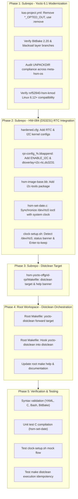

# Implementation Plan: Yocto 6.1 (Blacksail) Upgrade, HW-084 (DS3231) RTC Integration & Workspace Distclean

**Plan ID**: `PLAN-2026-YOCTO-BLACKSAIL-RTC`  
**Specification Reference**: [[Specification/Yocto 6.1 Blacksail Upgrade, HW-084 DS3231 RTC Integration and Workspace Distclean|Technical Specification]]  
**Status**: APPROVED  
**Author**: `coding-plan`  
**Date**: 2026-11-08  

---

## 1. Executive Summary & Architectural Scope

This implementation plan details the multi-repository engineering steps required to modernize the air-gapped Raspberry Pi OS ([`hsm-yocto-offgrid-rpi`](file:///Users/gpfister/Development/Projects/gpfister/nrf52840-hsm/hsm-yocto-offgrid-rpi)) to **Yocto 6.1 (Blacksail)**, integrate the **HW-084 (Maxim DS3231)** battery-backed Real-Time Clock module over hardware I2C-1, and implement atomic **`make distclean`** automation across both the sub-repository and root workspace.

### Affected Repositories & Git Branch Conventions

| Repository | Role | Target Branch | Base Branch |
| :--- | :--- | :--- | :--- |
| [`hsm-yocto-offgrid-rpi`](file:///Users/gpfister/Development/Projects/gpfister/nrf52840-hsm/hsm-yocto-offgrid-rpi) | Air-Gapped Embedded Linux OS | `feature/yocto-6.1-blacksail-rtc-distclean` | `main` |
| [Root Workspace](file:///Users/gpfister/Development/Projects/gpfister/nrf52840-hsm) | Multi-repo orchestration & tooling | `feature/yocto-6.1-blacksail-rtc-distclean` | `main` |

---

## 2. Local Deployment Assessment (`coding-deploy`)

Per the architectural guidelines, each affected repository is evaluated for local deployment instructions (Docker Compose, Minikube, Terraform, local deployment scripts, or deploy make targets):

| Repository | Deployment Indicators Found | Local Deployment Required? | Rationale |
| :--- | :--- | :--- | :--- |
| **`hsm-yocto-offgrid-rpi`** | None (`Dockerfile`, `compose.yaml`, `deploy_local.sh`, and `deploy-local` make targets are absent). The build system uses ephemeral Kas containers (`ghcr.io/siemens/kas/kas:latest`) for cross-compilation of disk images (`.img`), not running services. | **Not Required** | Target output is a flashable OS image (`sdimage-dual-raspberrypi.wks.in`) and RAUC update bundle (`.raucb`) for bare-metal Raspberry Pi hardware, not a locally hosted service. |
| **Root Workspace** | None | **Not Required** | Developer orchestration Makefile and documentation repository. |

> [!NOTE]
> Because neither repository requires local deployment, execution will advance directly from development (`coding-develop`) to code review (`coding-review`).

---

## 3. Work Breakdown Structure (WBS) & Implementation Steps



---

### Phase 1: `hsm-yocto-offgrid-rpi` — Yocto 6.1 (Blacksail) Upgrade

#### Step 1.1: Modernize Kas Project Manifest
- **File**: [`hsm-yocto-offgrid-rpi/kas-project.yml`](file:///Users/gpfister/Development/Projects/gpfister/nrf52840-hsm/hsm-yocto-offgrid-rpi/kas-project.yml)
- **Modifications**:
  1. Replace deprecated `DISTRO_FEATURES_OPTED_OUT += "sysvinit"` with `DISTRO_FEATURES:remove = "sysvinit"`.
  2. Remove redundant `MACHINE_FEATURES_OPTED_OUT += "bluetooth wifi"` (declared with `:remove`).
  3. Ensure `LAYERSERIES_COMPAT_raspberrypi:append = " blacksail"` and `LAYERSERIES_COMPAT_rauc:append = " blacksail"` remain in `local_conf_header.base_settings`.
  4. Retain tracking branches:
     - `openembedded-core`: `blacksail`
     - `bitbake`: `2.20`
     - `meta-yocto`: `blacksail`
     - `meta-openembedded`: `blacksail`
     - `meta-raspberrypi`: `master`
     - `meta-rauc`: `master`
- **Verification**: Run `python3 -c "import yaml; yaml.safe_load(open('hsm-yocto-offgrid-rpi/kas-project.yml'))"` to ensure valid YAML structure.

#### Step 1.2: Verify `UNPACKDIR` Compliance & Kernel Module Readiness
- **Files**:
  - [`meta-hsm-os/recipes-kernel/nrf52840-hsm-kmod/nrf52840-hsm-kmod.bb`](file:///Users/gpfister/Development/Projects/gpfister/nrf52840-hsm/hsm-yocto-offgrid-rpi/meta-hsm-os/recipes-kernel/nrf52840-hsm-kmod/nrf52840-hsm-kmod.bb)
  - [`meta-hsm-os/recipes-kernel/nrf52840-hsm-kmod/files/nrf52840_hsm.c`](file:///Users/gpfister/Development/Projects/gpfister/nrf52840-hsm/hsm-yocto-offgrid-rpi/meta-hsm-os/recipes-kernel/nrf52840-hsm-kmod/files/nrf52840_hsm.c)
- **Verification**:
  - Verify all recipes in `meta-hsm-os` correctly separate unpack destination (`${UNPACKDIR}`) from build directory (`${B}` / `${S}`).
  - Confirm `nrf52840_hsm.c` uses single-argument `class_create(DRIVER_NAME)` (compatible with Linux 6.4+ and 6.12+).

---

### Phase 2: `hsm-yocto-offgrid-rpi` — HW-084 (DS3231) RTC Module Integration

#### Step 2.1: Kernel Configuration Fragment
- **File**: [`meta-hsm-os/recipes-kernel/linux/files/hardened.cfg`](file:///Users/gpfister/Development/Projects/gpfister/nrf52840-hsm/hsm-yocto-offgrid-rpi/meta-hsm-os/recipes-kernel/linux/files/hardened.cfg)
- **Modifications**:
  Append kernel options enabling the I2C subsystem and DS3231 RTC driver:
  ```kconfig
  # Real-Time Clock (RTC) Subsystem and HW-084 (DS3231) Driver
  CONFIG_RTC_CLASS=y
  CONFIG_RTC_DRV_DS1307=y
  CONFIG_RTC_HCTOSYS=y
  CONFIG_RTC_HCTOSYS_DEVICE="rtc0"

  # I2C Subsystem & Hardware Controller for Raspberry Pi
  CONFIG_I2C=y
  CONFIG_I2C_CHARDEV=y
  CONFIG_I2C_BCM2835=y
  ```

#### Step 2.2: Raspberry Pi Boot Configuration & Device Tree Overlay
- **File**: [`meta-hsm-os/recipes-bsp/bootfiles/rpi-config_%.bbappend`](file:///Users/gpfister/Development/Projects/gpfister/nrf52840-hsm/hsm-yocto-offgrid-rpi/meta-hsm-os/recipes-bsp/bootfiles/rpi-config_%.bbappend)
- **Modifications**:
  1. Add `ENABLE_I2C = "1"` to instruct `meta-raspberrypi` to generate `dtparam=i2c_arm=on`.
  2. Append `dtoverlay=i2c-rtc,ds3231` to `RPI_EXTRA_CONFIG:append`.

#### Step 2.3: Image Recipe Tooling
- **File**: [`meta-hsm-os/recipes-core/images/hsm-image-base.bb`](file:///Users/gpfister/Development/Projects/gpfister/nrf52840-hsm/hsm-yocto-offgrid-rpi/meta-hsm-os/recipes-core/images/hsm-image-base.bb)
- **Modifications**:
  Add `i2c-tools` to `IMAGE_INSTALL:append` for low-level bus debugging (`i2cdetect -y 1`).

#### Step 2.4: Dual System / Hardware RTC Synchronization Helper (`hsm-set-date.c`)
- **File**: [`meta-hsm-os/recipes-core/init-wizard/files/hsm-set-date.c`](file:///Users/gpfister/Development/Projects/gpfister/nrf52840-hsm/hsm-yocto-offgrid-rpi/meta-hsm-os/recipes-core/init-wizard/files/hsm-set-date.c)
- **Modifications**:
  1. Parse validated timestamp string `YYYY-MM-DD HH:MM:SS` using `strptime()`.
  2. Call `settimeofday(&tv, NULL)` to set system clock.
  3. Probe for `/dev/rtc0`. If present, open `/dev/rtc0` in read-write mode and issue `ioctl(fd, RTC_SET_TIME, &rtc_tm)` using `<linux/rtc.h>`.
  4. Report both system time update and RTC synchronization status cleanly to stdout.

#### Step 2.5: Operator Login Clock Setup Script (`clock-setup.sh`)
- **File**: [`meta-hsm-os/recipes-core/init-wizard/files/clock-setup.sh`](file:///Users/gpfister/Development/Projects/gpfister/nrf52840-hsm/hsm-yocto-offgrid-rpi/meta-hsm-os/recipes-core/init-wizard/files/clock-setup.sh)
- **Modifications**:
  1. Check if `/dev/rtc0` exists.
  2. If `/dev/rtc0` is available, query hardware time via `hwclock -u -r 2>/dev/null`.
  3. Display banner indicating hardware RTC status:
     - If RTC present: `Hardware RTC detected (/dev/rtc0): active and synchronized`
     - If RTC absent: `Hardware RTC (/dev/rtc0): not detected (uninitialized or disconnected)`
  4. Prompt operator: `Enter current UTC date/time [YYYY-MM-DD HH:MM:SS] (or Enter to keep): `
  5. If operator presses `[Enter]`:
     - Retain current system/RTC time without error.
  6. If operator provides timestamp:
     - Invoke `hsm-set-date "${USER_DATE}"`.
     - Call `hwclock -u -w 2>/dev/null || true` as additional fallback synchronization.

---

### Phase 3: `hsm-yocto-offgrid-rpi` — Workspace Distclean Target

#### Step 3.1: Implement Sub-Repository Distclean
- **File**: [`hsm-yocto-offgrid-rpi/Makefile`](file:///Users/gpfister/Development/Projects/gpfister/nrf52840-hsm/hsm-yocto-offgrid-rpi/Makefile)
- **Modifications**:
  1. Add `distclean` to `.PHONY`.
  2. Define `distclean` target:
     ```makefile
     distclean: clean
     	@echo "==> Purging Yocto workspace, caches, and Kas repositories..."
     	@rm -rf $(BUILD_DIR)
     	@rm -rf downloads sstate-cache
     	@rm -rf bitbake openembedded-core meta-yocto meta-openembedded meta-raspberrypi meta-rauc
     	@echo "==> Removing container volume rpi_yocto_hsm_tmp if present..."
     	@$(CONTAINER_ENGINE) volume rm -f rpi_yocto_hsm_tmp 2>/dev/null || true
     	@echo "Distclean completed."
     ```
  3. Add `distclean` description to `help` target banner.

---

### Phase 4: Root Workspace — Distclean Orchestration & Documentation

#### Step 4.1: Integrate `yocto-distclean` in Root Makefile
- **File**: [`Makefile`](file:///Users/gpfister/Development/Projects/gpfister/nrf52840-hsm/Makefile)
- **Modifications**:
  1. Add `yocto-distclean` to `.PHONY`.
  2. Add `yocto-distclean` target:
     ```makefile
     yocto-distclean:
     	@$(MAKE) -C $(YOCTO_DIR) distclean
     ```
  3. Hook `yocto-distclean` into the root `distclean` pipeline:
     ```makefile
     distclean: firmware-distclean cli-clean libpkcs11-clean yocto-distclean
     ```
  4. Expose `yocto-distclean` in the `help` banner under the Yocto OS Targets section.

---

## 4. Verification & Validation Steps

| Step | Action / Command | Expected Result |
| :--- | :--- | :--- |
| **V-1** | `python3 -c "import yaml; yaml.safe_load(open('hsm-yocto-offgrid-rpi/kas-project.yml'))"` | Clean exit code 0; valid YAML syntax. |
| **V-2** | Check `kas-project.yml` for deprecated syntax | No occurrences of `DISTRO_FEATURES_OPTED_OUT` or `MACHINE_FEATURES_OPTED_OUT`. |
| **V-3** | Validate `hardened.cfg` syntax | Kernel config options `CONFIG_RTC_*` and `CONFIG_I2C_*` correctly formatted. |
| **V-4** | Validate `rpi-config_%.bbappend` syntax | `ENABLE_I2C = "1"` and `dtoverlay=i2c-rtc,ds3231` properly declared. |
| **V-5** | Compile `hsm-set-date.c` locally with clang/gcc | Compiles without warnings or errors with `-Wall -Wextra`. |
| **V-6** | Execute `bash -n meta-hsm-os/recipes-core/init-wizard/files/clock-setup.sh` | Bash syntax check exits 0 without errors. |
| **V-7** | Execute `make -C hsm-yocto-offgrid-rpi -n distclean` | Dry-run shows `rm -rf` targets for build, downloads, sstate-cache, repos, and volume removal. |
| **V-8** | Execute `make -n yocto-distclean` and `make -n distclean` from root | Dry-run confirms `yocto-distclean` triggers subrepo `distclean` as part of root `distclean`. |
| **V-9** | Run `git status` across both repositories | Changes cleanly isolated to specified files on `feature/yocto-6.1-blacksail-rtc-distclean`. |
