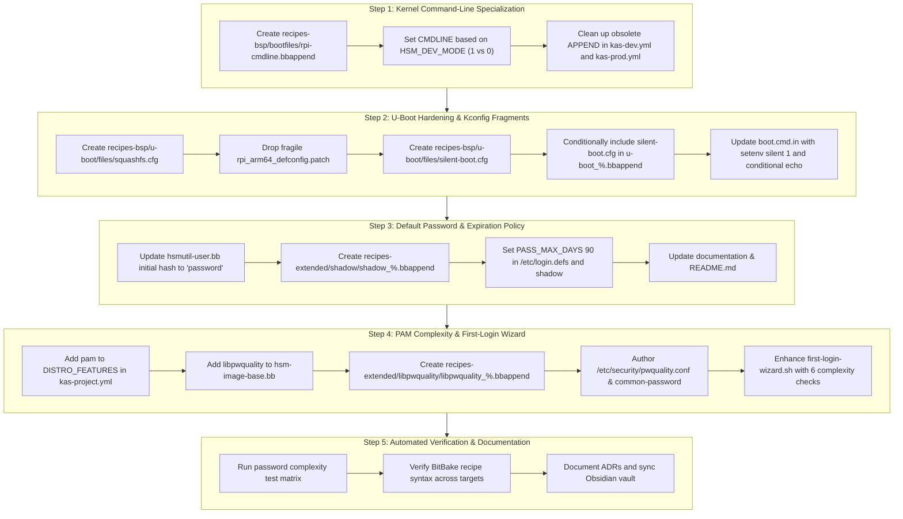

# Implementation Plan: Yocto Dev/Prod Boot Visibility, U-Boot Hardening, and `hsmutil` Password Security Policy

## 1. Overview & Strategy

This implementation plan details the architectural modifications and recipe-level engineering required in [`rpi-z2w-yocto-hsm`](file:///Users/gpfister/Development/Projects/gpfister/nrf52840-hsm/rpi-z2w-yocto-hsm) to satisfy [[Specification/Yocto Dev-Prod Boot Visibility, U-Boot Hardening, and Password Policy|Specification: Yocto Dev-Prod Boot Visibility, U-Boot Hardening, and Password Policy]].

The changes span three core subsystems:
1. **Bootloader & Kernel Command-Line Pipeline**:
   - `meta-hsm-os/recipes-bsp/bootfiles/rpi-cmdline.bbappend`
   - `meta-hsm-os/recipes-bsp/u-boot/u-boot_%.bbappend`
   - `meta-hsm-os/recipes-bsp/rpi-u-boot-scr/rpi-u-boot-scr.bbappend` and `files/boot.cmd.in`
   - Kas configuration overlays: `kas-dev.yml` and `kas-prod.yml`
2. **User Identity & Password Policy**:
   - `meta-hsm-os/recipes-core/users/hsmutil-user.bb`
   - `meta-hsm-os/recipes-extended/shadow/shadow_%.bbappend` and `shadow-sysroot_%.bbappend`
   - `meta-hsm-os/recipes-extended/libpwquality/libpwquality_%.bbappend`
   - `meta-hsm-os/recipes-core/init-wizard/files/first-login-wizard.sh`
3. **Workspace Tooling & Verification**:
   - Automated unit test suite verifying password complexity edge cases.
   - BitBake syntax and recipe parsing sanity checks across all 4 machine targets.

---

## 2. Work Breakdown & Implementation Steps



### Step 1: Boot Visibility & Kernel Command-Line Configuration
1. **Create `meta-hsm-os/recipes-bsp/bootfiles/rpi-cmdline.bbappend`**:
   - Override `CMDLINE` dynamically using BitBake inline Python or conditional assignment:
     ```python
     python __anonymous () {
         dev_mode = d.getVar('HSM_DEV_MODE')
         if dev_mode == "1":
             d.setVar('CMDLINE', 'console=serial0,115200 console=tty1 root=/dev/mmcblk0p2 rootfstype=ext4 rootwait loglevel=7 debug earlyprintk')
         else:
             d.setVar('CMDLINE', 'console=tty1 root=/dev/mmcblk0p2 rootfstype=ext4 rootwait quiet loglevel=0 fsck.mode=skip')
     }
     ```
   - Disable standard `CMDLINE_SERIAL` in prod to eliminate UART console binding.
2. **Clean up `kas-dev.yml` and `kas-prod.yml`**:
   - Remove dead `APPEND += "..."` lines that were previously ignored by `rpi-cmdline.bb`.

### Step 2: U-Boot Hardening & Kconfig Fragments
1. **Eliminate Brittle Defconfig Patching**:
   - Create `meta-hsm-os/recipes-bsp/u-boot/files/squashfs.cfg`:
     ```text
     CONFIG_CMD_SQUASHFS=y
     CONFIG_FS_SQUASHFS=y
     ```
   - Remove `rpi_arm64_defconfig.patch` from `SRC_URI`, allowing U-Boot to compile for `raspberrypi0-2w-64`, `raspberrypi3-64`, `raspberrypi4-64`, and `raspberrypi5` without defconfig mismatch errors.
2. **Create Production Silent Boot Fragment**:
   - Create `meta-hsm-os/recipes-bsp/u-boot/files/silent-boot.cfg`:
     ```text
     CONFIG_BOOTDELAY=-2
     CONFIG_SILENT_CONSOLE=y
     CONFIG_SYS_DEVICE_NULLDEV=y
     CONFIG_SILENT_U_BOOT_ONLY=y
     ```
   - In `u-boot_%.bbappend`, conditionally append `file://silent-boot.cfg` to `SRC_URI` only when `HSM_DEV_MODE == "0"`.
3. **Update U-Boot Bootscript (`rpi-u-boot-scr`)**:
   - In `boot.cmd.in`, conditionally execute `setenv silent 1` when `HSM_DEV_MODE == "0"`.
   - Wrap `echo "RAUC: ..."` diagnostic prints in conditional guards so production boot yields zero character output on serial UART or HDMI.

### Step 3: Default Password & Expiration Policy
1. **Update Default Password Hash**:
   - In `meta-hsm-os/recipes-core/users/hsmutil-user.bb`, update `USERADD_PARAM:${PN}`:
     ```bash
     --password '$6$saltsalt$qFmFH.bQmmtXzyBY0s9v7Oicd2z4XSIecDzlB5KiA2/jctKu9YterLp8wwnSq.qc.eoxqOmSuNp2xS0ktL3nh/'
     ```
   - Matches plaintext `password`.
2. **Enforce 90-Day Expiration**:
   - Create `meta-hsm-os/recipes-extended/shadow/shadow_%.bbappend` with `files/login.defs` specifying `PASS_MAX_DAYS 90`.
   - Ensure `hsmutil` user shadow record sets field 5 (max age) to `90`.

### Step 4: Password Complexity & First-Login Wizard
1. **Enable PAM Distribution Feature**:
   - In `kas-project.yml`, append `pam` to `DISTRO_FEATURES`.
2. **Install `libpwquality`**:
   - In `meta-hsm-os/recipes-core/images/hsm-image-base.bb`, add `libpwquality` (and `pam-plugin-pwquality`).
3. **Configure PAM Policy**:
   - Create `meta-hsm-os/recipes-extended/libpwquality/libpwquality_%.bbappend` deploying `/etc/security/pwquality.conf`:
     ```ini
     minlen = 10
     dcredit = -1
     ucredit = -1
     ocredit = -1
     maxrepeat = 1
     maxsequence = 2
     difok = 1
     enforce_for_root
     ```
   - Configure `/etc/pam.d/common-password` to reference `pam_pwquality.so retry=3 enforce_for_root`.
4. **Interactive Wizard Enforcement**:
   - Update `meta-hsm-os/recipes-core/init-wizard/files/first-login-wizard.sh`:
     - Display mandatory complexity rules in human-readable console banners.
     - Validate length (>=10), digit count (>=1), uppercase count (>=1), special char count (>=1).
     - Reject adjacent repeated characters (`(.)\1`).
     - Reject monotonic 3-char sequences (e.g. `abc`, `123`, `xyz`, `cba`, `321`).
     - Require double-entry confirmation before applying via `chpasswd`.

### Step 5: Verification & Automated Test Harness
1. **Password Complexity Test Matrix**:
   - Test vectors verified:
     - Compliant: `Hsm#92K!pL4`, `Str0ng#Sec!1`, `Secur3#Node9`
     - Non-compliant (length): `Short1!`
     - Non-compliant (no upper): `nouppercase1!`
     - Non-compliant (no digit): `NoDigitsHere!`
     - Non-compliant (no special): `NoSpecialChar1`
     - Non-compliant (consecutive repeat): `Passw0rd!!a`, `Aabbcc1234!`
     - Non-compliant (sequence): `Abcdefgh1!`, `12345678A!`, `Cba987654!`
2. **Build Configuration Validation**:
   - Validate Kas YAML parsing and BitBake recipe syntax.

---

## 3. Risk Assessment & Mitigations

| Risk | Impact | Mitigation Strategy |
| :--- | :--- | :--- |
| **`rpi-cmdline.bb` syntax differences across layer versions** | Kernel fails to boot if `root=` or `rootfstype=` is corrupted | Inspect upstream `rpi-cmdline.bb` in `meta-raspberrypi` and construct `CMDLINE` adhering strictly to upstream expected variables. |
| **`CONFIG_BOOTDELAY=-2` prevents recovery on serial** | If image is corrupted, operator cannot interrupt U-Boot | Production relies on RAUC A/B automated hardware watchdog fallback; development image retains interactive U-Boot console. |
| **Uncalibrated system clock triggers premature expiration** | System boots at Unix epoch (`1970-01-01`), triggering PAM expiration warnings | `clock-setup.sh` runs upon login before password expiration checks take effect, and volatile `/etc/shadow` tracks days since epoch accurately once timestamp is calibrated. |
