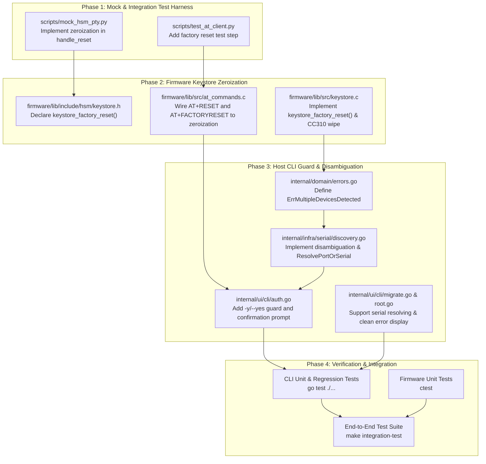

# Implementation Plan: Reset Confirmation & Factory Reset Zeroization, and Multi-Device Auto-Discovery Disambiguation

> [!NOTE]
> **Source Specification**: [`specification.md`](file:///Users/gpfister/.gemini/antigravity/brain/36b74c4b-dd01-44e1-9405-48fdc8d21d87/specification.md)  
> **Target Repositories**:
> - [`nrf52840-hsm-firmware`](file:///Users/gpfister/Development/Projects/gpfister/nrf52840-hsm/nrf52840-hsm-firmware)
> - [`nrf52840-hsm-cli`](file:///Users/gpfister/Development/Projects/gpfister/nrf52840-hsm/nrf52840-hsm-cli)
> - Workspace Root / [`scripts`](file:///Users/gpfister/Development/Projects/gpfister/nrf52840-hsm/scripts)
> 
> **Status**: Ready for Execution Gate.

---

## 1. Overview & Architectural Blueprint

This implementation plan resolves two critical operational and cryptographic safety gaps across the nRF52840 HSM ecosystem:
1. **Reset Safeguard & Cryptographic Zeroization**: Upgrades `hsmutil reset` from a silent, volatile session logout into an interactive, guarded factory reset that physically destroys persistent CryptoCell CC310 keys, wipes the Shamir Secret Sharing master secret from NVS flash, and restores the HSM to an unconfigured state (`HSM_STATE_UNCONFIGURED` / pulsating BLUE LED).
2. **Multi-Device Auto-Discovery Disambiguation**: Eliminates silent, arbitrary device targeting by terminating execution with `ErrMultipleDevicesDetected` when multiple dongles are attached without explicit `--port` (`-p`) or `--serial` (`-s`) flags. Adds support for BLE address / serial targeting in `hsmutil key migrate`.

### Implementation Sequence



---

## 2. Repository Work Breakdown

### 2.1 Workspace Root & Harness (`scripts/`)

- **Git Branch**: `feature/reset-and-disambiguation-tests` (on root workspace)
- **Target Subsystem**: Mock Serial PTY & Automated Integration Test Harness

#### Task 1.1: Mock PTY Factory Reset Zeroization
- **File to Modify**: [`scripts/mock_hsm_pty.py`](file:///Users/gpfister/Development/Projects/gpfister/nrf52840-hsm/scripts/mock_hsm_pty.py)
- **Changes**:
  - Update command dispatcher to recognize both `AT+RESET` and `AT+FACTORYRESET`.
  - When invoked:
    - Zeroize persistent key slot store: `self.slots.clear()`.
    - Zeroize Shamir master secret: `self.master_secret = None`.
    - Reset Shamir configuration flag: `self.shamir_initialized = False`.
    - Reset authentication state: `self.authenticated = False`.
    - Restore remaining PIN retries: `self.retries = 3`.
    - Clear pending share submissions and BIP-39 commitments: `self.submitted_shares.clear()`, `self.commitment_words.clear()`.
    - Return `\r\nOK\r\n`.

#### Task 1.2: Mock Harness Factory Reset Assertion Test
- **File to Modify**: [`scripts/test_at_client.py`](file:///Users/gpfister/Development/Projects/gpfister/nrf52840-hsm/scripts/test_at_client.py)
- **Changes**:
  - Add test step verifying `AT+RESET` / `AT+FACTORYRESET`:
    - Generates key in slot 1.
    - Sends `AT+RESET\r\n` and asserts `OK`.
    - Queries `AT+STATUS?` and asserts `AUTH=0` and `KEYCOUNT=0`.
    - Queries `AT+PUBKEY=1` and asserts rejection (`+CME ERROR: 104` or key not found).

#### Task 1.3: CLI End-to-End Integration Verification
- **File to Modify**: [`scripts/run_integration_tests.sh`](file:///Users/gpfister/Development/Projects/gpfister/nrf52840-hsm/scripts/run_integration_tests.sh)
- **Changes**:
  - In Phase C (`hsmutil CLI Tooling`), add verification for:
    - `hsmutil reset -y` skips interactive prompt and resets device.
    - `echo "no" | hsmutil reset` aborts cleanly with `Reset cancelled.` (code `0`).

---

### 2.2 Firmware (`nrf52840-hsm-firmware`)

- **Git Branch**: `feature/factory-reset-zeroization`
- **Target Subsystem**: On-device Keystore and AT Command Engine

#### Task 2.1: Keystore Factory Reset API
- **File to Modify**: [`firmware/lib/include/hsm/keystore.h`](file:///Users/gpfister/Development/Projects/gpfister/nrf52840-hsm/nrf52840-hsm-firmware/firmware/lib/include/hsm/keystore.h)
- **Changes**:
  - Declare `int keystore_factory_reset(void);` with documentation describing full zeroization of RAM, CC310 slots, and NVS flash.

#### Task 2.2: CC310 Hardware Key & NVS Zeroization Implementation
- **File to Modify**: [`firmware/lib/src/keystore.c`](file:///Users/gpfister/Development/Projects/gpfister/nrf52840-hsm/nrf52840-hsm-firmware/firmware/lib/src/keystore.c)
- **Changes**:
  - Implement `int keystore_factory_reset(void)`:
    1. Destroy all CC310 hardware key representations:
       ```c
       for (uint8_t slot = 1; slot <= KEYSTORE_MAX_SLOTS; slot++) {
           (void)crypto_cc310_destroy_key(slot);
       }
       ```
    2. Overwrite master Shamir secret in RAM:
       ```c
       sss_zeroize(s_data.master_secret, sizeof(s_data.master_secret));
       ```
    3. Destroy volatile ephemeral ECDH migration key if set:
       ```c
       if (s_target_ephemeral_key_id != 0) {
           (void)psa_destroy_key(s_target_ephemeral_key_id);
           s_target_ephemeral_key_id = 0;
       }
       ```
    4. Reset session state:
       ```c
       s_authenticated = false;
       ```
    5. Reinitialize RAM defaults:
       ```c
       init_defaults(); // sets PIN="123456", retries=3, shamir_initialized=false, slots cleared
       ```
    6. Commit cleared structure to flash:
       ```c
       save_to_nvs();
       ```
    7. Notify state change:
       ```c
       notify_state(); // triggers HSM_STATE_UNCONFIGURED -> Pulsating Blue LED
       ```
    8. Return `0` on success.

#### Task 2.3: AT Command Engine Dispatch
- **File to Modify**: [`firmware/lib/src/at_commands.c`](file:///Users/gpfister/Development/Projects/gpfister/nrf52840-hsm/nrf52840-hsm-firmware/firmware/lib/src/at_commands.c)
- **Changes**:
  - Update `+RESET` handler and register `+FACTORYRESET` alias:
    - Stop autolock timer: `k_timer_stop(&s_autolock_timer)`.
    - Clear custodian ceremony buffers: `at_commands_reset_shares()`.
    - Invoke `keystore_factory_reset()`.
    - Return `OK\r\n`.

---

### 2.3 Host CLI & SDK (`nrf52840-hsm-cli`)

- **Git Branch**: `feature/reset-safeguard-and-disambiguation`
- **Target Subsystem**: Serial Port Discovery, Domain Errors, and CLI Commands

#### Task 3.1: Disambiguation Domain Error
- **File to Create / Modify**: [`internal/domain/at_errors.go`](file:///Users/gpfister/Development/Projects/gpfister/nrf52840-hsm/nrf52840-hsm-cli/internal/domain/at_errors.go) (or `errors.go`)
- **Changes**:
  - Define `ErrMultipleDevicesDetected`:
    ```go
    type ErrMultipleDevicesDetected struct {
        Devices []DiscoveredDongle
    }

    func (e *ErrMultipleDevicesDetected) Error() string {
        var sb strings.Builder
        sb.WriteString("multiple nRF52840 HSM Dongles detected:\n")
        for i, d := range e.Devices {
            sb.WriteString(fmt.Sprintf("  [%d] Serial/BLE: %-16s Product: %-22s Port: %s\n",
                i+1, d.Serial, d.Product, d.DataPort))
        }
        sb.WriteString("\nPlease specify target device using --port (-p) or --serial (-s), or set NRF52840_HSM_SERIAL.")
        return sb.String()
    }
    ```

#### Task 3.2: Strict Auto-Discovery & Serial Matching Logic
- **File to Modify**: [`internal/infra/serial/discovery.go`](file:///Users/gpfister/Development/Projects/gpfister/nrf52840-hsm/nrf52840-hsm-cli/internal/infra/serial/discovery.go)
- **Changes**:
  - Refactor `AutoDiscoverPortTargeting(targetSerial string) (string, error)`:
    - When `targetSerial == ""` (and `NRF52840_HSM_PORT` is unset):
      - Query `EnumerateDongles()`.
      - If `len(dongles) == 0`: return `"", domain.ErrDeviceNotFound`.
      - If `len(dongles) == 1`: return `dongles[0].DataPort`, `nil`.
      - If `len(dongles) > 1`: return `""`, `&domain.ErrMultipleDevicesDetected{Devices: dongles}`.
    - When `targetSerial != ""`:
      - Filter `dongles` matching normalized serial / BLE address or suffix.
      - If `len(matches) == 0`: return `"", fmt.Errorf("no nRF52840 HSM Dongle found matching %q", targetSerial)`.
      - If `len(matches) == 1`: return `matches[0].DataPort`, `nil`.
      - If `len(matches) > 1`: return `""`, `&domain.ErrMultipleDevicesDetected{Devices: matches}`.
  - Add helper `ResolvePortOrSerial(target string) (string, error)`:
    - If `target` is a filesystem path or contains path separators (`/` or `\\`), return `target`, `nil`.
    - Else treat as serial/BLE and invoke `AutoDiscoverPortTargeting(target)`.

#### Task 3.3: Interactive Reset Guard & Flags (`hsmutil reset`)
- **File to Modify**: [`internal/ui/cli/auth.go`](file:///Users/gpfister/Development/Projects/gpfister/nrf52840-hsm/nrf52840-hsm-cli/internal/ui/cli/auth.go)
- **Changes**:
  - In `newResetCmd()`:
    - Add `-y` / `--yes` flag (`cmd.Flags().BoolVarP(&yesFlag, "yes", "y", false, "Confirm factory reset without interactive prompt")`).
    - If `!yesFlag`:
      - Print destructive warning banner to `os.Stdout`.
      - Prompt: `Are you sure you want to proceed? (yes/no): `.
      - Read line from `os.Stdin`.
      - If trimmed, case-insensitive response is not `"y"` and not `"yes"`:
        - Print `Reset cancelled.`
        - Return `nil` (exit `0` without contacting hardware).
    - If confirmed or `--yes` passed:
      - Call `client.Reset()`.
      - Print success message:
        ```text
        ✓ [OK] HSM Factory Reset Complete!
        All persistent keys and Shamir secrets have been wiped.
        The device is now in an unconfigured state. Run 'hsmutil init --threshold' to reconfigure.
        ```

#### Task 3.4: Migration Port/Serial Resolution & Clean Error Display
- **Files to Modify**:
  - [`internal/ui/cli/migrate.go`](file:///Users/gpfister/Development/Projects/gpfister/nrf52840-hsm/nrf52840-hsm-cli/internal/ui/cli/migrate.go)
  - [`internal/ui/cli/root.go`](file:///Users/gpfister/Development/Projects/gpfister/nrf52840-hsm/nrf52840-hsm-cli/internal/ui/cli/root.go)
- **Changes**:
  - In `migrate.go`: resolve `--source` and `--target` using `serial.ResolvePortOrSerial()`.
  - In `root.go`: in `getATClient()`, do not prepend "no nRF52840 HSM Dongle detected: ..." if the error is already `*domain.ErrMultipleDevicesDetected`.

#### Task 3.5: Unit Test Coverage
- **Files to Create / Modify**:
  - [`internal/infra/serial/discovery_test.go`](file:///Users/gpfister/Development/Projects/gpfister/nrf52840-hsm/nrf52840-hsm-cli/internal/infra/serial/discovery_test.go)
  - [`internal/ui/cli/cli_test.go`](file:///Users/gpfister/Development/Projects/gpfister/nrf52840-hsm/nrf52840-hsm-cli/internal/ui/cli/cli_test.go)
- **Test Scenarios**:
  - `TestAutoDiscover_SingleDevice`: Single dongle returns its data port.
  - `TestAutoDiscover_MultipleDevices`: Two dongles return `ErrMultipleDevicesDetected`.
  - `TestAutoDiscover_TargetSerial_Disambiguation`: Target serial selects matching dongle.
  - `TestResolvePortOrSerial`: Distinguishes `/dev/tty.*` paths from hex BLE addresses.
  - `TestResetCmd_InteractiveCancellation`: Prompt aborts on `"no"` or empty input without sending AT command.
  - `TestResetCmd_YesFlag`: Prompt is bypassed when `--yes` is provided.

---

## 3. Verification & Acceptance Testing Plan

| Verification Phase | Command | Expected Result |
| :--- | :--- | :--- |
| **Firmware Core Build & Unit Tests** | `make firmware-build` | Clean build of `hsm_core` and Zephyr firmware application without warnings |
| **CLI Unit Tests** | `cd nrf52840-hsm-cli && go test -v ./...` | 100% pass across serial discovery, reset prompt guard, and domain error formatting |
| **PKCS#11 Provider Tests** | `make libpkcs11-test` | All CTest Cryptoki provider tests pass |
| **End-to-End Integration Suite** | `make integration-test` | Mock PTY starts, executes factory reset, asserts slot erasure, runs CLI commands |
| **Interactive Reset Cancellation** | `echo "no" \| ./nrf52840-hsm-cli/bin/hsmutil reset` | Output: `Reset cancelled.`, exit code: 0, no AT command transmitted |
| **Scripted Factory Reset** | `./nrf52840-hsm-cli/bin/hsmutil reset -y` | Output: `✓ [OK] HSM Factory Reset Complete!`, device state is `Unconfigured` |

---

## 4. Git Branching & Worktree Strategy

| Repository | Branch Name | Base Branch |
| :--- | :--- | :--- |
| **Root Workspace** | `feature/reset-and-disambiguation-tests` | `master` |
| **`nrf52840-hsm-firmware`** | `feature/factory-reset-zeroization` | `main` |
| **`nrf52840-hsm-cli`** | `feature/reset-safeguard-and-disambiguation` | `main` |
