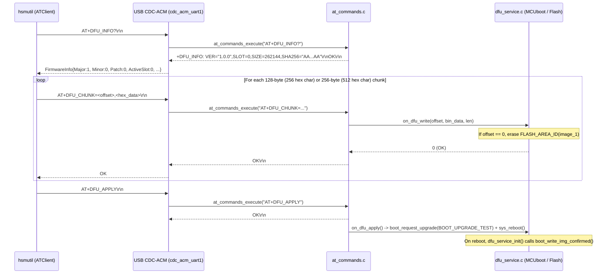

# Technical Specification: AT-Protocol DFU Support (`AT+DFU_INFO?`, `AT+DFU_CHUNK`, `AT+DFU_APPLY`)

> [!NOTE]
> **Feature Note**: [[features/at-protocol-dfu-support|AT-Protocol DFU Support Feature]]  
> **Implementation Plan**: [[Plan/AT-Protocol DFU Support Implementation Plan|Implementation Plan: AT-Protocol DFU Support]]  
> **Architecture Decision Record**: [[Architecture/Decisions/ADR-0006 - AT-Protocol DFU Chunk Streaming and Deferred MCUboot Swap|ADR-0006: AT-Protocol DFU Chunk Streaming & Deferred MCUboot Swap Architecture]]  
> **Source Artifact**: [`specification.md`](file:///Users/gpfister/.gemini/antigravity/brain/9de1e053-7881-466a-91a4-92de7e28e63c/specification.md)  
> **Target Repositories**: [`nrf52840-hsm-firmware`](file:///Users/gpfister/Development/Projects/gpfister/nrf52840-hsm/nrf52840-hsm-firmware) (`7aa1d2b`), [`nrf52840-hsm-cli`](file:///Users/gpfister/Development/Projects/gpfister/nrf52840-hsm/nrf52840-hsm-cli) (`7613d43`), and root workspace [`ncs-nrf52840dongle-kms`](file:///Users/gpfister/Development/Projects/gpfister/nrf52840-hsm) (`2a2a9ce`) on branch `feature/at-dfu-support`.

---

## 1. Summary & Problem Motivation

During the migration of the nRF52840 Dongle HSM (`PCA10059`) from the legacy binary YubiHSM-style framing (`s.transport`) to the ASCII AT command protocol (`s.atClient`), the Device Firmware Upgrade (DFU) subsystem was left partially unmigrated:

1. **CLI Layer (`nrf52840-hsm-cli`)**:
   - [`HSMService.GetFirmwareInfo`](file:///Users/gpfister/Development/Projects/gpfister/nrf52840-hsm/nrf52840-hsm-cli/internal/usecases/hsm_service.go#L93-L131) returns a hardcoded stub when `s.transport == nil`.
   - [`HSMService.UpdateFirmware`](file:///Users/gpfister/Development/Projects/gpfister/nrf52840-hsm/nrf52840-hsm-cli/internal/usecases/hsm_service.go#L178-L230) immediately fails with `DFU update requires legacy binary serial connection` when connected over the AT serial client (`s.atClient`).
   - [`ATClient`](file:///Users/gpfister/Development/Projects/gpfister/nrf52840-hsm/nrf52840-hsm-cli/internal/domain/at_client.go#L19-L22) lacks `DFUInfo()`, `DFUChunk()`, and `DFUApply()` domain methods.

2. **Firmware Layer (`nrf52840-hsm-firmware`)**:
   - [`at_commands_execute`](file:///Users/gpfister/Development/Projects/gpfister/nrf52840-hsm/nrf52840-hsm-firmware/firmware/lib/src/at_commands.c#L94-L687) has no command handlers for `AT+DFU_INFO?`, `AT+DFU_CHUNK=<offset>,<hex_data>`, or `AT+DFU_APPLY`, and has no callback mechanism to invoke [`dfu_service_write_chunk`](file:///Users/gpfister/Development/Projects/gpfister/nrf52840-hsm/nrf52840-hsm-firmware/firmware/app/src/dfu_service.c#L15-L42) and [`dfu_service_apply`](file:///Users/gpfister/Development/Projects/gpfister/nrf52840-hsm/nrf52840-hsm-firmware/firmware/app/src/dfu_service.c#L44-L56).
   - [`AT_PARSER_MAX_LINE_LEN`](file:///Users/gpfister/Development/Projects/gpfister/nrf52840-hsm/nrf52840-hsm-firmware/firmware/lib/include/hsm/at_parser.h#L12) is currently `512` bytes, which is too small to accommodate a 256-byte chunk (`512` hex characters) plus the `AT+DFU_CHUNK=<offset>,` prefix and `\r\n` terminator.
   - [`dfu_service_init`](file:///Users/gpfister/Development/Projects/gpfister/nrf52840-hsm/nrf52840-hsm-firmware/firmware/app/src/dfu_service.c#L10-L13) does not call `boot_write_img_confirmed()` (or `boot_is_img_confirmed()` check + confirm), causing MCUboot to revert to the previous slot on the subsequent reboot after a `BOOT_UPGRADE_TEST` swap.

3. **Hardware Bootstrap Constraint**:
   - Physical dongles currently running legacy firmware `53f764b` (`3302311888499AC7` and `FD54E793A75540C9`) lack the `AT+RESET` NVS wipe fix (`3664974`) and AT DFU handlers. They require a one-time J-Link flash (`make firmware-flash`) before subsequent updates can be performed over USB CDC-ACM via `hsmutil firmware update`.

---

## 2. Architecture & Protocol Design

---

## 3. Functional Requirements

### 3.1 Firmware (`nrf52840-hsm-firmware`)

1. **AT Parser Buffer Capacity**:
   - Increase [`AT_PARSER_MAX_LINE_LEN`](file:///Users/gpfister/Development/Projects/gpfister/nrf52840-hsm/nrf52840-hsm-firmware/firmware/lib/include/hsm/at_parser.h#L12) from `512` to `1024` bytes in [at_parser.h](file:///Users/gpfister/Development/Projects/gpfister/nrf52840-hsm/nrf52840-hsm-firmware/firmware/lib/include/hsm/at_parser.h) so that `AT+DFU_CHUNK=<offset>,<hex_data>` supports chunks up to `256` binary bytes (`512` hex characters + prefix + null terminator) without triggering `CME_ERR_BUFFER_OVERFLOW` (`+CME ERROR: 7`).

2. **DFU Callback Registration in AT Command Processor**:
   - Define a DFU callbacks structure `at_dfu_callbacks_t` in [at_commands.h](file:///Users/gpfister/Development/Projects/gpfister/nrf52840-hsm/nrf52840-hsm-firmware/firmware/lib/include/hsm/at_commands.h):
     - `int (*write_chunk)(uint32_t offset, const uint8_t *data, size_t len)`
     - `int (*apply)(void)`
     - `int (*get_info)(uint8_t *major, uint8_t *minor, uint8_t *patch, uint32_t *active_slot, uint32_t *image_size, uint8_t sha256[32])` (optional override; defaults to firmware constants if NULL)
   - Expose `void at_commands_register_dfu_callbacks(const at_dfu_callbacks_t *cbs)` in [at_commands.h](file:///Users/gpfister/Development/Projects/gpfister/nrf52840-hsm/nrf52840-hsm-firmware/firmware/lib/include/hsm/at_commands.h) and implement it in [at_commands.c](file:///Users/gpfister/Development/Projects/gpfister/nrf52840-hsm/nrf52840-hsm-firmware/firmware/lib/src/at_commands.c).

3. **AT DFU Commands in [`at_commands_execute`](file:///Users/gpfister/Development/Projects/gpfister/nrf52840-hsm/nrf52840-hsm-firmware/firmware/lib/src/at_commands.c#L94-L687)**:
   - **`AT+DFU_INFO?`**:
     - Returns active firmware version, active slot number, slot/image size, and 32-byte SHA-256 hex digest:
       `+DFU_INFO: VER="1.0.0",SLOT=0,SIZE=262144,SHA256="<64-hex-chars>"\r\nOK\r\n`
   - **`AT+DFU_CHUNK=<offset>,<hex_data>`**:
     - Requires the device to be authenticated (`keystore_is_authenticated()`); if locked, returns `+CME ERROR: 1` (`CME_ERR_DEVICE_LOCKED`).
     - Validates `<offset>` (unsigned 32-bit decimal integer) and `<hex_data>` (even number of hex characters, `1..256` decoded bytes). On malformed input, returns `+CME ERROR: 5` (`CME_ERR_INVALID_PARAMETER`).
     - Decodes `<hex_data>` and invokes the registered `write_chunk(offset, buf, bin_len)` callback (or succeeds in pure-unit-test mode if no callback is registered / mock callback registered).
     - On flash write failure, returns `+CME ERROR: 6` (`CME_ERR_CRYPTO_FAILURE`).
     - On success, returns `OK\r\n`.
   - **`AT+DFU_APPLY`**:
     - Requires the device to be authenticated (`keystore_is_authenticated()`); if locked, returns `+CME ERROR: 1` (`CME_ERR_DEVICE_LOCKED`).
     - Invokes the registered `apply()` callback. On failure, returns `+CME ERROR: 6`.
     - On success, formats `OK\r\n` (flushed before reboot or inside the callback after a short delay).

4. **MCUboot Image Confirmation & DFU Service Wiring**:
   - In [`dfu_service_init`](file:///Users/gpfister/Development/Projects/gpfister/nrf52840-hsm/nrf52840-hsm-firmware/firmware/app/src/dfu_service.c#L10-L13), check `!boot_is_img_confirmed()` and call `boot_write_img_confirmed()` so newly swapped test images are marked permanent upon successful startup.
   - Update [`dfu_service_apply`](file:///Users/gpfister/Development/Projects/gpfister/nrf52840-hsm/nrf52840-hsm-firmware/firmware/app/src/dfu_service.c#L44-L56) or [usb_serial.c](file:///Users/gpfister/Development/Projects/gpfister/nrf52840-hsm/nrf52840-hsm-firmware/firmware/app/src/usb_serial.c) so that `OK\r\n` is transmitted over USB CDC-ACM before `sys_reboot(SYS_REBOOT_COLD)` executes (e.g., send `OK\r\n` or schedule reboot via a delayed work item / flush before reboot).
   - Register `dfu_service_write_chunk` and `dfu_service_apply` with `at_commands_register_dfu_callbacks` during initialization in [`main`](file:///Users/gpfister/Development/Projects/gpfister/nrf52840-hsm/nrf52840-hsm-firmware/firmware/app/src/main.c#L32-L67).

---

### 3.2 CLI (`nrf52840-hsm-cli`)

1. **ATClient DFU Methods in [at_client.go](file:///Users/gpfister/Development/Projects/gpfister/nrf52840-hsm/nrf52840-hsm-cli/internal/domain/at_client.go)**:
   - `DFUInfo() (*FirmwareInfo, error)`:
     - Sends `AT+DFU_INFO?` (with fallback to `AT+INFO?` if an older firmware responds with `+CME ERROR: 8`) and parses `+DFU_INFO: VER="<major>.<minor>.<patch>",SLOT=<slot>,SIZE=<size>,SHA256="<hex>"` into [`FirmwareInfo`](file:///Users/gpfister/Development/Projects/gpfister/nrf52840-hsm/nrf52840-hsm-cli/internal/domain/firmware.go#L5-L12).
   - `DFUChunk(offset uint32, data []byte) error`:
     - Validates `1 <= len(data) <= 256`.
     - Encodes `data` as uppercase hex and sends `AT+DFU_CHUNK=<offset>,<hex>` with a `10s` timeout (accounting for secondary slot flash erase on `offset == 0`).
   - `DFUApply() error`:
     - Sends `AT+DFU_APPLY` with a `10s` timeout.

2. **Usecase Wiring in [hsm_service.go](file:///Users/gpfister/Development/Projects/gpfister/nrf52840-hsm/nrf52840-hsm-cli/internal/usecases/hsm_service.go)**:
   - Update [`HSMService.GetFirmwareInfo`](file:///Users/gpfister/Development/Projects/gpfister/nrf52840-hsm/nrf52840-hsm-cli/internal/usecases/hsm_service.go#L93-L131) to call `s.atClient.DFUInfo()` when `s.atClient != nil`.
   - Update [`HSMService.UpdateFirmware`](file:///Users/gpfister/Development/Projects/gpfister/nrf52840-hsm/nrf52840-hsm-cli/internal/usecases/hsm_service.go#L178-L230) so that when `s.atClient != nil`, it streams the firmware file in 256-byte chunks via `s.atClient.DFUChunk(uint32(offset), chunk)`, invokes `onProgress` after each chunk, and finishes with `s.atClient.DFUApply()`.

---

### 3.3 Mock PTY Simulator & Integration Tests (`scripts/mock_hsm_pty.py`)

1. **Line Buffer Size in [mock_hsm_pty.py](file:///Users/gpfister/Development/Projects/gpfister/nrf52840-hsm/scripts/mock_hsm_pty.py#L625-L629)**:
   - Increase the line overflow threshold in `main()` from `256` bytes to `1024` bytes so `AT+DFU_CHUNK` lines with 256-byte payloads (512 hex chars) are accepted without returning `+CME ERROR: 7`.
2. **DFU Command Simulation in [`MockHSMEngine.handle_command`](file:///Users/gpfister/Development/Projects/gpfister/nrf52840-hsm/scripts/mock_hsm_pty.py#L142-L526)**:
   - Track `self.dfu_buffer = bytearray()` and `self.dfu_applied = False` in [`MockHSMEngine`](file:///Users/gpfister/Development/Projects/gpfister/nrf52840-hsm/scripts/mock_hsm_pty.py#L89-L107).
   - Handle `AT+DFU_INFO?`: return `+DFU_INFO: VER="1.0.0",SLOT=0,SIZE=<len>,SHA256="<sha256_hex>"\r\nOK\r\n`.
   - Handle `AT+DFU_CHUNK=<offset>,<hex_data>`: require `self.authenticated` (`+CME ERROR: 1` if locked), validate offset and hex payload (`+CME ERROR: 5` on invalid args), write bytes into `self.dfu_buffer` (clearing on `offset == 0`), and return `\r\nOK\r\n`.
   - Handle `AT+DFU_APPLY`: require `self.authenticated` (`+CME ERROR: 1` if locked), require non-empty `self.dfu_buffer` (`+CME ERROR: 6` if empty), set `self.dfu_applied = True`, and return `\r\nOK\r\n`.

---

## 4. Non-Functional Requirements

- **Latency & Timeouts**:
  - Erasing the secondary MCUboot slot (`FLASH_AREA_ID(image_1)`) at `offset == 0` can take 1–4 seconds on nRF52840 internal flash. `ATClient.DFUChunk` must use at least a `10s` timeout so chunk `0` does not time out.
- **Safety & Security**:
  - Both `AT+DFU_CHUNK` and `AT+DFU_APPLY` must enforce HSM authentication (`keystore_is_authenticated()`) so unauthenticated hosts cannot stage or trigger firmware swaps.
  - All candidate firmware images are still cryptographically verified by MCUboot (ECDSA P-256 signature verification against `keys/root-ec-p256.pem`) prior to slot swap.
- **Backwards Compatibility**:
  - If `AT+DFU_INFO?` is sent to a legacy AT firmware that returns `+CME ERROR: 8` (`CME_ERR_COMMAND_UNSUPPORTED`), `ATClient.DFUInfo()` gracefully falls back to `AT+INFO?` and populates the semantic version from `DeviceInfo.Firmware`.

---

## 5. Affected Repositories & Files

| Repository | File | Change Summary |
| :--- | :--- | :--- |
| `nrf52840-hsm-firmware` | [at_parser.h](file:///Users/gpfister/Development/Projects/gpfister/nrf52840-hsm/nrf52840-hsm-firmware/firmware/lib/include/hsm/at_parser.h) | Increase `AT_PARSER_MAX_LINE_LEN` from `512` to `1024` |
| `nrf52840-hsm-firmware` | [at_commands.h](file:///Users/gpfister/Development/Projects/gpfister/nrf52840-hsm/nrf52840-hsm-firmware/firmware/lib/include/hsm/at_commands.h) | Add `at_dfu_callbacks_t` and `at_commands_register_dfu_callbacks()` |
| `nrf52840-hsm-firmware` | [at_commands.c](file:///Users/gpfister/Development/Projects/gpfister/nrf52840-hsm/nrf52840-hsm-firmware/firmware/lib/src/at_commands.c) | Implement `AT+DFU_INFO?`, `AT+DFU_CHUNK=<offset>,<hex>`, and `AT+DFU_APPLY` |
| `nrf52840-hsm-firmware` | [dfu_service.h](file:///Users/gpfister/Development/Projects/gpfister/nrf52840-hsm/nrf52840-hsm-firmware/firmware/app/src/dfu_service.h) / [dfu_service.c](file:///Users/gpfister/Development/Projects/gpfister/nrf52840-hsm/nrf52840-hsm-firmware/firmware/app/src/dfu_service.c) | Confirm MCUboot image on boot via `boot_write_img_confirmed()`, add `dfu_service_get_info()`, and schedule reboot cleanly after `AT+DFU_APPLY` response |
| `nrf52840-hsm-firmware` | [main.c](file:///Users/gpfister/Development/Projects/gpfister/nrf52840-hsm/nrf52840-hsm-firmware/firmware/app/src/main.c) | Register DFU callbacks with `at_commands_register_dfu_callbacks()` |
| `nrf52840-hsm-cli` | [at_client.go](file:///Users/gpfister/Development/Projects/gpfister/nrf52840-hsm/nrf52840-hsm-cli/internal/domain/at_client.go) | Add `DFUInfo()`, `DFUChunk()`, and `DFUApply()` methods and parsers |
| `nrf52840-hsm-cli` | [at_client_test.go](file:///Users/gpfister/Development/Projects/gpfister/nrf52840-hsm/nrf52840-hsm-cli/internal/domain/at_client_test.go) | Add unit tests for `DFUInfo`, `DFUChunk`, and `DFUApply` |
| `nrf52840-hsm-cli` | [hsm_service.go](file:///Users/gpfister/Development/Projects/gpfister/nrf52840-hsm/nrf52840-hsm-cli/internal/usecases/hsm_service.go) | Wire `GetFirmwareInfo()` and `UpdateFirmware()` to `s.atClient` |
| Root workspace (`ncs-nrf52840dongle-kms`) | [mock_hsm_pty.py](file:///Users/gpfister/Development/Projects/gpfister/nrf52840-hsm/scripts/mock_hsm_pty.py) | Increase line buffer limit to `1024` and support `AT+DFU_INFO?`, `AT+DFU_CHUNK`, and `AT+DFU_APPLY` |

---

## 6. Edge Cases & Mitigations

| Edge Case | Mitigation |
| :--- | :--- |
| **USB disconnect / premature reboot on `AT+DFU_APPLY`** | If `sys_reboot(SYS_REBOOT_COLD)` is called inside `at_commands_execute` before `usb_serial_write_at_response` sends `OK\r\n`, the CLI will see an EOF/timeout instead of `OK`. `dfu_service_apply()` will schedule the cold reboot via a `k_work_delayable` item (e.g., 200 ms delay) after `boot_request_upgrade(BOOT_UPGRADE_TEST)` succeeds, allowing `usb_serial_poll()` to transmit `OK\r\n` cleanly first. |
| **Unconfirmed MCUboot swap reversion** | Without `boot_write_img_confirmed()` at startup, MCUboot reverts the image on the next reset. Calling `boot_write_img_confirmed()` inside `dfu_service_init()` once the app boots confirms the new image. |
| **Unauthenticated DFU attempt** | `AT+DFU_CHUNK` and `AT+DFU_APPLY` reject unauthenticated callers with `+CME ERROR: 1` (`CME_ERR_DEVICE_LOCKED`). |
| **Odd-length or oversized hex chunk** | `AT+DFU_CHUNK` validates `hex_len % 2 == 0` and `1 <= bin_len <= 256`; returns `+CME ERROR: 5` otherwise. |
| **Legacy firmware (`53f764b`) on physical dongles** | `DFUInfo()` falls back to `AT+INFO?` if `AT+DFU_INFO?` returns `+CME ERROR: 8`. Physical dongles on `53f764b` require a one-time J-Link flash (`make firmware-flash`) to bootstrap the AT DFU handlers. |

---

## 7. Verifiable Acceptance Criteria

- [x] **AC-1 (Go CLI Unit Tests)**: `go test ./...` in `nrf52840-hsm-cli` passes, covering `ATClient.DFUInfo`, `ATClient.DFUChunk`, `ATClient.DFUApply`, and `HSMService.UpdateFirmware` over `ATClient`.
- [x] **AC-2 (Firmware Build & Unit Tests)**: Firmware unit tests (`at_commands` / `at_parser`) and `make firmware-build` succeed with the new `AT+DFU_*` handlers and `AT_PARSER_MAX_LINE_LEN = 1024`.
- [x] **AC-3 (End-to-End Mock PTY Integration Test)**: Starting `scripts/mock_hsm_pty.py` and running `hsmutil firmware info` and `hsmutil firmware update --file <test_bin>` (after `hsmutil auth`) succeeds end-to-end with 100% progress completion, and `make integration-test` passes completely.
