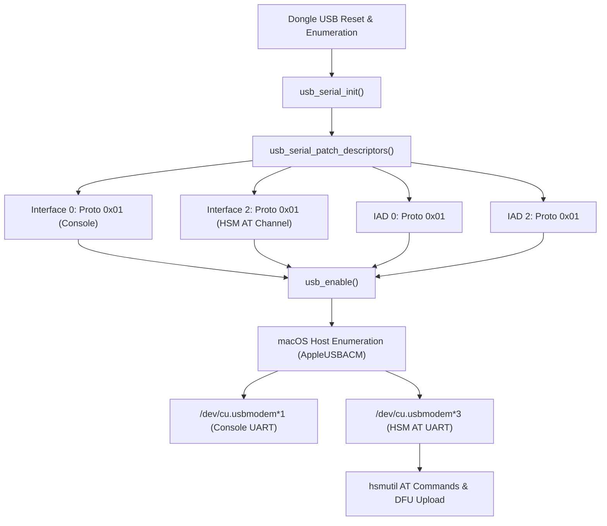

# Specification: Fix macOS CDC-ACM Enumeration for Interface 2 (HSM AT Channel)

## 1. Summary & Problem Motivation

The nRF52840 Dongle HSM (`PCA10059`) configures a dual CDC-ACM USB composite device:
- **Interface 0 & 1**: Zephyr OS Kernel Logging & Console (`cdc_acm_uart0`).
- **Interface 2 & 3**: Dedicated HSM AT Command & DFU Channel (`cdc_acm_uart1`).

On macOS (Darwin), Apple's native driver (`AppleUSBACM.kext` / DriverKit `com.apple.DriverKit.AppleUSBACMControl`) inspects both the **Interface Descriptor** (`bInterfaceProtocol`) and the **Interface Association Descriptor** (IAD, `bFunctionProtocol`). When protocol code `0x02` is configured, macOS fails to match or instantiate a virtual serial modem TTY device node for Interface 2. Consequently, only interface 0 enumerates as a character device (e.g. `/dev/cu.usbmodem1101`), while interface 2 is completely unavailable on macOS hosts.

According to the USB CDC Subclass Specification for PSTN Devices and Apple's driver matching rules:
- Protocol `0x01` represents standard AT Commands (ITU-T V.250).
- Protocol `0x00` represents vendor-specific / no specific protocol.
- Protocol `0x02` is non-standard or unsupported by `AppleUSBACM.kext` for virtual COM port binding (designated for PCCA-101 cellular modems).

Setting both the interface descriptor `bInterfaceProtocol` and the IAD `bFunctionProtocol` to `0x01` allows macOS to attach `AppleUSBACM` to Interface 2, generating a secondary `/dev/cu.usbmodem*` device node (e.g. `/dev/cu.usbmodem1103`) for AT communication and firmware DFU updates.

---

## 2. Affected Repositories & Files

- **Repository**: [nrf52840-hsm-firmware](file:///Users/gpfister/Development/Projects/gpfister/nrf52840-hsm/nrf52840-hsm-firmware)
  - Source File: [`firmware/app/src/usb_serial.c`](file:///Users/gpfister/Development/Projects/gpfister/nrf52840-hsm/nrf52840-hsm-firmware/firmware/app/src/usb_serial.c)
    - Function: [`usb_serial_patch_descriptors`](file:///Users/gpfister/Development/Projects/gpfister/nrf52840-hsm/nrf52840-hsm-firmware/firmware/app/src/usb_serial.c#L124-L176)
- **Repository Root**: [ncs-nrf52840dongle-kms](file:///Users/gpfister/Development/Projects/gpfister/nrf52840-hsm)
  - Tooling: [`Makefile`](file:///Users/gpfister/Development/Projects/gpfister/nrf52840-hsm/Makefile) (`firmware-build`, `firmware-flash`)
- **CLI Utility**: [nrf52840-hsm-cli](file:///Users/gpfister/Development/Projects/gpfister/nrf52840-hsm/nrf52840-hsm-cli) (`hsmutil`)

---

## 3. Functional Requirements

### FR-1: Interface Descriptor Fixup
In [`firmware/app/src/usb_serial.c`](file:///Users/gpfister/Development/Projects/gpfister/nrf52840-hsm/nrf52840-hsm-firmware/firmware/app/src/usb_serial.c#L149-L156):
- For interface descriptor with `bInterfaceNumber == 2`:
  - Set `if_desc->bInterfaceProtocol = 0x01;` (changed from `0x02`).
  - Update log string formatting cleanly to log `proto=0x%02x, iInterface=%u`.

### FR-2: Interface Association Descriptor (IAD) Fixup
In [`firmware/app/src/usb_serial.c`](file:///Users/gpfister/Development/Projects/gpfister/nrf52840-hsm/nrf52840-hsm-firmware/firmware/app/src/usb_serial.c#L164-L169):
- For IAD descriptor with `iad->bFirstInterface == 2`:
  - Set `iad->bFunctionProtocol = 0x01;` (changed from `0x02`).

### FR-3: Firmware Compilation & Signing
- Compile production firmware targeting `PCA10059` using sysbuild:
  - Command: `make -C /Users/gpfister/Development/Projects/gpfister/nrf52840-hsm firmware-build`
  - Ensure dual-stage bootloader artifacts (`b0.bin`, `mcuboot.bin`) and MCUboot signed app image (`zephyr.signed.bin`) are generated cleanly without build errors.

### FR-4: Device Flashing
- Flash the compiled firmware onto target dongle via J-Link probe `802007333`:
  - Command: `make -C /Users/gpfister/Development/Projects/gpfister/nrf52840-hsm firmware-flash`

### FR-5: Host Verification & DFU Functionality
- Verify macOS enumeration of two distinct TTY device nodes under `/dev/cu.usbmodem*`.
- Validate AT commands communication through the new secondary device node using `hsmutil`:
  - `hsmutil --port <at_port> firmware info`
  - AT reset / ping commands.
- Verify DFU streaming upgrade capability:
  - `hsmutil firmware update --file nrf52840-hsm-firmware/build-prod/app/zephyr/zephyr.signed.bin`

---

## 4. Non-Functional Requirements

- **Compatibility**:
  - macOS: Must enumerate both interface 0 and interface 2 as `/dev/cu.usbmodem*` via native `AppleUSBACM.kext` without third-party drivers or kext modification.
  - Linux: Must maintain backward compatibility with `cdc_acm` kernel driver creating `/dev/ttyACM0` and `/dev/ttyACM1`.
  - Windows: Must remain compliant with `usbser.sys` dual CDC device binding.
- **Safety & Integrity**:
  - Memory bounds and descriptor parsing loops must remain strictly intact with zero dynamic heap allocation in descriptor patch routines.
- **Boot Performance**:
  - Descriptor fixup must complete in sub-millisecond time during `usb_serial_init()` before USB stack configuration.

---

## 5. Architectural Flow

---

## 6. Edge Cases & Mitigations

| Edge Case | Description | Mitigation |
| :--- | :--- | :--- |
| **macOS USB Driver Caching** | macOS may cache previous USB descriptor values for the device ID across soft resets. | Unplug and replug the dongle or reset the USB port after flashing if macOS fails to refresh the descriptor cache. |
| **J-Link Connectivity** | Flashing requires hardware debug probe `802007333` to be connected and target board powered. | Confirm probe serial number `802007333` is detected via J-Link before executing flash command. |
| **Firmware Slot Rollback** | MCUboot dual-slot partition manager marks non-confirmed images for revert upon boot failure. | Run image confirmation or test command sequence to ensure the newly flashed image boots and stays confirmed. |
| **Baud Rate & Serial Framing** | USB CDC-ACM ignores physical baud rate, but port opening on macOS requires non-blocking or proper termios flags. | `hsmutil` uses pure-Go cross-platform serial routines that properly manage termios configurations. |

---

## 7. Verifiable Acceptance Criteria

- [ ] **AC-1 (Source Modification)**: [`usb_serial.c`](file:///Users/gpfister/Development/Projects/gpfister/nrf52840-hsm/nrf52840-hsm-firmware/firmware/app/src/usb_serial.c) contains `if_desc->bInterfaceProtocol = 0x01;` for interface 2 and `iad->bFunctionProtocol = 0x01;` for IAD first interface 2.
- [ ] **AC-2 (Build Integrity)**: `make firmware-build` completes with return code 0, generating signed binary `zephyr.signed.bin`.
- [ ] **AC-3 (Hardware Programming)**: `make firmware-flash` succeeds via J-Link probe `802007333`.
- [ ] **AC-4 (Dual Device Enumeration)**: Running `ls /dev/cu.usbmodem*` displays two devices (e.g. `...1` and `...3`).
- [ ] **AC-5 (AT Interface Communication)**: Running `hsmutil --port <at_port> firmware info` successfully queries and prints firmware version and serial number over Interface 2.
- [ ] **AC-6 (DFU Upgrade Validation)**: `hsmutil firmware update --file .../zephyr.signed.bin` performs chunked streaming update and successfully communicates with the target slot.
