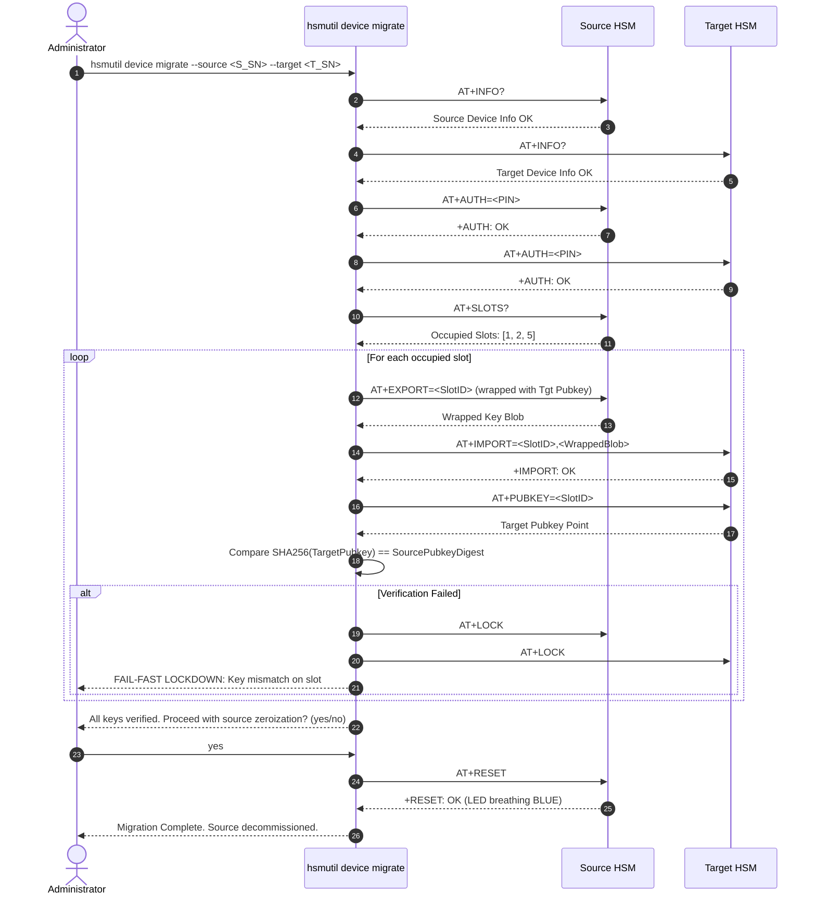

# Technical Specification: HSM CLI Restructuring, Static Compilation, Bubble Tea UX, and PKCS#11 Equivalence

---

## 1. Scope & Technical Architecture

This specification details the technical architecture, package layout, command registration tree, terminal UI integration, and build flags for `hsmutil` in [`hsm-cli`](file:///Users/gpfister/Development/Projects/gpfister/nrf52840-hsm/hsm-cli).

### 1.1 Architecture Goals

- **Clean Architecture Hierarchy**: Strict separation between CLI presentation (`internal/ui/cli`), use case services (`internal/usecases`), domain models/interfaces (`internal/domain`), and infrastructure serial drivers (`internal/infra/serial`).
- **Resource Orientation**: Group operations around core resources (`device`, `key`, `pkcs11`).
- **Zero Dynamic Runtime Dependencies**: Hermetic static compilation via Go toolchain (`CGO_ENABLED=0`).
- **Targeted Terminal UI**: Embed micro-components from Charm's Bubble Tea ecosystem (`bubbles/progress`, `bubbles/textinput`) with deterministic headless fallbacks.
- **Fail-Fast Device Migration**: Atomic multi-slot device migration with mutual lock down and decommissioning source zeroization.

---

## 2. Package Organization & Command Registration

### 2.1 Package Topology

```text
hsm-cli/
├── cmd/hsmutil/main.go               # Process entry point; invokes cli.Execute()
├── internal/
│   ├── domain/                       # Core entities, AT error definitions, command contracts
│   │   ├── at_errors.go              # AT error response codes and typed errors
│   │   ├── command.go                # AT command framing and response models
│   │   ├── device.go                 # Device identity, state, and version entities
│   │   ├── key.go                    # Key slot definitions and metadata
│   │   └── serial.go                 # Serial port interface abstractions
│   ├── infra/serial/                 # Serial port driver implementation
│   │   ├── at_client.go              # AT protocol framing, timeouts, and command dispatch
│   │   ├── discovery.go              # USB CDC-ACM port enumeration and BLE matching
│   │   └── port.go                   # Physical OS serial port wrapper
│   ├── ui/cli/                       # Cobra CLI command definitions
│   │   ├── root.go                   # rootCmd, global flags, and command registration
│   │   ├── device.go                 # hsmutil device <subcommand> implementations
│   │   ├── firmware.go               # hsmutil device firmware <info|update>
│   │   ├── key.go                    # hsmutil key <subcommand> implementations
│   │   ├── unlock.go                 # hsmutil unlock (alias: auth) with masked PIN
│   │   ├── p11.go                    # hsmutil pkcs11 (alias: p11) diagnostics
│   │   └── ...                       # echo.go, random.go
│   └── usecases/                     # High-level application services
│       ├── device_service.go         # Info, status, lock, reset, init workflows
│       ├── firmware_service.go       # DFU chunk streaming and swap orchestration
│       ├── key_service.go            # Keypair generation, signing, import/export
│       └── migration_service.go      # Single key and full device migration logic
```

### 2.2 Command Dispatch Architecture

```go
func Execute() error {
    return rootCmd.Execute()
}
```

#### Visible Command Registration

```go
rootCmd.AddCommand(newDeviceCmd())     // hsmutil device ...
rootCmd.AddCommand(newDevicesCmd())    // hsmutil devices (alias for device list)
rootCmd.AddCommand(newUnlockCmd())     // hsmutil unlock (alias: auth)
rootCmd.AddCommand(newKeyCmd())        // hsmutil key ...
rootCmd.AddCommand(newEchoCmd())       // hsmutil echo ...
rootCmd.AddCommand(newRandomCmd())     // hsmutil random ...
rootCmd.AddCommand(newP11Cmd())        // hsmutil pkcs11 / p11 ...
```

#### Backward-Compatible Hidden Aliases

To preserve existing automation without cluttering `--help`, legacy root commands are registered with `Hidden: true`:

```go
legacyInfo := newDeviceInfoCmd()
legacyInfo.Hidden = true
rootCmd.AddCommand(legacyInfo)

legacyStatus := newDeviceStatusCmd()
legacyStatus.Hidden = true
rootCmd.AddCommand(legacyStatus)

legacyInit := newInitCmd()
legacyInit.Hidden = true
rootCmd.AddCommand(legacyInit)

legacyLock := newLockCmd()
legacyLock.Hidden = true
rootCmd.AddCommand(legacyLock)

legacyReset := newResetCmd()
legacyReset.Hidden = true
rootCmd.AddCommand(legacyReset)

legacyFirmware := newFirmwareCmd()
legacyFirmware.Hidden = true
rootCmd.AddCommand(legacyFirmware)
```

---

## 3. Terminal UX & Bubble Tea Integration

### 3.1 TTY Detection Contract

Before launching any interactive terminal component, the CLI queries standard I/O file descriptors via `golang.org/x/term` or `github.com/mattn/go-isatty`:

```go
func isInteractiveTerminal(fd uintptr) bool {
    return term.IsTerminal(int(fd))
}
```

### 3.2 Masked PIN Entry (`bubbles/textinput`)

When `hsmutil unlock` is invoked without the `--pin` flag:
1. If `isInteractiveTerminal(os.Stdin.Fd())` is `true`:
   - An ephemeral Bubble Tea program initializes a `textinput.Model`.
   - `EchoMode` is configured to `textinput.EchoPassword` (`••••••`).
   - The user's input is captured without plaintext leakage to the terminal buffer.
2. If `isInteractiveTerminal(os.Stdin.Fd())` is `false`:
   - Checks if `os.Stdin` has available data (e.g. piped input).
   - If data exists, reads the first line, trims trailing whitespace, and utilizes it as the PIN.
   - If no data exists, aborts with a descriptive error:
     ```text
     Error: PIN must be provided via --pin flag, HSM_PIN environment variable, or piped stdin when running in non-interactive mode.
     ```

### 3.3 Firmware DFU Streaming (`bubbles/progress`)

During `hsmutil device firmware update --file <path>`:
1. If `isInteractiveTerminal(os.Stdout.Fd())` is `true`:
   - An inline Bubble Tea program renders a gradient progress bar using `bubbles/progress`.
   - Each acknowledged `AT+DFU_CHUNK` dispatches a progress update message:
     ```text
     Updating Firmware [zephyr.signed.bin] (Slot 1 Candidate)
     [████████████████████░░░░░░░░░░░░░░░░░░░░] 52% (67/128 chunks) [ETA: 00:14]
     ```
2. If `isInteractiveTerminal(os.Stdout.Fd())` is `false`:
   - Progress bar rendering is bypassed.
   - Progress is logged at discrete 10% intervals or chunk milestones as standard plain-text stdout lines:
     ```text
     [INFO] DFU Transfer: Chunk 67/128 (52%) acknowledged.
     ```

---

## 4. Whole-Device Migration Specification

### 4.1 Purpose & Security Invariants

The `hsmutil device migrate` command provides atomic migration of all occupied key slots from a source HSM to a target replacement HSM under strict cryptographic safety invariants:
1. **Target Authenticity**: Both source and target must be verified and unlocked.
2. **Ephemeral Wrapping**: Private keys are wrapped using target device public keys and never appear in plaintext over the host serial bus.
3. **Fail-Fast Mutual Lockdown**: If any slot fails verification or transfer, both source and target devices are immediately locked (`AT+LOCK`), any partial keys on the target are zeroized, and execution halts immediately.
4. **Decommissioning Zeroization**: The source device is zeroized (`AT+RESET`) only upon 100% verified transfer of all keys, preventing dangerous key duplication in production.

### 4.2 State Machine Specification



---

## 5. Build System & Compilation Specifications

### 5.1 Static Linkage Flags (`CGO_ENABLED=0`)

All build targets in `hsm-cli/Makefile` enforce pure Go static binary generation:

```makefile
BINARY_NAME = hsmutil
BIN_DIR = bin
SRC_PKG = ./cmd/hsmutil

build:
	@mkdir -p $(BIN_DIR)
	@echo "[INFO] Building $(BINARY_NAME) (pure static binary, CGO_ENABLED=0)..."
	CGO_ENABLED=0 go build -ldflags="-s -w" -o $(BIN_DIR)/$(BINARY_NAME) $(SRC_PKG)
	@ln -sf $(BINARY_NAME) $(BIN_DIR)/$(BINARY_NAME)s
	@echo "[OK] Built $(BIN_DIR)/$(BINARY_NAME) and symlink $(BIN_DIR)/$(BINARY_NAME)s"
```

### 5.2 Cross-Compilation Matrix

| Target OS | Target Arch | Makefile Target | Output Binary |
| :--- | :--- | :--- | :--- |
| macOS | arm64 | `build-darwin-arm64` | `bin/hsmutil-darwin-arm64` |
| Linux | arm64 | `build-linux-arm64` | `bin/hsmutil-linux-arm64` |
| Linux | amd64 | `build-linux-amd64` | `bin/hsmutil-linux-amd64` |
| Windows | arm64 | `build-windows-arm64` | `bin/hsmutil-windows-arm64.exe` |
| Windows | amd64 | `build-windows-amd64` | `bin/hsmutil-windows-amd64.exe` |

---

## 6. PKCS#11 Parity & Cryptoki Mechanism Specifications

`hsm-libpkcs11` implements Cryptoki v2.40. The table below specifies mechanism mappings and API parity:

| Cryptoki Function | PKCS#11 Mechanism | `pkcs11-tool` Equivalent | `hsmutil` Equivalent |
| :--- | :--- | :--- | :--- |
| `C_Initialize` | — | `--module libnrf52840_pkcs11.dylib` | Auto-initialized |
| `C_GetSlotList` | — | `-L` / `--list-slots` | `hsmutil device list` |
| `C_GetTokenInfo` | — | `-T` / `--show-info` | `hsmutil device info` |
| `C_GetMechanismList` | — | `-M` / `--list-mechanisms` | `hsmutil pkcs11 slots` |
| `C_InitToken` | — | `--init-token --label <L>` | `hsmutil device init` |
| `C_InitPIN` | — | `--init-pin --pin <P>` | `hsmutil device init` |
| `C_Login` | — | `--login --pin <P>` | `hsmutil unlock` |
| `C_Logout` | — | `--logout` | `hsmutil device lock` |
| `C_GenerateKeyPair` | `CKM_EC_KEY_PAIR_GEN` | `--keypairgen --key-type EC:secp256r1 --id <N>` | `hsmutil key generate --slot <N>` |
| `C_SignInit` / `C_Sign` | `CKM_ECDSA_SHA256` | `--sign --id <N> -m ECDSA-SHA256` | `hsmutil key sign --slot <N> --hash <H>` |
| `C_DestroyObject` | — | `--delete-object --type privkey --id <N>` | `hsmutil key delete --slot <N>` |
| `C_GenerateRandom` | — | `--generate-random <bytes>` | `hsmutil random [bytes]` |
