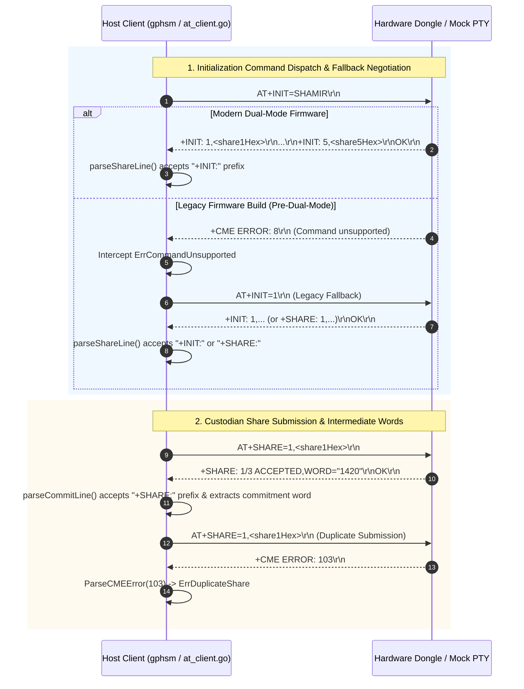

# Technical Specification: HSM Device Initialization and Dual-Mode Protocol Compatibility

> [!NOTE]
> **Specification Purpose**: Formalizes wire protocols, fallback command dispatching, line prefix parsing specifications, CME error mappings, and end-to-end integration test harnesses for HSM device initialization across modern and legacy firmware builds.

---

## 1. Protocol Architecture & Overview

This technical specification establishes the wire protocol standards and parsing contracts governing HSM device initialization and custodian ceremonies between the host administration utility ([`gphsm`](file:///Users/gpfister/Development/Projects/gpfister/nrf52840-hsm/hsm-cli)), the physical nRF52840 USB Dongle ([`hsm-ncs-firmware`](file:///Users/gpfister/Development/Projects/gpfister/nrf52840-hsm/hsm-ncs-firmware)), and virtual test mock environments.



---

## 2. AT Command Syntax & Wire Specifications

### 2.1 Shamir Initialization (`AT+INIT=SHAMIR` and Fallback `AT+INIT=1`)

#### Command Format
- Modern syntax: `AT+INIT=SHAMIR\r\n`
- Canonical legacy fallback syntax: `AT+INIT=1\r\n`

#### Response Grammar
```text
<response> ::= (<share_line> "\r\n")+ "OK\r\n" | "+CME ERROR: " <code> "\r\n"
<share_line> ::= (<prefix_init> | <prefix_share>) <share_payload>
<prefix_init>  ::= "+INIT:" [" "]
<prefix_share> ::= "+SHARE:" [" "]
<share_payload> ::= <index> "," <hex_bytes> | "INDEX=" <index> ",SHARE=" <hex_bytes>
<index> ::= [1-5]
<hex_bytes> ::= [0-9A-Fa-f]{32,64}
```

#### Client Behavior Contract
1. `InitShamir()` transmits `AT+INIT=SHAMIR`.
2. If the transport returns `ErrCommandUnsupported` (CME code 8) or error string containing `"unsupported"`, `InitShamir()` immediately transmits `AT+INIT=1`.
3. Erroneous fallback calls to `ThresholdInit(3, 5)` (which sent `AT+INIT=THRESHOLD,3,5`) are eliminated.
4. Response lines are evaluated against both `+INIT:` and `+SHARE:` prefixes.

---

### 2.2 Custodian Share Submission (`AT+SHARE`)

#### Command Format
```text
AT+SHARE=<index>,<shareHex>\r\n
```

#### Response Grammar
```text
<submission_response> ::= <commit_line> "\r\nOK\r\n" | "+CME ERROR: " <code> "\r\n"
<commit_line> ::= <commit_prefix> <commit_payload>
<commit_prefix> ::= "+COMMIT:" | "+WORD:" | "+SHARE:"
<commit_payload> ::= <count> "/" <threshold> " ACCEPTED,WORD=\"" <word> "\"" 
                   | <count> "/" <threshold> " ACCEPTED,WORD=" <word>
                   | "INDEX=" <index> ",WORD=" <word>
                   | <word>
```

#### Client Behavior Contract
1. `SubmitShare(index, shareHex)` transmits `AT+SHARE=<index>,<shareHex>`.
2. Response lines starting with `+COMMIT:`, `+WORD:`, or `+SHARE:` are processed by `parseCommitLine()`.
3. `parseCommitLine()` extracts the custodian index (or uses `fallbackIndex`) and the human-readable commitment word string.

---

## 3. CME Error Mapping Specification

Hardware CME error codes returned in `+CME ERROR: <code>\r\n` format are deterministically mapped into Go sentinel errors within [`internal/domain/at_errors.go`](file:///Users/gpfister/Development/Projects/gpfister/nrf52840-hsm/hsm-cli/internal/domain/at_errors.go):

| CME Code | Hardware Macro Definition | Go Error Sentinel / Type | Description |
| :--- | :--- | :--- | :--- |
| `1` | `CME_ERR_INVALID_PARAM` | `ErrInvalidParameter` | Malformed parameter or invalid length |
| `2` | `CME_ERR_NOT_AUTHENTICATED` | `ErrNotAuthenticated` | Operation requires authenticated session |
| `3` | `CME_ERR_ALREADY_AUTH` | `ErrAlreadyAuthenticated` | Device is already unlocked |
| `4` | `CME_ERR_AUTH_FAILED` | `ErrAuthFailed` | Incorrect PIN or invalid custodian share |
| `5` | `CME_ERR_KEY_NOT_FOUND` | `ErrKeyNotFound` | Specified key ID does not exist |
| `6` | `CME_ERR_KEYSTORE_FULL` | `ErrKeystoreFull` | Key capacity exceeded |
| `7` | `CME_ERR_BUFFER_OVERFLOW` | `ErrBufferOverflow` | Command buffer exceeded |
| `8` | `CME_ERR_COMMAND_UNSUPPORTED`| `ErrCommandUnsupported` | Unrecognized AT command opcode |
| **`41`** | **`CME_ERR_ALREADY_CONFIGURED`** | **`ErrAlreadyConfigured`** | **Device keystore has already been initialized** |
| **`42`** | **`CME_ERR_INVALID_AUTH_MODE`** | **`ErrInvalidAuthMode`** | **Command invalid for active mode (PIN vs Shamir exclusivity)** |
| **`103`** | **`CME_ERR_DUPLICATE_SHARE`** | **`ErrDuplicateShare`** | **Custodian share index already submitted in active ceremony** |

---

## 4. Host CLI Implementation Artifacts

### 4.1 `internal/domain/at_client.go`
- **Commit**: [`f46351a`](file:///Users/gpfister/Development/Projects/gpfister/nrf52840-hsm/hsm-cli) (*fix(cli): add AT+INIT=1 fallback, dual-prefix parsing, and CME errors 41/42/103*)
- `InitShamir()` fallback logic:
  ```go
  lines, err := c.transport.SendCommand("AT+INIT=SHAMIR", 10*time.Second)
  if err != nil {
      if errors.Is(err, ErrCommandUnsupported) || strings.Contains(err.Error(), "unsupported") {
          lines, err = c.transport.SendCommand("AT+INIT=1", 10*time.Second)
          if err != nil {
              return nil, err
          }
      } else {
          return nil, err
      }
  }
  ```
- `parseShareLine()` multi-prefix evaluation:
  ```go
  content := strings.TrimSpace(line)
  for _, prefix := range []string{"+SHARE:", "+INIT:"} {
      if strings.HasPrefix(content, prefix) {
          content = strings.TrimSpace(strings.TrimPrefix(content, prefix))
          break
      }
  }
  ```
- `parseCommitLine()` multi-prefix evaluation:
  ```go
  for _, prefix := range []string{"+COMMIT:", "+WORD:", "+SHARE:"} {
      if strings.HasPrefix(content, prefix) {
          content = strings.TrimSpace(strings.TrimPrefix(content, prefix))
          break
      }
  }
  ```

---

## 5. End-to-End Integration Test Suite

Automated verification in [`scripts/run_integration_tests.sh`](file:///Users/gpfister/Development/Projects/gpfister/nrf52840-hsm/scripts/run_integration_tests.sh) (commit [`52114b4`](file:///Users/gpfister/Development/Projects/gpfister/nrf52840-hsm)):

```bash
# 1. Device reset to factory defaults
gphsm --port $PTY device reset -y

# 2. PIN initialization via CLI
gphsm --port $PTY device init --mode pin --pin ValidP@ssw0rd123!

# 3. Status verification
# Assert: CONFIGURED=1, METHOD=PIN, AUTH=0

# 4. Duplicate initialization guard
# Assert: Re-initialization rejected with CME 41 (ErrAlreadyConfigured)

# 5. PIN unlock verification
gphsm --port $PTY unlock --pin ValidP@ssw0rd123!
# Assert: AUTH=1

# 6. Device reset
gphsm --port $PTY device reset -y

# 7. Shamir initialization via CLI
printf '\n\n\n\n\n\n\n\n\n\n' | gphsm --port $PTY device init --mode shamir
# Assert: All 5 shares parsed and emitted, CONFIGURED=1, METHOD=SHAMIR

# 8. Mutual exclusivity verification
# Assert: gphsm unlock --pin is rejected with CME 42 (ErrInvalidAuthMode)

# 9. Restore standard PIN configuration
gphsm --port $PTY device reset -y
```

---

## 6. Physical Hardware Deployment Verification

1. Firmware compiled with sysbuild and signed:
   `hsm-ncs-firmware/build-prod/app/zephyr/zephyr.signed.bin`
2. Streamed to connected physical PCA10059 dongle:
   ```bash
   gphsm device firmware update --file hsm-ncs-firmware/build-prod/app/zephyr/zephyr.signed.bin
   ```
3. Verified physical device reboot, MCUboot dual-slot swap, and post-swap enumeration with `AT+STATUS?` reflecting dual-mode readiness.
