# Technical Specification: Kernel Network Stripping, Clean Subrepo Architecture, Environment Conditioning, and gphsm Workflow

**Document ID**: `SPEC-2026-YOCTO-HARDENING-CLEAN-LAYOUT`  
**Target Systems**: `hsm-yocto-offgrid-rpi` (meta-hsm-os), Root Workspace Orchestration  
**Status**: APPROVED  
**Author**: `coding-specify`  

---

## 1. Executive Summary & Problem Motivation

The **nRF52840 Hardware Security Module (HSM)** ecosystem relies on an ultra-secure, air-gapped embedded Linux operating system running on 64-bit Raspberry Pi hardware (`hsm-yocto-offgrid-rpi`). To achieve an uncompromising security posture, zero-trust hardware profile, clean development lifecycle, and cohesive branding across the repository ecosystem, five specific architectural domains require refinement:

1. **Complete Kernel Network Stripping**: While physical wireless interfaces and wired Ethernet drivers have been disabled, the kernel still compiles IPv4/IPv6 networking subsystems (`CONFIG_INET`, `CONFIG_IPV6`) and Netfilter packet filtering (`CONFIG_NETFILTER`, `CONFIG_NF_TABLES`). On a true air-gapped cryptographic appliance, IP protocols and firewall stacks represent dead code and latent attack surface. All network protocol families (`PF_INET`, `PF_INET6`) must be stripped at compile time, retaining only local UNIX domain sockets (`CONFIG_UNIX`, `AF_UNIX`) and base socket infrastructure (`CONFIG_NET=y`) essential for `systemd`, `udev`, and IPC. Consequently, user-space packet filtering (`nftables`, `nftables-rules`) is obsolete and must be purged from image recipes.
2. **Conditional Shell History Retention (Prod vs Dev)**: In production mode (`HSM_DEV_MODE=0`), leaving command history on an HSM console introduces forensic and credential leakage risks. Bash command history must be completely deactivated in production (`HISTFILE=/dev/null`, `HISTSIZE=0`, `HISTFILESIZE=0`, `set +o history`). Conversely, development environments (`HSM_DEV_MODE=1`) require shell history for operator convenience and debugging.
3. **Environment-Conditioned System Hostname**: The appliance hostname must reflect its environment: production nodes identify strictly as `piKMS`, whereas development environments identify as `piKMS-dev`, avoiding operational ambiguity.
4. **Tidy Sub-Repository Layout**: Currently, Kas clones layer repositories (`openembedded-core`, `bitbake`, `meta-yocto`, etc.) and downloads cache directly into the root directory of `hsm-yocto-offgrid-rpi`, cluttering source control and complicating clean-up. All transient BitBake artifacts, downloaded archives (`downloads/`), shared state cache (`sstate-cache/`), temporary outputs (`tmp/`), and cloned layers must be encapsulated strictly within the `build/` directory, keeping the sub-repository root pristine.
5. **Modernized `gphsm` Build and Packaging Workflow**: The host CLI and management tool is standardized as `gphsm`. In development mode, `gphsm` shall build from the local `hsm-cli/` directory; in production mode, it shall fetch from the upstream Git repository. The legacy `hsmutil` backward-compatibility symlink must be completely eliminated to enforce clean ecosystem terminology. The dedicated unprivileged OS user account shall remain `hsmutil` (`/home/hsmutil`) to preserve filesystem ownership and volatile tmpfs overlays.

---

## 2. Architecture & Design Principles

```mermaid
flowchart TD
    subgraph RepoLayout["Sub-Repository Layout (hsm-yocto-offgrid-rpi)"]
        direction TB
        ROOT["Repository Root (Pristine)"]
        META["meta-hsm-os/"]
        SCRIPTS["scripts/"]
        CONF["kas-*.yml, Makefile, README.md"]
        
        ROOT --> META
        ROOT --> SCRIPTS
        ROOT --> CONF
        ROOT --> BUILD["build/ (Encapsulated Git-ignored)"]
        
        BUILD --> B_REPOS["build/repos/ (Kas clones)"]
        BUILD --> B_DL["build/downloads/"]
        BUILD --> B_SSTATE["build/sstate-cache/"]
        BUILD --> B_TMP["build/tmp/ (Docker APFS ext4 volume)"]
    end

    subgraph KernelNet["Kernel Network Hardening"]
        direction TB
        K_INET["# CONFIG_INET is not set<br/># CONFIG_IPV6 is not set"] --> K_NOIP["Zero IP / Zero PF_INET / Zero PF_INET6"]
        K_NF["# CONFIG_NETFILTER is not set<br/># CONFIG_NF_TABLES is not set"] --> K_NONF["Zero Firewall Overhead"]
        K_IPC["CONFIG_UNIX=y (AF_UNIX)<br/>CONFIG_NET=y (Base Socket IPC)"] --> K_SYS["systemd & udev Socket IPC Retained"]
    end

    subgraph EnvConditioning["Environment Differentiation"]
        direction TB
        PROD["PROD Mode (HSM_DEV_MODE=0)"]
        DEV["DEV Mode (HSM_DEV_MODE=1)"]
        
        PROD --> P_HOST["Hostname: piKMS"]
        PROD --> P_HIST["HISTFILE=/dev/null, HISTSIZE=0<br/>set +o history"]
        PROD --> P_CLI["gphsm: Git remote fetch"]
        
        DEV --> D_HOST["Hostname: piKMS-dev"]
        DEV --> D_HIST["Normal Bash history enabled"]
        DEV --> D_CLI["gphsm: Local hsm-cli source build"]
    end
```



---

## 3. Functional Requirements

### 3.1 Complete Kernel Network Stripping (FR-1)

- **FR-1.1**: The kernel configuration fragment [`meta-hsm-os/recipes-kernel/linux/files/hardened.cfg`](file:///Users/gpfister/Development/Projects/gpfister/nrf52840-hsm/hsm-yocto-offgrid-rpi/meta-hsm-os/recipes-kernel/linux/files/hardened.cfg) shall disable all IP protocol stacks:
  ```config
  # CONFIG_INET is not set
  # CONFIG_IPV6 is not set
  ```
- **FR-1.2**: Netfilter and packet filtering infrastructure shall be disabled in `hardened.cfg`:
  ```config
  # CONFIG_NETFILTER is not set
  # CONFIG_NF_TABLES is not set
  # CONFIG_NF_TABLES_INET is not set
  # CONFIG_NF_TABLES_NETDEV is not set
  # CONFIG_NFT_REJECT is not set
  # CONFIG_NFT_REJECT_INET is not set
  # CONFIG_NFT_REJECT_IPV4 is not set
  # CONFIG_NFT_REJECT_IPV6 is not set
  ```
- **FR-1.3**: Base socket infrastructure and local UNIX domain socket IPC must remain enabled:
  ```config
  CONFIG_NET=y
  CONFIG_UNIX=y
  ```
  No network protocol families (`PF_INET`, `PF_INET6`) shall be registered during kernel initialization, preventing any creation of IP/TCP/UDP sockets.
- **FR-1.4**: In [`recipes-core/images/hsm-image-base.bb`](file:///Users/gpfister/Development/Projects/gpfister/nrf52840-hsm/hsm-yocto-offgrid-rpi/meta-hsm-os/recipes-core/images/hsm-image-base.bb), `nftables` and `nftables-rules` shall be removed from `IMAGE_INSTALL`.
- **FR-1.5**: The obsolete recipe directory `meta-hsm-os/recipes-connectivity/nftables` shall be pruned or disabled.

### 3.2 Shell History Retention Conditional on Prod vs Dev (FR-2)

- **FR-2.1**: A new profile script or configuration in `meta-hsm-os/recipes-core/init-wizard/` (deployed to `/etc/profile.d/99-hsm-history.sh`) shall conditionally govern interactive shell history based on `HSM_DEV_MODE`:
- **FR-2.2 (Production Mode - `HSM_DEV_MODE=0`)**:
  - Deactivate command history completely for all interactive shell sessions:
    ```bash
    export HISTFILE=/dev/null
    export HISTSIZE=0
    export HISTFILESIZE=0
    set +o history 2>/dev/null || true
    ```
  - Ensure no `.bash_history` file is created or written in `/home/hsmutil` or `/root`.
- **FR-2.3 (Development Mode - `HSM_DEV_MODE=1`)**:
  - Retain standard interactive bash history logging to `${HOME}/.bash_history`.

### 3.3 System Identity / Hostname Distinction (FR-3)

- **FR-3.1**: Production appliances built via [`hsm-image-prod.bb`](file:///Users/gpfister/Development/Projects/gpfister/nrf52840-hsm/hsm-yocto-offgrid-rpi/meta-hsm-os/recipes-core/images/hsm-image-prod.bb) (and base configuration) shall configure:
  ```bitbake
  hostname:pn-base-files = "piKMS"
  ```
- **FR-3.2**: Development appliances built via [`hsm-image-dev.bb`](file:///Users/gpfister/Development/Projects/gpfister/nrf52840-hsm/hsm-yocto-offgrid-rpi/meta-hsm-os/recipes-core/images/hsm-image-dev.bb) shall override the hostname to:
  ```bitbake
  hostname:pn-base-files = "piKMS-dev"
  ```
- **FR-3.3**: The generated `/etc/hostname` and loopback entries in `/etc/hosts` must dynamically match `piKMS` or `piKMS-dev` respectively.

### 3.4 Tidy Sub-Repository Layout (FR-4)

- **FR-4.1**: In [`kas-project.yml`](file:///Users/gpfister/Development/Projects/gpfister/nrf52840-hsm/hsm-yocto-offgrid-rpi/kas-project.yml), all upstream repositories (`openembedded-core`, `bitbake`, `meta-yocto`, `meta-openembedded`, `meta-raspberrypi`, `meta-rauc`) shall be configured to clone inside `build/repos/`:
  ```yaml
  repos:
    openembedded-core:
      url: https://git.openembedded.org/openembedded-core
      branch: blacksail
      path: build/repos/openembedded-core
      layers:
        meta:

    bitbake:
      url: https://git.openembedded.org/bitbake
      branch: "2.20"
      path: build/repos/bitbake
      layers:
        .: disabled

    meta-yocto:
      url: https://git.yoctoproject.org/meta-yocto
      branch: blacksail
      path: build/repos/meta-yocto
      layers:
        meta-poky:
        meta-yocto-bsp:

    meta-openembedded:
      url: https://git.openembedded.org/meta-openembedded
      branch: blacksail
      path: build/repos/meta-openembedded
      layers:
        meta-oe:
        meta-python:
        meta-networking:
        meta-filesystems:

    meta-raspberrypi:
      url: https://github.com/agherzan/meta-raspberrypi.git
      branch: master
      path: build/repos/meta-raspberrypi

    meta-rauc:
      url: https://github.com/rauc/meta-rauc.git
      branch: master
      path: build/repos/meta-rauc

    meta-hsm-os:
      path: meta-hsm-os
  ```
- **FR-4.2**: [`scripts/run-kas.sh`](file:///Users/gpfister/Development/Projects/gpfister/nrf52840-hsm/hsm-yocto-offgrid-rpi/scripts/run-kas.sh) shall be updated to mount `build/downloads` and `build/sstate-cache`:
  - `mkdir -p "${REPO_DIR}/build/downloads" "${REPO_DIR}/build/sstate-cache"`
  - Map volume `-v "${REPO_DIR}/build/downloads:/downloads:rw"`
  - Map volume `-v "${REPO_DIR}/build/sstate-cache:/sstate-cache:rw"`
- **FR-4.3**: [`Makefile`](file:///Users/gpfister/Development/Projects/gpfister/nrf52840-hsm/hsm-yocto-offgrid-rpi/Makefile) targets:
  - `clean`: Remove `$(BUILD_DIR)/tmp` and build-generated configuration.
  - `distclean`: Execute `rm -rf $(BUILD_DIR)` and purge the container volume `$(CONTAINER_ENGINE) volume rm -f rpi_yocto_hsm_tmp 2>/dev/null || true`.
- **FR-4.4**: `.gitignore` in `hsm-yocto-offgrid-rpi` shall be simplified to ignore `build/`, removing redundant top-level layer ignore rules.

### 3.5 gphsm CLI Build & Packaging Workflow (FR-5)

- **FR-5.1**: The recipe [`recipes-support/gphsm/gphsm.bb`](file:///Users/gpfister/Development/Projects/gpfister/nrf52840-hsm/hsm-yocto-offgrid-rpi/meta-hsm-os/recipes-support/gphsm/gphsm.bb) shall support dual build strategies conditional on `HSM_DEV_MODE`:
  - **Development Mode (`HSM_DEV_MODE=1`)**: Build or package `gphsm` directly from the local workspace repository (`hsm-cli/`).
  - **Production Mode (`HSM_DEV_MODE=0`)**: Fetch from the Git remote repository (`https://github.com/gpfister/hsm-cli.git;protocol=https;branch=main` or release tag) and cross-compile for target `linux-arm64` with static linking (`CGO_ENABLED=0`).
- **FR-5.2**: The binary shall be installed strictly to `/usr/local/bin/gphsm` (mode `0755`).
- **FR-5.3**: **Elimination of `hsmutil` Symlink**: The backward-compatibility symlink `/usr/local/bin/hsmutil -> /usr/local/bin/gphsm` shall be completely removed from `gphsm.bb` and the image. No executable or link named `hsmutil` shall exist in `/usr/local/bin` or `${bindir}`.
- **FR-5.4**: The unprivileged system user account defined in [`recipes-core/users/hsmutil-user.bb`](file:///Users/gpfister/Development/Projects/gpfister/nrf52840-hsm/hsm-yocto-offgrid-rpi/meta-hsm-os/recipes-core/users/hsmutil-user.bb) shall remain named `hsmutil` with home directory `/home/hsmutil` to avoid disturbing volatile RAM overlays (`hsm-setup-volatile.sh`) and file permissions.

---

## 4. Non-Functional Requirements

- **NFR-1 (Security Hardening & Zero Attack Surface)**: With `CONFIG_INET` and `CONFIG_IPV6` disabled, the kernel cannot process IPv4/IPv6 packet headers or allocate socket buffers for network traffic, rendering entire classes of remote network vulnerabilities impossible at the architectural level.
- **NFR-2 (Anti-Forensic Privacy)**: Complete suppression of bash history in production mode guarantees that ephemeral administration actions, key parameters, or PIN entries cannot persist in unencrypted logs or volatile storage dumps.
- **NFR-3 (Build Cleanliness & Isolation)**: The encapsulation of all Kas artifacts inside `build/` ensures that running `git status` at the root of `hsm-yocto-offgrid-rpi` reports only intentional modifications to recipe files or scripts, eliminating accidental tracking of layer checkouts.
- **NFR-4 (Hermetic Compilation)**: Cross-compilation of `gphsm` with `CGO_ENABLED=0` guarantees a pure, statically linked Go binary without external libc or runtime dynamic library dependencies.

---

## 5. Affected Repositories & Files

| Component / Subsystem | File Path | Scope of Modification |
| :--- | :--- | :--- |
| **Kernel Hardening** | `meta-hsm-os/recipes-kernel/linux/files/hardened.cfg` | Strip `CONFIG_INET`, `CONFIG_IPV6`, and Netfilter configs; preserve `CONFIG_UNIX` and `CONFIG_NET`. |
| **Base Image** | `meta-hsm-os/recipes-core/images/hsm-image-base.bb` | Remove `nftables` and `nftables-rules` from `IMAGE_INSTALL`. Set default hostname `piKMS`. |
| **Dev Image** | `meta-hsm-os/recipes-core/images/hsm-image-dev.bb` | Set development hostname `hostname:pn-base-files = "piKMS-dev"`. |
| **Shell Profile & History** | `meta-hsm-os/recipes-core/init-wizard/init-wizard.bb` | Conditionally apply `HISTFILE=/dev/null`, `HISTSIZE=0`, `set +o history` in production mode. |
| **Kas Project Configuration** | `kas-project.yml` | Update repository paths to `build/repos/<repo-name>`. |
| **Kas Execution Wrapper** | `scripts/run-kas.sh` | Update volume mounts and directory checks for `build/downloads` and `build/sstate-cache`. |
| **Subrepo Makefile** | `Makefile` | Simplify `clean` and `distclean` to purge `build/` and Docker volume `rpi_yocto_hsm_tmp`. |
| **Subrepo Git Ignore** | `.gitignore` | Simplify ignore patterns to `build/`. |
| **gphsm CLI Recipe** | `meta-hsm-os/recipes-support/gphsm/gphsm.bb` | Implement Dev vs Prod build workflow; remove `hsmutil` symlink. |

---

## 6. Verifiable Acceptance Criteria

- [ ] **AC-1 (Kernel IP Network Stripping)**:
  - Kernel configuration verifies `# CONFIG_INET is not set` and `# CONFIG_IPV6 is not set`.
  - Kernel configuration verifies `CONFIG_UNIX=y` and `CONFIG_NET=y`.
  - Kernel configuration verifies `# CONFIG_NETFILTER is not set`.
  - On booted appliance, attempting to create a socket with `socket(AF_INET, ...)` returns `EAFNOSUPPORT`.
- [ ] **AC-2 (Image Cleanliness - No nftables)**:
  - Rootfs does not contain `/usr/sbin/nft` or `/etc/nftables.conf`.
- [ ] **AC-3 (Shell History Behavior)**:
  - In `hsm-image-prod` (`HSM_DEV_MODE=0`): logging in as `hsmutil` and issuing commands creates no `.bash_history` file; `echo $HISTFILE` outputs `/dev/null`; pressing Up-Arrow recalls no previous commands.
  - In `hsm-image-dev` (`HSM_DEV_MODE=1`): bash command history functions normally.
- [ ] **AC-4 (Hostname Differentiation)**:
  - In `hsm-image-prod`: `hostname` command returns `piKMS`.
  - In `hsm-image-dev`: `hostname` command returns `piKMS-dev`.
- [ ] **AC-5 (Tidy Sub-Repository Root)**:
  - Running `make build-dev` or `make build-prod` creates all cloned layers inside `build/repos/`, all downloads in `build/downloads/`, and sstate in `build/sstate-cache/`.
  - The root of `hsm-yocto-offgrid-rpi` contains zero cloned layer directories (`openembedded-core`, `bitbake`, `meta-*` are absent from root).
  - Running `make distclean` removes the entire `build/` directory and purges `rpi_yocto_hsm_tmp`.
- [ ] **AC-6 (gphsm Execution & Absence of hsmutil Symlink)**:
  - `/usr/local/bin/gphsm` is installed and executes `gphsm version` or `gphsm help`.
  - `/usr/local/bin/hsmutil` does not exist (`test ! -e /usr/local/bin/hsmutil` succeeds).
  - User account `hsmutil` and directory `/home/hsmutil` exist with correct ownership.
