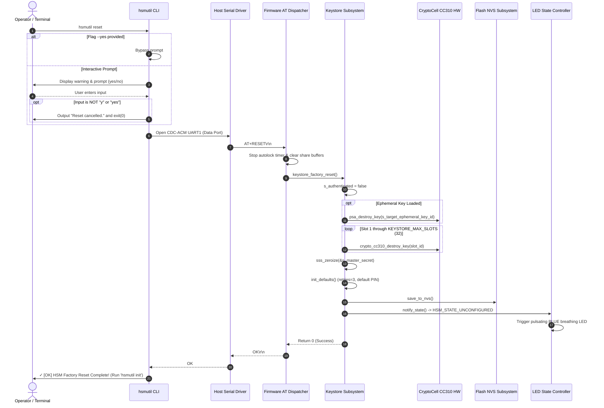
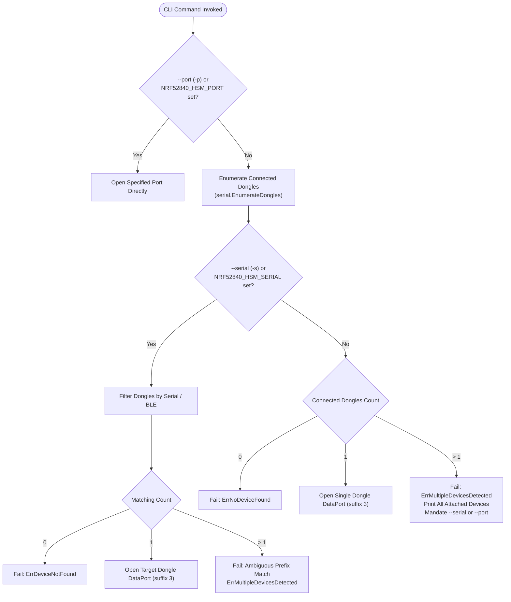

# Specification: `hsmutil` Reset Confirmation & Factory Reset, and Multi-Device Auto-Discovery Disambiguation

> [!NOTE]
> **Specification Origin**: Synthesized from [[investigations/2026-10-31-hsmutil-reset-and-multi-device-disambiguation|Investigation Assessment]], [[Architecture/Decisions/ADR-0003 - Host Port Discovery and Serial Targeting Strategy|ADR-0003: Host Port Discovery and Serial Targeting Strategy]], and [[Architecture/Decisions/ADR-0004 - Factory Reset Semantics and Safeguards|ADR-0004: Factory Reset Semantics and Safe Erasure Safeguards]].  
> **Target Subsystems**: [`nrf52840-hsm-cli`](file:///Users/gpfister/Development/Projects/gpfister/nrf52840-hsm/nrf52840-hsm-cli), [`nrf52840-hsm-firmware`](file:///Users/gpfister/Development/Projects/gpfister/nrf52840-hsm/nrf52840-hsm-firmware), [`scripts`](file:///Users/gpfister/Development/Projects/gpfister/nrf52840-hsm/scripts).  
> **Status**: Approved Requirements / Implementation Ready.

---

## 1. Problem Motivation & Executive Summary

Hardware Security Modules (HSMs) enforce strict boundaries between transient session state (logging out or releasing volatile keys) and cryptographic factory resets (purging persistent hardware secrets and returning hardware to pristine factory state). Furthermore, when operators connect multiple HSM tokens to a single workstation, host tools must never arbitrarily guess which physical token to manipulate.

Prior to this specification, two critical defects and architectural gaps were identified:

1. **Dangerous & Ineffective Reset Semantics**:
   - Running `hsmutil reset` executed immediately without an interactive confirmation prompt or an automation bypass flag (`-y` / `--yes`).
   - The underlying firmware handler in [`keystore.c`](file:///Users/gpfister/Development/Projects/gpfister/nrf52840-hsm/nrf52840-hsm-firmware/firmware/lib/src/keystore.c) only performed transient volatile session teardown (`s_authenticated = false`). All persistent keys generated in CryptoCell CC310 / PSA slots (`1..32`) remained completely intact, the Shamir Secret Sharing (SSS) master secret remained in Non-Volatile Storage (NVS), and the dongle remained configured in `HSM_STATE_LOCKED` (solid RED LED).
   - Operators expecting factory reset did not wipe keys, while operators running scripts risked catastrophic unintended key destruction if a true wipe executed without confirmation.

2. **Silent Arbitrary Multi-Device Selection**:
   - In [`discovery.go`](file:///Users/gpfister/Development/Projects/gpfister/nrf52840-hsm/nrf52840-hsm-cli/internal/infra/serial/discovery.go), when multiple physical dongles were connected without an explicit `--port` or `--serial` flag, `AutoDiscoverPortTargeting("")` pooled candidate ports from all detected dongles and silently selected the first port in priority order.
   - This caused commands (such as key generation, PIN authentication, or reset) to be routed to an arbitrary dongle based on host USB bus enumeration order, creating significant security and operational risk.

This specification defines the functional contracts, firmware zeroization sequence, multi-device disambiguation protocol, error representations, and verifiable acceptance criteria to resolve both defects.

---

## 2. Affected Repositories & Subsystems

| Subsystem | Repository Path | Primary Components Affected |
| :--- | :--- | :--- |
| **Host CLI & SDK** | [`nrf52840-hsm-cli`](file:///Users/gpfister/Development/Projects/gpfister/nrf52840-hsm/nrf52840-hsm-cli) | [`internal/ui/cli/auth.go`](file:///Users/gpfister/Development/Projects/gpfister/nrf52840-hsm/nrf52840-hsm-cli/internal/ui/cli/auth.go)<br/>[`internal/ui/cli/root.go`](file:///Users/gpfister/Development/Projects/gpfister/nrf52840-hsm/nrf52840-hsm-cli/internal/ui/cli/root.go)<br/>[`internal/ui/cli/migrate.go`](file:///Users/gpfister/Development/Projects/gpfister/nrf52840-hsm/nrf52840-hsm-cli/internal/ui/cli/migrate.go)<br/>[`internal/infra/serial/discovery.go`](file:///Users/gpfister/Development/Projects/gpfister/nrf52840-hsm/nrf52840-hsm-cli/internal/infra/serial/discovery.go)<br/>[`internal/domain/command.go`](file:///Users/gpfister/Development/Projects/gpfister/nrf52840-hsm/nrf52840-hsm-cli/internal/domain/command.go) |
| **On-Device Firmware** | [`nrf52840-hsm-firmware`](file:///Users/gpfister/Development/Projects/gpfister/nrf52840-hsm/nrf52840-hsm-firmware) | [`firmware/lib/include/hsm/keystore.h`](file:///Users/gpfister/Development/Projects/gpfister/nrf52840-hsm/nrf52840-hsm-firmware/firmware/lib/include/hsm/keystore.h)<br/>[`firmware/lib/src/keystore.c`](file:///Users/gpfister/Development/Projects/gpfister/nrf52840-hsm/nrf52840-hsm-firmware/firmware/lib/src/keystore.c)<br/>[`firmware/lib/src/at_commands.c`](file:///Users/gpfister/Development/Projects/gpfister/nrf52840-hsm/nrf52840-hsm-firmware/firmware/lib/src/at_commands.c)<br/>[`firmware/app/src/main.c`](file:///Users/gpfister/Development/Projects/gpfister/nrf52840-hsm/nrf52840-hsm-firmware/firmware/app/src/main.c) |
| **Mock Serial Harness** | [`scripts`](file:///Users/gpfister/Development/Projects/gpfister/nrf52840-hsm/scripts) | [`scripts/mock_hsm_pty.py`](file:///Users/gpfister/Development/Projects/gpfister/nrf52840-hsm/scripts/mock_hsm_pty.py) |

> [!NOTE]
> The PKCS#11 shared library ([`nrf52840-hsm-libpkcs11`](file:///Users/gpfister/Development/Projects/gpfister/nrf52840-hsm/nrf52840-hsm-libpkcs11)) already implements serial targeting filtering through candidate scoring and the `NRF52840_HSM_SERIAL` environment variable, so no direct C codebase changes are required there.

---

## 3. Functional Requirements

### 3.1 CLI Reset Safeguards (`hsmutil reset`)

- **FR-CLI-01: Flag Registration**: The `hsmutil reset` command MUST accept `-y` and `--yes` boolean flags (default: `false`).
- **FR-CLI-02: Interactive Confirmation Guard**: When `--yes` is omitted:
  - If standard input is connected, `hsmutil reset` MUST present a prominent destructive warning and prompt the user:
    ```text
    WARNING: This will permanently delete all stored cryptographic keys,
    zeroize the Shamir master secret, and return the HSM to an unconfigured state.
    This action cannot be undone!

    Are you sure you want to proceed? (yes/no): 
    ```
  - Input MUST be evaluated case-insensitively. Only `"y"` or `"yes"` (after trimming whitespace) SHALL constitute confirmation.
  - Any other input (including `"n"`, `"no"`, empty input / newline, or `EOF`) MUST abort the operation immediately, output `Reset cancelled.`, and exit cleanly with code `0`.
  - Under cancellation, NO serial connection SHALL be opened, and NO `AT+RESET` command SHALL be transmitted.
- **FR-CLI-03: Non-Interactive / Automation Execution**: When `-y` or `--yes` is specified, the CLI MUST bypass the interactive prompt and execute the reset directly.
- **FR-CLI-04: Informative Post-Reset Guidance**: Upon receiving a successful `OK` response from the hardware, the CLI MUST output explicit lifecycle guidance:
  ```text
  ✓ [OK] HSM Factory Reset Complete!
  All persistent keys and Shamir secrets have been wiped.
  The device is now in an unconfigured state. Run 'hsmutil init --threshold' to reconfigure.
  ```

### 3.2 Firmware Keystore Factory Reset Zeroization

- **FR-FW-01: Factory Reset Function**: The firmware keystore subsystem MUST expose `int keystore_factory_reset(void)` in [`keystore.h`](file:///Users/gpfister/Development/Projects/gpfister/nrf52840-hsm/nrf52840-hsm-firmware/firmware/lib/include/hsm/keystore.h) and [`keystore.c`](file:///Users/gpfister/Development/Projects/gpfister/nrf52840-hsm/nrf52840-hsm-firmware/firmware/lib/src/keystore.c).
- **FR-FW-02: CC310 Hardware Key Slot Destruction**: `keystore_factory_reset` MUST loop over all slots `1` through `KEYSTORE_MAX_SLOTS` (32 slots) and invoke `crypto_cc310_destroy_key(slot_id)` on each slot to destroy persistent hardware key representations and metadata.
- **FR-FW-03: Master Secret Zeroization**: The Shamir Secret Sharing master secret buffer in RAM MUST be securely overwritten with zero bytes using `sss_zeroize()`.
- **FR-FW-04: Session & Ephemeral Destruction**: Any active ephemeral ECDH migration key (`s_target_ephemeral_key_id`) MUST be destroyed via `psa_destroy_key()`. `s_authenticated` MUST be set to `false`, and the autolock timer MUST be stopped.
- **FR-FW-05: Factory Defaults Restoration**: Default settings MUST be restored in RAM:
  - `s_data.retries_remaining = KEYSTORE_MAX_RETRIES` (3).
  - `s_data.shamir_initialized = false`.
  - Default master PIN restored (`"12345678"`).
  - Slot allocation bitmask / counts cleared to 0.
- **FR-FW-06: Non-Volatile Storage (NVS) Persistence**: The cleared state MUST be committed to persistent flash using `save_to_nvs()`.
- **FR-FW-07: Hardware State Transition**: `notify_state()` MUST be triggered. Because `key_count == 0` and `shamir_initialized == false`, the device state MUST transition to `HSM_STATE_UNCONFIGURED`, switching the RGB status LED to pulsating / breathing BLUE (or white depending on board profile).
- **FR-FW-08: AT Command Dispatch**:
  - `firmware/lib/src/at_commands.c` MUST invoke `keystore_factory_reset()` when processing `AT+RESET`.
  - `AT+FACTORYRESET` MUST be supported as an explicit alias for `AT+RESET`.
  - Active shares held in RAM ceremony buffers MUST be cleared via `at_commands_reset_shares()`.

### 3.3 Mock Serial Harness Synchronization

- **FR-MCK-01: Python Mock PTY Zeroization**: In [`scripts/mock_hsm_pty.py`](file:///Users/gpfister/Development/Projects/gpfister/nrf52840-hsm/scripts/mock_hsm_pty.py), `handle_reset` MUST:
  - Purge the slot dictionary (`self.slots.clear()`).
  - Zeroize master secret reference (`self.master_secret = None`).
  - Reset `self.shamir_initialized = False`, `self.authenticated = False`, and `self.retries = 3`.
  - Return `OK\r\n`.

### 3.4 Multi-Device Auto-Discovery & Disambiguation Protocol

- **FR-DISC-01: Disambiguation Domain Error**: A dedicated domain error type `ErrMultipleDevicesDetected` MUST be defined in `internal/domain` or `internal/infra/serial`:
  - It MUST encapsulate the slice of `DiscoveredDongle` structures.
  - Its `Error()` method MUST format an actionable message listing each detected dongle's BLE address / serial number, product descriptor, and associated CDC-ACM data port path.
  - It MUST instruct the operator to disambiguate using `--port (-p)` or `--serial (-s)`.
- **FR-DISC-02: Auto-Discovery Strictness**: In [`discovery.go`](file:///Users/gpfister/Development/Projects/gpfister/nrf52840-hsm/nrf52840-hsm-cli/internal/infra/serial/discovery.go):
  - When no explicit `--port` or `--serial` (nor matching environment variables) is provided:
    - If connected dongles == 0: Return `ErrNoDeviceFound`.
    - If connected dongles == 1: Seamlessly return the data port (suffix `3`) of the single attached dongle.
    - If connected dongles > 1: Refuse silent execution and return `&ErrMultipleDevicesDetected{Devices: dongles}`.
- **FR-DISC-03: Explicit Serial Matching**: When `--serial` (or `NRF52840_HSM_SERIAL`) is provided:
  - Filter detected dongles matching the normalized serial or BLE address.
  - If 0 matches: Return `ErrDeviceNotFound`.
  - If 1 match: Return that dongle's data port (suffix `3`).
  - If >1 matches (e.g. prefix collision): Return `ErrMultipleDevicesDetected`.
- **FR-DISC-04: Non-Blocking Device Listing**: The command `hsmutil devices` MUST continue to enumerate and display all connected dongles without triggering `ErrMultipleDevicesDetected`.
- **FR-DISC-05: Flexible Migration Targeting**: In [`migrate.go`](file:///Users/gpfister/Development/Projects/gpfister/nrf52840-hsm/nrf52840-hsm-cli/internal/ui/cli/migrate.go), `--source` and `--target` flags MUST accept either filesystem port paths (e.g., `/dev/tty.usbmodem*` or `COM*`) OR 12-digit hex BLE serial numbers, resolved via a shared `ResolvePortOrSerial(target string) (string, error)` function.

---

## 4. Architectural Flows & Diagrams

### 4.1 CLI Reset Safeguard & Firmware Zeroization Flow



### 4.2 Multi-Device Disambiguation Logic



---

## 5. Non-Functional Requirements

- **NFR-SEC-01 (Permanent Zeroization)**: Key destruction MUST overwrite both RAM buffers and NVS persistent flash structures. No residual key fragments or Shamir polynomial parameters SHALL survive in non-volatile storage.
- **NFR-SEC-02 (Fail-Safe State)**: If an error occurs during key slot destruction or NVS serialization during reset, the firmware MUST lock all subsequent cryptographic operations and report an error rather than allowing partial operation in an inconsistent state.
- **NFR-LAT-01 (Reset Latency)**: The full zeroization loop across 32 CC310 slots and flash commit MUST complete within 250 ms to prevent host serial communication timeouts.
- **NFR-REL-01 (Atomic Disambiguation)**: Host auto-discovery MUST be atomic and deterministic across macOS (`/dev/tty.usbmodem*`), Linux (`/dev/ttyACM*`), and Windows (`COM*`).
- **NFR-CMP-01 (Backward Compatibility)**: Existing CI scripts providing `-p /dev/...` or `-s <BLE>` MUST experience no breaking changes and execute without prompts.

---

## 6. Edge Cases & Mitigations

| Edge Case | Potential Risk | Mitigation |
| :--- | :--- | :--- |
| **Non-interactive terminal without `-y`** (e.g., automated cron job or piped stdin) | CLI blocks waiting indefinitely for input on stdin | CLI checks for EOF or whitespace-only stream; if EOF reached without `"y"`, cleanly abort with `Reset cancelled.` |
| **Device unplugged during factory reset** | Keystore left in half-cleared NVS state | NVS write occurs in a single structured transaction; on reboot, uninitialized flash header checksum mismatch defaults to factory state. |
| **Two dongles sharing identical serial string** (e.g., misconfigured mock PTYs) | Target resolution matches multiple devices | Disambiguation error detects duplicate matches and requires specifying the explicit `--port`. |
| **User specifies partial serial prefix** (e.g. `-s D91C`) | Prefix matches more than one dongle | Strict prefix disambiguation: if matches > 1, emit ambiguous match error listing the candidate full serials. |
| **Command run while dongle in Bootloader (DFU) mode** | CDC-ACM data port unavailable | Enumerator detects DFU VID/PID or missing interface and outputs clear error that device is in bootloader mode. |

---

## 7. Verifiable Acceptance Criteria

| ID | Test Scenario | Execution Step | Expected Verification Criteria |
| :--- | :--- | :--- | :--- |
| **AC-RST-01** | Interactive reset cancellation | Run `hsmutil reset`, enter `n` at prompt | Output contains `Reset cancelled.`, exit code is `0`, serial monitor shows no `AT+RESET` sent. |
| **AC-RST-02** | Interactive reset confirmation | Run `hsmutil reset`, enter `yes` at prompt | Firmware receives `AT+RESET`, responds `OK`, CLI prints `✓ [OK] HSM Factory Reset Complete!`. |
| **AC-RST-03** | Scripted reset bypass | Run `hsmutil reset -y` (or `--yes`) | Prompt is skipped entirely, factory reset executes and returns code `0`. |
| **AC-RST-04** | Persistent key destruction | Generate key in slot 1 (`hsmutil key generate --slot 1`), execute `hsmutil reset -y` | Subsequent key read or signing on slot 1 fails with key not found; slot metadata cleared. |
| **AC-RST-05** | State machine transition | Check device info / LED status before and after `hsmutil reset -y` | LED transitions from solid RED (`LOCKED`) to breathing BLUE (`UNCONFIGURED`). `hsmutil info` reports device unconfigured. |
| **AC-RST-06** | Mock PTY synchronization | Send `AT+RESET` to `mock_hsm_pty.py` | Virtual mock zeroes slots table, clears master secret, and returns `OK\r\n`. |
| **AC-DISC-01**| Single dongle attached | Run `hsmutil info` with 1 dongle connected | Command discovers dongle and succeeds without requiring `--port` or `--serial`. |
| **AC-DISC-02**| Multi-dongle disambiguation refusal | Run `hsmutil info` with 2 dongles connected and no flags | Fails with `ErrMultipleDevicesDetected`, printing both dongles with serials and ports. Exit code != 0. |
| **AC-DISC-03**| Multi-dongle targeted execution | Run `hsmutil info -s <SERIAL>` with 2 dongles connected | Disambiguates cleanly, queries the selected dongle, returns code 0. |
| **AC-DISC-04**| Non-blocking device enumeration | Run `hsmutil devices` with 2 dongles connected | Prints both connected dongles in a structured table without blocking or erroring. |
| **AC-DISC-05**| Dual-device key migration | Run `hsmutil key migrate --source <SERIAL1> --target <SERIAL2>` | Resolves both serials to candidate ports using `ResolvePortOrSerial()` and initiates migration. |

---

## 8. Related Documents & Vault Links

- **Feature Note**: [[features/hsmutil-reset-and-multi-device-disambiguation|Reset Confirmation & Multi-Device Disambiguation Feature]]
- **Investigation**: [[investigations/2026-10-31-hsmutil-reset-and-multi-device-disambiguation|Issue Assessment (2026-10-31)]]
- **Session Note**: [[Sessions/36b74c4b-dd01-44e1-9405-48fdc8d21d87|Phase 2 Specification Session]]
- **Archived Artifact**: `[[Sessions/attachments/36b74c4b-dd01-44e1-9405-48fdc8d21d87/specification.md|specification.md]]`
- **Architecture Decisions**:
  - [[Architecture/Decisions/ADR-0003 - Host Port Discovery and Serial Targeting Strategy|ADR-0003: Host Port Discovery and Serial Targeting Strategy]]
  - [[Architecture/Decisions/ADR-0004 - Factory Reset Semantics and Safeguards|ADR-0004: Factory Reset Semantics and Safe Erasure Safeguards]]
- **Related Features**:
  - [[features/usb-descriptors-ble-address|USB Descriptors & Device Identification]]
- **Code Repositories**:
  - CLI: [`nrf52840-hsm-cli`](file:///Users/gpfister/Development/Projects/gpfister/nrf52840-hsm/nrf52840-hsm-cli)
  - Firmware: [`nrf52840-hsm-firmware`](file:///Users/gpfister/Development/Projects/gpfister/nrf52840-hsm/nrf52840-hsm-firmware)
  - Scripts: [`scripts/mock_hsm_pty.py`](file:///Users/gpfister/Development/Projects/gpfister/nrf52840-hsm/scripts/mock_hsm_pty.py)
