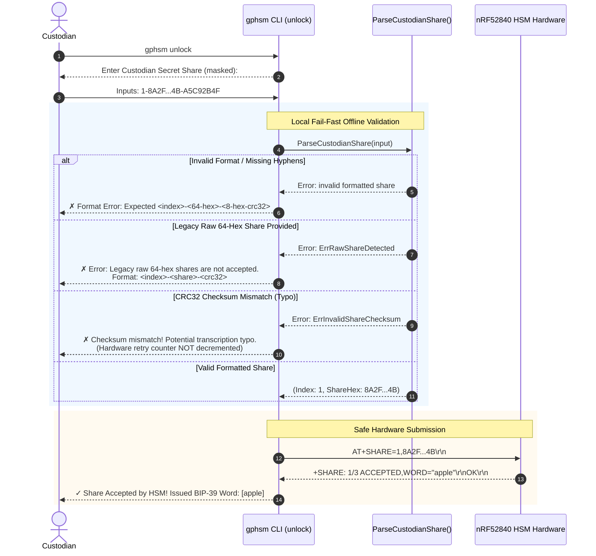

# Technical Specification: Shamir Key Format with Embedded Index and CRC32 Checksum

> **Document Status**: APPROVED (Phase 2 Specification Approved)  
> **Target Repositories**: [`hsm-cli`](file:///Users/gpfister/Development/Projects/gpfister/nrf52840-hsm/hsm-cli), [`hsm-obsidian`](file:///Users/gpfister/Development/Projects/gpfister/nrf52840-hsm/hsm-obsidian)  
> **Target Components**: Host Management CLI (`gphsm`), Ceremony Domain Services, Documentation Vault  
> **Related Architecture Decision Records**:
> - [[Architecture/Decisions/ADR-0034 - Shamir Key Format with Embedded Index and CRC32 Checksum|ADR-0034: Shamir Key Format with Embedded Index and CRC32 Checksum]]
> - [[Architecture/Decisions/ADR-0016 - Dual-Mode Authentication Architecture (PIN and Shamir Secret Sharing)|ADR-0016: Dual-Mode Authentication Architecture]]
> - [[Architecture/Decisions/ADR-0017 - Host CLI Rebranding to gphsm and PKCS11 Refactoring to libgphsm|ADR-0017: Host CLI Rebranding to gphsm and PKCS#11 Refactoring to libgphsm]]
> - [[Architecture/Decisions/ADR-0019 - HSM Device Initialization and Dual-Mode Protocol Compatibility|ADR-0019: HSM Device Initialization and Dual-Mode Protocol Compatibility]]

---

## 1. Executive Summary & Problem Motivation

### 1.1 Problem Statement
In the baseline Hardware Security Module (HSM) ecosystem, Shamir Secret Sharing initialization (`gphsm device init --mode shamir`) emits five 32-byte secret shares formatted as raw 64-character hexadecimal strings, along with a separate integer index ($1 \dots 5$). During authentication ceremonies (`gphsm unlock`), custodians must undergo a two-step interrogation:
1. Entering their custodian index integer ($1 \dots 5$) in cleartext.
2. Entering their raw 64-hexadecimal share under password masking.

This operational flow suffers from critical human-factor and security vulnerabilities:
1. **Index Disassociation**: Custodians frequently record their 64-hex share on paper or physical metal plates without explicitly binding the corresponding index number, or they associate the wrong index during the ceremony.
2. **Unprotected Hardware Counter Exhaustion**: The raw 64-hex share string has no self-verifying checksum. If a custodian makes a single-character typo during transcription or input, the erroneous share is transmitted directly over the serial AT link (`AT+SHARE=<idx>,<shareHex>`). The hardware microcontroller decrements its immutable non-volatile retry counter. Three incorrect submissions lock the HSM, requiring a destructive factory reset and permanent loss of unbacked keys.
3. **Disjointed UX**: Prompting for an index followed by a masked string introduces unnecessary friction during high-stress threshold recovery operations.

### 1.2 Solution Overview
This specification introduces a self-contained, tamper-evident custodian share format at the CLI layer:
$$\mathbf{\langle index \rangle \textbf{--} \langle 64\_hex\_share \rangle \textbf{--} \langle 8\_hex\_crc32 \rangle}$$

- **Self-Contained**: The 1-based custodian index is embedded directly into the share string.
- **Fail-Fast Offline Verification**: An IEEE 802.3 CRC-32 checksum protects both the index and the cryptographic share. The CLI validates the checksum locally **before** sending any packet over the serial link, completely eliminating accidental hardware retry counter decrements caused by transcription typos.
- **Streamlined Single-Prompt UX**: The authentication ceremony requires only a single masked prompt (`"Enter Custodian Secret Share (masked): "`), automatically extracting the index and share payload while providing clear feedback.
- **Strict Hardware Wire Invariance**: The physical firmware (`hsm-ncs-firmware`) and its CDC-ACM AT command framing (`AT+SHARE=<idx>,<shareHex>`) remain 100% unchanged. All packaging, parsing, and error-guard validation are encapsulated entirely within [`hsm-cli`](file:///Users/gpfister/Development/Projects/gpfister/nrf52840-hsm/hsm-cli).

---

## 2. Share Format & Checksum Specification

### 2.1 Grammar & Structure
A formatted custodian share string adheres to the following canonical format:
```text
<formatted_share> ::= <index> "-" <hex_share> "-" <crc32>
<index>           ::= [1-5]
<hex_share>       ::= [0-9A-Fa-f]{64}
<crc32>           ::= [0-9A-Fa-f]{8}
```

Total character length: **75 characters** ($1 + 1 + 64 + 1 + 8$).

#### Visual Layout
```text
 1 - 3F8C9E4B2A... (64 hex characters / 32 bytes) ...7D1E - A5C92B4F
─┬─ ─┬─────────────────────────────────────────────────┬─ ─┬───────┬─
 │   │                                                 │   │       └─ 8-Hex IEEE 802.3 CRC32
 │   │                                                 │   └───────── Hyphen Delimiter ('-')
 │   │                                                 └───────────── 32-Byte Secret Share (64 Hex)
 │   └─────────────────────────────────────────────────────────────── Hyphen Delimiter ('-')
 └─────────────────────────────────────────────────────────────────── Custodian Index (1..5)
```

### 2.2 Binary Serialization & CRC-32 Computation
The checksum protects both the identity (index) and the entropy (share).

1. **Index Byte**: The custodian index $I \in [1, 5]$ is cast to an unsigned 8-bit integer (`uint8(index)`), occupying exactly 1 byte.
2. **Share Bytes**: The 64-hexadecimal share string is decoded into its 32-byte raw binary representation ($S \in \mathbb{F}_{256}^{32}$).
3. **Payload Buffer**: A 33-byte contiguous binary slice is constructed:
   $$\text{Payload} = \left[ I \;\parallel\; S_0 \;\parallel\; S_1 \;\parallel\; \dots \;\parallel\; S_{31} \right]$$
4. **Polynomial & Algorithm**: Standard IEEE 802.3 CRC-32 (polynomial `0xEDB88320` reversed / `0x04C11DB7` normal, corresponding to Go `crc32.IEEE`).
5. **Hex Formatting**: The resulting 32-bit unsigned integer is rendered as an 8-character uppercase hexadecimal string:
   $$\text{CRC32Hex} = \text{fmt.Sprintf}("\%08\text{X}", \text{crc})$$

### 2.3 Worked Numerical Example
Given:
- Custodian Index: `1` (`0x01`)
- 32-Byte Secret Share (Hex):  
  `000102030405060708090A0B0C0D0E0F101112131415161718191A1B1C1D1E1F`
- 33-Byte Binary Payload:  
  `01000102030405060708090A0B0C0D0E0F101112131415161718191A1B1C1D1E1F`
- Computed CRC-32 (IEEE): `0x40B513CD`
- Formatted Output:  
  `1-000102030405060708090A0B0C0D0E0F101112131415161718191A1B1C1D1E1F-40B513CD`

---

## 3. Architecture & Operational Workflows



---

## 4. Detailed Component & Command Specifications

### 4.1 Device Initialization Ceremony (`gphsm device init --mode shamir`)
During `gphsm device init --mode shamir`, the CLI receives raw shares from the HSM via `AT+INIT=SHAMIR` (`+INIT: <idx>,<hex>`).

#### Display Requirements
In [`internal/usecases/ceremony_service.go`](file:///Users/gpfister/Development/Projects/gpfister/nrf52840-hsm/hsm-cli/internal/usecases/ceremony_service.go), `RunTurnByTurnInit` must:
1. Convert each raw `domain.CustodianShare` into the formatted string using `domain.FormatCustodianShare(share.Index, share.Share)`.
2. Present the formatted string prominently to the custodian:
```text
================================================================================
              PRIVATE SECRET SHARE — CUSTODIAN #1                             
================================================================================
 Custodian Index: 1
 Formatted Share: 1-E4C20F9B...64HEX...71A3-9F8120B4
--------------------------------------------------------------------------------
CRITICAL INSTRUCTIONS:
 1. Record your COMPLETE formatted share including index and checksum suffix.
 2. Format: <index>-<64_hex_share>-<8_hex_crc32> (e.g. 1-AAAA...-BBBB).
 3. Never store this share on a computer, phone, or connected system.
 4. At least 3 of 5 custodian shares are required to unlock this HSM.
================================================================================
```

### 4.2 Threshold Authentication Ceremony (`gphsm unlock`)
In [`internal/usecases/ceremony_service.go`](file:///Users/gpfister/Development/Projects/gpfister/nrf52840-hsm/hsm-cli/internal/usecases/ceremony_service.go), `RunTurnByTurnAuth` is streamlined:
1. **Single Prompt**: The previous separate index prompt:
   `Enter your Custodian Index (1-5) [default %d]:`
   is **eliminated**.
2. **Unified Interrogation**: The custodian is prompted once:
   `Enter Custodian Secret Share (masked): `
3. **Local Validation**:
   - The input is parsed via `domain.ParseCustodianShare(input)`.
   - If parsing fails due to checksum mismatch, syntax error, or raw share detection, the turn reports the failure **without** communicating with the HSM.
   - The user is offered immediate re-entry or turn restart without penalizing the device's remaining retries.
4. **Hardware Submission**:
   - Upon successful verification, the extracted `idx` and `shareHex` are passed to `client.SubmitShare(idx, shareHex)`.

### 4.3 Raw Share Deprecation & Helpful Diagnostics
If an operator pastes an old 64-character raw hex share (or 66-character `0x` prefixed hex), `ParseCustodianShare` detects the exact pattern and returns a structured error:
> `raw 64-character hex share detected: formatted shares with index and checksum (<index>-<share>-<crc32>) are required to prevent hardware lockout`

---

## 5. Domain Models and Utility Functions

### 5.1 Package `internal/domain`

Implementation in [`internal/domain/share_format.go`](file:///Users/gpfister/Development/Projects/gpfister/nrf52840-hsm/hsm-cli/internal/domain/share_format.go):

```go
package domain

import (
	"encoding/hex"
	"errors"
	"fmt"
	"hash/crc32"
	"strconv"
	"strings"
)

var (
	ErrInvalidShareFormat   = errors.New("invalid custodian share format: expected '<index>-<64-hex-share>-<8-hex-crc32>'")
	ErrInvalidShareIndex    = errors.New("custodian index out of range: must be between 1 and 5")
	ErrInvalidShareHex      = errors.New("invalid share payload: must be exactly 64 hexadecimal characters (32 bytes)")
	ErrInvalidShareChecksum = errors.New("custodian share checksum mismatch: potential transcription typo")
	ErrRawShareDetected     = errors.New("raw 64-hex share detected: formatted share '<index>-<share>-<crc32>' is required")
)

// CalculateShareCRC32 calculates IEEE 802.3 CRC-32 over [uint8(index) || 32-byte share binary].
func CalculateShareCRC32(index int, shareBytes []byte) uint32 {
	buf := make([]byte, 1+len(shareBytes))
	buf[0] = byte(index)
	copy(buf[1:], shareBytes)
	return crc32.ChecksumIEEE(buf)
}

// FormatCustodianShare packages an index and 64-hex share into '<index>-<64_hex>-<8_hex_crc32>'.
func FormatCustodianShare(index int, shareHex string) (string, error) {
	if index < 1 || index > 5 {
		return "", fmt.Errorf("%w: got %d", ErrInvalidShareIndex, index)
	}

	cleanHex := strings.TrimSpace(shareHex)
	cleanHex = strings.TrimPrefix(cleanHex, "0x")
	cleanHex = strings.TrimPrefix(cleanHex, "0X")

	if len(cleanHex) != 64 {
		return "", fmt.Errorf("%w: length is %d", ErrInvalidShareHex, len(cleanHex))
	}

	shareBytes, err := hex.DecodeString(cleanHex)
	if err != nil {
		return "", fmt.Errorf("%w: %v", ErrInvalidShareHex, err)
	}

	crc := CalculateShareCRC32(index, shareBytes)
	return fmt.Sprintf("%d-%s-%08X", index, strings.ToUpper(cleanHex), crc), nil
}

// ParseCustodianShare parses and verifies '<index>-<64_hex>-<8_hex_crc32>', returning (index, 64_hex, nil).
func ParseCustodianShare(input string) (int, string, error) {
	clean := strings.TrimSpace(input)

	// Check if user submitted a legacy raw 64-hex share
	unprefixed := strings.TrimPrefix(strings.TrimPrefix(clean, "0x"), "0X")
	if len(unprefixed) == 64 && !strings.Contains(clean, "-") {
		return 0, "", ErrRawShareDetected
	}

	parts := strings.Split(clean, "-")
	if len(parts) != 3 {
		return 0, "", ErrInvalidShareFormat
	}

	idxStr := strings.TrimSpace(parts[0])
	shareHex := strings.TrimSpace(parts[1])
	crcHex := strings.TrimSpace(parts[2])

	index, err := strconv.Atoi(idxStr)
	if err != nil || index < 1 || index > 5 {
		return 0, "", fmt.Errorf("%w: got %q", ErrInvalidShareIndex, idxStr)
	}

	if len(shareHex) != 64 {
		return 0, "", fmt.Errorf("%w: got %d characters", ErrInvalidShareHex, len(shareHex))
	}

	shareBytes, err := hex.DecodeString(shareHex)
	if err != nil {
		return 0, "", fmt.Errorf("%w: invalid hex: %v", ErrInvalidShareHex, err)
	}

	if len(crcHex) != 8 {
		return 0, "", fmt.Errorf("%w: expected 8 hex characters, got %q", ErrInvalidShareFormat, crcHex)
	}

	expectedCRC := CalculateShareCRC32(index, shareBytes)
	actualCRC, err := strconv.ParseUint(crcHex, 16, 32)
	if err != nil {
		return 0, "", fmt.Errorf("%w: invalid crc hex %q", ErrInvalidShareFormat, crcHex)
	}

	if uint32(actualCRC) != expectedCRC {
		return 0, "", fmt.Errorf("%w: expected %08X, got %08X", ErrInvalidShareChecksum, expectedCRC, uint32(actualCRC))
	}

	return index, strings.ToUpper(shareHex), nil
}
```

---

## 6. Non-Functional Requirements

### 6.1 Performance & Memory
- **Validation Latency**: Parsing and CRC-32 validation execute in less than **100 microseconds** ($< 0.1\text{ ms}$) on standard host CPUs.
- **Zero Heap Spilling**: Binary slices for CRC calculations are fixed at 33 bytes.
- **Zero CGO**: Pure Go implementation without external C library bindings, ensuring compatibility across macOS, Linux, and Windows.

### 6.2 Security & Resilience
- **Hardware Counter Protection**: Under no circumstances shall an unverified or checksum-failing share be transmitted to `client.SubmitShare`.
- **Memory Hygiene**: Temporary password and share buffers in `ceremony_service.go` continue to be masked during console entry using `term.ReadPassword`.
- **Clearance of Sensitive Console Buffers**: ANSI screen purge sequences (`\033[H\033[2J\033[3J`) remain active between custodian turns.

---

## 7. Edge Cases & Mitigations

| Edge Case | Description | Mitigation Strategy |
| :--- | :--- | :--- |
| **Transcription Typo** | Custodian mistypes 1 character in the 64-hex share or index. | CRC-32 detects all single-bit, double-bit, and burst errors up to 32 bits. Aborts with `ErrInvalidShareChecksum` locally without touching hardware. |
| **Index Swapping** | Custodian #1 enters Custodian #2's share while identifying as #1. | The index is part of the CRC-32 payload. If an operator edits the leading index to mismatch the share's original index, the CRC check fails immediately. |
| **Legacy Raw Hex Paste** | Custodian attempts to paste 64-hex share from pre-upgrade backups. | `ParseCustodianShare` detects 64-hex string and emits `ErrRawShareDetected` explaining the required `<index>-<share>-<crc32>` format. |
| **Case Sensitivity** | Custodian enters lowercase hex (e.g. `a-f`). | Parsers normalize all hex inputs to uppercase before comparison and return uppercase strings to callers. |
| **Whitespace & Padding** | Accidental leading/trailing spaces or tabs during copy-paste. | All segments (`clean := strings.TrimSpace(...)`) are trimmed before parsing. |
| **Hyphen Delimiters in Input** | Accidental double hyphens or alternate dashes (e.g. en-dash). | Strict validation on hyphen count (`len(parts) == 3`); rejects irregular unicode dashes with clear format error. |

---

## 8. Verifiable Acceptance Criteria

### Criteria 1: Formatted Share Round-Trip
- **Given** an index $i \in \{1 \dots 5\}$ and a valid 64-hex string $S$.
- **When** `FormatCustodianShare(i, S)` is called.
- **Then** it produces a 75-character string matching `<index>-<64_hex>-<8_hex_crc32>` where CRC-32 is computed over `[uint8(i) || hex_decode(S)]`.
- **When** `ParseCustodianShare(formatted)` is called.
- **Then** it returns index $i$ and normalized uppercase $S$ with zero error.

### Criteria 2: Checksum Failure & Typo Interception
- **Given** a formatted share string with any single character mutated (index, share payload, or CRC suffix).
- **When** `ParseCustodianShare` is called.
- **Then** it returns an error wrapping `ErrInvalidShareChecksum` or `ErrInvalidShareFormat`.

### Criteria 3: Legacy Raw Share Deprecation
- **Given** a 64-hexadecimal character string without hyphens.
- **When** `ParseCustodianShare` is called.
- **Then** it returns `ErrRawShareDetected`.

### Criteria 4: Local Protection of Hardware Retries
- **Given** a connected HSM device with 3 remaining retries in Shamir mode.
- **When** a user enters an invalid or typo-ridden formatted share into `gphsm unlock`.
- **Then** `gphsm` rejects the input locally, prints a helpful checksum error, and `AT+STATUS?` verifies that hardware retries remain exactly 3.

### Criteria 5: Streamlined Single Prompt UX
- **Given** an unauthenticated HSM in Shamir mode.
- **When** `gphsm unlock` runs.
- **Then** each turn displays strictly one masked input prompt: `"Enter Custodian Secret Share (masked): "`, and upon valid input, successfully unlocks the device when the 3-of-5 threshold is reached.
