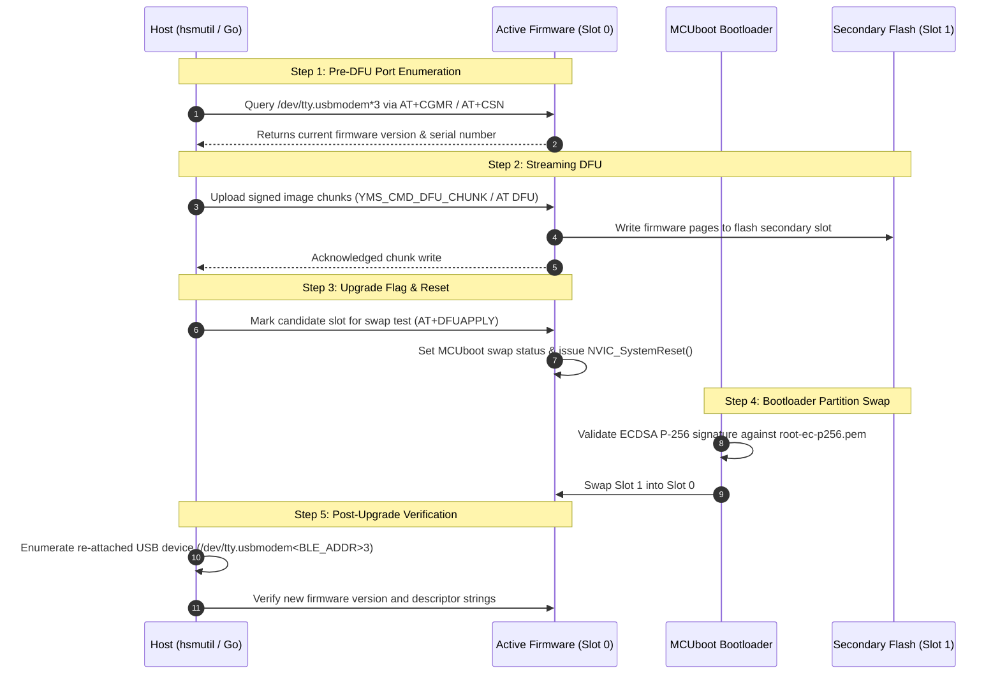

# USB Descriptors & Device Identification Specification

This document defines the technical specification for configuring the **nRF52840 USB descriptors**, dynamically generating the USB serial number string from the hardware Factory Information Configuration Registers (FICR) Bluetooth Low Energy (BLE) device address, setting interface protocol identifiers, and facilitating automated multi-device discovery and firmware updates.

---

## 1. Context & Objectives

The nRF52840 Dongle (`PCA10059`) functions as a dual-CDC ACM composite device. When multiple dongles are plugged into a host workstation or USB hub simultaneously, deterministic device identification is vital for:
1. Identifying physical tokens without cross-talk or ambiguous enumeration.
2. Directing firmware DFU payload chunks to the intended target dongle.
3. Matching individual cryptographic keys and PKCS#11 sessions to physical hardware dongles.

---

## 2. Requirements & Clarified Scope

### 2.1 In-Scope Capabilities
- **Dynamic Serial Number String Generation**:
  - Extract the unique 48-bit hardware BLE MAC address from `NRF_FICR->DEVICEADDR[0]` and `NRF_FICR->DEVICEADDR[1]`.
  - Format the address into a 12-digit uppercase hexadecimal string without delimiters (e.g. `F4CE368F12AB`).
  - Register this dynamic string descriptor with Zephyr's USB device stack via `usb_update_sn_string_descriptor()`.
- **Interface Protocol Identifiers**:
  - Configure the USB Communications Management interface descriptors with explicit protocol identifiers:
    - Interface 0 (Console CDC Management): `bInterfaceProtocol = 0x0001`
    - Interface 2 (HSM AT CDC Management): `bInterfaceProtocol = 0x0002`
- **Firmware Configuration (`prj.conf`)**:
  - Enable dynamic serial configuration options (`CONFIG_USB_DEVICE_SN=y`, `CONFIG_HWINFO=y`).
- **CLI Serial Port Discovery Enhancement (`nrf52840-hsm-cli`)**:
  - Update `hsmutil` serial discovery and enumerator matching to recognize `/dev/tty.usbmodem<BLE_ADDR>3` (and Linux `/dev/ttyACM*`) mapped to VID `0x1209` / PID `0x0001`.
- **Dual Device Monitoring & DFU Verification**:
  - Enumerate both physically connected dongles.
  - Inspect USB descriptors using host tools (`ioreg`, `system_profiler`).
  - Compile signed production firmware with updated descriptors and execute MCUboot partition swap update via `hsmutil firmware update`.

### 2.2 Out-of-Scope Capabilities
- **macOS DriverKit DEXT Development**:
  - Retain native macOS standard CDC-ACM kernel drivers (`AppleUSBCDCACMData`). Device nodes remain `/dev/tty.usbmodem*` to guarantee zero-driver, zero-privilege plug-and-play operation.
- **PKCS#11 Core Cryptographic Mechanisms**:
  - Modifications to the internal PKCS#11 cryptographic operations or session tokens are not required.

---

## 3. Technical Analysis & Design Decisions

### 3.1 BLE Address Extraction from FICR Registers

The Nordic nRF52840 SoC contains factory-programmed unique identifiers in the Factory Information Configuration Registers (FICR):
- `NRF_FICR->DEVICEADDR[0]`: Contains the lower 32 bits (bytes 0 to 3) of the BLE MAC address.
- `NRF_FICR->DEVICEADDR[1]`: Contains the upper 16 bits (bytes 4 and 5) of the BLE MAC address in bits `[15:0]`.

```text
       +---------------------------------------------+
FICR   | DEVICEADDR[1] (Bits 15:0) | DEVICEADDR[0]   |
       +---------------------------------------------+
Byte:  |       5       |     4     |  3 |  2 |  1 |  0|
       +---------------+-----------+----+----+----+---+
Hex:   |      F4       |    CE     | 36 | 8F | 12 | AB|
       +---------------+-----------+----+----+----+---+
Result:| String: "F4CE368F12AB" (12 characters + NUL) |
       +---------------------------------------------+
```

```c
#include <zephyr/kernel.h>
#include <zephyr/usb/usb_device.h>
#include <hal/nrf_ficr.h>
#include <stdio.h>

static char s_usb_sn[13];

void usb_serial_configure_sn(void)
{
    uint32_t addr0 = nrf_ficr_deviceaddr_get(NRF_FICR, 0);
    uint32_t addr1 = nrf_ficr_deviceaddr_get(NRF_FICR, 1) & 0x0000FFFF;

    /* Format 48-bit address in MSB-to-LSB order */
    snprintf(s_usb_sn, sizeof(s_usb_sn), "%02X%02X%02X%02X%02X%02X",
             (uint8_t)(addr1 >> 8),
             (uint8_t)(addr1),
             (uint8_t)(addr0 >> 24),
             (uint8_t)(addr0 >> 16),
             (uint8_t)(addr0 >> 8),
             (uint8_t)(addr0));

    usb_update_sn_string_descriptor(s_usb_sn);
}
```

> [!IMPORTANT]
> `usb_update_sn_string_descriptor()` must be executed **prior** to calling `usb_enable(NULL)` so the host retrieves the serial number descriptor during initial USB bus enumeration.

---

### 3.2 USB Interface & Protocol Descriptors

The USB composite hierarchy assigns interfaces and protocols as follows:

| Interface Number | Interface Class | Subclass | Protocol | Descriptors / Usage |
| :--- | :--- | :--- | :--- | :--- |
| **0** | CDC Communication (`0x02`) | ACM (`0x02`) | **`0x0001`** | Logging Console Management Interface (`iInterface` = "nRF52840 HSM Console") |
| **1** | CDC Data (`0x0A`) | Data (`0x00`) | `0x0000` | Logging Console Bulk Data Interface (macOS: `/dev/tty.usbmodem<SN>1`) |
| **2** | CDC Communication (`0x02`) | ACM (`0x02`) | **`0x0002`** | HSM AT Command Management Interface (`iInterface` = "nRF52840 HSM AT Interface") |
| **3** | CDC Data (`0x0A`) | Data (`0x00`) | `0x0000` | HSM AT Command Bulk Data Interface (macOS: `/dev/tty.usbmodem<SN>3`) |

---

### 3.3 macOS Device Node Naming Behavior

When macOS attaches `AppleUSBCDCACMData` to a USB CDC-ACM device:
1. `IOTTYBaseName` is assigned `"usbmodem"`.
2. `IOTTYSuffix` is assigned based on the USB serial number string concatenated with the data interface index.
   - For a dongle with serial number `F4CE368F12AB`, interface 1 becomes `/dev/tty.usbmodemF4CE368F12AB1` and interface 3 becomes `/dev/tty.usbmodemF4CE368F12AB3`.
   - If the USB device does not provide a valid serial number or uses non-standard formatting, macOS falls back to using the USB Hub Location ID (e.g. `31424101` and `31424103`).
3. BSD client nodes are published under `/dev/tty.usbmodem*` (interactive) and `/dev/cu.usbmodem*` (callout / non-blocking).

---

### 3.4 Verification & Firmware DFU Protocol

Verification encompasses the complete physical update lifecycle:



---

## 4. Architectural Decision Summary

| Area | Decision | Status | Rationale |
| :--- | :--- | :--- | :--- |
| **Node Naming** | Native `/dev/tty.usbmodem*` | Accepted | Standard CDC-ACM portability without requiring Apple DriverKit DEXT entitlements. |
| **Data Ports** | Suffix 1 (Console), Suffix 3 (AT) | Accepted | Aligns with Zephyr composite CDC-ACM paired interface architecture on macOS. |
| **S/N Format** | 12-char hex (MSB-to-LSB) | Accepted | Standard BLE MAC address format without colons, fits cleanly in USB string descriptors. |
| **Protocol IDs** | `0x0001` (Console), `0x0002` (AT) | Accepted | Unambiguous programmatic differentiation for multi-device hosts. |

---

## 5. Related Documents

- [[features/usb-descriptors-ble-address|Feature Specification: USB Descriptors & Device Identification]]
- [[Architecture/USB Composite Stack|USB Composite Stack Architecture]]
- [[Architecture/System Architecture|System Architecture]]
- [[Specification/YubiHSM Protocol|YubiHSM Protocol Specification]]
- [[Development/CLI Reference|CLI Reference]]
- [[Sessions/bd3d2f5d-cc3c-4513-97fd-6b35e8fb0ddc|Phase 2 Specification Session]]
