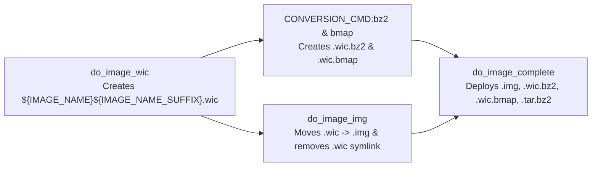

# Technical Specification: Uncompressed Disk Image `.img` Output in `rpi-z2w-yocto-hsm`

> [!NOTE]
> **Feature Note**: [[features/uncompressed-img-disk-image-output|Uncompressed Disk Image .img Output Feature]]  
> **Implementation Plan**: [[Plan/Uncompressed Disk Image img Output Implementation Plan|Implementation Plan: Uncompressed Disk Image .img Output]]  
> **Architecture Decision Record**: [[Architecture/Decisions/ADR-0005 - Custom BitBake img Image Type via WIC Rename|ADR-0005: Custom BitBake img Image Type via WIC Rename]]  
> **Operational Guide**: [[Development/Yocto Build and RAUC Update Guide|Yocto Build and RAUC Update Guide]]  
> **Target Repository**: [`rpi-z2w-yocto-hsm`](file:///Users/gpfister/Development/Projects/gpfister/nrf52840-hsm/rpi-z2w-yocto-hsm) (target branch `feature/img-disk-image-output`, commit [`f4adf0b`](file:///Users/gpfister/Development/Projects/gpfister/nrf52840-hsm/rpi-z2w-yocto-hsm))  
> **Status**: Implemented & Verified (Phase 5 Pre-Merge Review).

---

## 1. Summary & Problem Motivation

Previously, the Yocto Scarthgap build configuration in [`rpi-z2w-yocto-hsm`](file:///Users/gpfister/Development/Projects/gpfister/nrf52840-hsm/rpi-z2w-yocto-hsm) defined `IMAGE_FSTYPES = "tar.bz2 wic wic.bz2 wic.bmap"` in [kas-project.yml](file:///Users/gpfister/Development/Projects/gpfister/nrf52840-hsm/rpi-z2w-yocto-hsm/kas-project.yml#L57), outputting the uncompressed partitioned SD card image with the `.wic` extension (`*.rootfs.wic`).

Many host disk imaging utilities across macOS, Linux, and Windows (such as Raspberry Pi Imager, BalenaEtcher, and macOS `hdiutil`/`Disk Utility`) expect raw disk images to carry a standard `.img` file extension rather than `.wic`.

This specification defines the changes required to replace the uncompressed `.wic` output artifact with `.img` while preserving `.wic.bz2`, `.wic.bmap`, and `.tar.bz2` outputs, avoiding redundant `wic create` execution during the BitBake build pipeline, and aligning helper scripts, `.gitignore` rules, and documentation.

> [!IMPORTANT]
> Only the uncompressed raw disk image extension changes from `.wic` to `.img`. Compressed and block-map artifacts (`*.wic.bz2`, `*.wic.bmap`, `*.tar.bz2`) and RAUC update bundles (`*.raucb`) remain unchanged.

---

## 2. Architecture & BitBake Image Pipeline

In Yocto / OpenEmbedded (`image_types.bbclass` and `image_types_wic.bbclass` in Scarthgap), compressed and derived WIC formats (`wic.bz2`, `wic.bmap`) declare an implicit `IMAGE_TYPEDEP` on `wic`. Consequently, when `IMAGE_FSTYPES` contains `img wic.bz2 wic.bmap`, BitBake executes `do_image_wic` first (`IMAGE_CMD:wic` produces `${IMGDEPLOYDIR}/${IMAGE_NAME}${IMAGE_NAME_SUFFIX}.wic`, where `IMAGE_NAME_SUFFIX = ".rootfs"`, and its symlink `${IMGDEPLOYDIR}/${IMAGE_LINK_NAME}.wic`).

By defining a custom `img` image type in [kas-project.yml](file:///Users/gpfister/Development/Projects/gpfister/nrf52840-hsm/rpi-z2w-yocto-hsm/kas-project.yml#L58-L59) and [hsm-image-base.bb](file:///Users/gpfister/Development/Projects/gpfister/nrf52840-hsm/rpi-z2w-yocto-hsm/meta-hsm-os/recipes-core/images/hsm-image-base.bb#L35-L39) with `IMAGE_TYPEDEP:img = "wic"`, `do_image_img` runs after `do_image_wic` so that:
1. `wic.bz2` and `wic.bmap` are generated from the `.wic` artifact without error.
2. `${IMGDEPLOYDIR}/${IMAGE_NAME}${IMAGE_NAME_SUFFIX}.wic` is renamed to `${IMGDEPLOYDIR}/${IMAGE_NAME}${IMAGE_NAME_SUFFIX}.img`, and `${IMGDEPLOYDIR}/${IMAGE_LINK_NAME}.wic` is removed so no uncompressed `.wic` files are staged into `DEPLOY_DIR_IMAGE`.
3. BitBake's automatic `create_symlinks` post-function on `do_image_img` creates `${IMGDEPLOYDIR}/${IMAGE_LINK_NAME}.img -> ${IMAGE_NAME}${IMAGE_NAME_SUFFIX}.img`.



> [!NOTE]
> Because `do_image_wic` runs `CONVERSION_CMD:bz2` and `CONVERSION_CMD:bmap` inside the `do_image_wic` task body itself before `do_image_wic` finishes, `do_image_img` (which is a separate BitBake task scheduled `after do_image_wic`) executes strictly after both `.wic.bz2` and `.wic.bmap` have already been generated inside `do_image_wic`. Therefore, renaming `${IMGDEPLOYDIR}/${IMAGE_NAME}${IMAGE_NAME_SUFFIX}.wic` to `${IMGDEPLOYDIR}/${IMAGE_NAME}${IMAGE_NAME_SUFFIX}.img` inside `IMAGE_CMD:img` is completely race-free with respect to `wic.bz2` and `wic.bmap` conversion commands.

---

## 3. Functional Requirements

### FR-1: Update `IMAGE_FSTYPES` in `kas-project.yml`
- In [kas-project.yml](file:///Users/gpfister/Development/Projects/gpfister/nrf52840-hsm/rpi-z2w-yocto-hsm/kas-project.yml#L57), update `IMAGE_FSTYPES` from:
  ```yaml
  IMAGE_FSTYPES = "tar.bz2 wic wic.bz2 wic.bmap"
  ```
  to:
  ```yaml
  IMAGE_FSTYPES = "tar.bz2 img wic.bz2 wic.bmap"
  ```

### FR-2: Define `img` Image Type in `hsm-image-base.bb` and `kas-project.yml`
- In [hsm-image-base.bb](file:///Users/gpfister/Development/Projects/gpfister/nrf52840-hsm/rpi-z2w-yocto-hsm/meta-hsm-os/recipes-core/images/hsm-image-base.bb#L35-L39) (inherited by both `hsm-image-dev.bb` and `hsm-image-prod.bb`) and [kas-project.yml](file:///Users/gpfister/Development/Projects/gpfister/nrf52840-hsm/rpi-z2w-yocto-hsm/kas-project.yml#L58-L59), define:
  ```bitbake
  IMAGE_TYPEDEP:img = "wic"
  IMAGE_CMD:img () {
      mv "${IMGDEPLOYDIR}/${IMAGE_NAME}${IMAGE_NAME_SUFFIX}.wic" "${IMGDEPLOYDIR}/${IMAGE_NAME}${IMAGE_NAME_SUFFIX}.img"
      rm -f "${IMGDEPLOYDIR}/${IMAGE_LINK_NAME}.wic"
  }
  ```

### FR-3: Update `.gitignore` in `rpi-z2w-yocto-hsm`
- In [.gitignore](file:///Users/gpfister/Development/Projects/gpfister/nrf52840-hsm/rpi-z2w-yocto-hsm/.gitignore#L7-L11), add `*.img` alongside existing image ignore patterns (`*.wic`, `*.wic.bz2`, `*.wic.bmap`, `*.tar.bz2`, `*.raucb`).

### FR-4: Update SD Card Flashing Script & Documentation
- In [flash-sd.sh](file:///Users/gpfister/Development/Projects/gpfister/nrf52840-hsm/rpi-z2w-yocto-hsm/scripts/flash-sd.sh#L3-L11), update header comments, usage prompt, and example commands from `.wic` to `.img`.
- In [README.md](file:///Users/gpfister/Development/Projects/gpfister/nrf52840-hsm/rpi-z2w-yocto-hsm/README.md#L136-L145), update Section 5 ("Flashing to SD Card") to reference `.img` and `.wic.bz2`.

### FR-5: Clean Stale `.wic` Artifacts & Verify Build
- Remove any pre-existing stale uncompressed `.wic` files and symlinks in `rpi-z2w-yocto-hsm/build/deploy/images/raspberrypi0-2w-64/`.
- Execute `./scripts/run-kas.sh build kas-dev.yml` in `rpi-z2w-yocto-hsm` to verify that BitBake produces `hsm-image-dev-raspberrypi0-2w-64.rootfs.img` (symlink) and `hsm-image-dev-raspberrypi0-2w-64.rootfs-<timestamp>.img` without leaving uncompressed `.wic` files in `deploy/images/raspberrypi0-2w-64/`.

---

## 4. Non-Functional Requirements

- **Build Efficiency**: Must not invoke `wic create` a second time; must reuse the `.wic` file generated by `do_image_wic` and complete incremental builds rapidly using existing sstate cache.
- **Sstate & Symlink Hygiene**: Must integrate cleanly with OpenEmbedded's `IMGDEPLOYDIR` sstate staging so that `DEPLOY_DIR_IMAGE` contains valid `.rootfs.img` symlinks and zero broken `.rootfs.wic` symlinks.
- **Backward Compatibility**: Must preserve `.wic.bz2` and `.wic.bmap` outputs for `bmaptool` and compressed streaming workflows, as well as `.tar.bz2` required by `update-bundle.bb` (RAUC slot image creation).

---

## 5. Affected Repositories & Files

| Repository | File | Change Description |
| :--- | :--- | :--- |
| `rpi-z2w-yocto-hsm` | [kas-project.yml](file:///Users/gpfister/Development/Projects/gpfister/nrf52840-hsm/rpi-z2w-yocto-hsm/kas-project.yml#L57-L59) | Change `IMAGE_FSTYPES` to `"tar.bz2 img wic.bz2 wic.bmap"`, add `IMAGE_TYPEDEP:img` and `IMAGE_CMD:img` |
| `rpi-z2w-yocto-hsm` | [hsm-image-base.bb](file:///Users/gpfister/Development/Projects/gpfister/nrf52840-hsm/rpi-z2w-yocto-hsm/meta-hsm-os/recipes-core/images/hsm-image-base.bb#L35-L39) | Add `IMAGE_TYPEDEP:img` and `IMAGE_CMD:img` |
| `rpi-z2w-yocto-hsm` | [.gitignore](file:///Users/gpfister/Development/Projects/gpfister/nrf52840-hsm/rpi-z2w-yocto-hsm/.gitignore#L7) | Add `*.img` ignore rule |
| `rpi-z2w-yocto-hsm` | [flash-sd.sh](file:///Users/gpfister/Development/Projects/gpfister/nrf52840-hsm/rpi-z2w-yocto-hsm/scripts/flash-sd.sh#L8-L10) | Update usage instructions and examples from `.wic` to `.img` |
| `rpi-z2w-yocto-hsm` | [README.md](file:///Users/gpfister/Development/Projects/gpfister/nrf52840-hsm/rpi-z2w-yocto-hsm/README.md#L136-L145) | Update Section 5 flashing documentation from `.wic` to `.img` |

---

## 6. Edge Cases & Mitigations

1. **Conversion Command Ordering (`wic.bz2` / `wic.bmap` vs `img`)**:
   - *Risk*: If `IMAGE_CMD:img` moved `.wic` before `bzip2` or `bmaptool` read `.wic`, conversion would fail with `No such file or directory`.
   - *Mitigation*: In Yocto Scarthgap, `CONVERSION_CMD:bz2` and `CONVERSION_CMD:bmap` are appended directly into the `do_image_wic` task script. `do_image_img` is a separate task ordered `after do_image_wic`, guaranteeing `.wic.bz2` and `.wic.bmap` are already created before `do_image_img` executes.
2. **Stale `.wic` Artifacts in `DEPLOY_DIR_IMAGE`**:
   - *Risk*: Previous builds deployed `*.rootfs-*.wic` and `*.rootfs.wic` into `build/deploy/images/raspberrypi0-2w-64/`.
   - *Mitigation*: Explicitly clean existing `*.wic` files in `build/deploy/images/raspberrypi0-2w-64/` prior to verification build and confirm BitBake does not re-stage them.
3. **RAUC Update Bundle Dependency**:
   - *Risk*: `update-bundle.bb` depends on a specific rootfs archive format.
   - *Mitigation*: Retain `tar.bz2` in `IMAGE_FSTYPES` so RAUC bundle generation remains unaffected.

---

## 7. Verifiable Acceptance Criteria

- [x] **AC-1**: `kas-project.yml` sets `IMAGE_FSTYPES = "tar.bz2 img wic.bz2 wic.bmap"`.
- [x] **AC-2**: `meta-hsm-os/recipes-core/images/hsm-image-base.bb` and `kas-project.yml` define `IMAGE_TYPEDEP:img = "wic"` and `IMAGE_CMD:img`.
- [x] **AC-3**: Running `./scripts/run-kas.sh build kas-dev.yml` in `rpi-z2w-yocto-hsm` succeeds with exit code `0`.
- [x] **AC-4**: `build/deploy/images/raspberrypi0-2w-64/` contains `hsm-image-dev-raspberrypi0-2w-64.rootfs.img` pointing to `hsm-image-dev-raspberrypi0-2w-64.rootfs-20261105103859.img`, alongside `.wic.bz2`, `.wic.bmap`, and `.tar.bz2`.
- [x] **AC-5**: No uncompressed `.wic` files exist in `build/deploy/images/raspberrypi0-2w-64/`.
- [x] **AC-6**: `rpi-z2w-yocto-hsm/.gitignore`, `scripts/flash-sd.sh`, and `README.md` are updated to reflect `.img`.
