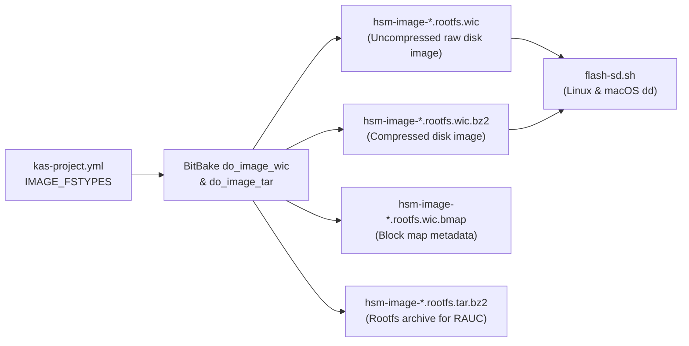

# Technical Specification: Uncompressed WIC Image Generation & SD Flash Tooling Alignment

> [!NOTE]
> **Feature Note**: [[features/uncompressed-wic-image-and-sd-flash-tooling|Uncompressed WIC Image Generation & SD Flash Tooling Alignment Feature]]  
> **Implementation Plan**: [[Plan/Uncompressed WIC Image Generation and SD Flash Tooling Implementation Plan|Implementation Plan: Uncompressed WIC Image Generation & SD Flash Tooling]]  
> **Operational Guide**: [[Development/Yocto Build and RAUC Update Guide|Yocto Build and RAUC Update Guide]]  
> **Target Repository**: [`rpi-z2w-yocto-hsm`](file:///Users/gpfister/Development/Projects/gpfister/nrf52840-hsm/rpi-z2w-yocto-hsm) (`main`, commit `b99899f`)  
> **Status**: Merged to `main` (Phase 6 Post-Merge Complete).

---

## 1. Summary & Problem Motivation

Currently, the Yocto Project 5.0 LTS (`scarthgap`) build configuration in [kas-project.yml](file:///Users/gpfister/Development/Projects/gpfister/nrf52840-hsm/rpi-z2w-yocto-hsm/kas-project.yml#L57) defines `IMAGE_FSTYPES = "tar.bz2 wic.bz2 wic.bmap"`. During image packaging, OpenEmbedded/BitBake generates an uncompressed `.wic` artifact and compresses it into `.wic.bz2`, removing or not retaining the standalone `.wic` artifact in `DEPLOY_DIR_IMAGE` (`build/deploy/images/<machine>/`).

Many SD card flashing workflows (such as Raspberry Pi Imager, BalenaEtcher, `bmaptool`, or direct `dd` without on-the-fly decompression) benefit from having the uncompressed `.wic` disk image directly available alongside `.wic.bz2`, `.wic.bmap`, and `.tar.bz2`.

Additionally, two inconsistencies exist in the SD card flashing workflow:
1. **Stale Deploy Path References**: Both [flash-sd.sh](file:///Users/gpfister/Development/Projects/gpfister/nrf52840-hsm/rpi-z2w-yocto-hsm/scripts/flash-sd.sh#L9) and [README.md](file:///Users/gpfister/Development/Projects/gpfister/nrf52840-hsm/rpi-z2w-yocto-hsm/README.md#L140) reference `build/tmp/deploy/images/...` in their usage examples, whereas [kas-project.yml](file:///Users/gpfister/Development/Projects/gpfister/nrf52840-hsm/rpi-z2w-yocto-hsm/kas-project.yml#L59) sets `DEPLOY_DIR = "${TOPDIR}/deploy"`, placing artifacts in `build/deploy/images/<machine>/`.
2. **macOS `dd` Compatibility**: [flash-sd.sh](file:///Users/gpfister/Development/Projects/gpfister/nrf52840-hsm/rpi-z2w-yocto-hsm/scripts/flash-sd.sh#L41-L50) invokes `dd` with GNU coreutils flags (`bs=4M conv=fsync`), which fail on macOS BSD `dd` (where lowercase `bs=4m` is required and `conv=fsync` is unsupported).

---

## 2. Architecture & Build Pipeline Flow



---

## 3. Functional Requirements

### FR-1: Uncompressed WIC Image Emission in Kas Configuration
- Update `IMAGE_FSTYPES` in [kas-project.yml](file:///Users/gpfister/Development/Projects/gpfister/nrf52840-hsm/rpi-z2w-yocto-hsm/kas-project.yml#L57) from:
  ```bitbake
  IMAGE_FSTYPES = "tar.bz2 wic.bz2 wic.bmap"
  ```
  to:
  ```bitbake
  IMAGE_FSTYPES = "tar.bz2 wic wic.bz2 wic.bmap"
  ```
- Because neither [kas-dev.yml](file:///Users/gpfister/Development/Projects/gpfister/nrf52840-hsm/rpi-z2w-yocto-hsm/kas-dev.yml), [kas-prod.yml](file:///Users/gpfister/Development/Projects/gpfister/nrf52840-hsm/rpi-z2w-yocto-hsm/kas-prod.yml), nor the image recipes (`hsm-image-base.bb`, `hsm-image-dev.bb`, `hsm-image-prod.bb`) override `IMAGE_FSTYPES`, this setting applies globally across all image targets and machines.

### FR-2: Cross-Platform `dd` Support & Path Alignment in `flash-sd.sh`
- Update the usage hint in [flash-sd.sh](file:///Users/gpfister/Development/Projects/gpfister/nrf52840-hsm/rpi-z2w-yocto-hsm/scripts/flash-sd.sh#L8-L10) to reference `build/deploy/images/raspberrypi0-2w-64/hsm-image-prod-raspberrypi0-2w-64.rootfs.wic` (and `.wic.bz2`).
- Detect host OS (`uname -s`) in [flash-sd.sh](file:///Users/gpfister/Development/Projects/gpfister/nrf52840-hsm/rpi-z2w-yocto-hsm/scripts/flash-sd.sh#L37-L52) to pass platform-appropriate `dd` arguments:
  - **Darwin (macOS)**: `bs=4m status=progress` (relying on the subsequent `sync` command for flushing).
  - **Linux**: `bs=4M status=progress conv=fsync`.

### FR-3: Documentation Alignment in `README.md`
- Update Section 5 ("Flashing to SD Card") in [README.md](file:///Users/gpfister/Development/Projects/gpfister/nrf52840-hsm/rpi-z2w-yocto-hsm/README.md#L134-L142) to show the accurate `build/deploy/images/raspberrypi0-2w-64/` path and demonstrate flashing both the uncompressed `.wic` image and compressed `.wic.bz2` image.

### FR-4: Build Verification (`make yocto-build-dev`)
- Execute `make yocto-build-dev` from the workspace root (or `make build-dev` in `rpi-z2w-yocto-hsm`) to run the Yocto build and verify that `hsm-image-dev-raspberrypi0-2w-64.rootfs.wic` (both symlink and timestamped `.wic` file) is emitted alongside `.wic.bz2`, `.wic.bmap`, and `.tar.bz2` in `rpi-z2w-yocto-hsm/build/deploy/images/raspberrypi0-2w-64/`.

---

## 4. Non-Functional Requirements

- **Backward Compatibility**: Existing `.tar.bz2` (required by RAUC bundle recipes), `.wic.bz2`, and `.wic.bmap` artifacts must remain intact and unaffected.
- **Safety & Reliability**: `flash-sd.sh` must preserve `set -euo pipefail`, file existence checks, device node validation warnings, and the interactive `yes` confirmation gate before executing `dd`.
- **Build Cache Reuse**: Adding `wic` to `IMAGE_FSTYPES` must leverage the existing BitBake sstate-cache and only re-run image generation tasks (`do_image_wic`, `do_image_complete`) without rebuilding kernel or user-space packages.

---

## 5. Affected Repositories & Files

| Repository | File | Change Summary |
| :--- | :--- | :--- |
| `rpi-z2w-yocto-hsm` | [kas-project.yml](file:///Users/gpfister/Development/Projects/gpfister/nrf52840-hsm/rpi-z2w-yocto-hsm/kas-project.yml#L57) | Add `wic` to `IMAGE_FSTYPES` (`"tar.bz2 wic wic.bz2 wic.bmap"`) |
| `rpi-z2w-yocto-hsm` | [scripts/flash-sd.sh](file:///Users/gpfister/Development/Projects/gpfister/nrf52840-hsm/rpi-z2w-yocto-hsm/scripts/flash-sd.sh#L8-L51) | Fix example path to `build/deploy/images/...` and add Darwin vs. Linux `dd` parameter handling |
| `rpi-z2w-yocto-hsm` | [README.md](file:///Users/gpfister/Development/Projects/gpfister/nrf52840-hsm/rpi-z2w-yocto-hsm/README.md#L134-L142) | Update SD flashing example paths to `build/deploy/images/...` and include `.wic` example |
| `nrf52840-hsm-obsidian` | Obsidian Vault (via `@coding-document`) | Document specification, implementation plan, and operational guides |

---

## 6. Edge Cases & Mitigations

| Edge Case | Impact | Mitigation |
| :--- | :--- | :--- |
| **BitBake deletes intermediate `.wic` when only `wic.bz2` is specified** | Previously caused `.wic` to be removed after bzip2 compression | Explicitly listing `wic` alongside `wic.bz2` in `IMAGE_FSTYPES` instructs BitBake to retain both the raw `.wic` file/symlink and the compressed `.wic.bz2` artifact in `DEPLOY_DIR_IMAGE`. |
| **macOS BSD `dd` rejects `bs=4M` and `conv=fsync`** | `flash-sd.sh` fails immediately when run on a macOS host | Branch on `uname -s`: use `bs=4m status=progress` on `Darwin` and `bs=4M status=progress conv=fsync` on `Linux`. |
| **Symlink vs. regular file check (`-f`) in `flash-sd.sh`** | Yocto creates symlinks (`hsm-image-dev-raspberrypi0-2w-64.rootfs.wic` $\rightarrow$ `hsm-image-dev-raspberrypi0-2w-64.rootfs-<timestamp>.wic`) | In bash, `[[ -f "${IMAGE_PATH}" ]]` follows symlinks and evaluates to true as long as the target regular file exists. |

---

## 7. Verifiable Acceptance Criteria

- [x] **AC-1**: [kas-project.yml](file:///Users/gpfister/Development/Projects/gpfister/nrf52840-hsm/rpi-z2w-yocto-hsm/kas-project.yml#L57) sets `IMAGE_FSTYPES = "tar.bz2 wic wic.bz2 wic.bmap"`.
- [x] **AC-2**: [flash-sd.sh](file:///Users/gpfister/Development/Projects/gpfister/nrf52840-hsm/rpi-z2w-yocto-hsm/scripts/flash-sd.sh) passes `bash -n` syntax validation, displays `build/deploy/images/...` in its usage message, and uses OS-appropriate `dd` flags for macOS (`Darwin`) and Linux.
- [x] **AC-3**: [README.md](file:///Users/gpfister/Development/Projects/gpfister/nrf52840-hsm/rpi-z2w-yocto-hsm/README.md#L134-L142) references `build/deploy/images/raspberrypi0-2w-64/` for both `.wic` and `.wic.bz2` flashing commands.
- [x] **AC-4**: Running `make yocto-build-dev` succeeds with exit code `0` and produces all four artifact types in `rpi-z2w-yocto-hsm/build/deploy/images/raspberrypi0-2w-64/`:
  - `hsm-image-dev-raspberrypi0-2w-64.rootfs.wic` $\rightarrow$ `hsm-image-dev-raspberrypi0-2w-64.rootfs-20261105101217.wic` (**1.6 GB**)
  - `hsm-image-dev-raspberrypi0-2w-64.rootfs.wic.bz2` $\rightarrow$ `hsm-image-dev-raspberrypi0-2w-64.rootfs-20261105101217.wic.bz2` (**168 MB**)
  - `hsm-image-dev-raspberrypi0-2w-64.rootfs.wic.bmap` $\rightarrow$ `hsm-image-dev-raspberrypi0-2w-64.rootfs-20261105101217.wic.bmap` (**8.0 KB**)
  - `hsm-image-dev-raspberrypi0-2w-64.rootfs.tar.bz2` $\rightarrow$ `hsm-image-dev-raspberrypi0-2w-64.rootfs-20261105101217.tar.bz2` (**73 MB**)
