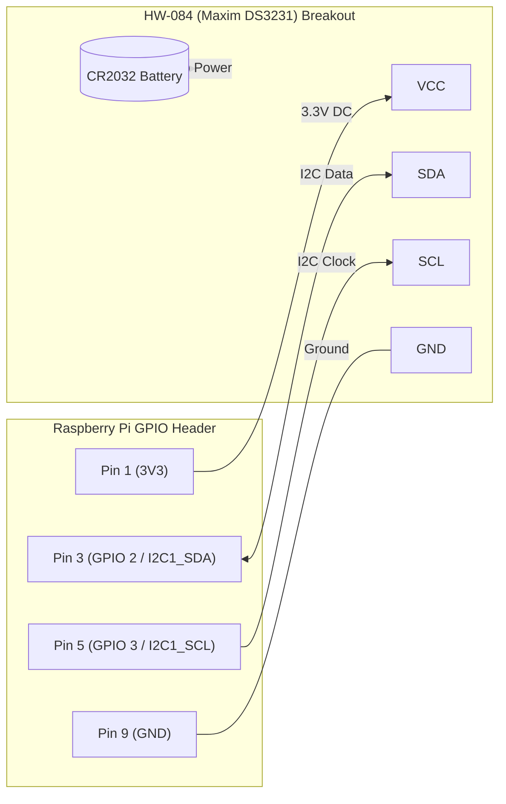
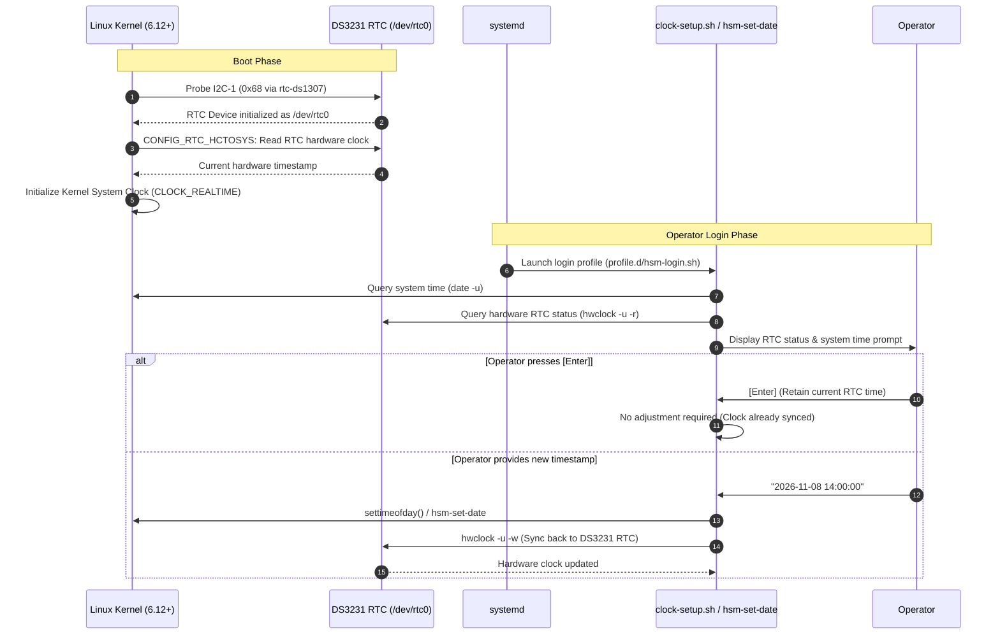

# Technical Specification: Yocto 6.1 (Blacksail) Upgrade, HW-084 (DS3231) RTC Integration & Workspace Distclean

**Document ID**: `SPEC-2026-YOCTO-BLACKSAIL-RTC`  
**Target Systems**: [`hsm-yocto-offgrid-rpi`](file:///Users/gpfister/Development/Projects/gpfister/nrf52840-hsm/hsm-yocto-offgrid-rpi), Root Workspace  
**Status**: APPROVED  
**Author**: `coding-specify`  

---

## 1. Executive Summary & Problem Motivation

The **nRF52840 Hardware Security Module (HSM)** ecosystem relies on an ultra-secure, air-gapped embedded Linux operating system running on 64-bit Raspberry Pi hardware ([`hsm-yocto-offgrid-rpi`](file:///Users/gpfister/Development/Projects/gpfister/nrf52840-hsm/hsm-yocto-offgrid-rpi)). Because this system operates in strict physical isolation—with all network hardware (Wi-Fi, Bluetooth, Ethernet) disabled at the kernel and device tree levels and packet filtering dropping 100% of traffic—it cannot utilize Network Time Protocol (NTP) daemons to maintain calendar time.

Accurate system time is paramount for HSM cryptographic operations, including X.509 certificate validation, audit log integrity, RAUC dual-slot update expiration verification, and PKCS#11 key generation metadata.

This specification defines three interconnected enhancements:
1. **Yocto 6.1 (Blacksail) Upgrade & Modernization**: Upgrading layer manifests to Yocto 6.1 (Blacksail), aligning BitBake to branch 2.20, enforcing layer compatibility overrides for upstream master branches, refactoring deprecated syntax (`*_OPTED_OUT` removal, strict `UNPACKDIR` usage), and verifying Linux kernel 6.12+ compatibility for the out-of-tree `nrf52840-hsm-kmod` driver.
2. **HW-084 (DS3231) Real-Time Clock (RTC) Integration**: Integrating the battery-backed DS3231 high-precision RTC module over hardware I2C-1, configuring kernel drivers (`CONFIG_RTC_DRV_DS1307`), Device Tree overlays (`i2c-rtc,ds3231`), module autoloading, and enhancing user-space boot restoration and login synchronization (`clock-setup.sh`, `hsm-set-date`).
3. **Comprehensive Build Cleanliness (`make distclean`)**: Implementing atomic workspace purge mechanisms in both `hsm-yocto-offgrid-rpi/Makefile` and root `Makefile` to prune transient BitBake artifacts, downloaded archives, shared state caches, Kas-cloned layer repositories, and the containerized tmpfs volume (`rpi_yocto_hsm_tmp`).

---

## 2. Architecture & Hardware Pinout

### 2.1 HW-084 (DS3231) Hardware Interconnect

The HW-084 RTC breakout board connects directly to the Raspberry Pi 40-pin GPIO header via the dedicated primary I2C bus (I2C-1):

| HW-084 (DS3231) Pin | RPi 40-Pin Header Physical Pin | BCM GPIO / Function | Signal Type |
| :--- | :--- | :--- | :--- |
| **VCC** | **Pin 1** | 3V3 Power | 3.3V DC Power Supply |
| **GND** | **Pin 9** (or Pin 6 / Pin 14) | Ground | 0V Reference |
| **SDA** | **Pin 3** | GPIO 2 / I2C1_SDA | Serial Data (I2C-1) |
| **SCL** | **Pin 5** | GPIO 3 / I2C1_SCL | Serial Clock (I2C-1) |



### 2.2 Time Synchronization Lifecycle



---

## 3. Functional Requirements

### 3.1 Yocto 6.1 (Blacksail) Upgrade & Kas Configuration

- **FR-1.1**: The Kas configuration [`kas-project.yml`](file:///Users/gpfister/Development/Projects/gpfister/nrf52840-hsm/hsm-yocto-offgrid-rpi/kas-project.yml) shall declare:
  - `openembedded-core`: tracking branch `blacksail`.
  - `bitbake`: tracking branch `2.20`.
  - `meta-yocto`: tracking branch `blacksail`.
  - `meta-openembedded`: tracking branch `blacksail`.
  - `meta-raspberrypi`: tracking branch `master`.
  - `meta-rauc`: tracking branch `master`.
- **FR-1.2**: Layer compatibility for upstream master branches without declared `blacksail` support shall be enforced via `local_conf_header.base_settings`:
  ```bitbake
  LAYERSERIES_COMPAT_raspberrypi:append = " blacksail"
  LAYERSERIES_COMPAT_rauc:append = " blacksail"
  ```
- **FR-1.3**: Deprecated Yocto variables must be completely eliminated:
  - Replace `DISTRO_FEATURES_OPTED_OUT += "sysvinit"` with `DISTRO_FEATURES:remove = "sysvinit"`.
  - Replace `MACHINE_FEATURES_OPTED_OUT += "bluetooth wifi"` with `MACHINE_FEATURES:remove = "bluetooth wifi"`.
- **FR-1.4**: All recipes in `meta-hsm-os` must use `${UNPACKDIR}` for source file access in `do_compile` and `do_install` tasks to ensure compliance with BitBake 2.20 / Yocto 6.1 unpack directory separation.
- **FR-1.5**: Out-of-tree kernel module `nrf52840-hsm-kmod` must maintain compatibility with Linux 6.12+ (verifying `class_create(DRIVER_NAME)` and USB interface binding).

### 3.2 Linux Kernel Configuration & Device Tree Overlays

- **FR-2.1**: The kernel configuration fragment [`hardened.cfg`](file:///Users/gpfister/Development/Projects/gpfister/nrf52840-hsm/hsm-yocto-offgrid-rpi/meta-hsm-os/recipes-kernel/linux/files/hardened.cfg) shall enable:
  - `CONFIG_RTC_CLASS=y`: RTC subsystem support.
  - `CONFIG_RTC_DRV_DS1307=y`: Driver for DS1307 / DS3231 / DS1337 chips.
  - `CONFIG_RTC_HCTOSYS=y`: Synchronize system clock from hardware RTC on kernel boot.
  - `CONFIG_RTC_HCTOSYS_DEVICE="rtc0"`: Designate default RTC device.
  - `CONFIG_I2C=y`: Linux I2C core subsystem.
  - `CONFIG_I2C_CHARDEV=y`: User-space `/dev/i2c-*` character device interface.
  - `CONFIG_I2C_BCM2835=y`: Broadcom BCM2835 / BCM2711 / BCM2712 hardware I2C controller.
- **FR-2.2**: The Raspberry Pi firmware configuration in [`rpi-config_%.bbappend`](file:///Users/gpfister/Development/Projects/gpfister/nrf52840-hsm/hsm-yocto-offgrid-rpi/meta-hsm-os/recipes-bsp/bootfiles/rpi-config_%.bbappend) shall enable I2C hardware and load the RTC device tree overlay:
  - `ENABLE_I2C = "1"`
  - `dtoverlay=i2c-rtc,ds3231` appended to `RPI_EXTRA_CONFIG`.
- **FR-2.3**: Kernel module autoload configuration must ensure `i2c-dev` and `rtc-ds1307` are loaded automatically during early boot if compiled as modules.

### 3.3 Air-Gapped Time Synchronization & User-Space Tooling

- **FR-3.1**: Include diagnostic utility `i2c-tools` in [`hsm-image-base.bb`](file:///Users/gpfister/Development/Projects/gpfister/nrf52840-hsm/hsm-yocto-offgrid-rpi/meta-hsm-os/recipes-core/images/hsm-image-base.bb) to enable hardware verification (`i2cdetect -y 1`).
- **FR-3.2**: Refactor [`clock-setup.sh`](file:///Users/gpfister/Development/Projects/gpfister/nrf52840-hsm/hsm-yocto-offgrid-rpi/meta-hsm-os/recipes-core/init-wizard/files/clock-setup.sh):
  - Detect `/dev/rtc0` presence and read RTC timestamp via `hwclock -u -r`.
  - Display informative banner showing system time and RTC hardware time status.
  - If RTC is present and synchronized, inform operator that pressing `[Enter]` keeps the RTC-backed clock.
  - If manual date/time input is provided, set system clock and immediately update hardware RTC via `hwclock -u -w` (or updated `hsm-set-date`).
- **FR-3.3**: Update [`hsm-set-date.c`](file:///Users/gpfister/Development/Projects/gpfister/nrf52840-hsm/hsm-yocto-offgrid-rpi/meta-hsm-os/recipes-core/init-wizard/files/hsm-set-date.c):
  - Allow non-privileged operators to set both kernel system time (`settimeofday()`) and synchronize to hardware RTC device (`/dev/rtc0` ioctl `RTC_SET_TIME` or `hwclock -u -w` execution) in a single transactional step.

### 3.4 Build Cleanliness & `make distclean` Automation

- **FR-4.1**: In [`hsm-yocto-offgrid-rpi/Makefile`](file:///Users/gpfister/Development/Projects/gpfister/nrf52840-hsm/hsm-yocto-offgrid-rpi/Makefile):
  - Add target `distclean` that performs a full workspace purge:
    - Purges BitBake build artifacts (`rm -rf $(BUILD_DIR)`).
    - Purges shared state cache (`rm -rf sstate-cache`).
    - Purges source downloads cache (`rm -rf downloads`).
    - Removes checked-out Kas layer repositories: `bitbake`, `openembedded-core`, `meta-yocto`, `meta-openembedded`, `meta-raspberrypi`, `meta-rauc`.
    - Deletes container tmpfs volume: `$(CONTAINER_ENGINE) volume rm -f rpi_yocto_hsm_tmp 2>/dev/null || true`.
  - Expose `distclean` in `help` banner.
- **FR-4.2**: In the root [`Makefile`](file:///Users/gpfister/Development/Projects/gpfister/nrf52840-hsm/Makefile):
  - Add `yocto-distclean` target forwarding to `$(YOCTO_DIR)` `distclean`.
  - Hook `yocto-distclean` into the root `distclean` target pipeline:
    ```makefile
    distclean: firmware-distclean cli-clean libpkcs11-clean yocto-distclean
    ```
  - Document `yocto-distclean` in root `make help`.

---

## 4. Non-Functional Requirements

- **NFR-1 (Security & Isolation)**: Hardware RTC integration must strictly operate over local I2C bus lines without introducing any network or remote communication stack.
- **NFR-2 (Privilege Separation)**: SUID binary `hsm-set-date` must validate all input strictly against `YYYY-MM-DD HH:MM:SS` and restrict system modifications strictly to clock adjustment, mitigating potential privilege escalation.
- **NFR-3 (Boot Latency)**: Hardware RTC probing and system clock synchronization (`CONFIG_RTC_HCTOSYS`) must execute during early kernel initialization and incur less than 50 ms latency.
- **NFR-4 (Build Idempotency)**: Executing `make yocto-distclean` (or `make -C hsm-yocto-offgrid-rpi distclean`) must completely restore the sub-repository to a clean git clone state without leaving orphaned Docker volumes or cache residues.

---

## 5. Subsystem Cross-References

- **Implementation Plan**: [[Plan/Yocto 6.1 Blacksail Upgrade, HW-084 DS3231 RTC Integration and Workspace Distclean Implementation Plan|Implementation Plan]]
- **Feature Specification**: [[features/yocto-blacksail-rtc-and-distclean|Feature Specification]]
- **Hardware RTC Interconnect ADR**: [[Architecture/Decisions/ADR-0021 - Hardware I2C-1 Bus Mapping for HW-084 DS3231 RTC Module|ADR-0021]]
- **Login Synchronization ADR**: [[Architecture/Decisions/ADR-0022 - RTC-Aware Informational Login Prompt with Transactional Hardware Clock Sync|ADR-0022]]
- **Distclean Container ADR**: [[Architecture/Decisions/ADR-0023 - Container Volume and Workspace Cache Purging during Distclean|ADR-0023]]
- **Time Synchronization Architecture**: [[Architecture/08 - Air-Gapped Time Synchronization and Hardware RTC Architecture|08 - Air-Gapped Time Synchronization and Hardware RTC Architecture]]
- **Build Lifecycle Architecture**: [[Architecture/Build Lifecycle and Workspace Clean Routines|Build Lifecycle and Workspace Clean Routines]]
