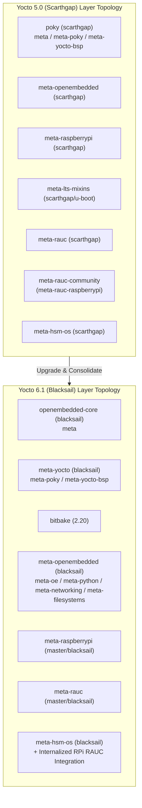

Plan: [[Plan/Yocto 6.1 Blacksail Upgrade Implementation Plan]] · ADRs: [[Architecture/Decisions/ADR-0007 - Decompose Poky into openembedded-core meta-yocto and bitbake|ADR-0007]], [[Architecture/Decisions/ADR-0008 - Internalize RPi RAUC Integration into meta-hsm-os|ADR-0008]], [[Architecture/Decisions/ADR-0009 - Kernel Driver llseek Version Guard and UNPACKDIR Migration|ADR-0009]]

# Specification: Upgrade `rpi-z2w-yocto-hsm` to Yocto Project 6.1 (Blacksail)

> [!IMPORTANT]
> This specification defines the architectural and implementation requirements to upgrade the air-gapped embedded Linux OS sub-repository ([rpi-z2w-yocto-hsm](file:///Users/gpfister/Development/Projects/gpfister/nrf52840-hsm/rpi-z2w-yocto-hsm)) from **Yocto Project 5.0 LTS (`scarthgap`)** to **Yocto Project 6.1 (`blacksail`, BitBake `2.20`)**.

---

## 1. Summary & Problem Motivation

The `rpi-z2w-yocto-hsm` sub-repository builds a hardened, air-gapped embedded Linux OS for 64-bit Raspberry Pi platforms (`raspberrypi0-2w-64`, `raspberrypi3-64`, `raspberrypi4-64`, `raspberrypi5`) hosting the nRF52840 USB Dongle HSM. Currently, the project targets Yocto Project 5.0 LTS (`scarthgap`) and relies on:
1. The monolithic `poky` repository, which has been retired in Yocto 6.x in favor of standalone `openembedded-core`, `meta-yocto`, and `bitbake` repositories.
2. `meta-lts-mixins` (`scarthgap/u-boot`), which was only needed to backport modern U-Boot to Yocto 5.0 and is obsolete in Yocto 6.1.
3. `meta-rauc-community` (`meta-rauc-raspberrypi`), which lags behind Yocto 6.1 (`LAYERSERIES_COMPAT` restricted to `scarthgap` and legacy `${WORKDIR}` unpacking assumptions).
4. Legacy Yocto 5.0 recipe conventions in `meta-hsm-os`, including `S = "${WORKDIR}"` for local `file://` sources (replaced by `${UNPACKDIR}` in Yocto 5.1+/6.1), `EXTRA_IMAGE_FEATURES += "debug-tweaks"` (removed in Yocto 5.2+/6.1), and `noop_llseek` in `nrf52840_hsm.c` (removed in Linux 6.12+).

Upgrading to **Yocto Project 6.1 (`blacksail`)** brings modern Linux kernel (6.12+ LTS), U-Boot, systemd, and toolchain support while eliminating fragile external community mixin dependencies by making `meta-hsm-os` self-contained for Raspberry Pi RAUC A/B integration.

---

## 2. Architecture & Layer Topology Changes

---

## 3. Functional Requirements

### FR-1: Kas Layer Configuration & Repository Decomposition
- Update [kas-project.yml](file:///Users/gpfister/Development/Projects/gpfister/nrf52840-hsm/rpi-z2w-yocto-hsm/kas-project.yml) to replace `poky`, `meta-lts-mixins`, and `meta-rauc-community` with:
  - `openembedded-core` (`https://git.openembedded.org/openembedded-core`, branch `blacksail`, layer `meta`)
  - `bitbake` (`https://git.openembedded.org/bitbake`, branch `2.20`, `layers: .: disabled`)
  - `meta-yocto` (`https://git.yoctoproject.org/meta-yocto`, branch `blacksail`, layers `meta-poky`, `meta-yocto-bsp`)
  - `meta-openembedded` (`https://git.openembedded.org/meta-openembedded`, branch `blacksail`, layers `meta-oe`, `meta-python`, `meta-networking`, `meta-filesystems`)
  - `meta-raspberrypi` (`https://github.com/agherzan/meta-raspberrypi.git`, branch `master` or `blacksail`)
  - `meta-rauc` (`https://github.com/rauc/meta-rauc.git`, branch `master` or `blacksail`)
  - `meta-hsm-os` (local path `meta-hsm-os`)
- Ensure `LAYERSERIES_COMPAT` in [meta-hsm-os/conf/layer.conf](file:///Users/gpfister/Development/Projects/gpfister/nrf52840-hsm/rpi-z2w-yocto-hsm/meta-hsm-os/conf/layer.conf) is updated to `blacksail` (and if `meta-raspberrypi` or `meta-rauc` upstream branches have not yet added `blacksail` to their `LAYERSERIES_COMPAT_*`, append `LAYERSERIES_COMPAT_raspberrypi += "blacksail"` / `LAYERSERIES_COMPAT_rauc += "blacksail"` in `kas-project.yml` `local_conf_header`).
- Remove obsolete cloned layer directories (`poky/`, `meta-lts-mixins/`, `meta-rauc-community/`) from `rpi-z2w-yocto-hsm/` and update [.gitignore](file:///Users/gpfister/Development/Projects/gpfister/nrf52840-hsm/rpi-z2w-yocto-hsm/.gitignore) to ignore `openembedded-core/`, `bitbake/`, and `meta-yocto/`.

### FR-2: Internalize Raspberry Pi RAUC Integration into `meta-hsm-os`
- Internalize all required Raspberry Pi A/B dual-slot RAUC artifacts previously provided by `meta-rauc-raspberrypi` directly into `meta-hsm-os` with full Yocto 6.1 (`${UNPACKDIR}`) compatibility:
  1. **WIC Partition Template**: Add `meta-hsm-os/wic/sdimage-dual-raspberrypi.wks.in` defining the dual-slot A/B partition layout (`boot`, `uboot.env`, `rootfsA`, `rootfsB`, and persistent data/appdata partitions).
  2. **U-Boot RAUC Environment & Boot Script**: Configure `meta-hsm-os/recipes-bsp/u-boot/u-boot_%.bbappend` (and associated config fragment `fw_env.config` / `uboot-rauc.cfg` / `boot.cmd.in` if needed) using `${UNPACKDIR}` so U-Boot supports redundant environment storage on MMC/FAT and boots the active RAUC slot.
  3. **Kernel RAUC Config Fragment**: Ensure `linux-raspberrypi_%.bbappend` enables `CONFIG_SQUASHFS=y` / `CONFIG_BLK_DEV_LOOP=y` (`rauc.cfg`) needed to mount and install RAUC `.raucb` bundles.
  4. **Base Files & udev Rules**: Add `/data` mount point creation and udev symlinks (`/dev/ubootenv` or MMC partition rules) into `meta-hsm-os` without any `${WORKDIR}` legacy references.

### FR-3: Migrate `meta-hsm-os` Recipes to Yocto 6.1 (`UNPACKDIR` & `debug-tweaks` Removal)
- Update all recipes and `.bbappend` files in `meta-hsm-os` that unpack local `file://` sources to use `${UNPACKDIR}` (or `S = "${UNPACKDIR}"`):
  - [nrf52840-hsm-kmod.bb](file:///Users/gpfister/Development/Projects/gpfister/nrf52840-hsm/rpi-z2w-yocto-hsm/meta-hsm-os/recipes-kernel/nrf52840-hsm-kmod/nrf52840-hsm-kmod.bb)
  - `meta-hsm-os/recipes-support/hsmutil/hsmutil.bb`
  - `meta-hsm-os/recipes-core/init-wizard/init-wizard.bb`
  - `meta-hsm-os/recipes-core/usb-mount/usb-mount.bb`
  - `meta-hsm-os/recipes-core/systemd/systemd-journald-airgap.bb`
  - `meta-hsm-os/recipes-core/volatile-storage/volatile-storage.bb`
  - `meta-hsm-os/recipes-connectivity/nftables/nftables-rules.bb`
  - `meta-hsm-os/recipes-core/rauc/rauc_%.bbappend` and `rauc-conf.bbappend`
  - `meta-hsm-os/recipes-bsp/u-boot/u-boot_%.bbappend` and `rpi-cmdline.bbappend`
- Replace `debug-tweaks` (removed in Yocto 5.2+/6.1) with `allow-root-login post-install-logging` (or `empty-root-password allow-empty-password allow-root-login post-install-logging` as appropriate alongside `EXTRA_USERS_PARAMS`) in:
  - [kas-dev.yml](file:///Users/gpfister/Development/Projects/gpfister/nrf52840-hsm/rpi-z2w-yocto-hsm/kas-dev.yml)
  - [hsm-image-dev.bb](file:///Users/gpfister/Development/Projects/gpfister/nrf52840-hsm/rpi-z2w-yocto-hsm/meta-hsm-os/recipes-core/images/hsm-image-dev.bb)

### FR-4: Linux 6.12+ Kernel Driver Compatibility (`nrf52840_hsm.c`)
- Update [nrf52840_hsm.c](file:///Users/gpfister/Development/Projects/gpfister/nrf52840-hsm/rpi-z2w-yocto-hsm/meta-hsm-os/recipes-kernel/nrf52840-hsm-kmod/files/nrf52840_hsm.c) so it compiles cleanly without warnings or errors against Linux 6.12+ in `meta-raspberrypi`:
  - Replace `.llseek = noop_llseek` (removed in Linux 6.12) with `.llseek = no_llseek` or conditional `#if LINUX_VERSION_CODE < KERNEL_VERSION(6, 12, 0)` compatibility guard (in Linux 6.12+, `noop_llseek` is the default when `.llseek` is `NULL`, or `no_llseek` can be used).
  - Verify `class_create` signature and header inclusions (`<linux/version.h>`) against Linux 6.12+.

### FR-5: Documentation & Makefile Version Updates
- Update all references from `Yocto 5.0 (Scarthgap)` to `Yocto 6.1 (Blacksail)` across:
  - [AGENTS.md](file:///Users/gpfister/Development/Projects/gpfister/nrf52840-hsm/AGENTS.md)
  - [README.md](file:///Users/gpfister/Development/Projects/gpfister/nrf52840-hsm/README.md)
  - [rpi-z2w-yocto-hsm/Makefile](file:///Users/gpfister/Development/Projects/gpfister/nrf52840-hsm/rpi-z2w-yocto-hsm/Makefile)
  - [rpi-z2w-yocto-hsm/README.md](file:///Users/gpfister/Development/Projects/gpfister/nrf52840-hsm/rpi-z2w-yocto-hsm/README.md)

---

## 4. Non-Functional Requirements

- **Air-Gap & Hardening Invariants**: All existing air-gap controls (WiFi/Bluetooth/Ethernet disabled at kernel & DTB level, `nftables` total-drop firewall, read-only rootfs in `hsm-image-prod`, suppression of `cdc_acm_uart0` console in production mode `HSM_DEV_MODE=0`) must remain strictly intact.
- **Reproducible Containerized Builds**: Both `make yocto-build-dev` and `make yocto-build-prod` must run cleanly inside the Kas container (`ghcr.io/siemens/kas/kas:latest`).
- **Self-Contained Layer**: `meta-hsm-os` must not depend on `meta-rauc-community` or `meta-lts-mixins`.

---

## 5. Affected Repositories & Key Files

| Repository | Key Files Affected |
| :--- | :--- |
| `rpi-z2w-yocto-hsm` | `kas-project.yml`, `kas-dev.yml`, `kas-prod.yml`, `.gitignore`, `Makefile`, `README.md`, `meta-hsm-os/conf/layer.conf`, `meta-hsm-os/wic/sdimage-dual-raspberrypi.wks.in`, `meta-hsm-os/recipes-kernel/nrf52840-hsm-kmod/*`, `meta-hsm-os/recipes-bsp/u-boot/*`, `meta-hsm-os/recipes-core/*`, `meta-hsm-os/recipes-support/hsmutil/hsmutil.bb`, `meta-hsm-os/recipes-connectivity/nftables/nftables-rules.bb` |
| `ncs-nrf52840dongle-kms` (root) | `AGENTS.md`, `README.md` |
| `nrf52840-hsm-obsidian` | Architecture, feature, and git status notes (delegated to `@coding-document`) |

---

## 6. Edge Cases & Mitigations

| Edge Case | Mitigation |
| :--- | :--- |
| **Upstream BSP/RAUC layer compatibility strings (`LAYERSERIES_COMPAT`)** | If `meta-raspberrypi` or `meta-rauc` branches declare `whinlatter` or `walnascar` rather than `blacksail` at the current commit, add `LAYERSERIES_COMPAT_raspberrypi:append = " blacksail"` and `LAYERSERIES_COMPAT_rauc:append = " blacksail"` in `kas-project.yml`. |
| **Stale Yocto 5.0 `build/tmp` cache artifacts** | Clean `build/tmp` (`make yocto-clean`) and remove legacy cloned layer directories (`poky/`, `meta-lts-mixins/`, `meta-rauc-community/`) before running the Yocto 6.1 build. |
| **Custom `IMAGE_CMD:img` vs WIC deployment paths in Yocto 6.1** | Verify `IMGDEPLOYDIR` and WIC image naming in `kas-project.yml` so `.wic.bz2`, `.wic.bmap`, and `.img` outputs are generated deterministically. |
| **Go recipe (`hsmutil.bb`) build with Yocto 6.1 Go toolchain** | Ensure `hsmutil.bb` correctly locates unpacked local source files under `${UNPACKDIR}` and compiles cleanly with the Yocto 6.1 Go class/compiler. |

---

## 7. Verifiable Acceptance Criteria

- [ ] **AC-1**: `kas-project.yml` uses `openembedded-core` (`blacksail`), `meta-yocto` (`blacksail`), `bitbake` (`2.20`), and `meta-openembedded` (`blacksail`), with zero references to `poky`, `meta-lts-mixins`, or `meta-rauc-community`.
- [ ] **AC-2**: Legacy directories `poky/`, `meta-lts-mixins/`, and `meta-rauc-community/` are removed from `rpi-z2w-yocto-hsm/`, and `.gitignore` is updated for the new split repositories.
- [ ] **AC-3**: All recipes in `meta-hsm-os` are migrated to `${UNPACKDIR}` with zero BitBake QA errors or warnings regarding `${WORKDIR}` or `debug-tweaks`.
- [ ] **AC-4**: `nrf52840-hsm-kmod` compiles cleanly against the Yocto 6.1 `linux-raspberrypi` (Linux 6.12+) kernel.
- [ ] **AC-5**: `make yocto-build-dev` completes with exit code `0` and produces the development OS image (`hsm-image-dev`).
- [ ] **AC-6**: `make yocto-build-prod` completes with exit code `0` and produces the hardened production air-gapped OS image (`hsm-image-prod`).
- [ ] **AC-7**: All documentation (`AGENTS.md`, `README.md`, `rpi-z2w-yocto-hsm/README.md`, `rpi-z2w-yocto-hsm/Makefile`) accurately reflects Yocto Project 6.1 (`blacksail`).
