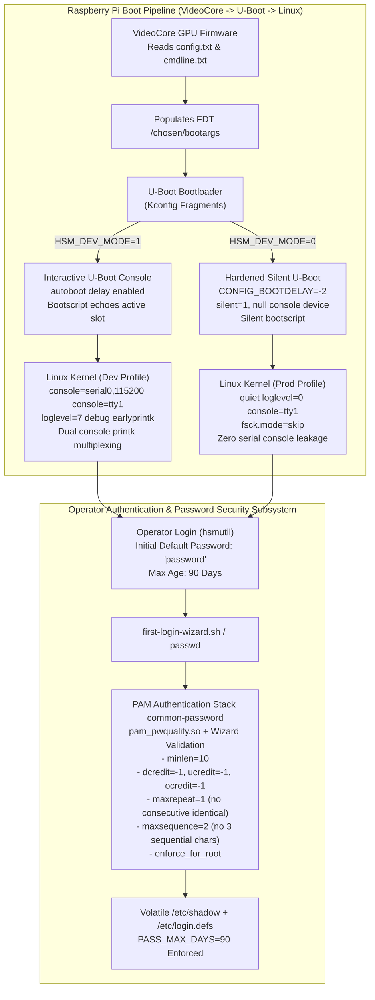

# Technical Specification: Yocto Dev/Prod Boot Visibility, U-Boot Hardening, and `hsmutil` Password Security Policy

## 1. Summary & Problem Motivation

The **`rpi-z2w-yocto-hsm`** project builds an air-gapped embedded Linux OS ([`meta-hsm-os`](file:///Users/gpfister/Development/Projects/gpfister/nrf52840-hsm/rpi-z2w-yocto-hsm/meta-hsm-os)) using Yocto Project 5.0 LTS (`scarthgap`) in two deployment profiles:
1. **Diagnostic Development Image** ([`hsm-image-dev.bb`](file:///Users/gpfister/Development/Projects/gpfister/nrf52840-hsm/rpi-z2w-yocto-hsm/meta-hsm-os/recipes-core/images/hsm-image-dev.bb)) via [`kas-dev.yml`](file:///Users/gpfister/Development/Projects/gpfister/nrf52840-hsm/rpi-z2w-yocto-hsm/kas-dev.yml) (`HSM_DEV_MODE = "1"`).
2. **Hardened Production Image** ([`hsm-image-prod.bb`](file:///Users/gpfister/Development/Projects/gpfister/nrf52840-hsm/rpi-z2w-yocto-hsm/meta-hsm-os/recipes-core/images/hsm-image-prod.bb)) via [`kas-prod.yml`](file:///Users/gpfister/Development/Projects/gpfister/nrf52840-hsm/rpi-z2w-yocto-hsm/kas-prod.yml) (`HSM_DEV_MODE = "0"`).

Several critical gaps were identified between the intended security/diagnostic posture and actual system behavior:

1. **Dev Kernel Boot Visibility vs. Production Boot Silence**:
   - [`kas-dev.yml`](file:///Users/gpfister/Development/Projects/gpfister/nrf52840-hsm/rpi-z2w-yocto-hsm/kas-dev.yml#L16-L17) defined `APPEND += "debug earlyprintk"` and [`kas-prod.yml`](file:///Users/gpfister/Development/Projects/gpfister/nrf52840-hsm/rpi-z2w-yocto-hsm/kas-prod.yml#L16-L17) defined `APPEND += "quiet loglevel=0 console=tty1 fsck.mode=skip"`.
   - However, `meta-raspberrypi`'s [`rpi-cmdline.bb`](file:///Users/gpfister/Development/Projects/gpfister/nrf52840-hsm/rpi-z2w-yocto-hsm/meta-raspberrypi/recipes-bsp/bootfiles/rpi-cmdline.bb#L52-L68) constructs `/boot/cmdline.txt` purely from `CMDLINE` variables (`CMDLINE_SERIAL`, `CMDLINE_DEBUG`, etc.) and entirely ignores BitBake's standard `APPEND` variable.
   - Consequently, neither the HDMI display (`tty1`) nor verbose debug parameters reached `cmdline.txt` (which VideoCore transfers into the FDT property `/chosen/bootargs` and [`boot.cmd.in`](file:///Users/gpfister/Development/Projects/gpfister/nrf52840-hsm/rpi-z2w-yocto-hsm/meta-hsm-os/recipes-bsp/rpi-u-boot-scr/files/boot.cmd.in#L4) parses).
2. **Production U-Boot Hardening & Non-Interactivity**:
   - On production appliances (`HSM_DEV_MODE = "0"`), U-Boot emitted boot banners, printed RAUC slot selection `echo` statements in [`boot.cmd.in`](file:///Users/gpfister/Development/Projects/gpfister/nrf52840-hsm/rpi-z2w-yocto-hsm/meta-hsm-os/recipes-bsp/rpi-u-boot-scr/files/boot.cmd.in#L20-L51), and waited for the `"Hit any key to stop autoboot"` prompt.
   - On an air-gapped production HSM, U-Boot must be non-interactive and silent (`CONFIG_BOOTDELAY=-2`), whereas development builds must retain interactive U-Boot serial console output and diagnostic logs.
   - Additionally, the brittle `rpi_arm64_defconfig.patch` inherited from `meta-rauc-raspberrypi` failed when building across non-RPi4 boards (e.g., `raspberrypi0-2w-64`).
3. **Operator Default Password & Password Complexity Policy**:
   - The operator account in [`hsmutil-user.bb`](file:///Users/gpfister/Development/Projects/gpfister/nrf52840-hsm/rpi-z2w-yocto-hsm/meta-hsm-os/recipes-core/users/hsmutil-user.bb#L10-L11) initialized with password `hsmutil` instead of `password`.
   - The system lacked Pluggable Authentication Module (PAM) `pam_pwquality` complexity enforcement during password changes via `passwd` or [`first-login-wizard.sh`](file:///Users/gpfister/Development/Projects/gpfister/nrf52840-hsm/rpi-z2w-yocto-hsm/meta-hsm-os/recipes-core/init-wizard/files/first-login-wizard.sh).
   - No 90-day password expiration policy (`PASS_MAX_DAYS 90`) was enforced in `/etc/login.defs` or `/etc/shadow`.

---

## 2. System Architecture & Flow

---

## 3. Functional Requirements

### REQ-1: Dev & Prod Kernel Boot Log Visibility (`cmdline.txt` / `/chosen/bootargs`)
- **Development Profile ([`kas-dev.yml`](file:///Users/gpfister/Development/Projects/gpfister/nrf52840-hsm/rpi-z2w-yocto-hsm/kas-dev.yml) / `HSM_DEV_MODE = "1"`)**:
  - Kernel boot log messages must output simultaneously to **both** the physical HDMI monitor (`console=tty1`) and the serial UART console (`console=serial0,115200`).
  - Leveraging Linux kernel console multiplexing behavior: specifying `console=serial0,115200 console=tty1` causes kernel `printk` output to broadcast to both sinks, while `/dev/console` attaches to the last specified entry (`tty1`) so systemd attaches the foreground display to the monitor and starts `serial-getty@ttyS0` on UART.
  - The generated `/boot/cmdline.txt` via [`rpi-cmdline.bbappend`](file:///Users/gpfister/Development/Projects/gpfister/nrf52840-hsm/rpi-z2w-yocto-hsm/meta-hsm-os/recipes-bsp/bootfiles/rpi-cmdline.bbappend) must contain:
    `console=serial0,115200 console=tty1 loglevel=7 debug earlyprintk`
- **Production Profile ([`kas-prod.yml`](file:///Users/gpfister/Development/Projects/gpfister/nrf52840-hsm/rpi-z2w-yocto-hsm/kas-prod.yml) / `HSM_DEV_MODE = "0"`)**:
  - The generated `/boot/cmdline.txt` must silence all boot messages and eliminate serial console leakage:
    `quiet loglevel=0 console=tty1 fsck.mode=skip`

### REQ-2: Silent U-Boot & Zero Autoboot Delay in Production
- **Production Profile (`HSM_DEV_MODE = "0"`)**:
  - Configure U-Boot via `meta-hsm-os/recipes-bsp/u-boot/u-boot_%.bbappend` across all supported boards (`raspberrypi0-2w-64`, `raspberrypi3-64`, `raspberrypi4-64`, `raspberrypi5`) using configuration fragment `silent-boot.cfg`:
    - `CONFIG_BOOTDELAY=-2` (completely disables autoboot abort via serial input or keyboard)
    - `CONFIG_SILENT_CONSOLE=y`
    - `CONFIG_SYS_DEVICE_NULLDEV=y`
    - `CONFIG_SILENT_U_BOOT_ONLY=y`
  - In [`meta-hsm-os/recipes-bsp/rpi-u-boot-scr/rpi-u-boot-scr.bbappend`](file:///Users/gpfister/Development/Projects/gpfister/nrf52840-hsm/rpi-z2w-yocto-hsm/meta-hsm-os/recipes-bsp/rpi-u-boot-scr/rpi-u-boot-scr.bbappend) and [`boot.cmd.in`](file:///Users/gpfister/Development/Projects/gpfister/nrf52840-hsm/rpi-z2w-yocto-hsm/meta-hsm-os/recipes-bsp/rpi-u-boot-scr/files/boot.cmd.in):
    - Assert `setenv silent 1` at the beginning of `boot.cmd`.
    - Silence all `echo "RAUC: ..."` status prints.
- **Development Profile (`HSM_DEV_MODE = "1"`)**:
  - Retain standard autoboot prompt (`CONFIG_BOOTDELAY=2`), interactive terminal, and verbose `echo "RAUC: ..."` diagnostic prints.
  - Replace the brittle `rpi_arm64_defconfig.patch` from `meta-rauc-raspberrypi` with modular Kconfig fragment `squashfs.cfg` (`CONFIG_CMD_SQUASHFS=y`, `CONFIG_FS_SQUASHFS=y`) so U-Boot compiles cleanly across all 4 target machines.

### REQ-3: Initial Default Password for `hsmutil` User
- Update [`hsmutil-user.bb`](file:///Users/gpfister/Development/Projects/gpfister/nrf52840-hsm/rpi-z2w-yocto-hsm/meta-hsm-os/recipes-core/users/hsmutil-user.bb#L10-L11) to configure the initial password of `hsmutil` to `password` using a secure SHA-512 crypt hash (`$6$saltsalt$qFmFH.bQmmtXzyBY0s9v7Oicd2z4XSIecDzlB5KiA2/jctKu9YterLp8wwnSq.qc.eoxqOmSuNp2xS0ktL3nh/`).
- Update documentation and [`README.md`](file:///Users/gpfister/Development/Projects/gpfister/nrf52840-hsm/rpi-z2w-yocto-hsm/README.md) to state `password` as the initial password.

### REQ-4: Password Complexity Enforcement (Dev & Prod Profiles)
Enforce password complexity rules on both images for `passwd` and [`first-login-wizard.sh`](file:///Users/gpfister/Development/Projects/gpfister/nrf52840-hsm/rpi-z2w-yocto-hsm/meta-hsm-os/recipes-core/init-wizard/files/first-login-wizard.sh):
1. **Minimum Length**: 10 characters (`minlen = 10`)
2. **Digits**: At least 1 numeric digit (`dcredit = -1`)
3. **Uppercase**: At least 1 uppercase letter (`ucredit = -1`)
4. **Special Characters**: At least 1 non-alphanumeric character (`ocredit = -1`)
5. **Consecutive Identical**: No 2 identical characters consecutively, e.g., `aa`, `00`, `$$` (`maxrepeat = 1`)
6. **Monotonic Sequences**: No 3 sequential characters, e.g., `abc`, `123`, `cba`, `321` (`maxsequence = 2`)

**System PAM Configuration**:
- Append `pam` to `DISTRO_FEATURES` in [`kas-project.yml`](file:///Users/gpfister/Development/Projects/gpfister/nrf52840-hsm/rpi-z2w-yocto-hsm/kas-project.yml).
- Add `libpwquality` to [`hsm-image-base.bb`](file:///Users/gpfister/Development/Projects/gpfister/nrf52840-hsm/rpi-z2w-yocto-hsm/meta-hsm-os/recipes-core/images/hsm-image-base.bb).
- Configure `/etc/security/pwquality.conf` and `/etc/pam.d/common-password` via `meta-hsm-os/recipes-extended/libpwquality/libpwquality_%.bbappend` with `enforce_for_root` enabled.

**First-Login Wizard Validation**:
- Step 1 of `first-login-wizard.sh` presents complexity rules to the operator, performs pre-validation with specific granular error messages, verifies confirmation match, and applies the password.

### REQ-5: 90-Day Password Expiration Policy (Dev & Prod Profiles)
- Configure `/etc/login.defs` (via `meta-hsm-os/recipes-extended/shadow/shadow_%.bbappend`) with:
  `PASS_MAX_DAYS 90`
- Configure `hsmutil` in `/etc/shadow` so field 5 (maximum password age) is `90` days.
- Ensure initial login requires immediate password change while subsequent changes maintain the 90-day window.

---

## 4. Acceptance Criteria Matrix

| ID | Criteria | Dev Profile (`HSM_DEV_MODE=1`) | Prod Profile (`HSM_DEV_MODE=0`) |
| :--- | :--- | :--- | :--- |
| **AC-1** | Kernel boot logs | `console=serial0,115200 console=tty1 loglevel=7 debug earlyprintk` | `quiet loglevel=0 console=tty1 fsck.mode=skip` |
| **AC-2** | U-Boot prompt | Interactive (`CONFIG_BOOTDELAY=2`), autoboot stoppable | Non-interactive (`CONFIG_BOOTDELAY=-2`), autoboot cannot be stopped |
| **AC-3** | U-Boot serial console | Emits banners and RAUC slot `echo` messages | Completely silent (`CONFIG_SILENT_CONSOLE=y`, `silent=1`, null dev) |
| **AC-4** | Default password | `password` | `password` |
| **AC-5** | Password complexity | 10+ chars, 1+ digit, 1+ upper, 1+ special, no repeats (`maxrepeat=1`), no sequences (`maxsequence=2`) | Same (enforced via PAM & wizard) |
| **AC-6** | Password expiration | `PASS_MAX_DAYS 90` in `/etc/login.defs` and `/etc/shadow` | Same |
| **AC-7** | Multi-board build | Builds cleanly on `raspberrypi0-2w-64`, `raspberrypi3-64`, `raspberrypi4-64`, `raspberrypi5` | Same |
