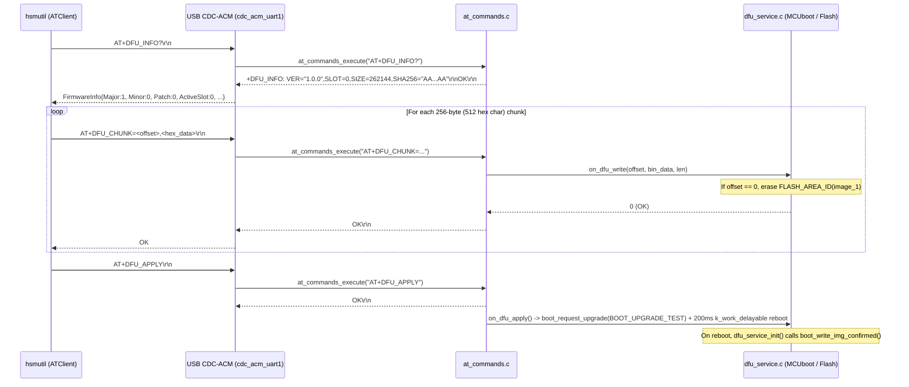

# Feature: AT-Protocol DFU Support (`AT+DFU_INFO?`, `AT+DFU_CHUNK`, `AT+DFU_APPLY`)

> [!NOTE]
> **Lifecycle Phase**: Phase 5 (Implementation, Local Deployment & Pre-Merge Review Complete — Ready for Phase 6 Merge).  
> **Target Branch**: `feature/at-dfu-support` across [`nrf52840-hsm-firmware`](file:///Users/gpfister/Development/Projects/gpfister/nrf52840-hsm/nrf52840-hsm-firmware) (`1d76b0d`, fast-forward merged with macOS CDC-ACM fix), [`nrf52840-hsm-cli`](file:///Users/gpfister/Development/Projects/gpfister/nrf52840-hsm/nrf52840-hsm-cli) (`7613d43`), and [`ncs-nrf52840dongle-kms`](file:///Users/gpfister/Development/Projects/gpfister/nrf52840-hsm) (`2a2a9ce`).  
> **Architecture Decision Record**: [[Architecture/Decisions/ADR-0006 - AT-Protocol DFU Chunk Streaming and Deferred MCUboot Swap|ADR-0006: AT-Protocol DFU Chunk Streaming & Deferred MCUboot Swap Architecture]].  
> **Specification Record**: [[Specification/AT-Protocol DFU Support|AT-Protocol DFU Support Specification]].  
> **Implementation Plan**: [[Plan/AT-Protocol DFU Support Implementation Plan|Implementation Plan: AT-Protocol DFU Support]].

---

## 1. Summary & Problem Motivation

During the migration of the nRF52840 Dongle HSM (`PCA10059`) from the legacy binary YubiHSM-style framing (`s.transport`) to the ASCII AT command protocol (`s.atClient`), the Device Firmware Upgrade (DFU) subsystem was left partially unmigrated:

1. **CLI Layer (`nrf52840-hsm-cli`)**:
   - [`HSMService.GetFirmwareInfo`](file:///Users/gpfister/Development/Projects/gpfister/nrf52840-hsm/nrf52840-hsm-cli/internal/usecases/hsm_service.go#L93-L131) previously returned a hardcoded stub when `s.transport == nil`.
   - [`HSMService.UpdateFirmware`](file:///Users/gpfister/Development/Projects/gpfister/nrf52840-hsm/nrf52840-hsm-cli/internal/usecases/hsm_service.go#L178-L250) previously failed with `DFU update requires legacy binary serial connection` when connected over `s.atClient`.
   - [`ATClient`](file:///Users/gpfister/Development/Projects/gpfister/nrf52840-hsm/nrf52840-hsm-cli/internal/domain/at_client.go) lacked `DFUInfo()`, `DFUChunk()`, and `DFUApply()`.
2. **Firmware Layer (`nrf52840-hsm-firmware`)**:
   - [`at_commands_execute`](file:///Users/gpfister/Development/Projects/gpfister/nrf52840-hsm/nrf52840-hsm-firmware/firmware/lib/src/at_commands.c) lacked handlers for `AT+DFU_INFO?`, `AT+DFU_CHUNK=<offset>,<hex_data>`, and `AT+DFU_APPLY`, and had no callback mechanism to invoke [`dfu_service_write_chunk`](file:///Users/gpfister/Development/Projects/gpfister/nrf52840-hsm/nrf52840-hsm-firmware/firmware/app/src/dfu_service.c) and [`dfu_service_apply`](file:///Users/gpfister/Development/Projects/gpfister/nrf52840-hsm/nrf52840-hsm-firmware/firmware/app/src/dfu_service.c).
   - [`AT_PARSER_MAX_LINE_LEN`](file:///Users/gpfister/Development/Projects/gpfister/nrf52840-hsm/nrf52840-hsm-firmware/firmware/lib/include/hsm/at_parser.h#L12) was `512` bytes, which could not hold a 256-byte chunk (`512` hex characters) plus the `AT+DFU_CHUNK=<offset>,` prefix and `\r\n` terminator.
   - [`dfu_service_init`](file:///Users/gpfister/Development/Projects/gpfister/nrf52840-hsm/nrf52840-hsm-firmware/firmware/app/src/dfu_service.c) did not call `boot_write_img_confirmed()`, causing MCUboot to revert to the previous slot on the subsequent reboot after a `BOOT_UPGRADE_TEST` swap.
3. **Hardware Bootstrap Constraint**:
   - Physical dongles currently running legacy firmware `53f764b` (`3302311888499AC7` and `FD54E793A75540C9`) require a one-time J-Link flash (`make firmware-flash`) before subsequent updates can be performed over USB CDC-ACM via `hsmutil firmware update`.

---

## 2. Architecture & Protocol Flow

---

## 3. Functional Requirements & Implementation Status

| ID | Subsystem | Requirement | Target Files | Status |
| :--- | :--- | :--- | :--- | :--- |
| **FR-1** | Firmware (`lib`) | Increase `AT_PARSER_MAX_LINE_LEN` from `512` to `1024` bytes | [`at_parser.h`](file:///Users/gpfister/Development/Projects/gpfister/nrf52840-hsm/nrf52840-hsm-firmware/firmware/lib/include/hsm/at_parser.h) | **Implemented (`7aa1d2b`)** |
| **FR-2** | Firmware (`lib`) | Define `at_dfu_callbacks_t` (`write_chunk`, `apply`, `get_info`) and `at_commands_register_dfu_callbacks()` | [`at_commands.h`](file:///Users/gpfister/Development/Projects/gpfister/nrf52840-hsm/nrf52840-hsm-firmware/firmware/lib/include/hsm/at_commands.h), [`at_commands.c`](file:///Users/gpfister/Development/Projects/gpfister/nrf52840-hsm/nrf52840-hsm-firmware/firmware/lib/src/at_commands.c) | **Implemented (`7aa1d2b`)** |
| **FR-3** | Firmware (`lib`) | Implement `AT+DFU_INFO?`, `AT+DFU_CHUNK=<offset>,<hex_data>`, and `AT+DFU_APPLY` (requiring `keystore_is_authenticated()` for write/apply) | [`at_commands.c`](file:///Users/gpfister/Development/Projects/gpfister/nrf52840-hsm/nrf52840-hsm-firmware/firmware/lib/src/at_commands.c) | **Implemented (`7aa1d2b`)** |
| **FR-4** | Firmware (`app`) | Confirm MCUboot test image on startup (`boot_write_img_confirmed()`), implement PSA SHA-256 `dfu_service_get_info()`, schedule deferred reboot (`k_work_delayable`, 200 ms) in `dfu_service_apply()`, and register callbacks in `main()` | [`dfu_service.h`](file:///Users/gpfister/Development/Projects/gpfister/nrf52840-hsm/nrf52840-hsm-firmware/firmware/app/src/dfu_service.h), [`dfu_service.c`](file:///Users/gpfister/Development/Projects/gpfister/nrf52840-hsm/nrf52840-hsm-firmware/firmware/app/src/dfu_service.c), [`main.c`](file:///Users/gpfister/Development/Projects/gpfister/nrf52840-hsm/nrf52840-hsm-firmware/firmware/app/src/main.c) | **Implemented (`7aa1d2b`)** |
| **FR-5** | CLI (`domain`) | Implement `DFUInfo()` (with `AT+INFO?` fallback on `+CME ERROR: 8`), `DFUChunk()` (`10s` timeout, `1..256` bytes), and `DFUApply()` (`10s` timeout) plus unit tests | [`at_client.go`](file:///Users/gpfister/Development/Projects/gpfister/nrf52840-hsm/nrf52840-hsm-cli/internal/domain/at_client.go), [`at_client_test.go`](file:///Users/gpfister/Development/Projects/gpfister/nrf52840-hsm/nrf52840-hsm-cli/internal/domain/at_client_test.go) | **Implemented (`7613d43`)** |
| **FR-6** | CLI (`usecases`) | Wire `HSMService.GetFirmwareInfo()` and `HSMService.UpdateFirmware()` (256-byte chunk streaming + progress callbacks) to `s.atClient` plus unit tests | [`hsm_service.go`](file:///Users/gpfister/Development/Projects/gpfister/nrf52840-hsm/nrf52840-hsm-cli/internal/usecases/hsm_service.go), [`hsm_service_test.go`](file:///Users/gpfister/Development/Projects/gpfister/nrf52840-hsm/nrf52840-hsm-cli/internal/usecases/hsm_service_test.go) | **Implemented (`7613d43`)** |
| **FR-7** | Root (`scripts`) | Increase mock PTY line limit to `1024` bytes, simulate `AT+DFU_INFO?`, `AT+DFU_CHUNK`, and `AT+DFU_APPLY` in `MockHSMEngine`, and add DFU checks in `test_at_client.py` and `run_integration_tests.sh` | [`mock_hsm_pty.py`](file:///Users/gpfister/Development/Projects/gpfister/nrf52840-hsm/scripts/mock_hsm_pty.py), [`test_at_client.py`](file:///Users/gpfister/Development/Projects/gpfister/nrf52840-hsm/scripts/test_at_client.py), [`run_integration_tests.sh`](file:///Users/gpfister/Development/Projects/gpfister/nrf52840-hsm/scripts/run_integration_tests.sh) | **Implemented (`2a2a9ce`)** |

---

## 4. Implementation Commits & Modified Files

### 4.1 `nrf52840-hsm-firmware` (`feature/at-dfu-support` — HEAD `1d76b0d`)
- **HEAD Commit**: [`1d76b0d`](file:///Users/gpfister/Development/Projects/gpfister/nrf52840-hsm/nrf52840-hsm-firmware) (`1d76b0db6ff676b763ecaa82a20ca8817343468d`) — *docs(firmware): update README with CDC-ACM AT protocol descriptor standardization (ADR-0013)*
- **Merged Bugfix Commits** (fast-forward merged from `bugfix/macos-cdc-acm-enumeration`):
  - [`1d76b0d`](file:///Users/gpfister/Development/Projects/gpfister/nrf52840-hsm/nrf52840-hsm-firmware): *docs(firmware): update README with CDC-ACM AT protocol descriptor standardization (ADR-0013)*
  - [`0e7361b`](file:///Users/gpfister/Development/Projects/gpfister/nrf52840-hsm/nrf52840-hsm-firmware): *fix(usb): standard CDC-ACM AT protocol descriptors for macOS dual enumeration (ADR-0013)*
- **Base Feature Commit**: [`7aa1d2b`](file:///Users/gpfister/Development/Projects/gpfister/nrf52840-hsm/nrf52840-hsm-firmware) (`7aa1d2beff9ba524479bd7c70eb4f9cfb27490a9`) — *feat(dfu): add AT+DFU_INFO?, AT+DFU_CHUNK, and AT+DFU_APPLY firmware handlers*
- **Modified Files**:
  - [`firmware/app/src/usb_serial.c`](file:///Users/gpfister/Development/Projects/gpfister/nrf52840-hsm/nrf52840-hsm-firmware/firmware/app/src/usb_serial.c): Standardized Interface 2 descriptor `bInterfaceProtocol` and IAD `bFunctionProtocol` to `0x01` (ITU-T V.250).
  - [`firmware/lib/include/hsm/at_parser.h`](file:///Users/gpfister/Development/Projects/gpfister/nrf52840-hsm/nrf52840-hsm-firmware/firmware/lib/include/hsm/at_parser.h): Updated `AT_PARSER_MAX_LINE_LEN` from `512` to `1024`.
  - [`firmware/lib/include/hsm/at_commands.h`](file:///Users/gpfister/Development/Projects/gpfister/nrf52840-hsm/nrf52840-hsm-firmware/firmware/lib/include/hsm/at_commands.h): Added `at_dfu_callbacks_t` and `at_commands_register_dfu_callbacks()`.
  - [`firmware/lib/src/at_commands.c`](file:///Users/gpfister/Development/Projects/gpfister/nrf52840-hsm/nrf52840-hsm-firmware/firmware/lib/src/at_commands.c): Implemented `AT+DFU_INFO?`, `AT+DFU_CHUNK=<offset>,<hex_data>`, and `AT+DFU_APPLY` with `keystore_is_authenticated()` access control and hex payload decoding.
  - [`firmware/app/src/dfu_service.h`](file:///Users/gpfister/Development/Projects/gpfister/nrf52840-hsm/nrf52840-hsm-firmware/firmware/app/src/dfu_service.h) & [`firmware/app/src/dfu_service.c`](file:///Users/gpfister/Development/Projects/gpfister/nrf52840-hsm/nrf52840-hsm-firmware/firmware/app/src/dfu_service.c): Added startup `boot_write_img_confirmed()` check in `dfu_service_init()`, PSA SHA-256 hash calculation over `FLASH_AREA_ID(image_0)` in `dfu_service_get_info()`, 4-byte flash boundary padding with `0xFF` in `dfu_service_write_chunk()`, and `200 ms` `k_work_delayable` deferred cold reboot in `dfu_service_apply()`.
  - [`firmware/app/src/main.c`](file:///Users/gpfister/Development/Projects/gpfister/nrf52840-hsm/nrf52840-hsm-firmware/firmware/app/src/main.c): Registered `dfu_service_write_chunk`, `dfu_service_apply`, and `dfu_service_get_info` via `at_commands_register_dfu_callbacks()`.
  - [`README.md`](file:///Users/gpfister/Development/Projects/gpfister/nrf52840-hsm/nrf52840-hsm-firmware/README.md): Documented the new AT DFU commands and protocol descriptor standardization.

### 4.2 `nrf52840-hsm-cli` (`feature/at-dfu-support` — commit `7613d43`)
- **Commit**: `7613d432e36e09cddc445e0ba7a8281e80c4fb16` — *feat(dfu): add AT-protocol DFU support (DFUInfo, DFUChunk, DFUApply)*
- **Modified Files**:
  - [`internal/domain/at_client.go`](file:///Users/gpfister/Development/Projects/gpfister/nrf52840-hsm/nrf52840-hsm-cli/internal/domain/at_client.go): Implemented `DFUInfo()` (with `+CME ERROR: 8` fallback to `AT+INFO?`), `DFUChunk()` (`10s` timeout, `1..256` byte validation), and `DFUApply()` (`10s` timeout).
  - [`internal/domain/at_client_test.go`](file:///Users/gpfister/Development/Projects/gpfister/nrf52840-hsm/nrf52840-hsm-cli/internal/domain/at_client_test.go): Added unit tests for `DFUInfo` (including fallback), `DFUChunk`, and `DFUApply`.
  - [`internal/usecases/hsm_service.go`](file:///Users/gpfister/Development/Projects/gpfister/nrf52840-hsm/nrf52840-hsm-cli/internal/usecases/hsm_service.go): Wired `HSMService.GetFirmwareInfo()` and `HSMService.UpdateFirmware()` (256-byte chunk streaming and progress reporting) to `s.atClient`.
  - [`internal/usecases/hsm_service_test.go`](file:///Users/gpfister/Development/Projects/gpfister/nrf52840-hsm/nrf52840-hsm-cli/internal/usecases/hsm_service_test.go): Added unit tests for `HSMService.GetFirmwareInfo()` and `HSMService.UpdateFirmware()` over `ATClient`.

### 4.3 `ncs-nrf52840dongle-kms` (`feature/at-dfu-support` — commit `2a2a9ce`)
- **Commit**: `2a2a9ceb23d8d6d85d9130f95a7c3bc1a0f60de3` — *feat(scripts): add AT DFU simulation and end-to-end integration tests*
- **Modified Files**:
  - [`scripts/mock_hsm_pty.py`](file:///Users/gpfister/Development/Projects/gpfister/nrf52840-hsm/scripts/mock_hsm_pty.py): Increased PTY line buffer limit from `256` to `1024` bytes and implemented `AT+DFU_INFO?`, `AT+DFU_CHUNK=<offset>,<hex_data>`, and `AT+DFU_APPLY` in `MockHSMEngine`.
  - [`scripts/test_at_client.py`](file:///Users/gpfister/Development/Projects/gpfister/nrf52840-hsm/scripts/test_at_client.py): Added end-to-end DFU command tests (locked rejection, invalid chunk validation, multi-chunk upload, SHA-256 verification, and `AT+DFU_APPLY`).
  - [`scripts/run_integration_tests.sh`](file:///Users/gpfister/Development/Projects/gpfister/nrf52840-hsm/scripts/run_integration_tests.sh): Added Phase C CLI verification for `hsmutil firmware info` and `hsmutil firmware update --file <bin>`.

---

## 5. Edge Cases & Mitigations

| Edge Case | Mitigation |
| :--- | :--- |
| **USB disconnect / premature reboot on `AT+DFU_APPLY`** | `dfu_service_apply()` schedules cold reboot via `k_work_delayable` (`200 ms` delay) after `boot_request_upgrade(BOOT_UPGRADE_TEST)`, allowing `usb_serial_poll()` to transmit `OK\r\n` cleanly before USB reset. |
| **Unconfirmed MCUboot swap reversion** | `dfu_service_init()` checks `!boot_is_img_confirmed()` and invokes `boot_write_img_confirmed()` on startup so newly swapped images become permanent. |
| **Secondary slot flash erase latency on chunk 0** | `ATClient.DFUChunk` uses a `10s` timeout to accommodate the 1–4 second `FLASH_AREA_ID(image_1)` erase when `offset == 0`. |
| **Unauthenticated DFU attempt** | `AT+DFU_CHUNK` and `AT+DFU_APPLY` enforce `keystore_is_authenticated()` and return `+CME ERROR: 1` (`CME_ERR_DEVICE_LOCKED`) when locked. |
| **Legacy firmware (`53f764b`) on physical dongles** | `DFUInfo()` falls back to `AT+INFO?` if `AT+DFU_INFO?` returns `+CME ERROR: 8`. Physical dongles on `53f764b` require a one-time J-Link flash (`make firmware-flash`) to install the AT DFU handlers. |

---

## 6. Verifiable Acceptance Criteria

- [x] **AC-1**: `go test ./...` in `nrf52840-hsm-cli` passes 100%, covering `ATClient.DFUInfo`, `ATClient.DFUChunk`, `ATClient.DFUApply`, and `HSMService.UpdateFirmware` over `ATClient`.
- [x] **AC-2**: Firmware unit tests (`at_commands` / `at_parser`) and `make firmware-build` succeed with the new `AT+DFU_*` handlers and `AT_PARSER_MAX_LINE_LEN = 1024`.
- [x] **AC-3**: Starting `scripts/mock_hsm_pty.py` and running `hsmutil firmware info` and `hsmutil firmware update --file <test_bin>` (after `hsmutil auth`) succeeds end-to-end with 100% progress completion, and `make integration-test` passes completely.
