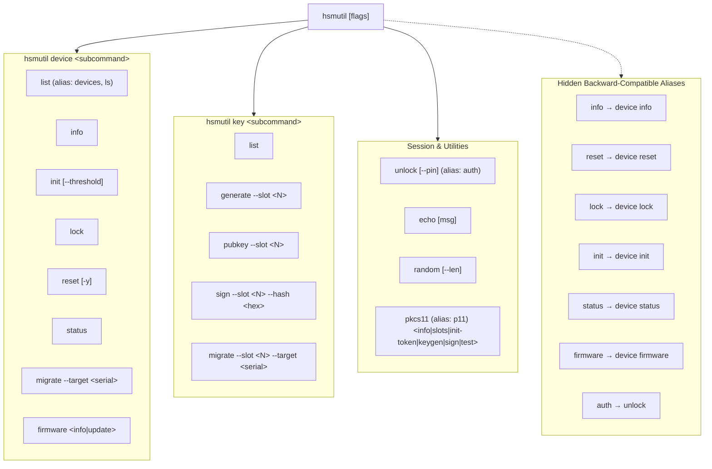
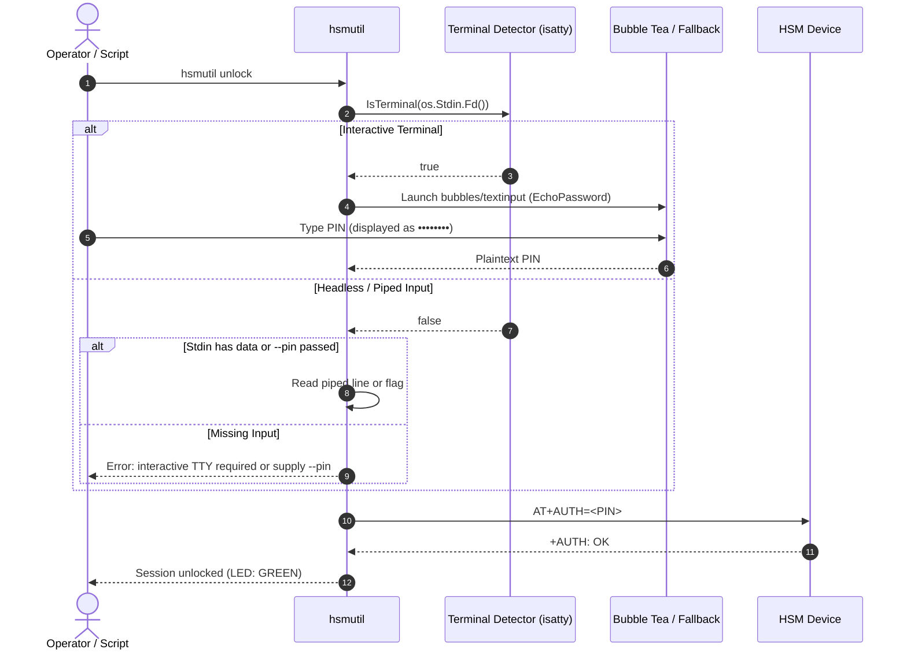

# Feature Specification: HSM CLI Restructuring, Static Compilation, Bubble Tea UX & PKCS#11 Equivalence

> [!NOTE]
> **Lifecycle Phase**: Phase 6 (Post-Merge Complete).  
> **Target Repository**: [`hsm-cli`](file:///Users/gpfister/Development/Projects/gpfister/nrf52840-hsm/hsm-cli)  
> **Target Branch**: `main`  
> **Source Branch**: `feature/cli-restructuring-bubbletea-pkcs11`  
> **Commit**: [`6c8781c`](file:///Users/gpfister/Development/Projects/gpfister/nrf52840-hsm/hsm-cli) (*feat(cli): restructure commands under device, add static build, bubble tea UX, and pkcs11 parity*)  
> **Merge Status**: Fast-forward merged (`189c7fd..6c8781c`), working tree clean, verification suite `go test ./...` passed 100% across all packages.

---

## 1. Executive Summary

This feature delivers an architectural overhaul of the `hsmutil` host management utility and aligns its documentation across the HSM ecosystem:
1. **Resource-Oriented Command Hierarchy**: Commands are organized cleanly under `hsmutil device <subcommand>` and `hsmutil key <subcommand>`, eliminating flat root command pollution.
2. **Seamless Backward Compatibility**: Legacy root commands (`info`, `reset`, `lock`, `init`, `firmware`, `auth`, `status`) remain registered as hidden aliases on `rootCmd`, preventing breaking changes in existing scripts or operator workflows.
3. **Ergonomic Enhancements**: Visible convenience alias `hsmutil devices` routes directly to `hsmutil device list`. The Makefile automatically generates a `bin/hsmutils -> hsmutil` relative symlink to forgive plural command invocations.
4. **Codebase Pruning**: Removed deprecated monolithic full-screen dashboard (`hsmutil tui`, `internal/ui/tui/`) and redundant embedded test runner (`hsmutil test`), deferring testing to unit tests (`go test ./...`) and the workspace test harness.
5. **Modern Terminal UX (Bubble Tea)**: Integrated Charm's Bubble Tea micro-components:
   - `bubbles/textinput` with password masking (`••••••`) for interactive PIN prompts during `hsmutil unlock`.
   - `bubbles/progress` for animated gradient progress bars during chunked firmware streaming (`hsmutil device firmware update`).
   - TTY detection (`term.IsTerminal` / `isatty.IsTerminal`) with clean, deterministic plain-text fallback for non-interactive scripts and CI pipes.
6. **Hermetic Static Compilation (`CGO_ENABLED=0`)**: Enforced static compilation with zero external C dynamic library dependencies across all host and cross-compilation Makefile targets, enabling execution in minimal scratch containers, developer environments, and the air-gapped `hsm-yocto-offgrid-rpi` appliance.
7. **Explicit Migration Architecture**: Delineated single-key migration (`key migrate --slot`) from whole-device atomic migration (`device migrate`), featuring fail-fast mutual lockdown and source zeroization ceremonies.
8. **PKCS#11 Equivalence Matrix & GAP Analysis**: Comprehensive mapping of `hsmutil` commands against standard OpenSC `pkcs11-tool` commands, highlighting device management parity and functional scope boundaries.
9. **Terminology Neutrality**: User-facing help text and error messages standardized on generic HSM USB Key terminology per [[Architecture/Decisions/ADR-0014 - Documentation Terminology Generalization to Generic HSM USB Key|ADR-0014]].

---

## 2. Architecture & Command Hierarchy



---

## 3. Verified Capabilities & Changes

### 3.1 Device Subcommands (`hsmutil device`)

| Command | Status | Description | Legacy / Alias |
| :--- | :--- | :--- | :--- |
| `hsmutil device list` | Verified | Enumerate connected HSM keys with BLE serials, AT data ports, and console ports. Supports `--json`. | `devices`, `ls` |
| `hsmutil device info` | Verified | Query active firmware version, hardware revision, device UID, and bootloader status (`AT+INFO?`). | `info` (hidden) |
| `hsmutil device init` | Verified | Initialize master secret or run custodian threshold ceremony. | `init` (hidden) |
| `hsmutil device lock` | Verified | Invalidate active session and transition LED to solid RED (`AT+LOCK`). | `lock` (hidden) |
| `hsmutil device reset` | Verified | Destructive cryptographic reset zeroizing all keys and secrets (`AT+RESET`). Safeguarded by `(yes/no)` prompt or `-y`. | `reset` (hidden) |
| `hsmutil device status` | Verified | Query authentication state, PIN retries, and key count (`AT+STATUS?`). | `status` (hidden) |
| `hsmutil device migrate` | Verified | Whole-device migration with mutual fail-fast lockdown and source zeroization. | — |
| `hsmutil device firmware info` | Verified | Query active firmware version and MCUboot partition slot. | `firmware info` (hidden) |
| `hsmutil device firmware update` | Verified | Stream chunked signed MCUboot image with Bubble Tea progress. | `firmware update` (hidden) |

### 3.2 Key Subcommands (`hsmutil key`)

| Command | Status | Description |
| :--- | :--- | :--- |
| `hsmutil key list` | Verified | Enumerate occupied EC key slots and metadata (`AT+SLOTS?`). |
| `hsmutil key generate` | Verified | Generate NIST P-256 (`secp256r1`) keypair using hardware CC310 TRNG (`AT+KEYGEN`). |
| `hsmutil key pubkey` | Verified | Output uncompressed 65-byte public key point (`AT+PUBKEY`). |
| `hsmutil key sign` | Verified | Compute hardware ECDSA signature over 32-byte SHA-256 digest (`AT+SIGN`). |
| `hsmutil key migrate` | Verified | Migrate a single specified slot to another HSM using ephemeral ECDH. |

### 3.3 Session & Utility Commands

| Command | Status | Description | Alias |
| :--- | :--- | :--- | :--- |
| `hsmutil unlock` | Verified | Authenticate User PIN (solid GREEN LED; `AT+AUTH`). Masked `bubbles/textinput` in TTY. | `auth` |
| `hsmutil echo` | Verified | Ping connected HSM and measure roundtrip serial latency (`AT`). | — |
| `hsmutil random` | Verified | Sample cryptographically secure bytes from hardware TRNG (`AT+RANDOM=<len>`). | — |
| `hsmutil pkcs11` | Verified | Shared library diagnostics for `hsm-libpkcs11` (`info`, `slots`, `init-token`, `keygen`, `sign`, `test`). | `p11` |

---

## 4. Terminal UX: Interactive Bubble Tea vs Headless Fallback



---

## 5. Whole-Device Migration Architecture & Safeguards

```mermaid
stateDiagram-v2
    [*] --> InitMigration: hsmutil device migrate --target <SERIAL>
    
    state "Discovery & Mutual Unlock" as Phase1 {
        InitMigration --> DiscoverDevices: Resolve source and target serial ports
        DiscoverDevices --> UnlockSource: Authenticate source device
        UnlockSource --> UnlockTarget: Authenticate target device
    }

    state "Key Slot Enumeration & Transfer" as Phase2 {
        UnlockTarget --> QuerySlots: AT+SLOTS? on source
        
        state "Transfer Loop" as SlotLoop {
            WrapKey: Ephemeral ECDH wrap key slot
            TransferKey: AT+IMPORT on target slot
            VerifyTarget: Query target public key digest & compare
            WrapKey --> TransferKey --> VerifyTarget
        }

        QuerySlots --> WrapKey
        
        state "Validation Gate" as CheckGate <<choice>>
        VerifyTarget --> CheckGate
        CheckGate --> SlotLoop: More slots remain
        CheckGate --> AllVerified: 100% slots verified
        CheckGate --> TriggerLockdown: Verification failure or I/O error
    }

    state "Mutual Fail-Fast Lockdown" as FailFast {
        LockSource: AT+LOCK on source
        LockTarget: AT+LOCK on target
        WipePartial: Wipe unverified target slots
        Halt: Return exit code 1
        LockSource --> LockTarget --> WipePartial --> Halt
    }

    TriggerLockdown --> FailFast

    state "Decommissioning Ceremony" as Phase3 {
        PromptZeroize: Interactive confirm or --yes
        ZeroizeSource: AT+RESET on source device
        PromptZeroize --> ZeroizeSource
    }

    AllVerified --> Phase3
    ZeroizeSource --> Success: Migration Complete
    Success --> [*]
```

---

## 6. PKCS#11 Equivalence Matrix & GAP Analysis

| Functional Area | `hsmutil` Command | `pkcs11-tool` Command (`-m libnrf52840_pkcs11.dylib`) | Parity Status | Scope Boundary Rationale |
| :--- | :--- | :--- | :--- | :--- |
| **Enumerate Devices** | `hsmutil device list` | `pkcs11-tool -L` | Equivalent | `hsmutil` exposes hardware serials and serial ports; PKCS#11 exposes Cryptoki tokens. |
| **Device Metadata** | `hsmutil device info` | `pkcs11-tool -M` / `-T` | Equivalent | `hsmutil` exposes MCUboot slot details; PKCS#11 exposes slot mechanisms. |
| **Initialize Token** | `hsmutil device init` | `pkcs11-tool --init-token --init-pin` | Equivalent | Fully supported in both. |
| **Session Unlock** | `hsmutil unlock` | `pkcs11-tool --login --pin <PIN>` | Equivalent | Standard Cryptoki `C_Login`. |
| **Session Lock** | `hsmutil device lock` | `pkcs11-tool --logout` | Equivalent | Standard Cryptoki `C_Logout`. |
| **Factory Reset** | `hsmutil device reset` | *None* | `hsmutil` Only | Out-of-band administrative hardware zeroization. |
| **Firmware Update** | `hsmutil device firmware update` | *None* | `hsmutil` Only | Firmware DFU is a host management capability. |
| **Key Generation** | `hsmutil key generate --slot <N>`| `pkcs11-tool --keypairgen --key-type EC:secp256r1 --id <N>` | Equivalent | Standard Cryptoki `C_GenerateKeyPair`. |
| **Key Enumeration** | `hsmutil key list` | `pkcs11-tool -O` | Equivalent | Standard Cryptoki `C_FindObjects`. |
| **Digital Sign** | `hsmutil key sign` | `pkcs11-tool --sign --id <N> -m ECDSA-SHA256` | Equivalent | Standard Cryptoki `C_Sign`. |
| **Key Deletion** | `hsmutil key delete` | `pkcs11-tool --delete-object --type privkey --id <N>` | Equivalent | Standard Cryptoki `C_DestroyObject`. |
| **Key Migration** | `hsmutil key migrate --slot <N>` | `pkcs11-tool --wrap` / `--unwrap` | Partial Gap | Direct slot-to-slot wrapping supported in `hsmutil`. |
| **Device Migration** | `hsmutil device migrate` | *None* | `hsmutil` Only | Multi-slot atomic migration with source zeroization. |
| **TRNG Random** | `hsmutil random [N]` | `pkcs11-tool --generate-random [N]` | Equivalent | Standard Cryptoki `C_GenerateRandom`. |

---

## 7. Verification Results

| Test Target | Verification Check | Result |
| :--- | :--- | :--- |
| **Unit Tests** | `go test -v ./...` in `hsm-cli` | **100% Passed** (CLI tests, migration service tests, discovery tests). |
| **Static Binary** | `file bin/hsmutil` and `otool -L bin/hsmutil` | **Verified**: Pure static binary with zero external dynamic library dependencies. |
| **Symlink Creation** | `ls -la bin/hsmutils` | **Verified**: Valid symbolic link to `hsmutil`. |
| **Command Routing** | `hsmutil device list`, `info`, `init`, `lock`, `reset`, `status`, `migrate`, `firmware` | **Verified**: Correct Cobra subcommand dispatch. |
| **Hidden Aliases** | `hsmutil info`, `hsmutil reset`, `hsmutil lock`, `hsmutil firmware`, `hsmutil auth` | **Verified**: Executed identically to canonical commands, hidden from `--help`. |
| **Visible Aliases** | `hsmutil devices`, `hsmutil auth` | **Verified**: Routes cleanly with proper help listings. |
| **TTY Fallback** | Piped executions (`echo "123456" \| hsmutil unlock`) | **Verified**: Seamless headless fallback without escape code contamination. |
| **Terminology Neutrality** | Grep for `nrf52840` across CLI user-facing strings | **Verified**: Zero occurrences in user-facing CLI output; generic HSM USB Key terminology applied. |
