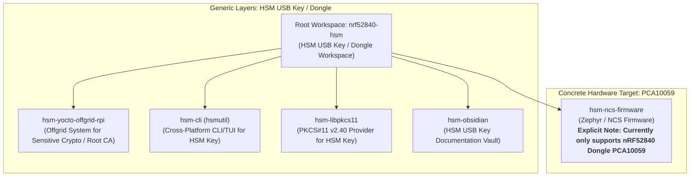

# Feature: Documentation Terminology Generalization to Generic HSM USB Key

> [!NOTE]
> **Lifecycle Phase**: Phase 5 (Pre-Merge Complete — Ready for Merge into `main` across all repositories).  
> **Workspace Branch**: `task/generalize-doc-terminology` across all 6 repositories.  
> **Working Tree Status**: Clean across all sub-repositories.  
> **Key Architecture Decision**: [[Architecture/Decisions/ADR-0014 - Documentation Terminology Generalization to Generic HSM USB Key|ADR-0014]].  
> **Implementation Plan**: [[Plan/Documentation Terminology Generalization Implementation Plan|Documentation Terminology Generalization Implementation Plan]].

---

## 1. Summary & Problem Statement

The **ncs-nrf52840dongle-kms** workspace coordinates multiple independent repositories forming an open-source Hardware Security Module (HSM) ecosystem:
1. Microcontroller firmware built on Zephyr RTOS / nRF Connect SDK ([`hsm-ncs-firmware`](file:///Users/gpfister/Development/Projects/gpfister/nrf52840-hsm/hsm-ncs-firmware)).
2. Cross-platform Go CLI & TUI management tooling `hsmutil` ([`hsm-cli`](file:///Users/gpfister/Development/Projects/gpfister/nrf52840-hsm/hsm-cli)).
3. Cryptoki PKCS#11 v2.40 shared provider library ([`hsm-libpkcs11`](file:///Users/gpfister/Development/Projects/gpfister/nrf52840-hsm/hsm-libpkcs11)).
4. Central engineering knowledge curation and architecture vault ([`hsm-obsidian`](file:///Users/gpfister/Development/Projects/gpfister/nrf52840-hsm/hsm-obsidian)).
5. Ultra-hardened, air-gapped embedded Linux operating system ([`hsm-yocto-offgrid-rpi`](file:///Users/gpfister/Development/Projects/gpfister/nrf52840-hsm/hsm-yocto-offgrid-rpi)).

### Problem Statement
Historically, subsystem `README.md` files, workspace instructions (`AGENTS.md`), and vault indexes bound high-level system descriptions and conceptual roles directly to the **nRF52840** microcontroller in prose, titles, and capability summaries. This created an inaccurate perception that host utilities (`hsmutil`), the PKCS#11 library, and the air-gapped OS appliance are locked to a single hardware microcontroller chip, violating clean architecture and modularity principles.

In reality:
- Host user-space utilities, PKCS#11 providers, and the offgrid OS interact with a generic HSM USB key over an AT-command serial transport or simulated PTY.
- The firmware subsystem (`hsm-ncs-firmware`) is the single repository tied to physical silicon, and it currently exclusively targets the Nordic Semiconductor nRF52840 USB Dongle (`PCA10059`).

---

## 2. Generalization Architecture & Taxonomy (ADR-0014)

Per [[Architecture/Decisions/ADR-0014 - Documentation Terminology Generalization to Generic HSM USB Key|ADR-0014]], the documentation taxonomy separates generic architectural layers from concrete microcontroller firmware targets:

### Generalization Taxonomy Matrix

| Subsystem | Scope | Generalized Terminology | Concrete Scope Notice |
| :--- | :--- | :--- | :--- |
| **Root Workspace (`nrf52840-hsm`)** | Multi-repo orchestration | Hardware Security Module (HSM) USB Key / Dongle Workspace | Coordinates sub-repositories; notes initial reference implementation |
| **`hsm-yocto-offgrid-rpi`** | Air-gapped OS appliance | Offgrid Yocto-based system to perform sensitive cryptographic operations (offline Root CA) interfacing with an HSM USB key | Hardware target: Raspberry Pi 64-bit with Waveshare USB HAT (B) |
| **`hsm-cli`** | Host CLI & TUI | Cross-platform CLI and TUI utility to interact with the HSM USB key | Protocol: AT serial commands or mock PTY |
| **`hsm-libpkcs11`** | Cryptoki PKCS#11 provider | Cryptoki PKCS#11 v2.40 shared library allowing standard tools (`pkcs11-tool`, OpenSSL, OpenSSH) to interact with the HSM USB key | AT serial transport; SECP256R1 operations |
| **`hsm-obsidian`** | Engineering vault | Central documentation vault for the Hardware Security Module (HSM) USB Key project | Indexes all architecture, ADRs, and implementation plans |
| **`hsm-ncs-firmware`** | Microcontroller firmware | nRF Connect SDK / Zephyr RTOS firmware workspace | **Explicit note: Currently only supports Nordic Semiconductor nRF52840 USB Dongle (`PCA10059`)** |

---

## 3. Preservation Invariants

To avoid any runtime regressions, breaking changes in CI/CD, or compatibility loss with existing tools, the following technical identifiers are strictly preserved:

1. **Shared Library Binary Names**:
   - `libnrf52840_pkcs11.dylib` (macOS)
   - `libnrf52840_pkcs11.so` (Linux)
   - `libnrf52840_pkcs11.dll` (Windows)
2. **Environment Variables**:
   - `NRF52840_HSM_SERIAL`
   - `NRF52840_HSM_PORT`
   - `NRF52840_HSM_DEBUG`
3. **Kernel Module & Device Node Patterns**:
   - `nrf52840-hsm-kmod` (Out-of-tree Linux kernel driver)
   - `/dev/tty.hsm<ble_address><number>` (Deterministic device nodes)
4. **Hardware Board Targets & Debugger IDs**:
   - `nrf52840dongle/nrf52840`
   - `PCA10059`
   - SEGGER J-Link probe serial `802007333`
5. **Git Sub-Repository Folder Paths**:
   - `hsm-ncs-firmware`, `hsm-cli`, `hsm-libpkcs11`, `hsm-obsidian`, `hsm-yocto-offgrid-rpi`

---

## 4. Multi-Repository Verified Deliverables

### 1. Root Workspace ([`nrf52840-hsm`](file:///Users/gpfister/Development/Projects/gpfister/nrf52840-hsm))
- **Commit**: [`af2d24e`](file:///Users/gpfister/Development/Projects/gpfister/nrf52840-hsm) (`af2d24e`) — *docs: generalize root documentation terminology*
- **Modified Files**:
  - [`README.md`](file:///Users/gpfister/Development/Projects/gpfister/nrf52840-hsm/README.md): Generalized title to "Hardware Security Module (HSM) USB Key / Dongle Workspace", updated system architecture overview, capabilities, and repository descriptions.
  - [`AGENTS.md`](file:///Users/gpfister/Development/Projects/gpfister/nrf52840-hsm/AGENTS.md): Updated project title and summary to HSM Workspace Coordinator.

### 2. Air-Gapped OS Appliance ([`hsm-yocto-offgrid-rpi`](file:///Users/gpfister/Development/Projects/gpfister/nrf52840-hsm/hsm-yocto-offgrid-rpi))
- **Commit**: [`28925aa`](file:///Users/gpfister/Development/Projects/gpfister/nrf52840-hsm/hsm-yocto-offgrid-rpi) (`28925aa`) — *docs: generalize README terminology to HSM USB key and appliance*
- **Modified Files**:
  - [`README.md`](file:///Users/gpfister/Development/Projects/gpfister/nrf52840-hsm/hsm-yocto-offgrid-rpi/README.md): Generalized title to "Offgrid Yocto-based system to perform sensitive cryptographic operations (typically on offline Root Certificate Authority / rootCA) interfacing with an HSM USB key", generalized headings and feature descriptions, preserved driver name `nrf52840-hsm-kmod`.

### 3. Host CLI & TUI Tooling ([`hsm-cli`](file:///Users/gpfister/Development/Projects/gpfister/nrf52840-hsm/hsm-cli))
- **Commit**: [`189c7fd`](file:///Users/gpfister/Development/Projects/gpfister/nrf52840-hsm/hsm-cli) (`189c7fd`) — *docs: generalize HSM device terminology and update utility title*
- **Modified Files**:
  - [`README.md`](file:///Users/gpfister/Development/Projects/gpfister/nrf52840-hsm/hsm-cli/README.md): Generalized title to `hsm-cli (hsmutil)`, updated CLI descriptions to reference generic HSM USB keys / dongles, preserved environment variable `NRF52840_HSM_SERIAL`.

### 4. PKCS#11 Provider Library ([`hsm-libpkcs11`](file:///Users/gpfister/Development/Projects/gpfister/nrf52840-hsm/hsm-libpkcs11))
- **Commit**: [`9c54759`](file:///Users/gpfister/Development/Projects/gpfister/nrf52840-hsm/hsm-libpkcs11) (`9c54759`) — *docs: generalize terminology in README.md*
- **Modified Files**:
  - [`README.md`](file:///Users/gpfister/Development/Projects/gpfister/nrf52840-hsm/hsm-libpkcs11/README.md): Generalized description to Cryptoki PKCS#11 v2.40 provider for the HSM USB key, preserved binary names (`libnrf52840_pkcs11.dylib`, `.so`, `.dll`) and environment variables (`NRF52840_HSM_*`).

### 5. Central Knowledge Vault ([`hsm-obsidian`](file:///Users/gpfister/Development/Projects/gpfister/nrf52840-hsm/hsm-obsidian))
- **Commit**: [`682fbfc`](file:///Users/gpfister/Development/Projects/gpfister/nrf52840-hsm/hsm-obsidian) (`682fbfc`) — *docs: generalize documentation terminology and add README*
- **Created & Modified Files**:
  - [`README.md`](file:///Users/gpfister/Development/Projects/gpfister/nrf52840-hsm/hsm-obsidian/README.md): Created comprehensive documentation vault guide.
  - [`00 - Index.md`](file:///Users/gpfister/Development/Projects/gpfister/nrf52840-hsm/hsm-obsidian/00%20-%20Index.md): Generalized vault title to "Hardware Security Module (HSM) USB Key Documentation Vault", indexed ADR-0014 and implementation plan.
  - [`Architecture/System Architecture.md`](file:///Users/gpfister/Development/Projects/gpfister/nrf52840-hsm/hsm-obsidian/Architecture/System%20Architecture.md): Aligned multi-repo architecture with ADR-0014.
  - [`Architecture/Decisions/ADR-0014 - Documentation Terminology Generalization to Generic HSM USB Key.md`](file:///Users/gpfister/Development/Projects/gpfister/nrf52840-hsm/hsm-obsidian/Architecture/Decisions/ADR-0014%20-%20Documentation%20Terminology%20Generalization%20to%20Generic%20HSM%20USB%20Key.md): Formal Architecture Decision Record.
  - [`Plan/Documentation Terminology Generalization Implementation Plan.md`](file:///Users/gpfister/Development/Projects/gpfister/nrf52840-hsm/hsm-obsidian/Plan/Documentation%20Terminology%20Generalization%20Implementation%20Plan.md): Multi-repository execution plan and verification criteria.

### 6. Microcontroller Firmware ([`hsm-ncs-firmware`](file:///Users/gpfister/Development/Projects/gpfister/nrf52840-hsm/hsm-ncs-firmware))
- **Commit**: [`e03c9bb`](file:///Users/gpfister/Development/Projects/gpfister/nrf52840-hsm/hsm-ncs-firmware) (`e03c9bb`) — *docs(firmware): generalize title and clarify PCA10059 hardware target support*
- **Modified Files**:
  - [`README.md`](file:///Users/gpfister/Development/Projects/gpfister/nrf52840-hsm/hsm-ncs-firmware/README.md): Updated title and added prominent scope callout: **Note that this firmware currently only supports the Nordic Semiconductor nRF52840 USB Dongle (`PCA10059`)**.

---

## 5. Verification Matrix & Acceptance Criteria

| Criteria | Target | Verification Method | Status |
| :--- | :--- | :--- | :--- |
| **AC-1**: Title & prose generalization | All workspace READMEs | Grep inspection of titles and overviews | **PASSED** |
| **AC-2**: Firmware target scoping | `hsm-ncs-firmware/README.md` | Verification of explicit PCA10059-only support note | **PASSED** |
| **AC-3**: Artifact name preservation | `libnrf52840_pkcs11.*` | Verified in `hsm-libpkcs11/README.md` and build targets | **PASSED** |
| **AC-4**: Environment variable preservation | `NRF52840_HSM_*` | Verified across CLI, PKCS#11, and firmware docs | **PASSED** |
| **AC-5**: Kernel module name preservation | `nrf52840-hsm-kmod` | Verified in `hsm-yocto-offgrid-rpi/README.md` | **PASSED** |
| **AC-6**: Obsidian vault index & README | `hsm-obsidian` | `README.md` created, `00 - Index.md` and `System Architecture.md` synchronized | **PASSED** |
| **AC-7**: ADR & Plan synchronization | `hsm-obsidian` | ADR-0014 and Implementation Plan authored and indexed | **PASSED** |
