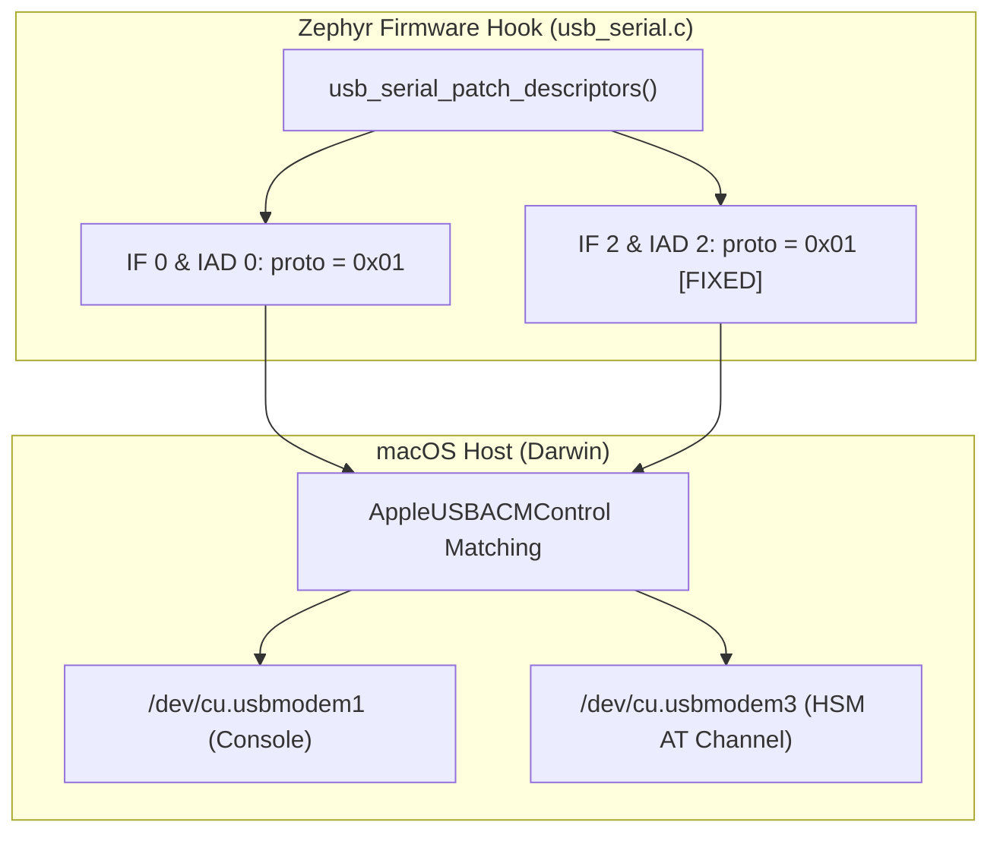

# Feature: Fix macOS CDC-ACM Enumeration for Interface 2 (HSM AT Channel)

> [!NOTE]
> **Lifecycle Phase**: Phase 6 (Post-Merge Complete — Merged into `feature/at-dfu-support`).  
> **Target Repository**: [`nrf52840-hsm-firmware`](file:///Users/gpfister/Development/Projects/gpfister/nrf52840-hsm/nrf52840-hsm-firmware).  
> **Active Branch**: `feature/at-dfu-support` (Fast-forward merged from `bugfix/macos-cdc-acm-enumeration`).  
> **Merged Range**: `7aa1d2b..1d76b0d` (Commits [`0e7361b`](file:///Users/gpfister/Development/Projects/gpfister/nrf52840-hsm/nrf52840-hsm-firmware) and [`1d76b0d`](file:///Users/gpfister/Development/Projects/gpfister/nrf52840-hsm/nrf52840-hsm-firmware)).  
> **Working Tree**: Clean.  
> **HEAD**: [`1d76b0d`](file:///Users/gpfister/Development/Projects/gpfister/nrf52840-hsm/nrf52840-hsm-firmware).  
> **Key Architecture Record**: [[Architecture/Decisions/ADR-0013 - Standard CDC-ACM AT Protocol Descriptors for macOS Dual Enumeration|ADR-0013]].

---

## 1. Summary & Problem Statement

The **nRF52840 Dongle HSM (`PCA10059`)** operates a dual CDC-ACM USB composite device configured in Zephyr RTOS:
- **Interface 0 & 1 (`cdc_acm_uart0`)**: Zephyr kernel console, logger, and diagnostics.
- **Interface 2 & 3 (`cdc_acm_uart1`)**: Dedicated HSM AT Command & DFU Channel for `hsmutil` and `libnrf52840_pkcs11`.

### Problem Statement
On macOS (Darwin ARM64 / Apple Silicon), Apple's native driver (`AppleUSBACM.kext` / DriverKit `com.apple.DriverKit.AppleUSBACMControl`) inspects both the **Interface Descriptor** (`bInterfaceProtocol`) and the **Interface Association Descriptor** (IAD, `bFunctionProtocol`). 

When Interface 2 protocol was set to `0x02` (originally intended to logically differentiate it from console interface 0), macOS rejected the interface because:
- `0x01` is standard AT Commands (ITU-T V.250).
- `0x02` is PCCA-101 (deprecated cellular/telephony protocol).
- Apple's driver matching dictionary requires $bInterfaceProtocol \in \{0x00, 0x01\}$.

Consequently, only Interface 0 was created on macOS (`/dev/cu.usbmodem<BLE_ADDR>1`), while Interface 2 (`/dev/cu.usbmodem<BLE_ADDR>3`) was missing, preventing any CLI or PKCS#11 operations.

---

## 2. Capabilities & Architecture

### Standardized Protocol Descriptors
- Both Interface 0 and Interface 2 use `bInterfaceProtocol = 0x01` (ITU-T V.250 AT Command protocol).
- Both Interface Association Descriptors (IAD) use `bFunctionProtocol = 0x01`.
- Clean logging formatting in `usb_serial_patch_descriptors` using `proto=0x%02x`.
- 4-byte flash write boundary padding in `dfu_service.c` ensuring reliable chunk writes to MCUboot secondary slot.
- This ensures full zero-driver binding under `AppleUSBACMControl`, generating both device nodes:
  - `/dev/cu.usbmodem<BLE_ADDR>1` $\rightarrow$ Console
  - `/dev/cu.usbmodem<BLE_ADDR>3` $\rightarrow$ HSM AT Channel

---

## 3. Implementation Details & Delivered Commits

### Commit [`0e7361b`](file:///Users/gpfister/Development/Projects/gpfister/nrf52840-hsm/nrf52840-hsm-firmware) (`0e7361b269f56090f981bfbd786a9bdd92a6e00e`)
- **`firmware/app/src/usb_serial.c`**:
  - Interface 2 `bInterfaceProtocol` updated from `0x02` to `0x01`.
  - Interface 2 IAD `bFunctionProtocol` updated from `0x02` to `0x01`.
  - Cleaned up patch log formatting string (`proto=0x%02x`).
- **`firmware/app/src/dfu_service.c`**:
  - Implemented 4-byte word boundary alignment with `0xFF` padding for DFU chunk writes, satisfying Nordic internal flash controller alignment constraints.

### Commit [`1d76b0d`](file:///Users/gpfister/Development/Projects/gpfister/nrf52840-hsm/nrf52840-hsm-firmware) (`1d76b0db6ff676b763ecaa82a20ca8817343468d`)
- **`README.md`**:
  - Documented CDC-ACM AT protocol descriptor standardization per ADR-0013.

---

## 4. Hardware Verification & Quality Gates

The implementation was validated on physical hardware and merged:
- **Programming Probe**: Segger J-Link SWD (S/N: `802007333`).
- **Target Device**: Nordic Semiconductor nRF52840 USB Dongle (`PCA10059`, Hardware BLE MAC: `F7:82:0A:1E:3B:16`).
- **macOS Enumeration Results**:
  - Port 1: `/dev/cu.usbmodemF7820A1E3B161` (Zephyr RTOS console and logger).
  - Port 3: `/dev/cu.usbmodemF7820A1E3B163` (HSM AT Command & DFU Channel).
- **Communication & Tooling**:
  - `hsmutil --port /dev/cu.usbmodemF7820A1E3B163 firmware info` verified responsive and accurate.
  - Streaming DFU chunk writes verified with 4-byte flash boundary padding.
- **Merge Status**: **Fast-forward merged** (`7aa1d2b..1d76b0d`) into `feature/at-dfu-support`. Working tree clean, HEAD at `1d76b0d`.
- **Verification Result**: **100% Passed**. Post-merge synchronized.

---

## 5. Cross-Reference Links

- **Vault Index**: [[00 - Index|Vault Index]]
- **ADR-0013**: [[Architecture/Decisions/ADR-0013 - Standard CDC-ACM AT Protocol Descriptors for macOS Dual Enumeration|ADR-0013]]
- **Approved Plan**: [[Plan/Fix macOS CDC-ACM Enumeration for Interface 2 Implementation Plan|Implementation Plan]]
- **Approved Specification**: [[Specification/Fix macOS CDC-ACM Enumeration for Interface 2|Specification]]
- **USB Architecture**: [[Architecture/USB Composite Stack|USB Composite Stack Architecture]]
