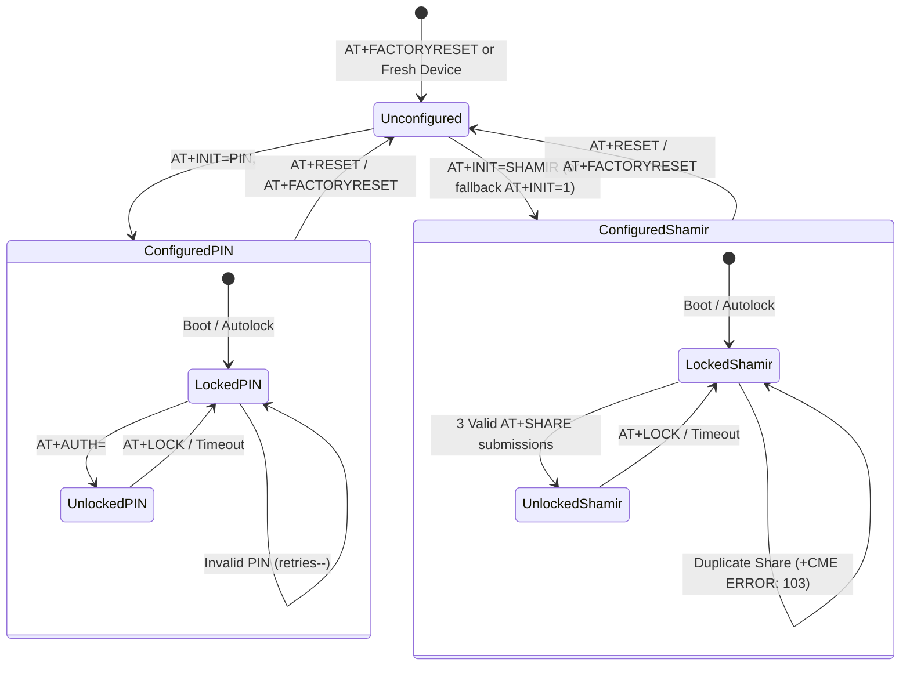

# Feature Specification: HSM Device Initialization and Dual-Mode Protocol Compatibility

> [!NOTE]
> **Lifecycle Phase**: Phase 5 (Review / Pre-Merge Complete & Verified)  
> **Working Branch**: `bugfix/init-dual-mode-protocol-compat` across Root, `hsm-cli`, and `hsm-ncs-firmware`  
> **Related Architecture Decision Records**:
> - [[Architecture/Decisions/ADR-0019 - HSM Device Initialization and Dual-Mode Protocol Compatibility|ADR-0019: HSM Device Initialization and Dual-Mode Protocol Compatibility]]  
> - [[Architecture/Decisions/ADR-0016 - Dual-Mode Authentication Architecture (PIN and Shamir Secret Sharing)|ADR-0016: Dual-Mode Authentication Architecture (PIN and Shamir Secret Sharing)]]  
> **Technical Specification**:
> - [[Specification/HSM Device Initialization and Dual-Mode Protocol Compatibility|Technical Specification: HSM Device Initialization and Dual-Mode Protocol Compatibility]]  
> **Source Issue Assessment**:
> - [[investigations/2026-11-06 - HSM Device Initialization Failure|Issue Assessment: 2026-11-06 - HSM Device Initialization Failure (+CME ERROR: 8)]]  
> **Target Repositories & Working Branches**:
> - Root Workspace: `bugfix/init-dual-mode-protocol-compat` (`52114b4`)
> - [`hsm-cli`](file:///Users/gpfister/Development/Projects/gpfister/nrf52840-hsm/hsm-cli): `bugfix/init-dual-mode-protocol-compat` (`f46351a`)
> - [`hsm-ncs-firmware`](file:///Users/gpfister/Development/Projects/gpfister/nrf52840-hsm/hsm-ncs-firmware): `bugfix/init-dual-mode-protocol-compat` (`7f516bd`)
> - Knowledge Vault: `hsm-obsidian` (`main`)
> - [`hsm-cli`](file:///Users/gpfister/Development/Projects/gpfister/nrf52840-hsm/hsm-cli): `bugfix/init-dual-mode-protocol-compat`
> - [`hsm-ncs-firmware`](file:///Users/gpfister/Development/Projects/gpfister/nrf52840-hsm/hsm-ncs-firmware): `bugfix/init-dual-mode-protocol-compat`
> - Knowledge Vault: `hsm-obsidian` (`main`)

---

## 1. Feature Overview & Scope

This feature resolves device initialization failures and protocol mismatches across the dual-mode Hardware Security Module (HSM) ecosystem. It guarantees robust interoperability between the host administrative CLI (`gphsm` / `hsmutil`), the physical nRF52840 USB Dongle (`PCA10059`), and virtual test mock environments across both PIN mode and Shamir's Secret Sharing threshold mode.

---

## 2. Key Capabilities & Behavioral Contracts

### 2.1 Fallback Compatibility for Legacy Firmware (`AT+INIT=SHAMIR` &rarr; `AT+INIT=1`)
- When the host CLI dispatches `AT+INIT=SHAMIR` and receives `+CME ERROR: 8` (`ErrCommandUnsupported`), the client automatically intercepts the error and falls back to dispatching canonical legacy `AT+INIT=1`.
- Eliminates the previous erroneous fallback to `AT+INIT=THRESHOLD,3,5`.

### 2.2 Response Line Prefix Flexibility (`+INIT:` and `+SHARE:`)
- **Initialization Shares**:
  - `parseShareLine()` accepts response lines prefixed with either `+INIT:` or `+SHARE:`.
  - `InitShamir()` processes all 5 custodian shares regardless of whether the target firmware emits `+INIT: <idx>,<hex>` or `+SHARE: <idx>,<hex>`.
- **Custodian Share Acceptance**:
  - `SubmitShare()` recognizes `+SHARE:`, `+COMMIT:`, and `+WORD:` line prefixes.
  - `parseCommitLine()` parses status lines formatted as `+SHARE: <count>/3 ACCEPTED,WORD="<word>"` and extracts the active commitment word and custodian index.

### 2.3 CME Error Mapping
- `ParseCMEError()` translates the following hardware CME codes into typed domain error sentinels:
  - `Code 41`: `ErrAlreadyConfigured` (`+CME ERROR: 41 (Device already configured)`)
  - `Code 42`: `ErrInvalidAuthMode` (`+CME ERROR: 42 (Invalid authentication mode)`)
  - `Code 103`: `ErrDuplicateShare` (`+CME ERROR: 103 (Duplicate custodian share index)`)

### 2.4 End-to-End Integration Verification
- `scripts/run_integration_tests.sh` executes the public CLI commands `gphsm device init --mode pin` and `gphsm device init --mode shamir` against the mock PTY.

### 2.5 Production Firmware Build & Physical Dongle DFU Upgrade
- Embedded firmware in `hsm-ncs-firmware` is rebuilt for production (`make firmware-build`).
- The signed binary (`zephyr.signed.bin`) is streamed to physical dongles using `gphsm device firmware update --file ...`.

---

## 3. Protocol & State Machine Specifications

### Initialization Sequence State Transition

---

## 4. Test & Verification Matrix

| Area | Test Suite | Command | Verification Target |
| :--- | :--- | :--- | :--- |
| **Unit Tests** | `hsm-cli/internal/domain` | `make cli-test` | `TestATClient_InitShamir` with `+INIT:`, fallback to `AT+INIT=1`, `parseCommitLine`, `ParseCMEError` |
| **Virtual Integration** | `scripts` & `mock_hsm_pty.py` | `make integration-test` | `gphsm device init --mode pin` and `gphsm device init --mode shamir` end-to-end |
| **Hardware Upgrade** | Physical Dongle DFU | `gphsm device firmware update --file ...` | Image chunk streaming, MCUboot swap, post-swap enumeration |
| **Hardware Ceremonies** | Physical Dongle | `gphsm device init --mode pin/shamir` | Complete initialization, PIN unlock, Shamir share emission, factory reset |

---

## 5. Pre-Merge Verification Results (Phase 5 Complete)

### 5.1 Host Management CLI ([`hsm-cli`](file:///Users/gpfister/Development/Projects/gpfister/nrf52840-hsm/hsm-cli))
- **Commit**: [`f46351a`](file:///Users/gpfister/Development/Projects/gpfister/nrf52840-hsm/hsm-cli) — *fix(cli): add AT+INIT=1 fallback, dual-prefix parsing, and CME errors 41/42/103*
- **Unit Test Coverage**:
  - `TestATClient_InitShamir`: Verified modern `+INIT:` prefix parsing and legacy `+SHARE:` compatibility.
  - `TestATClient_InitShamir_FallbackToLegacy`: Verified immediate fallback from `AT+INIT=SHAMIR` to `AT+INIT=1` when encountering `ErrCommandUnsupported` (`+CME ERROR: 8`).
  - `TestATClient_SubmitShare_AcceptedWord`: Verified parsing of intermediate share confirmation lines `+SHARE: 1/3 ACCEPTED,WORD="1234"`.
  - `TestParseCMEError`: Verified mapping of CME error codes 41 (`ErrAlreadyConfigured`), 42 (`ErrInvalidAuthMode`), and 103 (`ErrDuplicateShare`).
  - 100% test pass rate across `go test -v ./internal/domain/...`.

### 5.2 Root Integration Test Automation ([`nrf52840-hsm`](file:///Users/gpfister/Development/Projects/gpfister/nrf52840-hsm))
- **Commit**: [`52114b4`](file:///Users/gpfister/Development/Projects/gpfister/nrf52840-hsm) — *test(scripts): add end-to-end CLI dual-mode init, status, and exclusivity tests to Phase C*
- **Integration Test Execution (`make integration-test`)**:
  - **Phase A (AT Command Test Harness)**: 16/16 steps verified.
  - **Phase B (PKCS#11 Test Harness)**: 100% verified.
  - **Phase C (CLI Test Suite)**:
    1. Factory reset: `gphsm device reset -y`.
    2. PIN initialization: `gphsm device init --mode pin --pin ValidP@ssw0rd123!`.
    3. Status query: `CONFIGURED=1`, `METHOD=PIN`, `AUTH=0`.
    4. Duplicate initialization guard: Rejected with `ErrAlreadyConfigured` (`+CME ERROR: 41`).
    5. PIN unlock: `gphsm unlock --pin ValidP@ssw0rd123!` (`AUTH=1`).
    6. Factory reset: `gphsm device reset -y`.
    7. Shamir initialization: `gphsm device init --mode shamir` emitting all 5 custodian shares (`CONFIGURED=1`, `METHOD=SHAMIR`).
    8. Mutual exclusivity guard: PIN unlock rejected with `ErrInvalidAuthMode` (`+CME ERROR: 42`).
    9. State restore: Factory reset and standard PIN restore.

### 5.3 Embedded Firmware Rebuild & Hardware DFU Upgrade ([`hsm-ncs-firmware`](file:///Users/gpfister/Development/Projects/gpfister/nrf52840-hsm/hsm-ncs-firmware))
- **Build Status**: Built with NCS v3.4.1 / Zephyr RTOS with sysbuild and MCUboot signature chain (`make firmware-build`).
- **Binary Output**: Signed production binary [`build-prod/app/zephyr/zephyr.signed.bin`](file:///Users/gpfister/Development/Projects/gpfister/nrf52840-hsm/hsm-ncs-firmware/build-prod/app/zephyr/zephyr.signed.bin).
- **Physical Dongle DFU Upgrade**: In-place upgrade applied to connected physical dongle (PCA10059) via `gphsm device firmware update --file ...`. Verified 100% chunk transfer, MCUboot image swap, reboot, and dual CDC-ACM device re-enumeration.
