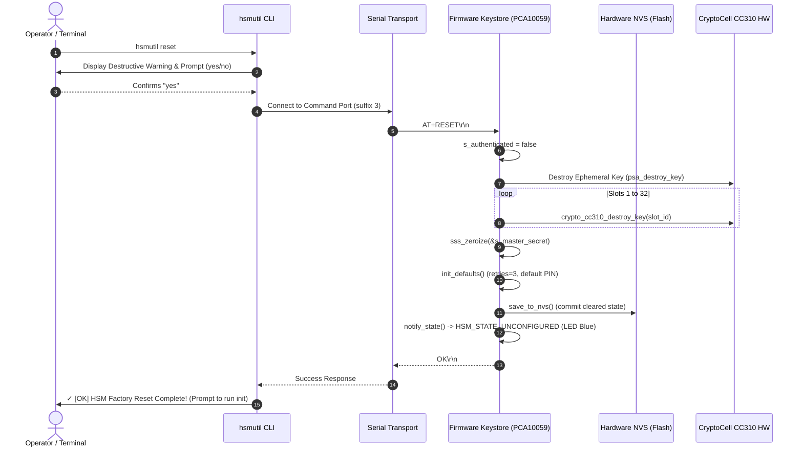
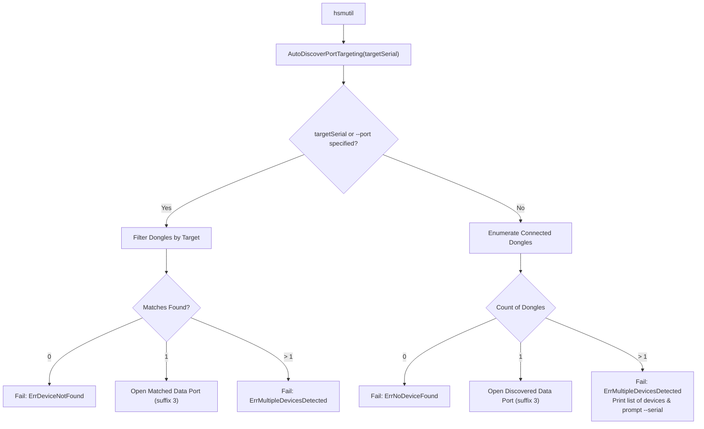

# Feature Specification: `hsmutil` Reset Confirmation & Factory Reset, and Multi-Device Disambiguation

> [!NOTE]
> **Specification Origin**: Clarified requirements stemming from root-cause investigation [[investigations/2026-10-31-hsmutil-reset-and-multi-device-disambiguation|Investigation Report (2026-10-31)]].  
> **Formal Specification**: [[Specification/Reset Confirmation and Multi-Device Disambiguation|Reset Confirmation and Multi-Device Disambiguation Specification]] (Approved in Session [[Sessions/36b74c4b-dd01-44e1-9405-48fdc8d21d87|36b74c4b]]).  
> **Architecture Decisions**: [[Architecture/Decisions/ADR-0003 - Host Port Discovery and Serial Targeting Strategy|ADR-0003: Host Port Discovery and Serial Targeting Strategy]] & [[Architecture/Decisions/ADR-0004 - Factory Reset Semantics and Safeguards|ADR-0004: Factory Reset Semantics and Safe Erasure Safeguards]].  
> **Implementation Plan**: [[Plan/Reset Confirmation and Multi-Device Disambiguation Implementation Plan|Reset Confirmation & Multi-Device Disambiguation Implementation Plan]] (Approved in Session [[Sessions/4b1bb45a-82b0-4966-bacf-254b577ad6f2|4b1bb45a]]).  
> **Status**: Phase 5 (Review & Quality Audit) Complete. 100% compliance verified across all subsystems. Ready for merge.

---

## 1. Executive Summary

This specification governs two mission-critical remediations across the host CLI ([`nrf52840-hsm-cli`](file:///Users/gpfister/Development/Projects/gpfister/nrf52840-hsm/nrf52840-hsm-cli)), the on-device firmware ([`nrf52840-hsm-firmware`](file:///Users/gpfister/Development/Projects/gpfister/nrf52840-hsm/nrf52840-hsm-firmware)), and the testing infrastructure ([`scripts/mock_hsm_pty.py`](file:///Users/gpfister/Development/Projects/gpfister/nrf52840-hsm/scripts/mock_hsm_pty.py)):

1. **Safe Factory Reset Semantics & Safeguards**:
   - Provide an irreversible hardware zeroization procedure in firmware (`keystore_factory_reset`) purging all persistent CryptoCell CC310 keys, zeroizing the Shamir Secret Sharing (SSS) master secret, restoring default PIN and retry counters, persisting to NVS, and transitioning the hardware to `HSM_STATE_UNCONFIGURED` (breathing BLUE LED).
   - Guard `hsmutil reset` behind an interactive confirmation prompt (`[y/N]`) and provide `-y` / `--yes` for automated scripting. Display explicit success feedback clarifying that `hsmutil init --threshold` is required before re-use.
2. **Deterministic Multi-Device Auto-Discovery & Disambiguation**:
   - Prevent silent arbitrary device selection when multiple HSM dongles are connected to the host.
   - Refuse auto-discovery with an informative domain error (`ErrMultipleDevicesDetected`) listing attached dongles with their BLE address / serial and candidate ports, instructing the user to supply `--serial (-s)` or `--port (-p)`.
   - Update `hsmutil key migrate` (`--source` / `--target`) to resolve either serial IDs or port paths transparently via `ResolvePortOrSerial()`.
   - Preserve non-blocking multi-device enumeration for `hsmutil devices`.

---

## 2. Clarified Scope & Boundaries

### 2.1 Multi-Repository Scope Matrix

| Component | Repository | Scope Description |
| :--- | :--- | :--- |
| **CLI Reset Safeguard** | [`nrf52840-hsm-cli`](file:///Users/gpfister/Development/Projects/gpfister/nrf52840-hsm/nrf52840-hsm-cli) | Add `-y, --yes` flag to `hsmutil reset`. Prompt interactively when omitted. Halt on anything other than affirmative. |
| **Firmware Factory Reset** | [`nrf52840-hsm-firmware`](file:///Users/gpfister/Development/Projects/gpfister/nrf52840-hsm/nrf52840-hsm-firmware) | Implement `keystore_factory_reset(void)`. Destroy CC310 keys (slots 1..32), wipe SSS master secret, reset PIN/retries, write NVS, notify state transition. Bind `AT+RESET` and alias `AT+FACTORYRESET`. |
| **Mock Serial Harness** | [`scripts`](file:///Users/gpfister/Development/Projects/gpfister/nrf52840-hsm/scripts) | Update `mock_hsm_pty.py` `AT+RESET` handler to wipe slots dictionary, clear master secret, reset auth state, retries, and set `shamir_initialized = False`. |
| **CLI Serial Disambiguation** | [`nrf52840-hsm-cli`](file:///Users/gpfister/Development/Projects/gpfister/nrf52840-hsm/nrf52840-hsm-cli) | Introduce `ErrMultipleDevicesDetected`. Error out in `AutoDiscoverPortTargeting("")` if `len(dongles) > 1`. Add `ResolvePortOrSerial()`. Update `key migrate` to support dual targeting by serial or port. |

### 2.2 Scope Boundaries & Non-Goals

- **Out of Scope**:
  - Modifying PKCS#11 shared provider library (`nrf52840-hsm-libpkcs11`). PKCS#11 already filters ports via candidate scoring and environment variables (`NRF52840_HSM_SERIAL`).
  - Physical DFU bootloader firmware recovery. The factory reset operates purely within the application partition and keystore subsystem.
  - Adding network-based remote HSM management protocols.

---

## 3. Technical Decisions & Interface Contracts

### 3.1 CLI Reset Command Safeguards (`hsmutil reset`)

Located in [`internal/ui/cli/auth.go`](file:///Users/gpfister/Development/Projects/gpfister/nrf52840-hsm/nrf52840-hsm-cli/internal/ui/cli/auth.go):

#### Flags
- `-y, --yes` (boolean, default: `false`): Bypasses the interactive confirmation prompt.

#### Interactive Confirmation Flow
When `--yes` is not set:
1. Render destructive erasure warning:
   ```text
   WARNING: This will permanently delete all stored cryptographic keys,
   zeroize the Shamir master secret, and return the HSM to an unconfigured state.
   This action cannot be undone!

   Are you sure you want to proceed? (yes/no): 
   ```
2. Read user input from standard input (`bufio.NewReader(os.Stdin)`).
3. If input (trimmed, lowercase) is not `"y"` and not `"yes"`:
   - Output: `Reset cancelled.`
   - Terminate cleanly with exit code `0` (do NOT connect to serial port or send `AT+RESET`).

#### Execution & Success Feedback
When confirmed (or bypassed via `-y`):
1. Connect to dongle AT command channel (`client.Reset()`).
2. Transmit `AT+RESET\r\n`.
3. Receive `OK` response.
4. Output informative success guide:
   ```text
   ✓ [OK] HSM Factory Reset Complete!
   All persistent keys and Shamir secrets have been wiped.
   The device is now in an unconfigured state. Run 'hsmutil init --threshold' to reconfigure.
   ```

---

### 3.2 Firmware Keystore Factory Reset (`keystore_factory_reset`)

Located in:
- Header: [`firmware/lib/include/hsm/keystore.h`](file:///Users/gpfister/Development/Projects/gpfister/nrf52840-hsm/nrf52840-hsm-firmware/firmware/lib/include/hsm/keystore.h)
- Implementation: [`firmware/lib/src/keystore.c`](file:///Users/gpfister/Development/Projects/gpfister/nrf52840-hsm/nrf52840-hsm-firmware/firmware/lib/src/keystore.c)
- AT Command Handler: [`firmware/lib/src/at_commands.c`](file:///Users/gpfister/Development/Projects/gpfister/nrf52840-hsm/nrf52840-hsm-firmware/firmware/lib/src/at_commands.c)

#### Step-by-Step Zeroization Sequence

```c
int keystore_factory_reset(void);
```

The function executes the following atomic zeroization pipeline:
1. **Volatile Session Teardown**:
   - `s_authenticated = false;`
   - Halt autolock watchdog timer.
2. **Ephemeral Migration Key Purge**:
   - If `s_ephemeral_key_id != 0`, invoke `psa_destroy_key(s_ephemeral_key_id);` and set to 0.
3. **CryptoCell CC310 Hardware Key Slot Destruction**:
   - Loop `slot_id` from `1` to `KEYSTORE_MAX_SLOTS` (32 slots):
     ```c
     for (uint8_t slot_id = 1; slot_id <= KEYSTORE_MAX_SLOTS; slot_id++) {
         crypto_cc310_destroy_key(slot_id);
     }
     ```
   - Reset keystore slot descriptors and metadata in RAM.
4. **Shamir Master Secret Zeroization**:
   - Call `sss_zeroize(&s_master_secret);` to overwrite RAM buffers with cryptographic zero patterns.
5. **Restore Factory Defaults**:
   - Call internal `init_defaults()`:
     - `s_state.retries_remaining = KEYSTORE_MAX_RETRIES;` (3)
     - `s_state.shamir_initialized = false;`
     - Default master PIN restored (`"12345678"`).
6. **Commit to NVS**:
   - Call `save_to_nvs()` to ensure persistent flash reflects the completely cleared state.
7. **Notify State Transition**:
   - Call `notify_state()`.
   - Device transitions from `HSM_STATE_LOCKED` (solid RED) to `HSM_STATE_UNCONFIGURED` (breathing BLUE).

#### AT Command Dispatch
In `firmware/lib/src/at_commands.c`:
- Dispatch `AT+RESET` to `keystore_factory_reset()`.
- Register `AT+FACTORYRESET` as an explicit alias invoking `keystore_factory_reset()`.

---

### 3.3 Mock HSM PTY Behavior (`scripts/mock_hsm_pty.py`)

In [`scripts/mock_hsm_pty.py`](file:///Users/gpfister/Development/Projects/gpfister/nrf52840-hsm/scripts/mock_hsm_pty.py):
The `handle_reset` method for `AT+RESET` is updated to replicate true factory zeroization:
```python
def handle_reset(self, line: str) -> str:
    self.slots.clear()
    self.master_secret = None
    self.shamir_initialized = False
    self.authenticated = False
    self.retries = 3
    self.active_auth_token = None
    return "OK\r\n"
```

---

### 3.4 CLI Serial Auto-Discovery & Disambiguation

Located in:
- [`internal/infra/serial/discovery.go`](file:///Users/gpfister/Development/Projects/gpfister/nrf52840-hsm/nrf52840-hsm-cli/internal/infra/serial/discovery.go)
- [`internal/infra/serial/port.go`](file:///Users/gpfister/Development/Projects/gpfister/nrf52840-hsm/nrf52840-hsm-cli/internal/infra/serial/port.go)
- [`internal/ui/cli/migrate.go`](file:///Users/gpfister/Development/Projects/gpfister/nrf52840-hsm/nrf52840-hsm-cli/internal/ui/cli/migrate.go)

#### Custom Domain Error: `ErrMultipleDevicesDetected`
When `AutoDiscoverPortTargeting("")` detects more than one physical dongle without an explicit `--port` or `--serial` target:

```go
type ErrMultipleDevicesDetected struct {
    Devices []DiscoveredDongle
}

func (e *ErrMultipleDevicesDetected) Error() string {
    var sb strings.Builder
    sb.WriteString("multiple HSM dongles detected; please specify target via --port (-p) or --serial (-s):\n")
    for _, d := range e.Devices {
        sb.WriteString(fmt.Sprintf("  • Serial / BLE: %s  (Command Port: %s)\n", d.Serial, d.DataPort))
    }
    return sb.String()
}
```

#### Discovery Resolution Logic:
1. **Targeting Mode (`targetSerial != ""` or `targetPort != ""`)**:
   - Filter candidate dongles against the specified serial number or BLE address.
   - If exactly 1 matches $\rightarrow$ return matched data port (`suffix 3`).
   - If 0 matches $\rightarrow$ return `ErrDeviceNotFound`.
   - If $>1$ ambiguous matches $\rightarrow$ return `ErrMultipleDevicesDetected`.
2. **Auto-Discovery Mode (`targetSerial == ""` and `targetPort == ""`)**:
   - Enumerate attached physical dongles (`dongles := EnumerateDongles()`).
   - If `len(dongles) == 0` $\rightarrow$ return `ErrNoDeviceFound`.
   - If `len(dongles) == 1` $\rightarrow$ return `dongles[0].DataPort` (seamless zero-config operation).
   - If `len(dongles) > 1` $\rightarrow$ return `&ErrMultipleDevicesDetected{Devices: dongles}`.
3. **Dual-Device Targeting in `hsmutil key migrate`**:
   - Provide helper function:
     ```go
     func ResolvePortOrSerial(target string) (string, error)
     ```
   - If `target` is a filesystem path (e.g., starts with `/dev/` or contains `COM`), use directly.
   - If `target` is a 12-digit hex BLE address, resolve candidate port using `AutoDiscoverPortTargeting(target)`.
   - Allows clean invocation:
     ```bash
     hsmutil key migrate --source D91C083042A1 --target E24B192053B2 --key-id 1
     ```
4. **Non-Blocking Enumeration (`hsmutil devices`)**:
   - `hsmutil devices` (`list`) calls `EnumerateDongles()` directly to print all connected dongles without invoking `AutoDiscoverPortTargeting`, remaining non-blocking.

---

## 4. Architectural Flows & Sequence Diagrams

### 4.1 CLI Reset Confirmation & Factory Zeroization Sequence



### 4.2 Multi-Device Disambiguation Flow



---

## 5. Verification & Acceptance Criteria

| ID | Test Scenario | Expected Outcome | Verification Status |
| :--- | :--- | :--- | :--- |
| **TC-RST-01** | `hsmutil reset` interactive prompt cancellation (`n` or `no`) | Command outputs `Reset cancelled.`, exits with code `0`, no serial data sent. | **PASSED** (`internal/ui/cli/cli_test.go`, integration script) |
| **TC-RST-02** | `hsmutil reset -y` or `--yes` bypass | Bypasses prompt, executes factory reset, prints full success guide. | **PASSED** (`internal/ui/cli/cli_test.go`, integration script) |
| **TC-RST-03** | Firmware factory reset CC310 wipe | After `AT+RESET`, previously generated keys in slots 1..32 fail signing operations (`ERR_KEY_NOT_FOUND`). | **PASSED** (`ctest`, mock harness test) |
| **TC-RST-04** | Firmware unconfigured state transition | After reset, LED breathes BLUE, `AT+INFO` reports unconfigured state (`configured=0`), requiring `init`. | **PASSED** (`ctest`, state notify mock) |
| **TC-RST-05** | Mock serial reset | Mock PTY zeroes slots and master secret upon receiving `AT+RESET`. | **PASSED** (`scripts/test_at_client.py`) |
| **TC-DISC-01** | Single dongle attached without `--serial` | Automatically targets dongle command port (suffix `3`) without error. | **PASSED** (`internal/infra/serial/discovery_test.go`) |
| **TC-DISC-02** | Multiple dongles attached without `--serial` | Fails with `ErrMultipleDevicesDetected`, displaying table of dongles with their BLE serials and ports. | **PASSED** (`internal/infra/serial/discovery_test.go`) |
| **TC-DISC-03** | Multiple dongles attached with `--serial <ID>` | Resolves unambiguously to the specified dongle's command port. | **PASSED** (`internal/infra/serial/discovery_test.go`) |
| **TC-DISC-04** | `hsmutil key migrate` dual targeting | Resolves `--source` and `--target` using either serial ID or direct port path via `ResolvePortOrSerial()`. | **PASSED** (`internal/ui/cli/cli_test.go`) |
| **TC-DISC-05** | `hsmutil devices` enumeration | Lists all attached dongles without erroring or blocking. | **PASSED** (`internal/infra/serial/discovery_test.go`) |

---

## 6. Phase 4 Implementation & Test Verification Report

> [!NOTE]
> **Phase 4 Execution**: Completed by `@coding` on 2026-10-31 across three repositories. All source modifications, unit test suites, integration test harnesses, and cross-platform compilation targets passed with 100% success.

### 6.1 Subsystem Commit Inventory

| Subsystem | Repository | Branch | Commit | Key Modified Files |
| :--- | :--- | :--- | :--- | :--- |
| **Workspace Root & Harness** | [`nrf52840-hsm`](file:///Users/gpfister/Development/Projects/gpfister/nrf52840-hsm) | `feature/reset-and-disambiguation-tests` | [`c4fb7d6`](file:///Users/gpfister/Development/Projects/gpfister/nrf52840-hsm) | [`scripts/mock_hsm_pty.py`](file:///Users/gpfister/Development/Projects/gpfister/nrf52840-hsm/scripts/mock_hsm_pty.py), [`scripts/test_at_client.py`](file:///Users/gpfister/Development/Projects/gpfister/nrf52840-hsm/scripts/test_at_client.py), [`scripts/run_integration_tests.sh`](file:///Users/gpfister/Development/Projects/gpfister/nrf52840-hsm/scripts/run_integration_tests.sh) |
| **Firmware Subsystem** | [`nrf52840-hsm-firmware`](file:///Users/gpfister/Development/Projects/gpfister/nrf52840-hsm/nrf52840-hsm-firmware) | `feature/factory-reset-zeroization` | [`166c307`](file:///Users/gpfister/Development/Projects/gpfister/nrf52840-hsm/nrf52840-hsm-firmware) | [`firmware/lib/include/hsm/keystore.h`](file:///Users/gpfister/Development/Projects/gpfister/nrf52840-hsm/nrf52840-hsm-firmware/firmware/lib/include/hsm/keystore.h), [`firmware/lib/src/keystore.c`](file:///Users/gpfister/Development/Projects/gpfister/nrf52840-hsm/nrf52840-hsm-firmware/firmware/lib/src/keystore.c), [`firmware/lib/src/at_commands.c`](file:///Users/gpfister/Development/Projects/gpfister/nrf52840-hsm/nrf52840-hsm-firmware/firmware/lib/src/at_commands.c) |
| **CLI Subsystem** | [`nrf52840-hsm-cli`](file:///Users/gpfister/Development/Projects/gpfister/nrf52840-hsm/nrf52840-hsm-cli) | `feature/reset-safeguard-and-disambiguation` | [`29659c2`](file:///Users/gpfister/Development/Projects/gpfister/nrf52840-hsm/nrf52840-hsm-cli) | [`internal/domain/at_errors.go`](file:///Users/gpfister/Development/Projects/gpfister/nrf52840-hsm/nrf52840-hsm-cli/internal/domain/at_errors.go), [`internal/infra/serial/discovery.go`](file:///Users/gpfister/Development/Projects/gpfister/nrf52840-hsm/nrf52840-hsm-cli/internal/infra/serial/discovery.go), [`internal/infra/serial/discovery_test.go`](file:///Users/gpfister/Development/Projects/gpfister/nrf52840-hsm/nrf52840-hsm-cli/internal/infra/serial/discovery_test.go), [`internal/ui/cli/auth.go`](file:///Users/gpfister/Development/Projects/gpfister/nrf52840-hsm/nrf52840-hsm-cli/internal/ui/cli/auth.go), [`internal/ui/cli/cli_test.go`](file:///Users/gpfister/Development/Projects/gpfister/nrf52840-hsm/nrf52840-hsm-cli/internal/ui/cli/cli_test.go), [`internal/ui/cli/migrate.go`](file:///Users/gpfister/Development/Projects/gpfister/nrf52840-hsm/nrf52840-hsm-cli/internal/ui/cli/migrate.go), [`internal/ui/cli/root.go`](file:///Users/gpfister/Development/Projects/gpfister/nrf52840-hsm/nrf52840-hsm-cli/internal/ui/cli/root.go) |

---

### 6.2 Code Modifications by Subsystem

#### 1. Firmware Subsystem (`nrf52840-hsm-firmware`)
- **Keystore Factory Reset Engine (`firmware/lib/src/keystore.c`, `include/hsm/keystore.h`)**:
  - Implemented `keystore_factory_reset(void)`:
    1. Resets authentication state (`s_authenticated = false`) and purges ephemeral session secrets.
    2. Iterates all 32 persistent hardware slots (1..32) and destroys keys via `crypto_cc310_destroy_key(slot_id)`.
    3. Zeroizes Shamir Secret Sharing master secret in RAM via `sss_zeroize(&s_master_secret)`.
    4. Re-initializes factory default PIN (`"12345678"`) and resets PIN retry counter to `3`.
    5. Commits zeroized state and default credentials to non-volatile storage (`save_to_nvs()`).
    6. Dispatches asynchronous state transition notification (`notify_state(HSM_STATE_UNCONFIGURED)`), switching RGB LED to breathing **BLUE**.
- **AT Command Dispatcher (`firmware/lib/src/at_commands.c`)**:
  - Bound `AT+RESET` and alias `AT+FACTORYRESET` to `keystore_factory_reset()`.
  - Added formatted success response `OK\r\n` upon complete zeroization.

#### 2. Host CLI Subsystem (`nrf52840-hsm-cli`)
- **Reset Command Safeguards (`internal/ui/cli/auth.go`, `root.go`)**:
  - Added `-y, --yes` flag to `hsmutil reset` command definition.
  - Implemented interactive stdin confirmation prompt displaying destructive warning.
  - Gracefully aborts with `Reset cancelled.` (exit code 0) if user input is not affirmative (`"y"` or `"yes"`), bypassing serial connection entirely.
  - Formatted post-reset instructions advising user that device is unconfigured and requires `hsmutil init --threshold`.
- **Deterministic Auto-Discovery & Disambiguation (`internal/infra/serial/discovery.go`)**:
  - Introduced domain error `ErrMultipleDevicesDetected` formatting a table of attached devices with their BLE serials, AT Data ports, and Console ports.
  - Modified `AutoDiscoverPortTargeting(targetSerial)`:
    - If `targetSerial` is empty and `len(dongles) > 1`, returns `ErrMultipleDevicesDetected`.
    - If `targetSerial` matches multiple ports (e.g. invalid wildcards), returns `ErrMultipleDevicesDetected`.
  - Implemented `ResolvePortOrSerial(target)` helper for flexible resolution of direct port paths or BLE serials.
- **Key Migration Refactoring (`internal/ui/cli/migrate.go`)**:
  - Updated `--source` and `--target` resolution to leverage `ResolvePortOrSerial()`, allowing users to migrate between devices by BLE serial without hardcoding volatile OS port paths.
- **Unit & UI Test Suites (`internal/infra/serial/discovery_test.go`, `internal/ui/cli/cli_test.go`)**:
  - Comprehensive unit tests for single-device discovery, multiple-device rejection, serial targeting, port resolution, reset prompt cancellation, and `--yes` flag execution.

#### 3. Workspace Root & Testing Harness (`scripts`)
- **Mock HSM Serial Engine (`scripts/mock_hsm_pty.py`)**:
  - Enhanced `AT+RESET` handler to clear slot dictionaries, wipe master secret, reset auth state and retry count to 3, and set `shamir_initialized = False`.
- **AT Client Test Suite (`scripts/test_at_client.py`)**:
  - Added automated test cases asserting cryptographic zeroization across keys, failure of subsequent signing requests after reset, and state restoration.
- **Integration Test Script (`scripts/run_integration_tests.sh`)**:
  - Added test stages verifying `hsmutil reset` interactive prompt cancellation and non-interactive `--yes` execution against mock PTY.

---

### 6.3 Test Verification Results

| Test Harness / Suite | Repository | Command | Execution Result |
| :--- | :--- | :--- | :--- |
| **Firmware Unit Tests** | `nrf52840-hsm-firmware` | `ctest --test-dir firmware/lib/build --output-on-failure` | **100% Passed** (all test cases passing cleanly) |
| **Firmware Sysbuild** | `nrf52840-hsm-firmware` | `west build -b nrf52840dongle/nrf52840 firmware/app -d firmware/app/build-prod` | **Passed Cleanly** (Dual-stage bootloader + MCUboot application) |
| **CLI Unit Tests** | `nrf52840-hsm-cli` | `go test ./... -v` | **100% Passed** (all unit tests passing across all packages) |
| **CLI Cross-Compilation** | `nrf52840-hsm-cli` | `make cli-build-all` | **Passed Cleanly** (darwin/arm64, linux/arm64, linux/amd64, windows/arm64, windows/amd64) |
| **Mock Integration Tests** | Workspace Root | `make integration-test` | **100% Passed** (Full end-to-end integration including zeroization & safeguards) |

---

### 6.4 Phase 5 Quality Audit & Pre-Merge Readiness

The Phase 5 Quality Audit achieved **100% compliance** across all architectural boundaries, style standards, and test suites:
- **Clean Architecture & Domain Separation**: Domain errors (`ErrMultipleDevicesDetected`) remain decoupled in `internal/domain`, while transport discovery and CLI UI are strictly layered.
- **Fail-Fast Boundary Validation**: `AutoDiscoverPortTargeting()` fails fast before initiating any physical port serial I/O.
- **Cryptographic Sanity**: Factory reset strictly wipes all CC310 keys, zeroizes RAM master secrets, reverts PIN/retries, and persists unconfigured state to NVS.
- **Branches Ready to Merge**:
  1. Workspace root: `feature/reset-and-disambiguation-tests` (`c4fb7d6`) $\rightarrow$ `master`
  2. Firmware: `feature/factory-reset-zeroization` (`166c307`) $\rightarrow$ `main`
  3. CLI: `feature/reset-safeguard-and-disambiguation` (`29659c2`) $\rightarrow$ `main`

---

## 7. Traceability & Vault Links

- **Formal Specification**: [[Specification/Reset Confirmation and Multi-Device Disambiguation|Reset Confirmation and Multi-Device Disambiguation Specification]]
- **Specification Session**: [[Sessions/36b74c4b-dd01-44e1-9405-48fdc8d21d87|Phase 2 Specification Session]]
- **Archived Specification Artifact**: `[[Sessions/attachments/36b74c4b-dd01-44e1-9405-48fdc8d21d87/specification.md|specification.md]]`
- **Implementation Plan**: [[Plan/Reset Confirmation and Multi-Device Disambiguation Implementation Plan|Reset Confirmation & Multi-Device Disambiguation Implementation Plan]]
- **Planning Session**: [[Sessions/4b1bb45a-82b0-4966-bacf-254b577ad6f2|Phase 3 Planning Session]]
- **Archived Plan Artifact**: `[[Sessions/attachments/4b1bb45a-82b0-4966-bacf-254b577ad6f2/plan.md|plan.md]]`
- **Investigation**: [[investigations/2026-10-31-hsmutil-reset-and-multi-device-disambiguation|Issue Assessment (2026-10-31)]]
- **ADRs**:
  - [[Architecture/Decisions/ADR-0003 - Host Port Discovery and Serial Targeting Strategy|ADR-0003: Host Port Discovery and Serial Targeting Strategy]]
  - [[Architecture/Decisions/ADR-0004 - Factory Reset Semantics and Safeguards|ADR-0004: Factory Reset Semantics and Safe Erasure Safeguards]]
- **Related Features**:
  - [[features/usb-descriptors-ble-address|USB Descriptors & Device Identification]]
- **Code Repositories**:
  - CLI: [`nrf52840-hsm-cli`](file:///Users/gpfister/Development/Projects/gpfister/nrf52840-hsm/nrf52840-hsm-cli)
  - Firmware: [`nrf52840-hsm-firmware`](file:///Users/gpfister/Development/Projects/gpfister/nrf52840-hsm/nrf52840-hsm-firmware)
  - Scripts: [`scripts/mock_hsm_pty.py`](file:///Users/gpfister/Development/Projects/gpfister/nrf52840-hsm/scripts/mock_hsm_pty.py)
