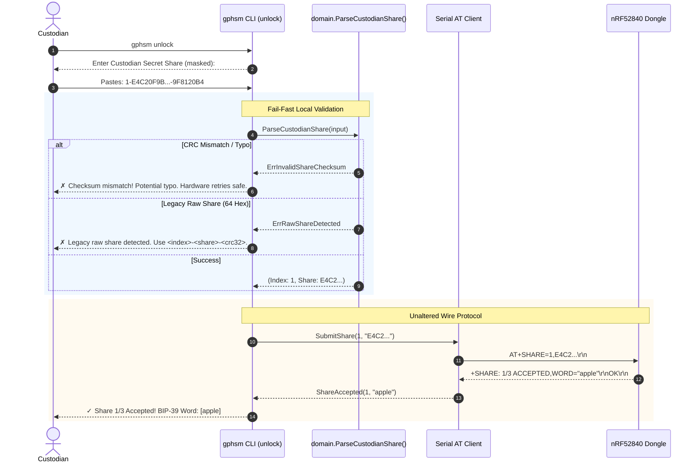

# Feature Specification: Shamir Custodian Share Format with CRC32 Checksum

> [!NOTE]
> **Lifecycle Status**: Phase 3 (Plan Approved)  
> **Target Branch**: `feature/shamir-checksummed-shares`  
> **Related Architecture Decision Records**:
> - [[Architecture/Decisions/ADR-0034 - Shamir Key Format with Embedded Index and CRC32 Checksum|ADR-0034: Shamir Key Format with Embedded Index and CRC32 Checksum]]  
> - [[Architecture/Decisions/ADR-0016 - Dual-Mode Authentication Architecture (PIN and Shamir Secret Sharing)|ADR-0016: Dual-Mode Authentication Architecture (PIN and Shamir Secret Sharing)]]  
> - [[Architecture/Decisions/ADR-0017 - Host CLI Rebranding to gphsm and PKCS11 Refactoring to libgphsm|ADR-0017: Host CLI Rebranding to gphsm and PKCS#11 Refactoring to libgphsm]]  
> - [[Architecture/Decisions/ADR-0019 - HSM Device Initialization and Dual-Mode Protocol Compatibility|ADR-0019: HSM Device Initialization and Dual-Mode Protocol Compatibility]]  
> **Technical Specification**:
> - [[Specification/Shamir Key Format with Embedded Index and CRC32 Checksum|Technical Specification: Shamir Key Format with Embedded Index and CRC32 Checksum]]  
> **Implementation Plan**:
> - [[Plan/Shamir Key Format with Embedded Index and CRC32 Checksum Implementation Plan|Implementation Plan: Shamir Key Format with Embedded Index and CRC32 Checksum]]  
> **Target Repositories**:
> - Host CLI ([`hsm-cli`](file:///Users/gpfister/Development/Projects/gpfister/nrf52840-hsm/hsm-cli))
> - Documentation Vault ([`hsm-obsidian`](file:///Users/gpfister/Development/Projects/gpfister/nrf52840-hsm/hsm-obsidian))

---

## 1. Feature Overview & Problem Context

In high-assurance cryptographic deployments using the 3-of-5 Shamir Secret Sharing threshold scheme, managing custodian shares poses severe operational risks:

1. **Typo-Induced Hardware Lockouts**: In baseline implementations, raw 64-hexadecimal strings lack error detection. A single mistyped character during an authentication ceremony triggers a rejection from the microcontroller, decrementing its hardware non-volatile retry counter. After 3 bad attempts, the device undergoes permanent lockout, destroying unbacked private keys.
2. **Index Disassociation**: Custodians frequently record the 64-hex string on physical media (paper, steel plates) without recording the 1-based custodian index ($1 \dots 5$), or enter an incorrect index during recovery.
3. **Multi-Prompt Friction**: Previous unlocking flows required custodians to respond to two consecutive prompts: entering an index in cleartext, followed by masked share entry.

This feature resolves these issues by introducing a self-contained, 75-character delimited format:
$$\mathbf{\langle index \rangle \textbf{--} \langle 64\_hex\_share \rangle \textbf{--} \langle 8\_hex\_crc32 \rangle}$$

The host CLI (`gphsm`) validates syntax and verifies the IEEE 802.3 CRC-32 checksum locally **prior** to sending any AT command across the serial link. If an operator mistypes a character, the error is caught offline instantly, preserving device retry counters.

---

## 2. Canonical Format & Visual Anatomy

```text
 1 - 3F8C9E4B2A... (64 hex characters / 32 bytes) ...7D1E - A5C92B4F
─┬─ ─┬─────────────────────────────────────────────────┬─ ─┬───────┬─
 │   │                                                 │   │       └─ 8-Hex IEEE 802.3 CRC32
 │   │                                                 │   └───────── Hyphen Delimiter ('-')
 │   │                                                 └───────────── 32-Byte Secret Share (64 Hex)
 │   └─────────────────────────────────────────────────────────────── Hyphen Delimiter ('-')
 └─────────────────────────────────────────────────────────────────── Custodian Index (1..5)
```

- **Exact Length**: Exactly 75 characters.
- **Index**: ASCII digit `'1'` through `'5'`.
- **Payload**: 64 hexadecimal characters representing the 32-byte secret share.
- **Checksum**: 8 hexadecimal characters representing standard IEEE 802.3 CRC-32 computed over the 33-byte binary payload:
  $$\text{Payload} = \left[ \text{uint8}(index) \;\parallel\; \text{raw\_share\_bytes} \right]$$

---

## 3. Operational Workflows

### 3.1 Device Initialization Ceremony (`gphsm device init --mode shamir`)

During Shamir initialization, the CLI communicates with the HSM via `AT+INIT=SHAMIR` (with fallback to `AT+INIT=1` per [[Architecture/Decisions/ADR-0019 - HSM Device Initialization and Dual-Mode Protocol Compatibility|ADR-0019]]). The emitted raw shares are packaged into formatted strings and displayed turn-by-turn:

```text
================================================================================
              PRIVATE SECRET SHARE — CUSTODIAN #1                             
================================================================================
 Custodian Index: 1
 Formatted Share: 1-E4C20F9B103847FA6283D04C2E910237B4810239A01928374650192837465012-9F8120B4
--------------------------------------------------------------------------------
CRITICAL INSTRUCTIONS:
 1. Record your COMPLETE formatted share including index and checksum suffix.
 2. Format: <index>-<64_hex_share>-<8_hex_crc32> (e.g. 1-AAAA...-BBBB).
 3. Never store this share on a computer, phone, or connected system.
 4. At least 3 of 5 custodian shares are required to unlock this HSM.
================================================================================
```

### 3.2 Threshold Authentication Ceremony (`gphsm unlock`)

During device unlocking, the previous two-stage interrogation is replaced by a single masked prompt:



---

## 4. Hardware Non-Volatile Retry Protection

The nRF52840 dongle enforces a hardware policy: 3 consecutive invalid authentication submissions permanently locks the device.

| Failure Cause | Handled By | Serial AT Sent? | HW Retry Decremented? |
| :--- | :--- | :--- | :--- |
| **Typo in Hex Share** | CLI `ParseCustodianShare` | **No** | **No (Protected)** |
| **Typo in Custodian Index** | CLI `ParseCustodianShare` | **No** | **No (Protected)** |
| **Typo in CRC Suffix** | CLI `ParseCustodianShare` | **No** | **No (Protected)** |
| **Malformed Delimiters** | CLI `ParseCustodianShare` | **No** | **No (Protected)** |
| **Legacy 64-Hex String** | CLI `ParseCustodianShare` | **No** | **No (Protected)** |
| **Valid Syntax, Wrong Secret** | HSM Keystore | Yes (`AT+SHARE`) | Yes (Microcontroller Decrements) |

---

## 5. Verifiable Acceptance Criteria

1. **Round-Trip Parity**:
   `ParseCustodianShare(FormatCustodianShare(i, s)) == (i, s, nil)` for all $i \in [1, 5]$ and valid 32-byte shares.
2. **Typo Interception**:
   Mutating any single character in the index, share, or checksum produces `ErrInvalidShareChecksum` or `ErrInvalidShareFormat`.
3. **Legacy Raw Share Rejection**:
   Submitting a 64-character hex string returns `ErrRawShareDetected` with clear upgrade guidance.
4. **Hardware Retry Invariance**:
   Entering an invalid or corrupted share in `gphsm unlock` leaves `AT+STATUS?` retries unchanged at 3.
5. **Single-Prompt Ceremony**:
   `gphsm unlock` requires exactly one masked input per custodian.
