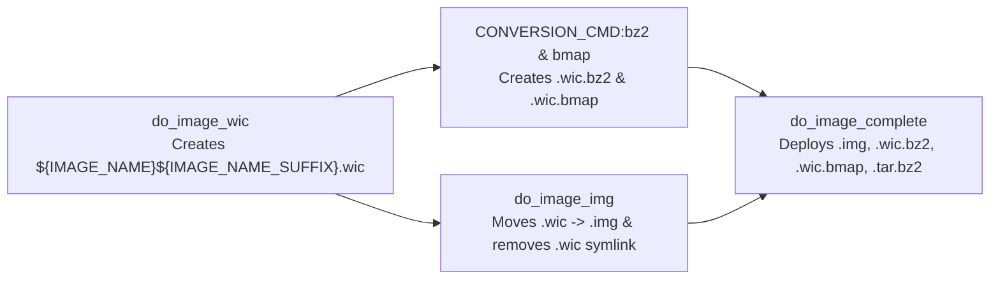

# Feature: Uncompressed Disk Image `.img` Output in `rpi-z2w-yocto-hsm`

> [!NOTE]
> **Lifecycle Phase**: Phase 5 (Implementation & Build Verification Complete — Pre-Merge Review).  
> **Target Branch**: `feature/img-disk-image-output` (commit [`f4adf0b`](file:///Users/gpfister/Development/Projects/gpfister/nrf52840-hsm/rpi-z2w-yocto-hsm)) in [`rpi-z2w-yocto-hsm`](file:///Users/gpfister/Development/Projects/gpfister/nrf52840-hsm/rpi-z2w-yocto-hsm).  
> **Architecture Decision Record**: [[Architecture/Decisions/ADR-0005 - Custom BitBake img Image Type via WIC Rename|ADR-0005: Custom BitBake img Image Type via WIC Rename]].  
> **Specification Record**: [[Specification/Uncompressed Disk Image img Output in rpi-z2w-yocto-hsm|Uncompressed Disk Image .img Output in rpi-z2w-yocto-hsm Specification]].  
> **Implementation Plan**: [[Plan/Uncompressed Disk Image img Output Implementation Plan|Implementation Plan: Uncompressed Disk Image .img Output]].  
> **Supersedes / Evolves**: [[features/uncompressed-wic-image-and-sd-flash-tooling|Feature: Uncompressed WIC Image Generation & SD Flash Tooling Alignment]].

---

## 1. Summary & Problem Motivation

In [`rpi-z2w-yocto-hsm`](file:///Users/gpfister/Development/Projects/gpfister/nrf52840-hsm/rpi-z2w-yocto-hsm), the Yocto Scarthgap build configuration previously set `IMAGE_FSTYPES = "tar.bz2 wic wic.bz2 wic.bmap"` in [`kas-project.yml`](file:///Users/gpfister/Development/Projects/gpfister/nrf52840-hsm/rpi-z2w-yocto-hsm/kas-project.yml#L57), outputting the uncompressed partitioned SD card image with the `.wic` extension (`*.rootfs.wic`).

However, desktop and CLI disk imaging tools across macOS, Linux, and Windows — including Raspberry Pi Imager, BalenaEtcher, and macOS `hdiutil`/`Disk Utility` — expect raw disk images to carry a standard `.img` file extension rather than `.wic`.

This feature replaces the uncompressed `.wic` output artifact with `.img` while preserving `.wic.bz2`, `.wic.bmap`, and `.tar.bz2` outputs, avoiding redundant `wic create` execution during the BitBake build pipeline, and aligning helper scripts (`scripts/flash-sd.sh`), `.gitignore` rules, and documentation.

---

## 2. Architecture & BitBake Image Pipeline

By declaring `IMAGE_TYPEDEP:img = "wic"` and `IMAGE_CMD:img` in [`kas-project.yml`](file:///Users/gpfister/Development/Projects/gpfister/nrf52840-hsm/rpi-z2w-yocto-hsm/kas-project.yml#L58-L59) and [`hsm-image-base.bb`](file:///Users/gpfister/Development/Projects/gpfister/nrf52840-hsm/rpi-z2w-yocto-hsm/meta-hsm-os/recipes-core/images/hsm-image-base.bb#L35-L39):
1. BitBake schedules `do_image_wic` first (`IMAGE_CMD:wic` produces `${IMGDEPLOYDIR}/${IMAGE_NAME}${IMAGE_NAME_SUFFIX}.wic` where `IMAGE_NAME_SUFFIX = ".rootfs"`) and runs `CONVERSION_CMD:bz2` and `CONVERSION_CMD:bmap` inline inside `do_image_wic` to emit `.wic.bz2` and `.wic.bmap`.
2. Next, `do_image_img` executes (`after do_image_wic`), renaming `${IMGDEPLOYDIR}/${IMAGE_NAME}${IMAGE_NAME_SUFFIX}.wic` to `${IMGDEPLOYDIR}/${IMAGE_NAME}${IMAGE_NAME_SUFFIX}.img` and removing `${IMGDEPLOYDIR}/${IMAGE_LINK_NAME}.wic`.
3. BitBake's automatic `create_symlinks` post-function on `do_image_img` creates `${IMGDEPLOYDIR}/${IMAGE_LINK_NAME}.img -> ${IMAGE_NAME}${IMAGE_NAME_SUFFIX}.img`.
4. `do_image_complete` stages `.img`, `.wic.bz2`, `.wic.bmap`, and `.tar.bz2` into `DEPLOY_DIR_IMAGE` with zero uncompressed `.wic` artifacts remaining.

---

## 3. Functional Requirements Summary

| ID | Requirement | Target File |
| :--- | :--- | :--- |
| **FR-1** | Update `IMAGE_FSTYPES = "tar.bz2 img wic.bz2 wic.bmap"` | [`kas-project.yml`](file:///Users/gpfister/Development/Projects/gpfister/nrf52840-hsm/rpi-z2w-yocto-hsm/kas-project.yml#L57) |
| **FR-2** | Define `IMAGE_TYPEDEP:img = "wic"` and `IMAGE_CMD:img` (in-place `mv` + symlink cleanup) | [`kas-project.yml`](file:///Users/gpfister/Development/Projects/gpfister/nrf52840-hsm/rpi-z2w-yocto-hsm/kas-project.yml#L58-L59), [`hsm-image-base.bb`](file:///Users/gpfister/Development/Projects/gpfister/nrf52840-hsm/rpi-z2w-yocto-hsm/meta-hsm-os/recipes-core/images/hsm-image-base.bb#L35-L39) |
| **FR-3** | Add `*.img` ignore pattern alongside `*.wic`, `*.wic.bz2`, `*.wic.bmap`, `*.tar.bz2`, `*.raucb` | [`.gitignore`](file:///Users/gpfister/Development/Projects/gpfister/nrf52840-hsm/rpi-z2w-yocto-hsm/.gitignore#L7) |
| **FR-4** | Update SD card flashing helper script and README instructions from `.wic` to `.img` | [`scripts/flash-sd.sh`](file:///Users/gpfister/Development/Projects/gpfister/nrf52840-hsm/rpi-z2w-yocto-hsm/scripts/flash-sd.sh#L8-L10), [`README.md`](file:///Users/gpfister/Development/Projects/gpfister/nrf52840-hsm/rpi-z2w-yocto-hsm/README.md#L136-L145) |
| **FR-5** | Clean stale `.wic` artifacts from `build/deploy/images/raspberrypi0-2w-64/` and verify Kas build | `rpi-z2w-yocto-hsm/build/deploy/images/raspberrypi0-2w-64/` |

---

## 4. Implementation & Build Verification Report (Phase 4)

- **Repository**: [`rpi-z2w-yocto-hsm`](file:///Users/gpfister/Development/Projects/gpfister/nrf52840-hsm/rpi-z2w-yocto-hsm)
- **Branch**: `feature/img-disk-image-output`
- **Commit**: [`f4adf0b30072dff14c8feb887250dc81285dd16f`](file:///Users/gpfister/Development/Projects/gpfister/nrf52840-hsm/rpi-z2w-yocto-hsm)
- **Build Command**: `./scripts/run-kas.sh build kas-dev.yml` (`passed`)
- **Syntax Check**: `bash -n scripts/flash-sd.sh` (`passed`)
- **Deployed Artifacts Verified**:
  - `build/deploy/images/raspberrypi0-2w-64/hsm-image-dev-raspberrypi0-2w-64.rootfs-20261105103859.img`
  - `build/deploy/images/raspberrypi0-2w-64/hsm-image-dev-raspberrypi0-2w-64.rootfs.img -> hsm-image-dev-raspberrypi0-2w-64.rootfs-20261105103859.img`
  - `build/deploy/images/raspberrypi0-2w-64/hsm-image-dev-raspberrypi0-2w-64.rootfs.wic.bz2 -> hsm-image-dev-raspberrypi0-2w-64.rootfs-20261105103859.wic.bz2`
  - `build/deploy/images/raspberrypi0-2w-64/hsm-image-dev-raspberrypi0-2w-64.rootfs.wic.bmap -> hsm-image-dev-raspberrypi0-2w-64.rootfs-20261105103859.wic.bmap`
  - `build/deploy/images/raspberrypi0-2w-64/hsm-image-dev-raspberrypi0-2w-64.rootfs.tar.bz2 -> hsm-image-dev-raspberrypi0-2w-64.rootfs-20261105103859.tar.bz2`
- **No Stale `.wic` Files**: Confirmed (`noStaleWicFiles: true`).

---

## 5. Verifiable Acceptance Criteria

- [x] **AC-1**: [`kas-project.yml`](file:///Users/gpfister/Development/Projects/gpfister/nrf52840-hsm/rpi-z2w-yocto-hsm/kas-project.yml#L57) sets `IMAGE_FSTYPES = "tar.bz2 img wic.bz2 wic.bmap"`.
- [x] **AC-2**: [`hsm-image-base.bb`](file:///Users/gpfister/Development/Projects/gpfister/nrf52840-hsm/rpi-z2w-yocto-hsm/meta-hsm-os/recipes-core/images/hsm-image-base.bb#L35-L39) and [`kas-project.yml`](file:///Users/gpfister/Development/Projects/gpfister/nrf52840-hsm/rpi-z2w-yocto-hsm/kas-project.yml#L58-L59) define `IMAGE_TYPEDEP:img = "wic"` and `IMAGE_CMD:img`.
- [x] **AC-3**: Running `./scripts/run-kas.sh build kas-dev.yml` in `rpi-z2w-yocto-hsm` succeeds with exit code `0`.
- [x] **AC-4**: `build/deploy/images/raspberrypi0-2w-64/` contains `hsm-image-dev-raspberrypi0-2w-64.rootfs.img` pointing to `hsm-image-dev-raspberrypi0-2w-64.rootfs-20261105103859.img`, alongside `.wic.bz2`, `.wic.bmap`, and `.tar.bz2`.
- [x] **AC-5**: No uncompressed `.wic` files exist in `build/deploy/images/raspberrypi0-2w-64/`.
- [x] **AC-6**: [`rpi-z2w-yocto-hsm/.gitignore`](file:///Users/gpfister/Development/Projects/gpfister/nrf52840-hsm/rpi-z2w-yocto-hsm/.gitignore), [`scripts/flash-sd.sh`](file:///Users/gpfister/Development/Projects/gpfister/nrf52840-hsm/rpi-z2w-yocto-hsm/scripts/flash-sd.sh), and [`README.md`](file:///Users/gpfister/Development/Projects/gpfister/nrf52840-hsm/rpi-z2w-yocto-hsm/README.md) are updated to reflect `.img`.
