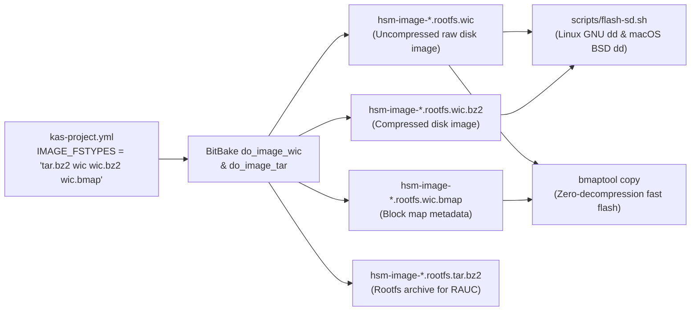

# Feature: Uncompressed WIC Image Generation & SD Flash Tooling Alignment

> [!NOTE]
> **Lifecycle Phase**: Phase 6 (Merge / Post-Merge Complete).  
> **Merged Target**: `main` in [`rpi-z2w-yocto-hsm`](file:///Users/gpfister/Development/Projects/gpfister/nrf52840-hsm/rpi-z2w-yocto-hsm) (fast-forward merge of `feature/uncompressed-wic-image`, commit [`b99899f`](file:///Users/gpfister/Development/Projects/gpfister/nrf52840-hsm/rpi-z2w-yocto-hsm), branch pruned).  
> **Release Note**: [[Changelog|Release v0.4.0-alpha - Air-Gapped Raspberry Pi Embedded Linux OS]].  
> **Specification Record**: [[Specification/Uncompressed WIC Image Generation and SD Flash Tooling Alignment|Uncompressed WIC Image Generation & SD Flash Tooling Alignment Specification]].  
> **Implementation Plan**: [[Plan/Uncompressed WIC Image Generation and SD Flash Tooling Implementation Plan|Implementation Plan: Uncompressed WIC Image Generation & SD Flash Tooling]].  
> **Operational Guide**: [[Development/Yocto Build and RAUC Update Guide|Yocto Build and RAUC Update Guide]].

---

## 1. Summary & Problem Motivation

The **`rpi-z2w-yocto-hsm`** sub-repository builds an air-gapped Yocto Project 5.0 LTS (`scarthgap`) Linux OS image for the Raspberry Pi Zero 2 W (`raspberrypi0-2w-64`) appliance using containerized Kas/BitBake.

### 1.1 Problem Statement
1. **Missing Standalone `.wic` Image Artifact**:
   - In [`kas-project.yml`](file:///Users/gpfister/Development/Projects/gpfister/nrf52840-hsm/rpi-z2w-yocto-hsm/kas-project.yml#L57), `IMAGE_FSTYPES` was configured as `"tar.bz2 wic.bz2 wic.bmap"`.
   - When OpenEmbedded/BitBake runs `do_image_wic` followed by bzip2 compression without `wic` explicitly listed in `IMAGE_FSTYPES`, the intermediate uncompressed `.wic` image is removed or not retained in `DEPLOY_DIR_IMAGE` (`build/deploy/images/<machine>/`).
   - Many SD card flashing tools (e.g., Raspberry Pi Imager, BalenaEtcher, `bmaptool copy`, or direct raw `dd`) benefit from having the uncompressed `.wic` disk image available directly alongside `.wic.bz2`, `.wic.bmap`, and `.tar.bz2`.
2. **Stale Deploy Directory References**:
   - Both [`scripts/flash-sd.sh`](file:///Users/gpfister/Development/Projects/gpfister/nrf52840-hsm/rpi-z2w-yocto-hsm/scripts/flash-sd.sh#L9) and [`README.md`](file:///Users/gpfister/Development/Projects/gpfister/nrf52840-hsm/rpi-z2w-yocto-hsm/README.md#L140) referenced `build/tmp/deploy/images/...` in their examples, whereas [`kas-project.yml`](file:///Users/gpfister/Development/Projects/gpfister/nrf52840-hsm/rpi-z2w-yocto-hsm/kas-project.yml#L59) sets `DEPLOY_DIR = "${TOPDIR}/deploy"`, placing all artifacts in `build/deploy/images/<machine>/`.
3. **macOS BSD `dd` Incompatibility**:
   - [`scripts/flash-sd.sh`](file:///Users/gpfister/Development/Projects/gpfister/nrf52840-hsm/rpi-z2w-yocto-hsm/scripts/flash-sd.sh#L41-L50) hardcoded GNU coreutils `dd` arguments (`bs=4M status=progress conv=fsync`), which fail on macOS (`Darwin`) where BSD `dd` requires lowercase `bs=4m` and does not support `conv=fsync`.

---

## 2. Architecture & Build Pipeline Flow



---

## 3. Functional Requirements

### FR-1: Uncompressed WIC Image Emission in Kas Configuration
- Update `IMAGE_FSTYPES` in [`kas-project.yml`](file:///Users/gpfister/Development/Projects/gpfister/nrf52840-hsm/rpi-z2w-yocto-hsm/kas-project.yml#L57) from:
  ```bitbake
  IMAGE_FSTYPES = "tar.bz2 wic.bz2 wic.bmap"
  ```
  to:
  ```bitbake
  IMAGE_FSTYPES = "tar.bz2 wic wic.bz2 wic.bmap"
  ```
- Because neither [`kas-dev.yml`](file:///Users/gpfister/Development/Projects/gpfister/nrf52840-hsm/rpi-z2w-yocto-hsm/kas-dev.yml), [`kas-prod.yml`](file:///Users/gpfister/Development/Projects/gpfister/nrf52840-hsm/rpi-z2w-yocto-hsm/kas-prod.yml), nor the image recipes (`hsm-image-base.bb`, `hsm-image-dev.bb`, `hsm-image-prod.bb`) override `IMAGE_FSTYPES`, this setting applies globally across all image targets and machines.

### FR-2: Cross-Platform `dd` Support & Path Alignment in `scripts/flash-sd.sh`
- Update the usage hint in [`scripts/flash-sd.sh`](file:///Users/gpfister/Development/Projects/gpfister/nrf52840-hsm/rpi-z2w-yocto-hsm/scripts/flash-sd.sh#L8-L10) to reference `build/deploy/images/raspberrypi0-2w-64/hsm-image-prod-raspberrypi0-2w-64.rootfs.wic` (and `.wic.bz2`).
- Detect host OS (`uname -s`) in [`scripts/flash-sd.sh`](file:///Users/gpfister/Development/Projects/gpfister/nrf52840-hsm/rpi-z2w-yocto-hsm/scripts/flash-sd.sh#L37-L52) to pass platform-appropriate `dd` arguments:
  - **Darwin (macOS)**: `bs=4m status=progress` (relying on the subsequent `sync` command for flushing).
  - **Linux**: `bs=4M status=progress conv=fsync`.

### FR-3: Documentation Alignment in `README.md`
- Update Section 5 ("Flashing to SD Card") in [`README.md`](file:///Users/gpfister/Development/Projects/gpfister/nrf52840-hsm/rpi-z2w-yocto-hsm/README.md#L134-L142) to show the accurate `build/deploy/images/raspberrypi0-2w-64/` path and demonstrate flashing both the uncompressed `.wic` image and compressed `.wic.bz2` image.

### FR-4: Build Verification (`make yocto-build-dev`)
- Execute `make yocto-build-dev` from the workspace root (or `make build-dev` in `rpi-z2w-yocto-hsm`) to run the Yocto build and verify that `hsm-image-dev-raspberrypi0-2w-64.rootfs.wic` (both symlink and timestamped `.wic` file) is emitted alongside `.wic.bz2`, `.wic.bmap`, and `.tar.bz2` in `rpi-z2w-yocto-hsm/build/deploy/images/raspberrypi0-2w-64/`.

---

## 4. Non-Functional Requirements

- **Backward Compatibility**: Existing `.tar.bz2` (required by RAUC bundle recipes), `.wic.bz2`, and `.wic.bmap` artifacts remain intact and unaffected.
- **Safety & Reliability**: `flash-sd.sh` preserves `set -euo pipefail`, file existence checks, device node validation warnings, and the interactive `yes` confirmation gate before executing `dd`.
- **Build Cache Reuse**: Adding `wic` to `IMAGE_FSTYPES` leverages the existing BitBake `sstate-cache` and only re-runs image generation tasks (`do_image_wic`, `do_image_complete`) without rebuilding kernel or user-space packages.

---

## 5. Edge Cases & Mitigations

| Edge Case | Impact | Mitigation |
| :--- | :--- | :--- |
| **BitBake deletes intermediate `.wic` when only `wic.bz2` is specified** | Previously caused `.wic` to be removed after bzip2 compression | Explicitly listing `wic` alongside `wic.bz2` in `IMAGE_FSTYPES` instructs BitBake to retain both the raw `.wic` file/symlink and the compressed `.wic.bz2` artifact in `DEPLOY_DIR_IMAGE`. |
| **macOS BSD `dd` rejects `bs=4M` and `conv=fsync`** | `flash-sd.sh` fails immediately when run on a macOS host | Branch on `uname -s`: use `bs=4m status=progress` on `Darwin` and `bs=4M status=progress conv=fsync` on `Linux`. |
| **Symlink vs. regular file check (`-f`) in `flash-sd.sh`** | Yocto creates symlinks (`hsm-image-dev-raspberrypi0-2w-64.rootfs.wic` $\rightarrow$ `hsm-image-dev-raspberrypi0-2w-64.rootfs-<timestamp>.wic`) | In bash, `[[ -f "${IMAGE_PATH}" ]]` follows symlinks and evaluates to true as long as the target regular file exists. |

---

## 6. Verifiable Acceptance Criteria

- [x] **AC-1**: [`kas-project.yml`](file:///Users/gpfister/Development/Projects/gpfister/nrf52840-hsm/rpi-z2w-yocto-hsm/kas-project.yml#L57) sets `IMAGE_FSTYPES = "tar.bz2 wic wic.bz2 wic.bmap"`.
- [x] **AC-2**: [`scripts/flash-sd.sh`](file:///Users/gpfister/Development/Projects/gpfister/nrf52840-hsm/rpi-z2w-yocto-hsm/scripts/flash-sd.sh) passes `bash -n` syntax validation, displays `build/deploy/images/...` in its usage message, and uses OS-appropriate `dd` flags for macOS (`Darwin`) and Linux.
- [x] **AC-3**: [`README.md`](file:///Users/gpfister/Development/Projects/gpfister/nrf52840-hsm/rpi-z2w-yocto-hsm/README.md#L134-L142) references `build/deploy/images/raspberrypi0-2w-64/` for both `.wic` and `.wic.bz2` flashing commands.
- [x] **AC-4**: Running `make yocto-build-dev` succeeds with exit code `0` and produces all four artifact types in `rpi-z2w-yocto-hsm/build/deploy/images/raspberrypi0-2w-64/`:
  - `hsm-image-dev-raspberrypi0-2w-64.rootfs.wic` $\rightarrow$ `hsm-image-dev-raspberrypi0-2w-64.rootfs-20261105101217.wic` (**1.6 GB**)
  - `hsm-image-dev-raspberrypi0-2w-64.rootfs.wic.bz2` $\rightarrow$ `hsm-image-dev-raspberrypi0-2w-64.rootfs-20261105101217.wic.bz2` (**168 MB**)
  - `hsm-image-dev-raspberrypi0-2w-64.rootfs.wic.bmap` $\rightarrow$ `hsm-image-dev-raspberrypi0-2w-64.rootfs-20261105101217.wic.bmap` (**8.0 KB**)
  - `hsm-image-dev-raspberrypi0-2w-64.rootfs.tar.bz2` $\rightarrow$ `hsm-image-dev-raspberrypi0-2w-64.rootfs-20261105101217.tar.bz2` (**73 MB**)

---

## 7. Implementation & Verification Evidence

### 7.1 Repository Changes (`rpi-z2w-yocto-hsm`)
- **Branch**: `feature/uncompressed-wic-image` (commit `b99899f`)
- **Modified Files**:
  1. [`kas-project.yml`](file:///Users/gpfister/Development/Projects/gpfister/nrf52840-hsm/rpi-z2w-yocto-hsm/kas-project.yml#L57): Updated `IMAGE_FSTYPES = "tar.bz2 wic wic.bz2 wic.bmap"`.
  2. [`scripts/flash-sd.sh`](file:///Users/gpfister/Development/Projects/gpfister/nrf52840-hsm/rpi-z2w-yocto-hsm/scripts/flash-sd.sh#L8-L52): Updated usage example paths to `build/deploy/images/raspberrypi0-2w-64/...` and added `uname -s` detection (`bs=4m status=progress` on `Darwin`, `bs=4M status=progress conv=fsync` on `Linux`).
  3. [`README.md`](file:///Users/gpfister/Development/Projects/gpfister/nrf52840-hsm/rpi-z2w-yocto-hsm/README.md#L134-L142): Updated Section 5 ("Flashing to SD Card") with `build/deploy/images/raspberrypi0-2w-64/` paths for both `.wic` and `.wic.bz2`.

### 7.2 Build & Artifact Verification (`make yocto-build-dev`)
All four artifact symlinks and timestamped target files were verified in [`rpi-z2w-yocto-hsm/build/deploy/images/raspberrypi0-2w-64/`](file:///Users/gpfister/Development/Projects/gpfister/nrf52840-hsm/rpi-z2w-yocto-hsm/build/deploy/images/raspberrypi0-2w-64):

| Symlink | Target Artifact | Size | Status |
| :--- | :--- | :--- | :--- |
| `hsm-image-dev-raspberrypi0-2w-64.rootfs.wic` | `hsm-image-dev-raspberrypi0-2w-64.rootfs-20261105101217.wic` | **1.6 GB** | Verified |
| `hsm-image-dev-raspberrypi0-2w-64.rootfs.wic.bz2` | `hsm-image-dev-raspberrypi0-2w-64.rootfs-20261105101217.wic.bz2` | **168 MB** | Verified |
| `hsm-image-dev-raspberrypi0-2w-64.rootfs.wic.bmap` | `hsm-image-dev-raspberrypi0-2w-64.rootfs-20261105101217.wic.bmap` | **8.0 KB** | Verified |
| `hsm-image-dev-raspberrypi0-2w-64.rootfs.tar.bz2` | `hsm-image-dev-raspberrypi0-2w-64.rootfs-20261105101217.tar.bz2` | **73 MB** | Verified |
