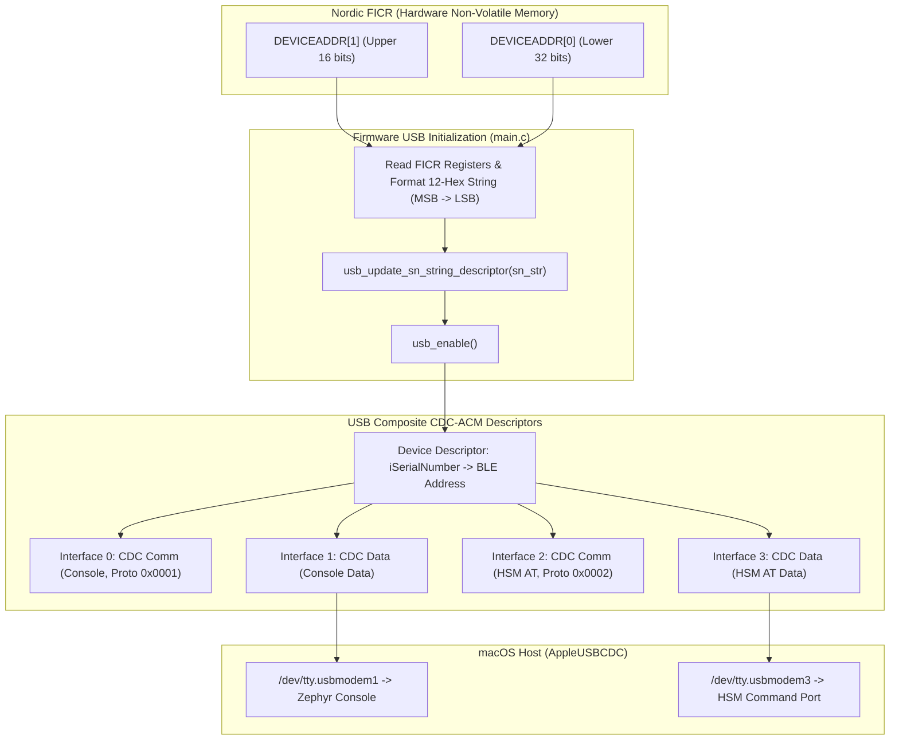

# Feature Specification: nRF52840 USB Descriptors & Device Identification Configuration

> [!NOTE]
> This specification was formulated during **Phase 2 (Specify)** of the feature lifecycle and approved in session [[Sessions/bd3d2f5d-cc3c-4513-97fd-6b35e8fb0ddc|bd3d2f5d-cc3c-4513-97fd-6b35e8fb0ddc]]. The original artifact is archived at `Sessions/attachments/bd3d2f5d-cc3c-4513-97fd-6b35e8fb0ddc/specification.md`.

---

## 1. Summary & Problem Motivation

The nRF52840 Dongle (`PCA10059`) functions as a dual-stage secure boot Hardware Security Module (HSM). It exposes two USB CDC-ACM communication channels:
1. `cdc_acm_uart0`: Zephyr kernel console, logging, and diagnostics.
2. `cdc_acm_uart1`: HSM binary / AT command interaction channel for `hsmutil` and `libnrf52840_pkcs11`.

### 1.1 Problem Statement
Currently, generic USB descriptor settings cause macOS and other host operating systems to assign non-deterministic or generic `/dev/tty.usbmodem*` node names. When multiple dongles are plugged in simultaneously, or when switching between bootloader and application modes, hosts cannot deterministically map specific dongles or distinguish between the serial console interface and the HSM command interface.

Furthermore, device management tools and PKCS#11 callers require deterministic serial numbers and protocol identification in USB descriptor metadata to discover dongles without trial-and-error serial handshakes.

### 1.2 Proposed Solution
1. **Dynamic Hardware Serial Number**: Extract the factory-burned 48-bit Bluetooth Device Address from the Nordic Factory Information Configuration Registers (`NRF_FICR->DEVICEADDR[1]` and `NRF_FICR->DEVICEADDR[0]`). Format this address as a 12-character uppercase hexadecimal string without delimiters (`%04X%08X`) and dynamically register it as the USB Serial Number string descriptor via Zephyr's `usb_update_sn_string_descriptor()` before `usb_enable()`.
2. **Predictable macOS TTY Device Nodes**: Leverage the native macOS `AppleUSBCDC` kernel driver behavior. macOS constructs device node names formatted as `/dev/tty.usbmodem<SERIAL_NUMBER><INTERFACE_NUM>`. Dual CDC-ACM allocates interface pairs (0/1 for Console, 2/3 for AT Command channel). macOS attaches TTY nodes to the data interfaces, producing deterministic paths:
   - `/dev/tty.usbmodem<BLE_ADDR>1` for Console (`cdc_acm_uart0`)
   - `/dev/tty.usbmodem<BLE_ADDR>3` for HSM AT Command interface (`cdc_acm_uart1`)
3. **Protocol Identifiers & Vendor Metadata**:
   - Assign protocol identifiers in interface descriptors: `0x0001` for Console interface and `0x0002` for HSM Command interface.
   - Expose the device serial number and protocol metadata in USB vendor / interface descriptors.
4. **Monitoring & Firmware Update Verification**:
   - Verify build and flashing with J-Link on both connected dongles.
   - Verify simultaneous monitoring of console and command interfaces on macOS.
   - Execute a streaming firmware update using `hsmutil` to validate dual-slot bootloader candidate staging and reboot verification.

---

## 2. Technical Architecture & Descriptor Mapping



### 2.1 macOS Device Node Naming Rationale
On macOS, device node naming for USB Communication Device Class (CDC) devices is governed by the kernel-level `AppleUSBCDC` driver (or `AppleUSBHostPlatform`). Specifically:
- The driver generates BSD tty node names adhering to the pattern:
  ```text
  /dev/tty.usbmodem<SERIAL_NUMBER><INTERFACE_INDEX>
  ```
- Zephyr's dual CDC-ACM stack allocates USB interfaces sequentially:
  - Interface 0: CDC Communication Class (Console Control)
  - Interface 1: CDC Data Class (Console Data) $\rightarrow$ attached as `/dev/tty.usbmodem<BLE_ADDR>1`
  - Interface 2: CDC Communication Class (HSM Control)
  - Interface 3: CDC Data Class (HSM Data) $\rightarrow$ attached as `/dev/tty.usbmodem<BLE_ADDR>3`
- *Technical Note on Custom Node Aliasing*: Creating custom `/dev/` symlinks or arbitrary naming on macOS would require a dedicated macOS DriverKit DEXT (Driver Extension) or launchd devd/hotplug daemons, which introduces elevated privileges and system extension approvals. Adopting standard `/dev/tty.usbmodem<BLE_ADDR><1|3>` provides zero-privilege, out-of-the-box determinism across all host tools (`hsmutil`, `openocd`, `picocom`, `minicom`).

---

## 3. Functional Requirements

### FR-01: FICR Bluetooth Device Address Extraction
- The firmware must read `NRF_FICR->DEVICEADDR[1]` and `NRF_FICR->DEVICEADDR[0]`.
- The address must be synthesized as a 48-bit value where `DEVICEADDR[1] & 0xFFFF` forms the most significant 16 bits, and `DEVICEADDR[0]` forms the least significant 32 bits.
- Format: Exactly 12 uppercase hexadecimal characters (`%04X%08X`), null-terminated.
- Must execute during application initialization *before* calling `usb_enable(NULL)`.

### FR-02: USB Serial Number Descriptor Registration
- Call Zephyr's `usb_update_sn_string_descriptor()` with the 12-digit hex string.
- The USB Device Descriptor string descriptor index for `iSerialNumber` must point to this dynamically allocated descriptor.
- Host USB tree interrogation tools (`system_profiler SPUSBDataType` on macOS, `lsusb -v` on Linux) must report `Serial Number: <12_HEX_DIGITS>`.

### FR-03: USB Interface & Protocol Identifiers
- Dual CDC-ACM configuration in Zephyr devicetree / Kconfig:
  - CDC-ACM UART 0: Assigned protocol identifier `0x0001` (Zephyr Console / Logging).
  - CDC-ACM UART 1: Assigned protocol identifier `0x0002` (HSM AT Command Interface).
- USB vendor descriptors and interface descriptors must export these protocol identifiers and serial number mapping.

### FR-04: Tool Discovery & Deterministic Port Detection
- `hsmutil` and `libnrf52840_pkcs11` must support automatic port detection:
  - Scan `/dev/tty.usbmodem*` on macOS (and equivalent `/dev/serial/by-id/*` on Linux).
  - Identify Dongles by checking serial number and port suffix (`3` for AT interface, `1` for Console).
  - Allow explicit `--serial <BLE_ADDR>` flag targeting in CLI commands.

### FR-05: Multi-Device Monitoring & Firmware Update
- Support connecting and distinguishing at least two physical nRF52840 dongles simultaneously.
- Verify streaming firmware upload via `hsmutil firmware update --file <signed_image.bin>`:
  - Target candidate partition slot (`slot1_partition`).
  - Verify dual-stage bootloader signature verification upon device reset.
  - Device confirms active firmware version on reboot.

---

## 4. Non-Functional Requirements

### NFR-01: Performance & Startup Latency
- Register extraction and USB descriptor update overhead must not exceed 500 microseconds during boot.
- USB enumeration must complete within 250 milliseconds of USB bus attachment.

### NFR-02: Cryptographic & Hardware Safety
- `NRF_FICR` access must be strictly read-only. No write attempts to protected factory memory.
- Dynamic USB serial number buffer must be statically or securely allocated with zero risk of buffer overflows (bounds checked to 13 bytes including null terminator).

### NFR-03: Backward Compatibility
- If `NRF_FICR` contains erased/invalid addresses (`0xFFFFFFFFFFFF`), fallback to a valid pseudo-unique serial derived from `NRF_FICR->DEVICEID[0]` and `[1]`.
- Maintain full protocol packet compatibility with existing `hsmutil` commands and `libnrf52840_pkcs11` PKCS#11 Cryptoki calls.

---

## 5. Affected Workspaces & Repositories

| Repository | Path | Key Files / Areas |
| :--- | :--- | :--- |
| **Firmware** | [nrf52840-hsm-firmware](file:///Users/gpfister/Development/Projects/gpfister/nrf52840-hsm/nrf52840-hsm-firmware/) | [`src/main.c`](file:///Users/gpfister/Development/Projects/gpfister/nrf52840-hsm/nrf52840-hsm-firmware/src/main.c), [`prj.conf`](file:///Users/gpfister/Development/Projects/gpfister/nrf52840-hsm/nrf52840-hsm-firmware/prj.conf), [`boards/nrf52840dongle_nrf52840.overlay`](file:///Users/gpfister/Development/Projects/gpfister/nrf52840-hsm/nrf52840-hsm-firmware/boards/nrf52840dongle_nrf52840.overlay) |
| **CLI** | [nrf52840-hsm-cli](file:///Users/gpfister/Development/Projects/gpfister/nrf52840-hsm/nrf52840-hsm-cli/) | [`internal/serial/`](file:///Users/gpfister/Development/Projects/gpfister/nrf52840-hsm/nrf52840-hsm-cli/internal/serial/), [`cmd/`](file:///Users/gpfister/Development/Projects/gpfister/nrf52840-hsm/nrf52840-hsm-cli/cmd/), [`internal/firmware/`](file:///Users/gpfister/Development/Projects/gpfister/nrf52840-hsm/nrf52840-hsm-cli/internal/firmware/) |
| **PKCS#11** | [nrf52840-hsm-libpkcs11](file:///Users/gpfister/Development/Projects/gpfister/nrf52840-hsm/nrf52840-hsm-libpkcs11/) | [`src/transport.c`](file:///Users/gpfister/Development/Projects/gpfister/nrf52840-hsm/nrf52840-hsm-libpkcs11/src/transport.c), [`src/pkcs11.c`](file:///Users/gpfister/Development/Projects/gpfister/nrf52840-hsm/nrf52840-hsm-libpkcs11/src/pkcs11.c) |
| **Obsidian Vault** | [nrf52840-hsm-obsidian](file:///Users/gpfister/Development/Projects/gpfister/nrf52840-hsm/nrf52840-hsm-obsidian/) | [[features/usb-descriptors-ble-address|features/usb-descriptors-ble-address.md]], [[Architecture/USB Composite Stack|Architecture/USB Composite Stack.md]] |

---

## 6. Edge Cases & Mitigations

| Edge Case | Risk | Mitigation |
| :--- | :--- | :--- |
| **Host CDC Driver Port Race** | Interface 1 and Interface 3 attach in arbitrary order on host reboot. | `hsmutil` matches port suffix explicitly (`3` for AT, `1` for Console) rather than enumeration order. |
| **Unprovisioned / Blank FICR** | Development engineering samples with unprogrammed `DEVICEADDR`. | Detect all `0xFF` or all `0x00`, fall back to `DEVICEID[1]:DEVICEID[0]`. |
| **DFU Mode Node Naming** | Entering MCUboot or Nordic DFU bootloader changes USB VID/PID and serial. | Document DFU USB VID/PID mapping and ensure CLI clearly detects bootloader mode vs application runtime. |
| **macOS USB Port Caching** | macOS IORegistry occasionally caches old descriptors if dongle resets rapidly. | Trigger explicit USB bus disconnect/re-enumeration or configure DTR line assertion. |

---

## 7. Verifiable Acceptance Criteria

- [ ] **AC-01 (Descriptor Verification)**: Running `system_profiler SPUSBDataType` on macOS displays the dongle with `Serial Number: <12_HEX_DIGITS>` matching `NRF_FICR->DEVICEADDR`.
- [ ] **AC-02 (Node Creation)**: Dual device nodes `/dev/tty.usbmodem<BLE_ADDR>1` and `/dev/tty.usbmodem<BLE_ADDR>3` are created on macOS.
- [ ] **AC-03 (Console Access)**: Opening `/dev/tty.usbmodem<BLE_ADDR>1` at 115200 baud displays Zephyr boot banner and log output.
- [ ] **AC-04 (HSM Command Interface)**: Sending `AT` or HSM framing over `/dev/tty.usbmodem<BLE_ADDR>3` produces expected cryptographic responses.
- [ ] **AC-05 (Multi-Dongle Support)**: Connecting two dongles simultaneously creates distinct nodes for each dongle based on their respective FICR BLE addresses without naming collisions.
- [ ] **AC-06 (Firmware Update Verification)**: Executing `hsmutil firmware update --file <app_update.bin>` completes streaming upload, passes MCUboot dual-stage signature verification, boots new image, and retains deterministic device node naming.

---

## 8. Cross-References & Related Notes

- [[Specification/USB Descriptors and Device Identification|USB Descriptors and Device Identification Implementation Specification]]
- [[Architecture/USB Composite Stack|USB Composite Stack Architecture]]
- [[Architecture/System Architecture|System Architecture]]
- [[Development/CLI Reference|CLI Reference (`hsmutil`)]]
- [[Sessions/bd3d2f5d-cc3c-4513-97fd-6b35e8fb0ddc|Phase 2 Specification Session]]
