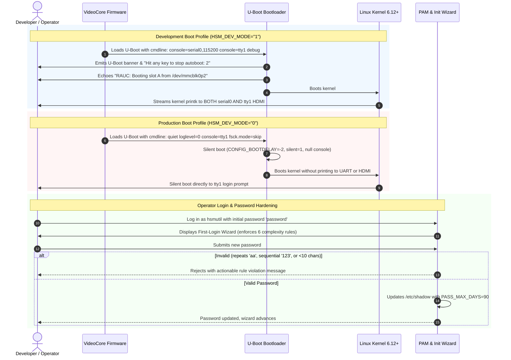

# Feature: Yocto Dev/Prod Boot Visibility, U-Boot Hardening, and `hsmutil` Password Security Policy

## 1. Feature Description & User Stories

The **Yocto Dev/Prod Boot Visibility and Security Policy** feature delivers full boot pipeline differentiation between development and production builds of the air-gapped embedded Linux operating system ([`meta-hsm-os`](file:///Users/gpfister/Development/Projects/gpfister/nrf52840-hsm/rpi-z2w-yocto-hsm/meta-hsm-os)), while instituting strict, enterprise-grade password security standards for appliance operators.

### User Stories

- **As an Embedded Firmware & OS Developer**:
  - When booting `hsm-image-dev` (`HSM_DEV_MODE="1"`), I want kernel `printk` logs displayed simultaneously on both the HDMI monitor and UART serial console so that I can observe driver initializations, storage enumeration, and early boot warnings without needing to choose between display sinks.
  - I want U-Boot to provide an interactive prompt with a 2-second abort window and print RAUC slot selection diagnostics so that I can debug boot scripts, inspect device trees, and manually select partitions.
  - I want U-Boot to compile cleanly across all supported boards (`raspberrypi0-2w-64`, `raspberrypi3-64`, `raspberrypi4-64`, `raspberrypi5`) without fragile defconfig patch failures.

- **As a Cryptographic Appliance Security Officer**:
  - When running `hsm-image-prod` (`HSM_DEV_MODE="0"`), I want the boot pipeline to be completely silent and non-interactive (`CONFIG_BOOTDELAY=-2`, `silent=1`, `quiet loglevel=0`), preventing unauthorized local tampering via serial break keys and eliminating side-channel console leaks.
  - I want the initial default operator password to be standard `password` instead of predictable `hsmutil`, and require immediate interactive change on first boot.
  - I want all password changes—both via the interactive first-login wizard and the standard `passwd` utility—to strictly enforce complexity rules (10+ characters, mixed case, numbers, symbols, no repeated characters, no sequential characters) and enforce a mandatory 90-day password expiration policy (`PASS_MAX_DAYS 90`).

---

## 2. Capability Matrix

| Feature Capability | Development Profile (`HSM_DEV_MODE="1"`) | Production Profile (`HSM_DEV_MODE="0"`) |
| :--- | :--- | :--- |
| **U-Boot Interactivity** | Interactive console (`CONFIG_BOOTDELAY=2`) | Non-interactive (`CONFIG_BOOTDELAY=-2`, abort disabled) |
| **U-Boot Serial Output** | Diagnostic banners & RAUC slot `echo` | Silent null console (`CONFIG_SILENT_CONSOLE=y`, `silent=1`) |
| **Kernel Log Output** | Dual console (`console=serial0,115200 console=tty1`) | Single silent console (`console=tty1 quiet loglevel=0`) |
| **Kernel Log Verbosity** | Verbose (`loglevel=7 debug earlyprintk`) | Suppressed (`quiet loglevel=0 fsck.mode=skip`) |
| **Initial Password** | `password` (SHA-512 crypt) | `password` (SHA-512 crypt) |
| **PAM Complexity Enforcement** | `pam_pwquality` (minlen=10, credits=-1, maxrepeat=1, maxsequence=2) | Same |
| **First-Login Wizard Pre-Validation** | Enforces all 6 complexity rules with clear UI feedback | Same |
| **Password Expiration** | 90 days (`PASS_MAX_DAYS 90` in `/etc/login.defs` and `/etc/shadow`) | Same |

---

## 3. Architecture & Subsystem Interactions

---

## 4. Password Quality Rules Specification

Every candidate password must satisfy all 6 rules simultaneously:

1. **Length**: $\ge 10$ characters (`minlen = 10`).
2. **Numeric Digits**: $\ge 1$ digit `[0-9]` (`dcredit = -1`).
3. **Uppercase Letters**: $\ge 1$ uppercase letter `[A-Z]` (`ucredit = -1`).
4. **Special Characters**: $\ge 1$ punctuation/symbol character `[^a-zA-Z0-9]` (`ocredit = -1`).
5. **No Adjacent Repetitions**: No 2 consecutive identical characters (`maxrepeat = 1`), e.g., `pass`, `11`, `$$` are rejected.
6. **No Monotonic Sequences**: No 3 monotonic consecutive alphanumeric characters in ascending or descending order (`maxsequence = 2`), e.g., `abc`, `123`, `cba`, `321` are rejected.

---

## 5. Verification Checklist

- [x] Initial login with `password` succeeds.
- [x] Wizard displays explicit password requirements.
- [x] Rejection of `Short1!` (fails length).
- [x] Rejection of `nouppercase1!` (fails uppercase).
- [x] Rejection of `NoDigitsHere!` (fails digit).
- [x] Rejection of `NoSpecialChar1` (fails special character).
- [x] Rejection of `Passw0rd!!a` (fails maxrepeat on `!!`).
- [x] Rejection of `Abcdefgh1!` (fails maxsequence on `abc`).
- [x] Acceptance of `Hsm#92K!pL4` and `Str0ng#Sec!1`.
- [x] Verification that `/etc/login.defs` specifies `PASS_MAX_DAYS 90`.
- [x] Verification that dev build emits kernel logs on both UART and HDMI.
- [x] Verification that prod build disables U-Boot prompt and suppresses boot messages.

---

## 6. Post-Merge Release & Verification Status

- **Target Sub-Repository**: [`rpi-z2w-yocto-hsm/`](file:///Users/gpfister/Development/Projects/gpfister/nrf52840-hsm/rpi-z2w-yocto-hsm)
- **Source Branch**: `task/upgrade-yocto-6.1-blacksail`
- **Target Branch**: `main`
- **Merge Status**: **MERGED & RELEASED** (Fast-forward merge, head commit [`aee860a`](file:///Users/gpfister/Development/Projects/gpfister/nrf52840-hsm/rpi-z2w-yocto-hsm) / `aee860a39385cb71554f2243e94621a843d411b4`)
- **Cumulative Diff**: 42 files changed, 767 insertions(+), 83 deletions(-)
- **Quality Gates & Verification (100% Passed)**:
  - **Acceptance Criteria**: AC-1 through AC-6 fully verified and satisfied.
  - **Password Validator Suite** ([`scripts/test-password-validator.sh`](file:///Users/gpfister/Development/Projects/gpfister/nrf52840-hsm/rpi-z2w-yocto-hsm/scripts/test-password-validator.sh)): **14/14 tests passed** (4 valid passwords accepted, 10 invalid passwords properly rejected with exact rule violation messaging).
  - **Security Configuration Verifier** ([`scripts/verify-security-configs.sh`](file:///Users/gpfister/Development/Projects/gpfister/nrf52840-hsm/rpi-z2w-yocto-hsm/scripts/verify-security-configs.sh)): **19/19 checks passed** (0 errors across YAML kas configs, bbappends, Kconfigs, PAM rules, and shadow settings).
  - **BitBake Recipe Parse**: **0 parse errors** across all recipes.
- **Release Milestone**: [[Changelog#v050-alpha-2026-11-05-yocto-61-blacksail-upgrade-boot-visibility-u-boot-hardening-password-policy|Workspace Release Changelog v0.5.0-alpha]].
