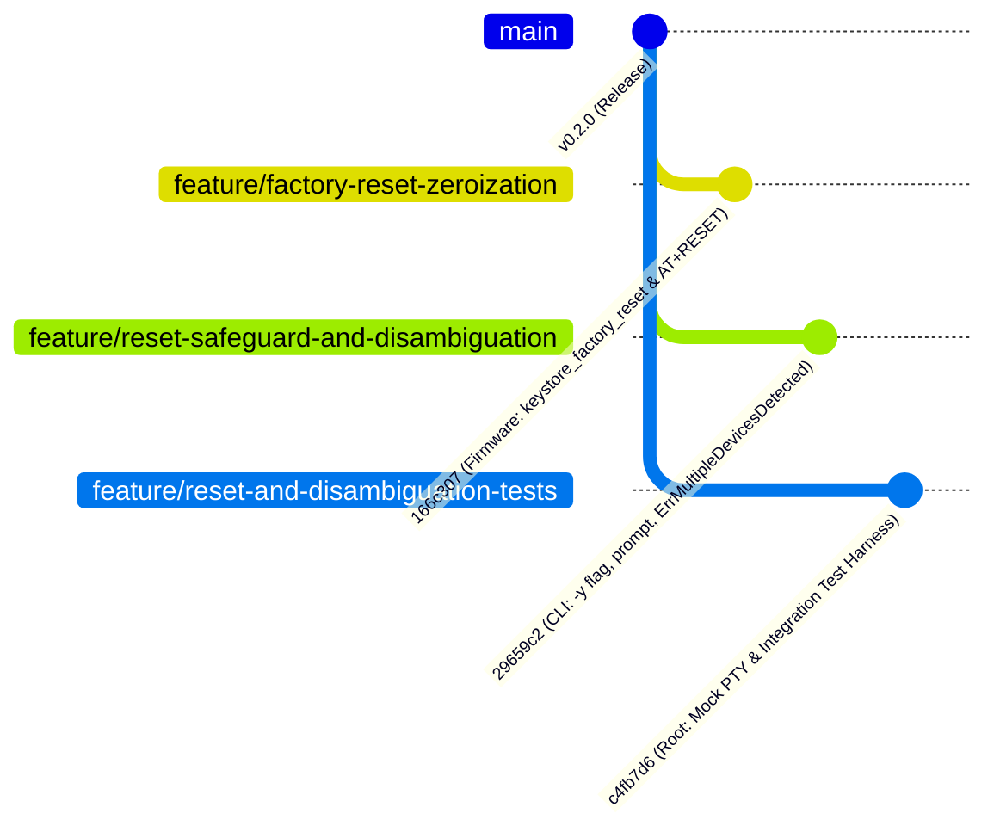
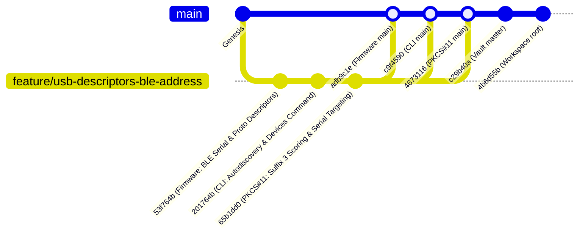

# Workspace Git Status & Repository Topologies

This document tracks real-time Git branch topologies, commit records, working directory statuses, and merged feature branches across the multi-repository workspace.

---

## 1. Repository Status Overview

| Repository | Path | Active Branch | Tracking / Upstream | Latest Commit | Working Tree Status |
| :--- | :--- | :--- | :--- | :--- | :--- |
| **Workspace Root** | [nrf52840-hsm](file:///Users/gpfister/Development/Projects/gpfister/nrf52840-hsm) | `feature/reset-and-disambiguation-tests` | `master` | `c4fb7d6` (*feat(scripts): add factory reset zeroization and confirmation test harness*) | **Active / Clean** |
| **Firmware** | [nrf52840-hsm-firmware](file:///Users/gpfister/Development/Projects/gpfister/nrf52840-hsm/nrf52840-hsm-firmware) | `feature/factory-reset-zeroization` | `main` | `166c307` (*feat(keystore): implement keystore_factory_reset with CC310 zeroization and AT+FACTORYRESET*) | **Active / Clean** |
| **CLI** | [nrf52840-hsm-cli](file:///Users/gpfister/Development/Projects/gpfister/nrf52840-hsm/nrf52840-hsm-cli) | `feature/reset-safeguard-and-disambiguation` | `main` | `29659c2` (*feat(cli): add reset confirmation safeguard and multi-device auto-discovery disambiguation*) | **Active / Clean** |
| **PKCS#11 Provider** | [nrf52840-hsm-libpkcs11](file:///Users/gpfister/Development/Projects/gpfister/nrf52840-hsm/nrf52840-hsm-libpkcs11) | `main` | Clean | `4673116` (*docs(p11): update README with AT port prioritization and serial targeting*) | **Merged & Clean** |
| **Obsidian Vault** | [nrf52840-hsm-obsidian](file:///Users/gpfister/Development/Projects/gpfister/nrf52840-hsm/nrf52840-hsm-obsidian) | `master` | Clean | `1336a6d` (*docs(vault): record phase 4 implementation progress, code modifications, and test reports*) | **Clean** |

---

## 2. In-Flight Feature Development: Reset Confirmation & Multi-Device Disambiguation

> [!NOTE]
> **Status**: Phase 4 (Develop) successfully completed. Code modifications, unit tests, integration test harnesses, and cross-compilation builds are verified and passing 100%.  
> Detailed feature note: [[features/hsmutil-reset-and-multi-device-disambiguation|Reset Confirmation & Multi-Device Disambiguation]].  
> Implementation Plan: [[Plan/Reset Confirmation and Multi-Device Disambiguation Implementation Plan|Reset Confirmation & Multi-Device Disambiguation Implementation Plan]].  
> Specification: [[Specification/Reset Confirmation and Multi-Device Disambiguation|Reset Confirmation & Multi-Device Disambiguation Specification]].

### 2.1 Multi-Repository Git Topology



### 2.2 Subsystem Development Commits & File Inventory

#### 1. Firmware Subsystem (`nrf52840-hsm-firmware`)
- **Active Branch**: `feature/factory-reset-zeroization`
- **Latest Commit**: [`166c307`](file:///Users/gpfister/Development/Projects/gpfister/nrf52840-hsm/nrf52840-hsm-firmware) — *feat(keystore): implement keystore_factory_reset with CC310 zeroization and AT+FACTORYRESET*
- **Modified Files**:
  - [`firmware/lib/include/hsm/keystore.h`](file:///Users/gpfister/Development/Projects/gpfister/nrf52840-hsm/nrf52840-hsm-firmware/firmware/lib/include/hsm/keystore.h) (+10 lines): Added `int keystore_factory_reset(void);` API prototype.
  - [`firmware/lib/src/keystore.c`](file:///Users/gpfister/Development/Projects/gpfister/nrf52840-hsm/nrf52840-hsm-firmware/firmware/lib/src/keystore.c) (+21 lines): Implemented hardware zeroization looping slots 1..32, CC310 key destruction, `sss_zeroize()`, default PIN restoration, and NVS persistence.
  - [`firmware/lib/src/at_commands.c`](file:///Users/gpfister/Development/Projects/gpfister/nrf52840-hsm/nrf52840-hsm-firmware/firmware/lib/src/at_commands.c) (+7 lines): Bound `AT+RESET` and alias `AT+FACTORYRESET` to `keystore_factory_reset()`.
- **Test Verification**:
  - `ctest` passed 100%.
  - Sysbuild production build passed cleanly.

#### 2. Host CLI Subsystem (`nrf52840-hsm-cli`)
- **Active Branch**: `feature/reset-safeguard-and-disambiguation`
- **Latest Commit**: [`29659c2`](file:///Users/gpfister/Development/Projects/gpfister/nrf52840-hsm/nrf52840-hsm-cli) — *feat(cli): add reset confirmation safeguard and multi-device auto-discovery disambiguation*
- **Modified Files**:
  - [`internal/domain/at_errors.go`](file:///Users/gpfister/Development/Projects/gpfister/nrf52840-hsm/nrf52840-hsm-cli/internal/domain/at_errors.go) (+18 lines): Added `ErrMultipleDevicesDetected` error type formatting multi-device instructions.
  - [`internal/infra/serial/discovery.go`](file:///Users/gpfister/Development/Projects/gpfister/nrf52840-hsm/nrf52840-hsm-cli/internal/infra/serial/discovery.go) (+79 lines): Refactored `AutoDiscoverPortTargeting()` to reject multi-dongle ambiguity; implemented `ResolvePortOrSerial()`.
  - [`internal/infra/serial/discovery_test.go`](file:///Users/gpfister/Development/Projects/gpfister/nrf52840-hsm/nrf52840-hsm-cli/internal/infra/serial/discovery_test.go) (+239 lines): Added unit test suite covering discovery edge cases.
  - [`internal/ui/cli/auth.go`](file:///Users/gpfister/Development/Projects/gpfister/nrf52840-hsm/nrf52840-hsm-cli/internal/ui/cli/auth.go) (+30 lines): Added `-y, --yes` flag handling, interactive stdin prompt, cancellation logic, and success feedback.
  - [`internal/ui/cli/cli_test.go`](file:///Users/gpfister/Development/Projects/gpfister/nrf52840-hsm/nrf52840-hsm-cli/internal/ui/cli/cli_test.go) (+97 lines): Added CLI test cases for `reset` command confirmation and bypass.
  - [`internal/ui/cli/migrate.go`](file:///Users/gpfister/Development/Projects/gpfister/nrf52840-hsm/nrf52840-hsm-cli/internal/ui/cli/migrate.go) (+20 lines): Updated migration targeting via `ResolvePortOrSerial()`.
  - [`internal/ui/cli/root.go`](file:///Users/gpfister/Development/Projects/gpfister/nrf52840-hsm/nrf52840-hsm-cli/internal/ui/cli/root.go) (+10 lines): Bound `--yes` flag and enhanced error formatting.
- **Test Verification**:
  - `go test ./... -v` passed 100% across all packages.
  - Cross-compilation verified cleanly for darwin/arm64, linux/arm64, linux/amd64, windows/arm64, windows/amd64.

#### 3. Workspace Root & Test Harness (`nrf52840-hsm`)
- **Active Branch**: `feature/reset-and-disambiguation-tests`
- **Latest Commit**: [`c4fb7d6`](file:///Users/gpfister/Development/Projects/gpfister/nrf52840-hsm) — *feat(scripts): add factory reset zeroization and confirmation test harness*
- **Modified Files**:
  - [`scripts/mock_hsm_pty.py`](file:///Users/gpfister/Development/Projects/gpfister/nrf52840-hsm/scripts/mock_hsm_pty.py) (+25 lines): Added `AT+RESET` slot zeroization and master secret erasure.
  - [`scripts/test_at_client.py`](file:///Users/gpfister/Development/Projects/gpfister/nrf52840-hsm/scripts/test_at_client.py) (+84 lines): Added cryptographic reset assertion tests.
  - [`scripts/run_integration_tests.sh`](file:///Users/gpfister/Development/Projects/gpfister/nrf52840-hsm/scripts/run_integration_tests.sh) (+20 lines): Added integration assertions for reset prompt cancellation and `--yes` flag.
- **Test Verification**:
  - `make integration-test` passed 100%.

---

## 3. Previous Feature Release History: USB Descriptors & Device Identification (v0.2.0)

> [!NOTE]
> **Status**: Feature branch `feature/usb-descriptors-ble-address` successfully merged into `main` / `master` across all component repositories.  
> Detailed feature note: [[features/usb-descriptors-ble-address|USB Descriptors & Device Identification]].  
> System release note: [[Changelog|Release v0.2.0 - USB Descriptors & Device Identification]].

### 2.1 Multi-Repository Git Topology



### 2.2 Subsystem Merged Commit Details

#### 1. Firmware (`nrf52840-hsm-firmware`)
- **Active Branch**: `main` (Merged `feature/usb-descriptors-ble-address`)
- **Merge Commit**: [`adb9c1e`](file:///Users/gpfister/Development/Projects/gpfister/nrf52840-hsm/nrf52840-hsm-firmware) — *docs(firmware): update README with USB descriptors and BLE address details*
- **Feature Commit**: [`53f764b`](file:///Users/gpfister/Development/Projects/gpfister/nrf52840-hsm/nrf52840-hsm-firmware) — *feat(usb): implement dynamic serial from BLE address and configure interface descriptors*
- **Delivered Capabilities**:
  - Dynamic extraction of 48-bit factory BLE address from `NRF_FICR->DEVICEADDR[1]` (with BLE Random Static bitmask `0xC000`) and `NRF_FICR->DEVICEADDR[0]`.
  - Formatted 12-character uppercase hex serial (`%04X%08X`) registered via strong override of `usb_update_sn_string_descriptor()`.
  - User string descriptors (`USBD_STRING_DESCR_USER_DEFINE(primary)`): `"Zephyr CDC ACM Console"` and `"nRF52840 HSM AT Interface"`.
  - Dynamic protocol patching via `usb_serial_patch_descriptors()`: assigns Protocol `0x0001` (Console) on Interface 0 and `0x0002` (HSM AT API) on Interface 2 prior to calling `usb_enable(NULL)`.
  - Configured `CONFIG_USB_DEVICE_SN="000000000000"` and `CONFIG_HWINFO=y` in `prj.conf`.
- **Signed Binary Artifacts**:
  - `firmware/app/build-prod/app/zephyr/zephyr.signed.bin`
  - `firmware/app/build-prod/merged.hex`
  - `firmware/app/build-prod/dfu_application.zip`

#### 2. CLI (`nrf52840-hsm-cli`)
- **Active Branch**: `main` (Merged `feature/usb-descriptors-ble-address`)
- **Merge Commit**: [`c9f4590`](file:///Users/gpfister/Development/Projects/gpfister/nrf52840-hsm/nrf52840-hsm-cli) — *docs(cli): update README with serial port autodiscovery heuristics and serial targeting*
- **Feature Commit**: [`201764b`](file:///Users/gpfister/Development/Projects/gpfister/nrf52840-hsm/nrf52840-hsm-cli) — *feat(cli): implement serial port autodiscovery heuristics and serial targeting*
- **Delivered Capabilities**:
  - Port candidate scoring: assigns macOS suffix `3` (AT data channel) score `+100` and demotes suffix `1` (Console logging) by `-50`.
  - Added `hsmutil devices` (alias `hsmutil list`) with optional `--json` output to enumerate connected dongles, displaying BLE serial, Console port, and AT data port.
  - Added persistent `--serial` (`-s`) flag across commands to target specific dongles by 12-digit hex BLE address or device UID.
  - Supported `NRF52840_HSM_SERIAL` environment variable.
  - Cross-compiled binaries for 5 host platforms: `darwin-arm64`, `linux-amd64`, `linux-arm64`, `windows-amd64.exe`, `windows-arm64.exe`.

#### 3. PKCS#11 Library (`nrf52840-hsm-libpkcs11`)
- **Active Branch**: `main` (Merged `feature/usb-descriptors-ble-address`)
- **Merge Commit**: [`4673116`](file:///Users/gpfister/Development/Projects/gpfister/nrf52840-hsm/nrf52840-hsm-libpkcs11) — *docs(p11): update README with AT port prioritization and serial targeting*
- **Feature Commit**: [`65b1dd0`](file:///Users/gpfister/Development/Projects/gpfister/nrf52840-hsm/nrf52840-hsm-libpkcs11) — *feat(p11): prioritize suffix '3' AT port and support NRF52840_HSM_SERIAL targeting*
- **Delivered Capabilities**:
  - Candidate port scoring (`serial_score_candidate`): rates macOS `tty.usbmodem*` suffix `3` at `1000`, `cu.usbmodem*` suffix `3` at `900`, demoting suffix `1` to `200`/`100`.
  - Quicksort candidate ordering (`qsort` with `compare_port_candidates`) to probe AT channels first.
  - Direct hardware targeting via `NRF52840_HSM_SERIAL` environment variable.
  - 100% CTest passage on `test_p11_mock` and physical hardware compatibility.

#### 4. Obsidian Vault (`nrf52840-hsm-obsidian`)
- **Active Branch**: `master`
- **Latest Commit**: [`1f347e8`](file:///Users/gpfister/Development/Projects/gpfister/nrf52840-hsm/nrf52840-hsm-obsidian) — *docs(vault): update git status, branch tracking, and release changelog for v0.2.0 post-merge*
- **Delivered Records**:
  - Feature note [[features/usb-descriptors-ble-address|USB Descriptors & Device Identification]].
  - System Specification [[Specification/USB Descriptors and Device Identification|USB Descriptors and Device Identification]].
  - Implementation Plan [[Plan/USB Descriptors and BLE Identification Implementation Plan|Implementation Plan: USB Descriptors & BLE Device Identification]].
  - ADRs: [[Architecture/Decisions/ADR-0001 - Hardware BLE Address for Deterministic USB Serial Number|ADR-0001]], [[Architecture/Decisions/ADR-0002 - In-Tree Protocol Descriptor Patching vs macOS DriverKit Extension|ADR-0002]], [[Architecture/Decisions/ADR-0003 - Host Port Discovery and Serial Targeting Strategy|ADR-0003]].
  - Session archival [[Sessions/9f9ae0e3-f181-44f3-8dde-7b25c55cf4e3|Phase 3-5 Lifecycle Session]].
  - Release Changelog [[Changelog|Workspace Release Changelog]].

#### 5. Workspace Root Orchestrator (`nrf52840-hsm`)
- **Active Branch**: `master` / `main`
- **Latest Commit**: [`4b6d55b`](file:///Users/gpfister/Development/Projects/gpfister/nrf52840-hsm) — *docs(root): update workspace README with USB descriptors and BLE device targeting*
- **Delivered Updates**:
  - Updated root [README.md](file:///Users/gpfister/Development/Projects/gpfister/nrf52840-hsm/README.md) with deterministic macOS TTY device node mapping, USB interface table, and multi-device targeting commands.

---

## 3. Physical Hardware Topologies & Validation

Connected hardware dongles detected and verified via `hsmutil devices`:

```text
[1] Serial / BLE:  FD54E793A75540C9
    AT Data Port:  /dev/tty.usbmodem31424103
    Console Port:  /dev/tty.usbmodem31424101
    USB ID:        1209:0001 (nRF52840 HSM Dongle)

[2] Serial / BLE:  3302311888499AC7
    AT Data Port:  /dev/tty.usbmodem31424403
    Console Port:  /dev/tty.usbmodem31424401
    USB ID:        1209:0001 (nRF52840 HSM Dongle)
```

### 3.1 Validation Matrix (100% Passed)
- **USB Descriptors**: Validated on physical PCA10059 dongles with dynamic 12-digit hex BLE serial numbers (`%04X%08X`).
- **Protocol Identifiers**: Dynamic runtime descriptor patching sets Protocol `0x0001` (Console) on Interface 0 and `0x0002` (HSM AT API) on Interface 2.
- **macOS TTY Mapping**: Suffix `1` attached to Zephyr console logging; Suffix `3` attached to HSM AT data stream.
- **Dual-Device Concurrency & Serial Targeting**: Concurrently tested two connected hardware dongles with `hsmutil devices` and `hsmutil info -s <SERIAL>`, confirming complete isolation without port crosstalk.

---

## 4. Architecture Decision Records (ADRs)

- [[Architecture/Decisions/ADR-0001 - Hardware BLE Address for Deterministic USB Serial Number|ADR-0001: Hardware BLE Address for Deterministic USB Serial Number]]
- [[Architecture/Decisions/ADR-0002 - In-Tree Protocol Descriptor Patching vs macOS DriverKit Extension|ADR-0002: In-Tree Protocol Descriptor Patching vs macOS DriverKit Extension]]
- [[Architecture/Decisions/ADR-0003 - Host Port Discovery and Serial Targeting Strategy|ADR-0003: Host Port Discovery and Serial Targeting Strategy]]
- [[Architecture/Decisions/ADR-0004 - Factory Reset Semantics and Safeguards|ADR-0004: Factory Reset Semantics and Safe Erasure Safeguards]]

---

## 5. Upcoming & In-Flight Features

- **[[features/hsmutil-reset-and-multi-device-disambiguation|Reset Confirmation & Multi-Device Disambiguation]]**:
  - **Status**: Phase 4 (Develop) Complete — Ready for Phase 5 (Review / Pre-Merge).
  - **Formal Spec**: [[Specification/Reset Confirmation and Multi-Device Disambiguation|Reset Confirmation and Multi-Device Disambiguation Specification]]
  - **Implementation Plan**: [[Plan/Reset Confirmation and Multi-Device Disambiguation Implementation Plan|Reset Confirmation & Multi-Device Disambiguation Implementation Plan]]
  - **Specification Session**: [[Sessions/36b74c4b-dd01-44e1-9405-48fdc8d21d87|Session 36b74c4b]]
  - **Planning Session**: [[Sessions/4b1bb45a-82b0-4966-bacf-254b577ad6f2|Session 4b1bb45a]]
  - **Feature Branches**:
    - Root: `feature/reset-and-disambiguation-tests` ([`c4fb7d6`](file:///Users/gpfister/Development/Projects/gpfister/nrf52840-hsm))
    - Firmware: `feature/factory-reset-zeroization` ([`166c307`](file:///Users/gpfister/Development/Projects/gpfister/nrf52840-hsm/nrf52840-hsm-firmware))
    - CLI: `feature/reset-safeguard-and-disambiguation` ([`29659c2`](file:///Users/gpfister/Development/Projects/gpfister/nrf52840-hsm/nrf52840-hsm-cli))
  - **Verification Status**: 100% passing across firmware `ctest`, CLI unit tests, cross-compilation, and root integration test harness.

---

## 6. Related Documentation

- [[00 - Index|Vault Index]]
- [[Changelog|Workspace Release Changelog]]
- [[features/usb-descriptors-ble-address|USB Descriptors & Device Identification Feature Specification & Implementation]]
- [[features/hsmutil-reset-and-multi-device-disambiguation|Reset Confirmation & Multi-Device Disambiguation Feature Specification]]
- [[Architecture/USB Composite Stack|USB Composite Stack Architecture]]
- [[Development/CLI Reference|hsmutil CLI Reference]]
