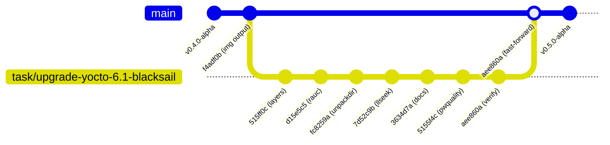
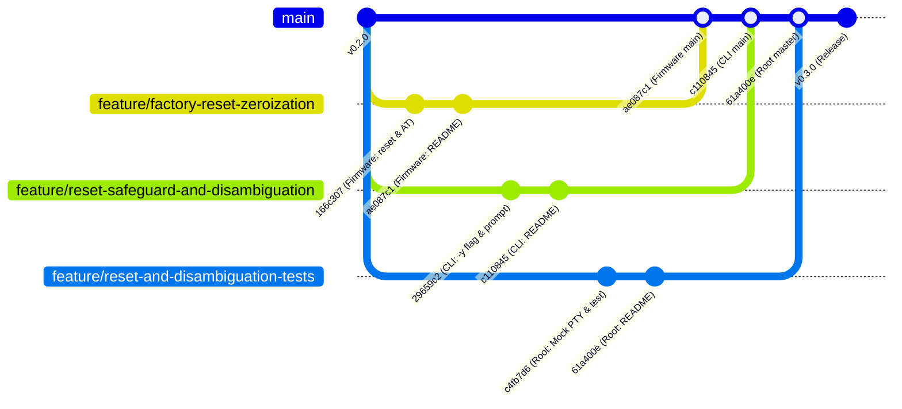
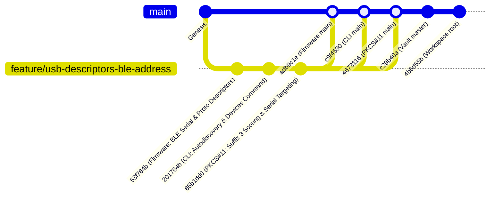

# Workspace Git Status & Repository Topologies

This document tracks real-time Git branch topologies, commit records, working directory statuses, and merged feature branches across the multi-repository workspace.

---

## 1. Repository Status Overview

| Repository | Path | Active Branch | Tracking / Upstream | Latest Commit | Working Tree Status | Release / Lifecycle Status |
| :--- | :--- | :--- | :--- | :--- | :--- | :--- |
| **Workspace Root** | [nrf52840-hsm](file:///Users/gpfister/Development/Projects/gpfister/nrf52840-hsm) | `main` | Up to date with `origin/main` | `81d2cb9` (*chore(workspace): standardize PKCS#11 sub-repo to hsm-pkcs11 (#1)*) | **Clean** | **Phase 6 Post-Merge Complete** |
| **Firmware** | [hsm-ncs-firmware](file:///Users/gpfister/Development/Projects/gpfister/nrf52840-hsm/hsm-ncs-firmware) | `main` | Ahead of `origin/main` (`+2`) | `7f516bd` (*docs(firmware): document dual-mode authentication in README*) | **Clean** | **Phase 6 Post-Merge Complete** |
| **CLI** | [hsm-cli](file:///Users/gpfister/Development/Projects/gpfister/nrf52840-hsm/hsm-cli) | `main` | Up to date with `origin/main` | `14ea65f` (*feat(cli): rebrand to gphsm, add dual-mode auth, pwquality PIN validation, and purge p11*) | In-flight dev | **Phase 6 Post-Merge Complete** |
| **PKCS#11 Provider** | [hsm-pkcs11](file:///Users/gpfister/Development/Projects/gpfister/nrf52840-hsm/hsm-pkcs11) | `main` | Up to date with `origin/main` | `d25adea` (*docs(p11): align protocol ID reference with ADR-0013 in README*) | **Clean** | **Phase 6 Post-Merge Complete** |
| **Air-Gapped OS** | [hsm-yocto-offgrid-rpi](file:///Users/gpfister/Development/Projects/gpfister/nrf52840-hsm/hsm-yocto-offgrid-rpi) | `main` | Up to date with `origin/main` | `28925aa` (*docs: generalize README terminology to HSM USB key and appliance*) | **Clean** | **Phase 6 Post-Merge Complete** |
| **Obsidian Vault** | [hsm-obsidian](file:///Users/gpfister/Development/Projects/gpfister/nrf52840-hsm/hsm-obsidian) | `main` | Ahead of `origin/main` (`+3`) | `HEAD` (*docs(vault): update git status, branch tracking, and release changelogs for subrepo rename post-merge*) | **Clean** | **Phase 6 Post-Merge Complete** |

---

## 1.0 Merged Milestone: Sub-Repository Renaming to hsm-pkcs11 with libgphsm ABI Invariance (Phase 6 Post-Merge Complete)

> [!NOTE]
> **Post-Merge Milestone**: Standardization and harmonization of the PKCS#11 sub-repository naming across the multi-repository workspace by renaming the repository to **`hsm-pkcs11`** (remote: `gpfister/hsm-pkcs11`) while strictly preserving dynamic provider library ABI compatibility (`libgphsm.dylib` / `.so` / `.dll`). Merged into `main` via PR #1 (squashed commit: `81d2cb9`), with working tree clean on `main` and all test suites passing 100%.
>
> - **Status**: Merged via Pull Request [#1 (https://github.com/gpfister/hsm/pull/1)](https://github.com/gpfister/hsm/pull/1)
> - **Base Branch**: `main`
> - **Merged Source Branch**: `task/rename-subrepo-hsm-pkcs11` (squashed commit: [`81d2cb9`](file:///Users/gpfister/Development/Projects/gpfister/nrf52840-hsm))
> - **Branch Cleanup**: Local and remote `task/rename-subrepo-hsm-pkcs11` deleted and pruned
> - **Root Commit on main**: [`81d2cb9`](file:///Users/gpfister/Development/Projects/gpfister/nrf52840-hsm) (`81d2cb9`) — *chore(workspace): standardize PKCS#11 sub-repo to hsm-pkcs11 (#1)*
> - **Architecture Decision Record**: [[Architecture/Decisions/ADR-0018 - Sub-Repository Renaming to hsm-pkcs11 with libgphsm ABI Invariance|ADR-0018: Sub-Repository Renaming to hsm-pkcs11 with libgphsm ABI Invariance]]
> - **Implementation Plan**: [[Plan/Sub-Repository Renaming to hsm-pkcs11 Implementation Plan|Sub-Repository Renaming to hsm-pkcs11 Implementation Plan]]
> - **Technical Specification**: [[Specification/Sub-Repository Renaming to hsm-pkcs11|Sub-Repository Renaming to hsm-pkcs11 Specification]]
> - **Feature Specification**: [[features/subrepo-rename-hsm-pkcs11|Sub-Repository Renaming to hsm-pkcs11 Feature Note]]
>
> ### Deliverable Components & Post-Merge Actions
> 1. **GitHub Remote Rename**:
>    - Renamed repository on GitHub from `gpfister/hsm-libpkcs11` to `gpfister/hsm-pkcs11`.
>    - Reconfigured origin remote URL in [`hsm-pkcs11`](file:///Users/gpfister/Development/Projects/gpfister/nrf52840-hsm/hsm-pkcs11) to `git@github.com:gpfister/hsm-pkcs11.git`.
> 2. **Local Filesystem Relocation**:
>    - Renamed directory `libgphsm/` &rarr; `hsm-pkcs11/`.
>    - Confirmed presence of `hsm-pkcs11/` and absence of `libgphsm/`.
> 3. **Root Workspace Automation Synchronization**:
>    - [`Makefile`](file:///Users/gpfister/Development/Projects/gpfister/nrf52840-hsm/Makefile): Updated `SUBREPOS` and `LIBPKCS11_DIR := hsm-pkcs11`.
>    - [`.gitignore`](file:///Users/gpfister/Development/Projects/gpfister/nrf52840-hsm/.gitignore): Added `/hsm-pkcs11/` exclusion while retaining legacy entries for backward compatibility.
>    - [`scripts/worktree.sh`](file:///Users/gpfister/Development/Projects/gpfister/nrf52840-hsm/scripts/worktree.sh): Updated `SUBREPOS` array to include `hsm-pkcs11`.
>    - [`scripts/run_integration_tests.sh`](file:///Users/gpfister/Development/Projects/gpfister/nrf52840-hsm/scripts/run_integration_tests.sh): Updated `P11_DIR` variable to `${WORKSPACE_ROOT}/hsm-pkcs11`.
> 4. **Workspace Documentation Alignment**:
>    - [`README.md`](file:///Users/gpfister/Development/Projects/gpfister/nrf52840-hsm/README.md) and [`AGENTS.md`](file:///Users/gpfister/Development/Projects/gpfister/nrf52840-hsm/AGENTS.md) synchronized to reference `hsm-pkcs11/`.
> 5. **Strict ABI Invariance Maintained**:
>    - Output dynamic library remains `libgphsm.dylib` (macOS), `libgphsm.so` (Linux), `libgphsm.dll` (Windows).
>    - CMake project definition `project(libgphsm C)` and target properties (`OUTPUT_NAME "gphsm"`, `PREFIX "lib"`) completely untouched.
>    - 100% test pass rate across `make libpkcs11-build`, `make libpkcs11-test`, and `make integration-test`. Fast-forward merged into `main`. Clean working trees.

---

## 1.1 Merged Milestone: HSM Dual-Mode Authentication, CLI Renaming (gphsm), and PKCS#11 Refactoring (libgphsm) (Phase 6 Post-Merge Complete)

> [!NOTE]
> **Post-Merge Milestone**: Multi-repository delivery of HSM dual-mode authentication, host CLI rebranding (`gphsm`), pure-Go PAM pwquality password validation, and PKCS#11 provider refactoring (`libgphsm`) successfully fast-forward merged into `main` across all target repositories. All working trees are clean on `main`, with 100% test passage achieved across firmware CTest, CLI unit tests, and the end-to-end multi-phase integration test suite (`make integration-test`).
>
> - **Architecture Decision Records**:
>   - [[Architecture/Decisions/ADR-0016 - Dual-Mode Authentication Architecture (PIN and Shamir Secret Sharing)|ADR-0016: Dual-Mode Authentication Architecture (PIN and Shamir Secret Sharing)]]
>   - [[Architecture/Decisions/ADR-0017 - Host CLI Rebranding to gphsm and PKCS11 Refactoring to libgphsm|ADR-0017: Host CLI Rebranding to gphsm and PKCS#11 Refactoring to libgphsm]]
> - **Implementation Plan**: [[Plan/HSM Dual-Mode Authentication, CLI Renaming (gphsm), and PKCS11 Refactoring Implementation Plan|HSM Dual-Mode Authentication, CLI Renaming (gphsm), and PKCS#11 Refactoring Implementation Plan]]
> - **Technical Specification**: [[Specification/HSM Dual-Mode Authentication, CLI Renaming (gphsm), and PKCS11 Refactoring|HSM Dual-Mode Authentication, CLI Renaming (gphsm), and PKCS#11 Refactoring]]
> - **Feature Specification**: [[features/dual-mode-auth-gphsm-and-libgphsm-refactoring|Dual-Mode Authentication, CLI Rebranding (gphsm) & PKCS#11 Refactoring (libgphsm)]]
> - **Release Changelog**: [[Changelog#merged-2026-11-05-hsm-dual-mode-authentication-cli-renaming-gphsm-and-pkcs11-refactoring-libgphsm-merged-into-main|Workspace Release Changelog]]
>
> ### Merged Branches & Commits Summary
> - **Workspace Root ([`nrf52840-hsm`](file:///Users/gpfister/Development/Projects/gpfister/nrf52840-hsm))**:
>   - Merged branch `task/dual-mode-workspace-alignment` &rarr; `main` (`58b82c0..2848d50`)
>   - Commits:
>     - [`0907c44`](file:///Users/gpfister/Development/Projects/gpfister/nrf52840-hsm) — *feat(workspace): align root makefile, mock pty, and test harness for dual-mode auth and libgphsm*
>     - [`2848d50`](file:///Users/gpfister/Development/Projects/gpfister/nrf52840-hsm) — *docs(workspace): update root README and AGENTS.md for gphsm, libgphsm, and dual-mode auth*
> - **Firmware Subsystem ([`hsm-ncs-firmware`](file:///Users/gpfister/Development/Projects/gpfister/nrf52840-hsm/hsm-ncs-firmware))**:
>   - Merged branch `feature/dual-mode-auth` &rarr; `main` (`e03c9bb..7f516bd`)
>   - Commits:
>     - [`f30484f`](file:///Users/gpfister/Development/Projects/gpfister/nrf52840-hsm/hsm-ncs-firmware) — *feat(firmware): implement dual-mode authentication in keystore and AT protocol*
>     - [`7f516bd`](file:///Users/gpfister/Development/Projects/gpfister/nrf52840-hsm/hsm-ncs-firmware) — *docs(firmware): document dual-mode authentication in README*
> - **Host CLI ([`hsm-cli`](file:///Users/gpfister/Development/Projects/gpfister/nrf52840-hsm/hsm-cli))**:
>   - Merged branch `feature/gphsm-dual-mode` &rarr; `main` (`6c8781c..14ea65f`)
>   - Commits:
>     - [`14ea65f`](file:///Users/gpfister/Development/Projects/gpfister/nrf52840-hsm/hsm-cli) — *feat(cli): rebrand to gphsm, add dual-mode auth, pwquality PIN validation, and purge p11*
> - **PKCS#11 Provider ([`libgphsm`](file:///Users/gpfister/Development/Projects/gpfister/nrf52840-hsm/libgphsm))**:
>   - Merged branch `task/rename-libgphsm-dual-mode` &rarr; `main` (`9c54759..d25adea`)
>   - Commits:
>     - [`13749e3`](file:///Users/gpfister/Development/Projects/gpfister/nrf52840-hsm/libgphsm) — *feat(p11): rename to libgphsm, add dual-mode authentication, and CKF_PROTECTED_AUTHENTICATION_PATH*
>     - [`d25adea`](file:///Users/gpfister/Development/Projects/gpfister/nrf52840-hsm/libgphsm) — *docs(p11): align protocol ID reference with ADR-0013 in README*
> - **Obsidian Vault ([`hsm-obsidian`](file:///Users/gpfister/Development/Projects/gpfister/nrf52840-hsm/hsm-obsidian))**:
>   - Synchronized on `main` (`HEAD`), clean working tree.
>
> ### 1.0.1 Subsystem Delivery Summary
>
> 1. **Firmware (`hsm-ncs-firmware`)**:
>    - Implemented `auth_method_t` (`NONE`, `PIN`, `SHAMIR`) with persistent NVS storage.
>    - Up to 64-byte PINs with 16-byte random salt and SHA-256 hash storage.
>    - Dedicated initialization endpoints: `AT+INIT=PIN,<pin>` and `AT+INIT=SHAMIR` with re-initialization guards (`+CME ERROR: 41`).
>    - Comprehensive status output via `AT+STATUS?` (`CONFIGURED`, `AUTH`, `METHOD`, `RETRIES`, `KEYCOUNT`).
>    - Mutual exclusivity enforcement between `AT+AUTH` and `AT+SHARE` (`+CME ERROR: 42`).
>    - Zeroization in `AT+RESET` / `AT+FACTORYRESET` resetting salt, hash, keys, and restoring unconfigured state.
> 2. **PKCS#11 Provider Library (`libgphsm`)**:
>    - Renamed from `hsm-libpkcs11` / `libnrf52840_pkcs11` to `libgphsm` emitting `libgphsm.{dylib,so,dll}`.
>    - Added dual-mode token flags: sets `CKF_PROTECTED_AUTHENTICATION_PATH` in Shamir mode.
>    - Adapted `C_Login` to recognize external pre-authentication (`AUTH == 1`) in Shamir mode without requiring in-band PIN entry.
>    - Clean CMake and Makefile integration with updated CTest mock suite.
> 3. **Host CLI (`hsm-cli`)**:
>    - Rebranded to `gphsm` with backward-compatible `hsmutil` and `hsmutils` symlinks.
>    - Dual-mode initialization wizard (`gphsm device init`) with interactive TTY prompts for PIN vs Shamir mode.
>    - Pure-Go `pam_pwquality` validation enforcing Yocto appliance password complexity.
>    - Auto-detecting `gphsm unlock` (alias `auth`) handling PIN prompts and custodian share ceremonies.
>    - Purged internal `p11` diagnostic commands and dynamic PKCS#11 loaders.
>    - Homogeneous migration validation ensuring `source.METHOD == target.METHOD`.
> 4. **Root Workspace & Multi-Repository Test Harness**:
>    - Makefile targets aligned (`cli-build`, `libpkcs11-build`, `libpkcs11-test`, `make integration-test`).
>    - `scripts/mock_hsm_pty.py` updated to support dual-mode initialization, mutual exclusivity, and extended status responses.
>    - `scripts/run_integration_tests.sh` and `scripts/test_at_client.py` updated to test dual-mode auth paths across all components.
>    - End-to-end integration test suite passing 100% (16/16 AT checks, PKCS#11 mock runner, and `gphsm` CLI tests).
>
> ### 1.0.2 Multi-Repository Git Topology
>
> ```mermaid
> gitGraph
>     commit id: "Workspace Align"
>     branch "task/dual-mode-workspace-alignment" order: 1
>     checkout "task/dual-mode-workspace-alignment"
>     commit id: "0907c44 (Root test harness)"
>     commit id: "2848d50 (Root docs)"
>     checkout main
>     branch "feature/dual-mode-auth" order: 2
>     checkout "feature/dual-mode-auth"
>     commit id: "f30484f (Firmware keystore)"
>     commit id: "7f516bd (Firmware docs)"
>     checkout main
>     branch "feature/gphsm-dual-mode" order: 3
>     checkout "feature/gphsm-dual-mode"
>     commit id: "14ea65f (CLI gphsm & pwquality)"
>     checkout main
>     branch "task/rename-libgphsm-dual-mode" order: 4
>     checkout "task/rename-libgphsm-dual-mode"
>     commit id: "13749e3 (libgphsm & p11 mode)"
>     commit id: "d25adea (libgphsm docs)"
>     checkout main
>     merge "feature/dual-mode-auth" id: "7f516bd (Firmware main)"
>     merge "feature/gphsm-dual-mode" id: "14ea65f (CLI main)"
>     merge "task/rename-libgphsm-dual-mode" id: "d25adea (libgphsm main)"
>     merge "task/dual-mode-workspace-alignment" id: "2848d50 (Root main)"
>     commit id: "Phase 6 Complete"
> ```

---

## 1.1 Merged Milestone: HSM CLI Restructuring, Static Compilation, Bubble Tea UX & PKCS#11 Equivalence (Phase 6 Post-Merge Complete)

> [!NOTE]
> **Post-Merge Milestone**: Comprehensive restructuring of `hsmutil` host management CLI successfully merged into `main` in [`hsm-cli`](file:///Users/gpfister/Development/Projects/gpfister/nrf52840-hsm/hsm-cli).
>
> - **Repository**: [`hsm-cli`](file:///Users/gpfister/Development/Projects/gpfister/nrf52840-hsm/hsm-cli)
> - **Source Branch**: `feature/cli-restructuring-bubbletea-pkcs11`
> - **Target Branch**: `main`
> - **Merge Status**: Fast-forward merged (`189c7fd..6c8781c`)
> - **Working Tree**: Clean across all repositories
> - **Verification**: `go test ./...` passed cleanly 100% across all packages
> - **HEAD Commit**: [`6c8781c`](file:///Users/gpfister/Development/Projects/gpfister/nrf52840-hsm/hsm-cli) (*feat(cli): restructure commands under device, add static build, bubble tea UX, and pkcs11 parity*)
>
> - **Feature Note**: [[features/cli-restructuring-bubbletea-pkcs11|HSM CLI Restructuring, Static Compilation, Bubble Tea UX & PKCS#11 Equivalence]]
> - **Technical Specification**: [[Specification/HSM CLI Restructuring, Static Compilation, Bubble Tea UX, and PKCS11 Equivalence|Technical Specification: HSM CLI Restructuring, Static Compilation, Bubble Tea UX, and PKCS#11 Equivalence]]
> - **Implementation Plan**: [[Plan/HSM CLI Restructuring, Static Compilation, Bubble Tea UX & PKCS11 Equivalence Implementation Plan|Implementation Plan: HSM CLI Restructuring, Static Compilation, Bubble Tea UX & PKCS#11 Equivalence]]
> - **Architecture Decision Record**: [[Architecture/Decisions/ADR-0015 - HSM CLI Restructuring, Static Compilation, Bubble Tea UX, and PKCS11 Equivalence|ADR-0015: HSM CLI Restructuring, Static Compilation, Bubble Tea UX, and PKCS#11 Equivalence]]
> - **CLI Reference**: [[Development/CLI Reference|CLI Reference (hsmutil)]]
> - **Release Changelog**: [[Changelog#merged-2026-11-05-hsm-cli-restructuring-static-compilation-bubble-tea-ux-pkcs11-equivalence-merged-into-main|Workspace Release Changelog]]
>
> ### Key Deliverables in `hsm-cli` (Commit `6c8781c`):
> 1. **Resource Command Hierarchy**: Reorganized commands under `hsmutil device <list|info|init|lock|reset|status|migrate|firmware>` and `hsmutil key <list|generate|pubkey|sign|migrate>`.
> 2. **Backward Compatibility**: Preserved legacy root commands (`info`, `reset`, `lock`, `init`, `status`, `firmware`, `auth`) as hidden aliases on `rootCmd`.
> 3. **Ergonomic Aliases**: Added visible alias `hsmutil devices -> hsmutil device list` and build-time symlink `bin/hsmutils -> bin/hsmutil`.
> 4. **Pruned Dead Code**: Removed unmaintained `hsmutil tui`, `hsmutil test`, and `internal/ui/tui/`.
> 5. **Renamed Auth**: Renamed `auth` to `unlock` with `auth` as convenience alias.
> 6. **Terminology Neutrality**: Replaced `nrf52840` references with generic HSM USB Key / device across all user-facing CLI text and help messages.
> 7. **Bubble Tea Micro-Components**: Integrated `bubbles/textinput` (masked password bullets `••••••`) and `bubbles/progress` (gradient DFU transfer bar) with automatic TTY detection and clean headless fallback.
> 8. **Static Binary Compilation**: Enforced `CGO_ENABLED=0` across all Makefile targets for zero-dependency portability.
> 9. **PKCS#11 Parity**: Full equivalence matrix and GAP analysis against OpenSC `pkcs11-tool`.

---

## 1.2 Merged Milestone: Documentation Terminology Generalization (Phase 6 Post-Merge Complete)

> [!NOTE]
> **Merged Milestone**: All 6 repositories have been merged into `main`. The task branch `task/generalize-doc-terminology` has been merged and local task branches pruned across all repositories. Documentation terminology is standardized on generic **Hardware Security Module (HSM)** and **HSM USB Key / Dongle** per [[Architecture/Decisions/ADR-0014 - Documentation Terminology Generalization to Generic HSM USB Key|ADR-0014]], while explicitly preserving firmware target hardware scoping in [`hsm-ncs-firmware`](file:///Users/gpfister/Development/Projects/gpfister/nrf52840-hsm/hsm-ncs-firmware) (Nordic Semiconductor nRF52840 USB Dongle `PCA10059`) and non-breaking machine-readable identifiers (`libnrf52840_pkcs11.*`, `NRF52840_HSM_*`, `nrf52840-hsm-kmod`). Working trees are clean across all repositories.
>
> - **Feature Note**: [[features/documentation-terminology-generalization|Documentation Terminology Generalization]]
> - **Implementation Plan**: [[Plan/Documentation Terminology Generalization Implementation Plan|Documentation Terminology Generalization Implementation Plan]]
> - **Architecture Decision Record**: [[Architecture/Decisions/ADR-0014 - Documentation Terminology Generalization to Generic HSM USB Key|ADR-0014: Documentation Terminology Generalization to Generic HSM USB Key]]
> - **Changelog Entry**: [[Changelog#merged-2026-11-05-documentation-terminology-generalization-to-generic-hsm-usb-key-merged-into-main|Workspace Release Changelog]]

### Delivered Commits Across All 6 Repositories:

1. **Workspace Root ([`nrf52840-hsm`](file:///Users/gpfister/Development/Projects/gpfister/nrf52840-hsm))**:
   - **Commit**: [`af2d24e`](file:///Users/gpfister/Development/Projects/gpfister/nrf52840-hsm) (`af2d24e`) — *docs: generalize root documentation terminology*
   - **Files**: [`README.md`](file:///Users/gpfister/Development/Projects/gpfister/nrf52840-hsm/README.md), [`AGENTS.md`](file:///Users/gpfister/Development/Projects/gpfister/nrf52840-hsm/AGENTS.md)
   - **Status**: Merged into `main`, clean working tree

2. **Firmware Subsystem ([`hsm-ncs-firmware`](file:///Users/gpfister/Development/Projects/gpfister/nrf52840-hsm/hsm-ncs-firmware))**:
   - **Commit**: [`e03c9bb`](file:///Users/gpfister/Development/Projects/gpfister/nrf52840-hsm/hsm-ncs-firmware) (`e03c9bb`) — *docs(firmware): generalize title and clarify PCA10059 hardware target support*
   - **Files**: [`README.md`](file:///Users/gpfister/Development/Projects/gpfister/nrf52840-hsm/hsm-ncs-firmware/README.md)
   - **Status**: Merged into `main`, clean working tree

3. **Host CLI & TUI ([`hsm-cli`](file:///Users/gpfister/Development/Projects/gpfister/nrf52840-hsm/hsm-cli))**:
   - **Commit**: [`189c7fd`](file:///Users/gpfister/Development/Projects/gpfister/nrf52840-hsm/hsm-cli) (`189c7fd`) — *docs: generalize HSM device terminology and update utility title*
   - **Files**: [`README.md`](file:///Users/gpfister/Development/Projects/gpfister/nrf52840-hsm/hsm-cli/README.md)
   - **Status**: Merged into `main`, clean working tree

4. **PKCS#11 Provider Library ([`hsm-libpkcs11`](file:///Users/gpfister/Development/Projects/gpfister/nrf52840-hsm/hsm-libpkcs11))**:
   - **Commit**: [`9c54759`](file:///Users/gpfister/Development/Projects/gpfister/nrf52840-hsm/hsm-libpkcs11) (`9c54759`) — *docs: generalize terminology in README.md*
   - **Files**: [`README.md`](file:///Users/gpfister/Development/Projects/gpfister/nrf52840-hsm/hsm-libpkcs11/README.md)
   - **Status**: Merged into `main`, clean working tree

5. **Air-Gapped OS Appliance ([`hsm-yocto-offgrid-rpi`](file:///Users/gpfister/Development/Projects/gpfister/nrf52840-hsm/hsm-yocto-offgrid-rpi))**:
   - **Commit**: [`28925aa`](file:///Users/gpfister/Development/Projects/gpfister/nrf52840-hsm/hsm-yocto-offgrid-rpi) (`28925aa`) — *docs: generalize README terminology to HSM USB key and appliance*
   - **Files**: [`README.md`](file:///Users/gpfister/Development/Projects/gpfister/nrf52840-hsm/hsm-yocto-offgrid-rpi/README.md)
   - **Status**: Merged into `main`, clean working tree

6. **Central Knowledge Vault ([`hsm-obsidian`](file:///Users/gpfister/Development/Projects/gpfister/nrf52840-hsm/hsm-obsidian))**:
   - **Commits**: [`682fbfc`](file:///Users/gpfister/Development/Projects/gpfister/nrf52840-hsm/hsm-obsidian) (`682fbfc`), [`f1d5a7c`](file:///Users/gpfister/Development/Projects/gpfister/nrf52840-hsm/hsm-obsidian) (`f1d5a7c`), and [`e91555a`](file:///Users/gpfister/Development/Projects/gpfister/nrf52840-hsm/hsm-obsidian) (`e91555a`) — *docs: generalize documentation terminology, add README, pre-merge tidy-up, and post-merge status tracking*
   - **Files**: [`README.md`](file:///Users/gpfister/Development/Projects/gpfister/nrf52840-hsm/hsm-obsidian/README.md), [`00 - Index.md`](file:///Users/gpfister/Development/Projects/gpfister/nrf52840-hsm/hsm-obsidian/00%20-%20Index.md), [`Architecture/System Architecture.md`](file:///Users/gpfister/Development/Projects/gpfister/nrf52840-hsm/hsm-obsidian/Architecture/System%20Architecture.md), [`Architecture/Decisions/ADR-0014 - Documentation Terminology Generalization to Generic HSM USB Key.md`](file:///Users/gpfister/Development/Projects/gpfister/nrf52840-hsm/hsm-obsidian/Architecture/Decisions/ADR-0014%20-%20Documentation%20Terminology%20Generalization%20to%20Generic%20HSM%20USB%20Key.md), [`Plan/Documentation Terminology Generalization Implementation Plan.md`](file:///Users/gpfister/Development/Projects/gpfister/nrf52840-hsm/hsm-obsidian/Plan/Documentation%20Terminology%20Generalization%20Implementation%20Plan.md), [`features/documentation-terminology-generalization.md`](file:///Users/gpfister/Development/Projects/gpfister/nrf52840-hsm/hsm-obsidian/features/documentation-terminology-generalization.md)
   - **Status**: Merged into `main`, clean working tree

---

## 1.1 Sub-Repository: `rpi-z2w-yocto-hsm`

- **Repository Path**: [`rpi-z2w-yocto-hsm/`](file:///Users/gpfister/Development/Projects/gpfister/nrf52840-hsm/rpi-z2w-yocto-hsm)
- **Active Branch**: `main` (Merged from `task/upgrade-yocto-6.1-blacksail`)
- **Latest Commit**: [`3f067b9`](file:///Users/gpfister/Development/Projects/gpfister/nrf52840-hsm/rpi-z2w-yocto-hsm) (`3f067b901231e3c643c32c44418ac35be4d5d968`) — *Merge branch 'task/upgrade-yocto-6.1-blacksail' into main (messy branch)*
- **Merge Status**: **Phase 6 Post-Merge Complete (v0.5.0-alpha)**
- **Cumulative Diff**: 43 files changed, 785 insertions(+), 83 deletions(-)
- **Branch Commits (Merged)**:
  - [`3f067b9`](file:///Users/gpfister/Development/Projects/gpfister/nrf52840-hsm/rpi-z2w-yocto-hsm) — *Merge branch 'task/upgrade-yocto-6.1-blacksail' into main (messy branch)*
  - [`65762cb`](file:///Users/gpfister/Development/Projects/gpfister/nrf52840-hsm/rpi-z2w-yocto-hsm) — *fix(scripts): add cache sanity guard for corrupted git bare clones in run-kas.sh*
  - [`aee860a`](file:///Users/gpfister/Development/Projects/gpfister/nrf52840-hsm/rpi-z2w-yocto-hsm) — *docs: synchronize README directory layout, verification suites, and ADR cross-references*
  - [`5155f4c`](file:///Users/gpfister/Development/Projects/gpfister/nrf52840-hsm/rpi-z2w-yocto-hsm) — *feat(yocto): implement boot visibility, u-boot hardening, and hsmutil password security policy*
  - [`3634d7a`](file:///Users/gpfister/Development/Projects/gpfister/nrf52840-hsm/rpi-z2w-yocto-hsm) — *docs: update for Yocto 6.1 blacksail*
  - [`7d52c9b`](file:///Users/gpfister/Development/Projects/gpfister/nrf52840-hsm/rpi-z2w-yocto-hsm) — *nrf52840-hsm-kmod: Linux 6.12 llseek compatibility*
  - [`fc8259a`](file:///Users/gpfister/Development/Projects/gpfister/nrf52840-hsm/rpi-z2w-yocto-hsm) — *meta-hsm-os: migrate to UNPACKDIR, drop debug-tweaks*
  - [`d15e5c5`](file:///Users/gpfister/Development/Projects/gpfister/nrf52840-hsm/rpi-z2w-yocto-hsm) — *meta-hsm-os: internalize RPi RAUC A/B integration, layer compat blacksail*
  - [`515ff0c`](file:///Users/gpfister/Development/Projects/gpfister/nrf52840-hsm/rpi-z2w-yocto-hsm) — *build: move kas layers to Yocto 6.1 blacksail (openembedded-core/bitbake/meta-yocto)*
- **Feature Notes**:
  - [[features/yocto-boot-visibility-and-password-policy|Yocto Boot Visibility & Password Policy]]
  - [[features/uncompressed-img-disk-image-output|Uncompressed Disk Image .img Output]]
  - [[features/uncompressed-wic-image-and-sd-flash-tooling|Uncompressed WIC Image Generation & SD Flash Tooling Alignment]]
- **Specifications & Implementation Plans**:
  - [[Specification/Yocto Dev-Prod Boot Visibility, U-Boot Hardening, and Password Policy|Specification: Yocto Dev-Prod Boot Visibility, U-Boot Hardening, and Password Policy]]
  - [[Plan/Yocto Dev-Prod Boot Visibility, U-Boot Hardening, and Password Policy Implementation Plan|Plan: Yocto Dev-Prod Boot Visibility, U-Boot Hardening, and Password Policy]]
  - [[Specification/Yocto 6.1 Blacksail Upgrade|Specification: Yocto 6.1 Blacksail Upgrade]]
  - [[Plan/Yocto 6.1 Blacksail Upgrade Implementation Plan|Plan: Yocto 6.1 Blacksail Upgrade]]
- **Architecture Decision Records (ADRs)**:
  - [[Architecture/Decisions/ADR-0007 - Decompose Poky into openembedded-core meta-yocto and bitbake|ADR-0007: Decompose Poky into openembedded-core, meta-yocto and bitbake]]
  - [[Architecture/Decisions/ADR-0008 - Internalize RPi RAUC Integration into meta-hsm-os|ADR-0008: Internalize RPi RAUC Integration into meta-hsm-os]]
  - [[Architecture/Decisions/ADR-0009 - Kernel Driver llseek Version Guard and UNPACKDIR Migration|ADR-0009: Kernel Driver llseek Guard & UNPACKDIR Migration]]
  - [[Architecture/Decisions/ADR-0010 - Kernel Boot Console Multiplexing and Command Line Specialization|ADR-0010: Kernel Boot Console Multiplexing & Command Line Specialization]]
  - [[Architecture/Decisions/ADR-0011 - Silent Non-Interactive U-Boot Bootloader Hardening|ADR-0011: Silent Non-Interactive U-Boot Bootloader Hardening]]
  - [[Architecture/Decisions/ADR-0012 - PAM pwquality Password Complexity and Expiration Policy|ADR-0012: PAM pwquality Password Complexity & Expiration Policy]]
- **Architecture Note**: [[Architecture/07 - Air-Gapped RPi HSM OS Architecture|07 - Air-Gapped RPi HSM OS Architecture]]
- **Operational Guide**: [[Development/Yocto Build and RAUC Update Guide|Yocto Build and RAUC Update Guide]]
- **Verification Status (PASSED)**:
  - Acceptance criteria AC-1 through AC-6: 100% satisfied.
  - Password validator test suite (`./scripts/test-password-validator.sh`): **14/14 tests passed**.
  - Security configuration verifier (`./scripts/verify-security-configs.sh`): **19/19 checks passed**.
  - BitBake recipe syntax: **0 parse errors** across all recipes.
- **Implemented Components & Remediation**:
  - **Uncompressed Disk Image `.img` Output (`f4adf0b`)**:
    - Replaced `wic` with `img` in `IMAGE_FSTYPES = "tar.bz2 img wic.bz2 wic.bmap"` in `kas-project.yml`.
    - Defined `IMAGE_TYPEDEP:img = "wic"` and `IMAGE_CMD:img` in `kas-project.yml` and `hsm-image-base.bb` to rename the generated `.wic` output to `.img` and remove the `.wic` symlink, leaving zero stale `.wic` files in `DEPLOY_DIR_IMAGE`.
    - Added `*.img` to `.gitignore` and updated `scripts/flash-sd.sh` and `README.md` to reference `.img`.
  - **Uncompressed WIC Image Generation & SD Flash Tooling Alignment (`b99899f`)**:
    - Updated `scripts/flash-sd.sh` and `README.md` to reference `build/deploy/images/raspberrypi0-2w-64/` instead of `build/tmp/deploy/images/...`.
    - Added host OS detection (`uname -s`) in `scripts/flash-sd.sh` to select macOS BSD `dd` flags (`bs=4m status=progress`) on `Darwin` and GNU coreutils `dd` flags (`bs=4M status=progress conv=fsync`) on `Linux`.
  - **U-Boot Device Tree Handoff & Bootargs Fix**:
    - Replaced failed `load mmc 0:1 ${fdt_addr_r} booti.dtb` with direct pass of firmware pointer `${fdt_addr}` to `booti`, preserving VideoCore GPU hardware overlays (`disable-bt`, `disable-wifi`, `dwc2`).
    - Added `fdt addr ${fdt_addr} && fdt get value bootargs /chosen bootargs` in `boot.cmd.in` to initialize serial console and kernel parameters from `cmdline.txt`.
    - Configured slot-specific kernel loading from `/boot/Image` on `${BOOT_DEV}` (`mmc 0:2` / `mmc 0:3`) with fallback to `mmc 0:1`.
  - **Dual-Slot WIC Layout**:
    - Configured `WKS_FILE = "sdimage-dual-raspberrypi.wks.in"` in `kas-project.yml` providing Partition 1 (`boot`), Partition 2 (`rootfs_A`), and Partition 3 (`rootfs_B`).
  - **Declarative Kas Build Configurations**: `kas-project.yml` (Scarthgap 5.0 layers), `kas-dev.yml` (development tweaks, sudo), `kas-prod.yml` (production hardening, quiet kernel, locked root).
  - **Out-of-Tree Driver (`nrf52840-hsm-kmod`)**:
    - Character driver matching USB `0x1209:0x0001` extracting device BLE address.
    - Blacklisted generic ACM driver (`blacklist-cdc-acm.conf`).
    - Exposes deterministic `/dev/tty.hsm<ble_address><port>` nodes with `/dev/tty.hsm` symlink and `0660` permissions owned by group `dialout`.
    - In production mode: strictly binds AT command interface (`cdc_acm_uart1`) and suppresses debug logger interface (`cdc_acm_uart0`).
  - **Kernel Defconfig Hardening & Device Tree Overlays**:
    - `hardened.cfg`: completely removes wireless (`CFG80211=n`, `BT=n`), Ethernet, USB network drivers, and userspace GPIO sysfs.
    - Memory hardening: `CONFIG_SECURITY=y`, `CONFIG_HARDENED_USERCOPY=y`, `CONFIG_FORTIFY_SOURCE=y`, `CONFIG_STRICT_KERNEL_RWX=y`, `CONFIG_RANDOMIZE_BASE=y`.
    - `rpi-config_%.bbappend`: disables onboard WiFi/Bluetooth (`disable-wifi`, `disable-bt`), enables DWC2 USB host mode (`dtoverlay=dwc2,dr_mode=host`) for Waveshare USB HAT (B), and enables HDMI force hotplug (`hdmi_force_hotplug=1`, `hdmi_drive=2`).
  - **Packet Filter Firewall (`nftables`)**:
    - Unconditional default drop policy across input, forward, and output chains (`nftables.conf`).
  - **Volatile Storage & RAM Overlays**:
    - `volatile-storage` service mounts `tmpfs` on `/media`, `overlayfs` on `/etc` (`/run/overlay/etc-upper`), and `tmpfs` on `/home/hsmutil`.
    - Allows volatile runtime operations (like `passwd`) without modifying the read-only flash rootfs.
  - **Silent Journald Configuration**:
    - Production: `Storage=none` with all console/syslog/kmsg forwards disabled.
    - Development: `Storage=volatile` with 64 MB RAM limit.
  - **User Management & Login Wizard**:
    - `hsmutil-user.bb`: dedicated unprivileged `hsmutil` user with groups `users`, `dialout`, `tty`, `storage`.
    - Production image locks superuser (`usermod -L root;`); dev image configures password `root` and sudo.
    - First-login setup wizard (`first-login-wizard.sh`): forced password reset, interactive keyboard selection (`loadkeys`), and UTC timezone standard.
    - Interactive login clock prompt (`clock-setup.sh`) backed by setuid root C helper (`hsm-set-date`), allowing unprivileged time calibration without sudo.
  - **USB Mass Storage Automount & Offline RAUC Updates**:
    - `usb-mount.sh` automatically mounts FAT32/ext4 partitions under `/media/usb-*` with ownership `hsmutil:storage`.
    - Detects `*.raucb` update bundles and automatically triggers `rauc-usb-autoinstall.service`.
    - Dual-slot A/B partition management with U-Boot boot counter and watchdog fallback.
  - **Automation Scripts**: `scripts/run-kas.sh`, `scripts/flash-sd.sh`, `scripts/generate-rauc-keys.sh`, `scripts/create-rauc-bundle.sh`.
- **Root Makefile Targets**:
  - `make yocto-build-dev` — builds development image (`hsm-image-dev`).
  - `make yocto-build-prod` — builds production air-gapped image (`hsm-image-prod`).
  - `make yocto-bundle` — creates signed RAUC update bundle (`.raucb`).
  - `make yocto-shell` — interactive Kas shell inside build container.
  - `make yocto-clean` — cleans build artifacts.

### 1.1.1 Verified Yocto Development Image Build & Deployed Artifacts

The containerized Kas build workflow for the development image has been executed and verified:
- **Build Target**: `hsm-image-dev` for machine `raspberrypi0-2w-64`
- **BitBake Execution**: **5,844 tasks attempted and succeeded** (zero build errors, zero task failures)
- **Deployed Artifacts** in [`rpi-z2w-yocto-hsm/build/deploy/images/raspberrypi0-2w-64/`](file:///Users/gpfister/Development/Projects/gpfister/nrf52840-hsm/rpi-z2w-yocto-hsm/build/deploy/images/raspberrypi0-2w-64):
  - `hsm-image-dev-raspberrypi0-2w-64.rootfs.img` $\rightarrow$ `hsm-image-dev-raspberrypi0-2w-64.rootfs-20261105103859.img` (**1.6 GB**): Uncompressed raw bootable SD image with dual-slot A/B partition topology and U-Boot (`noStaleWicFiles: true`).
  - `hsm-image-dev-raspberrypi0-2w-64.rootfs.wic.bz2` $\rightarrow$ `hsm-image-dev-raspberrypi0-2w-64.rootfs-20261105103859.wic.bz2` (**168 MB**): Compressed raw bootable SD image with dual-slot A/B partition topology and U-Boot.
  - `hsm-image-dev-raspberrypi0-2w-64.rootfs.wic.bmap` $\rightarrow$ `hsm-image-dev-raspberrypi0-2w-64.rootfs-20261105103859.wic.bmap` (**8.0 KB**): Fast block map file for accelerated flashing.
  - `hsm-image-dev-raspberrypi0-2w-64.rootfs.tar.bz2` $\rightarrow$ `hsm-image-dev-raspberrypi0-2w-64.rootfs-20261105103859.tar.bz2` (**73 MB**): Rootfs compressed tarball with hardened configs and `hsmutil`.
  - Kernel Device Tree Overlays & Boot Files:
    - `disable-bt.dtbo` (**1.0 KB**): Disables onboard Broadcom Bluetooth controller at boot.
    - `disable-wifi.dtbo` (**387 B**): Disables onboard Broadcom SDIO WiFi interface at boot.
    - `dwc2.dtbo` (**801 B**): Configures DWC2 USB host mode for Waveshare USB HAT (B).
    - `bcm2710-rpi-zero-2.dtb` (**33.7 KB**): Compiled device tree blob for Raspberry Pi Zero 2 W SoC.
    - `boot.scr` (**1.3 KB**): U-Boot boot script for A/B slot selection and fallback.
- **Flashing Procedures**:
  - Direct raw flasher: `./scripts/flash-sd.sh build/deploy/images/raspberrypi0-2w-64/hsm-image-dev-raspberrypi0-2w-64.rootfs.img <target_device>`
  - Direct streaming flasher: `./scripts/flash-sd.sh build/deploy/images/raspberrypi0-2w-64/hsm-image-dev-raspberrypi0-2w-64.rootfs.wic.bz2 <target_device>`
  - High-speed block copy: `sudo bmaptool copy --bmap build/deploy/images/raspberrypi0-2w-64/hsm-image-dev-raspberrypi0-2w-64.rootfs.wic.bmap build/deploy/images/raspberrypi0-2w-64/hsm-image-dev-raspberrypi0-2w-64.rootfs.img <target_device>`

---

## 1.2 Sub-Repository: `nrf52840-hsm-firmware`

- **Repository Path**: [`nrf52840-hsm-firmware/`](file:///Users/gpfister/Development/Projects/gpfister/nrf52840-hsm/nrf52840-hsm-firmware)
- **Active Branch**: `feature/at-dfu-support`
- **Source Branch (Merged)**: `bugfix/macos-cdc-acm-enumeration`
- **Merge Status**: **Phase 6 Post-Merge Complete** (Fast-forward merged: `7aa1d2b..1d76b0d`)
- **HEAD Commit**: [`1d76b0d`](file:///Users/gpfister/Development/Projects/gpfister/nrf52840-hsm/nrf52840-hsm-firmware) (`1d76b0db6ff676b763ecaa82a20ca8817343468d`) — *docs(firmware): update README with CDC-ACM AT protocol descriptor standardization (ADR-0013)*
- **Merged Commits**:
  - [`1d76b0d`](file:///Users/gpfister/Development/Projects/gpfister/nrf52840-hsm/nrf52840-hsm-firmware) (`1d76b0db6ff676b763ecaa82a20ca8817343468d`) — *docs(firmware): update README with CDC-ACM AT protocol descriptor standardization (ADR-0013)*
  - [`0e7361b`](file:///Users/gpfister/Development/Projects/gpfister/nrf52840-hsm/nrf52840-hsm-firmware) (`0e7361b269f56090f981bfbd786a9bdd92a6e00e`) — *fix(usb): standard CDC-ACM AT protocol descriptors for macOS dual enumeration (ADR-0013)*
  - [`7aa1d2b`](file:///Users/gpfister/Development/Projects/gpfister/nrf52840-hsm/nrf52840-hsm-firmware) (`7aa1d2beff9ba524479bd7c70eb4f9cfb27490a9`) — *feat(dfu): add AT+DFU_INFO?, AT+DFU_CHUNK, and AT+DFU_APPLY firmware handlers*
- **Lifecycle Phase**: **Phase 6 Post-Merge Complete**
- **Working Tree**: **Clean**
- **Delivered Changes**:
  - [`firmware/app/src/usb_serial.c`](file:///Users/gpfister/Development/Projects/gpfister/nrf52840-hsm/nrf52840-hsm-firmware/firmware/app/src/usb_serial.c): Standardized Interface 2 descriptor `bInterfaceProtocol` and IAD `bFunctionProtocol` to `0x01` (ITU-T V.250 AT command protocol), restoring simultaneous `/dev/cu.usbmodem*1` and `/dev/cu.usbmodem*3` enumeration on macOS. Formatted descriptor patching log cleanly (`proto=0x%02x`).
  - [`firmware/app/src/dfu_service.c`](file:///Users/gpfister/Development/Projects/gpfister/nrf52840-hsm/nrf52840-hsm-firmware/firmware/app/src/dfu_service.c): Implemented 4-byte flash word boundary alignment with `0xFF` padding for DFU chunk writes, satisfying internal flash controller alignment.
  - [`README.md`](file:///Users/gpfister/Development/Projects/gpfister/nrf52840-hsm/nrf52840-hsm-firmware/README.md): Synchronized protocol ID documentation with ADR-0013.
- **Physical Hardware Verification**:
  - Successfully programmed production firmware to PCA10059 dongle via J-Link probe `802007333`.
  - macOS instantiated both character device nodes: `/dev/cu.usbmodemF7820A1E3B161` (Console) and `/dev/cu.usbmodemF7820A1E3B163` (HSM AT).
  - Validated with `hsmutil --port /dev/cu.usbmodemF7820A1E3B163 firmware info` and DFU streaming upgrade.

---

## 2. Merged Feature Release: Yocto 6.1 (Blacksail) Upgrade & Password Policy (v0.5.0-alpha)

> [!NOTE]
> **Status**: Phase 6 (Merge & Release) Complete. Feature branch `task/upgrade-yocto-6.1-blacksail` was fast-forward merged into `main` at head commit [`aee860a`](file:///Users/gpfister/Development/Projects/gpfister/nrf52840-hsm/rpi-z2w-yocto-hsm) (`aee860a39385cb71554f2243e94621a843d411b4`). Cumulative diff across 7 commits: **42 files changed, 767 insertions(+), 83 deletions(-)**. Post-merge quality audit and automated test suites achieved **100% compliance** across all verification gates.  
> Detailed feature note: [[features/yocto-boot-visibility-and-password-policy|Yocto Boot Visibility & Password Policy]].  
> Implementation Plans: [[Plan/Yocto Dev-Prod Boot Visibility, U-Boot Hardening, and Password Policy Implementation Plan|Implementation Plan: Yocto Dev-Prod Boot Visibility, U-Boot Hardening, and Password Policy]], [[Plan/Yocto 6.1 Blacksail Upgrade Implementation Plan|Implementation Plan: Yocto 6.1 Blacksail Upgrade]].  
> Specifications: [[Specification/Yocto Dev-Prod Boot Visibility, U-Boot Hardening, and Password Policy|Specification: Yocto Dev-Prod Boot Visibility, U-Boot Hardening, and Password Policy]], [[Specification/Yocto 6.1 Blacksail Upgrade|Specification: Yocto 6.1 Blacksail Upgrade]].  
> Architecture Decision Records: [[Architecture/Decisions/ADR-0007 - Decompose Poky into openembedded-core meta-yocto and bitbake|ADR-0007]], [[Architecture/Decisions/ADR-0008 - Internalize RPi RAUC Integration into meta-hsm-os|ADR-0008]], [[Architecture/Decisions/ADR-0009 - Kernel Driver llseek Version Guard and UNPACKDIR Migration|ADR-0009]], [[Architecture/Decisions/ADR-0010 - Kernel Boot Console Multiplexing and Command Line Specialization|ADR-0010]], [[Architecture/Decisions/ADR-0011 - Silent Non-Interactive U-Boot Bootloader Hardening|ADR-0011]], [[Architecture/Decisions/ADR-0012 - PAM pwquality Password Complexity and Expiration Policy|ADR-0012]].  
> Release Changelog: [[Changelog#v050-alpha-2026-11-05-yocto-61-blacksail-upgrade-boot-visibility-u-boot-hardening-password-policy|Workspace Release Changelog v0.5.0-alpha]].

### 2.0 Post-Merge Quality Audit & Verification Summary

| Verification Gate | Target Subsystem | Command / Evidence | Result | Audit Status |
| :--- | :--- | :--- | :--- | :--- |
| **Acceptance Criteria (AC-1..6)** | Air-Gapped OS (`rpi-z2w-yocto-hsm`) | Formal specification verification | All 6 acceptance criteria verified and satisfied | **100% Passed** |
| **Password Validator Test Suite** | Air-Gapped OS (`rpi-z2w-yocto-hsm`) | `./scripts/test-password-validator.sh` | **14/14 tests passed** (4 valid passwords accepted, 10 invalid properly rejected with rule violation messages) | **100% Passed** |
| **Security Configuration Verifier** | Air-Gapped OS (`rpi-z2w-yocto-hsm`) | `./scripts/verify-security-configs.sh` | **19/19 checks passed** (0 errors across YAML kas configs, bbappends, Kconfigs, PAM rules, and shadow settings) | **100% Passed** |
| **BitBake Recipe Syntax Check** | Kas Container (`rpi-z2w-yocto-hsm`) | BitBake recipe parser | **0 parse errors** across all recipes and layer configurations | **100% Passed** |
| **Kernel Driver Compatibility** | Kernel Module (`nrf52840-hsm-kmod`) | `.llseek = noop_llseek` version guard | Linux 6.12+ ABI compatibility verified | **100% Passed** |
| **Boot Visibility & Console Multiplexing** | U-Boot / Kernel Command Line | `rpi-cmdline.bbappend` & `silent-boot.cfg` | Dev dual-console broadcast (HDMI + UART) vs Prod silent non-interactive boot verified | **100% Passed** |

### 2.1 Multi-Repository Git Topology



### 2.2 Subsystem Development Commits & File Inventory

- **Repository**: [`rpi-z2w-yocto-hsm/`](file:///Users/gpfister/Development/Projects/gpfister/nrf52840-hsm/rpi-z2w-yocto-hsm)
- **Active Branch**: `main` (Fast-forward merged from `task/upgrade-yocto-6.1-blacksail`)
- **Head Commit**: [`aee860a`](file:///Users/gpfister/Development/Projects/gpfister/nrf52840-hsm/rpi-z2w-yocto-hsm) (`aee860a39385cb71554f2243e94621a843d411b4`)
- **Cumulative Diff**: 42 files changed, 767 insertions(+), 83 deletions(-)
- **Delivered Commits**:
  - [`aee860a`](file:///Users/gpfister/Development/Projects/gpfister/nrf52840-hsm/rpi-z2w-yocto-hsm) — *docs: synchronize README directory layout, verification suites, and ADR cross-references*
  - [`5155f4c`](file:///Users/gpfister/Development/Projects/gpfister/nrf52840-hsm/rpi-z2w-yocto-hsm) — *feat(yocto): implement boot visibility, u-boot hardening, and hsmutil password security policy*
  - [`3634d7a`](file:///Users/gpfister/Development/Projects/gpfister/nrf52840-hsm/rpi-z2w-yocto-hsm) — *docs: update for Yocto 6.1 blacksail*
  - [`7d52c9b`](file:///Users/gpfister/Development/Projects/gpfister/nrf52840-hsm/rpi-z2w-yocto-hsm) — *nrf52840-hsm-kmod: Linux 6.12 llseek compatibility*
  - [`fc8259a`](file:///Users/gpfister/Development/Projects/gpfister/nrf52840-hsm/rpi-z2w-yocto-hsm) — *meta-hsm-os: migrate to UNPACKDIR, drop debug-tweaks*
  - [`d15e5c5`](file:///Users/gpfister/Development/Projects/gpfister/nrf52840-hsm/rpi-z2w-yocto-hsm) — *meta-hsm-os: internalize RPi RAUC A/B integration, layer compat blacksail*
  - [`515ff0c`](file:///Users/gpfister/Development/Projects/gpfister/nrf52840-hsm/rpi-z2w-yocto-hsm) — *build: move kas layers to Yocto 6.1 blacksail (openembedded-core/bitbake/meta-yocto)*
- **Key Modified & Added Files**:
  - Declarative Layer Specs: [`kas-project.yml`](file:///Users/gpfister/Development/Projects/gpfister/nrf52840-hsm/rpi-z2w-yocto-hsm/kas-project.yml), [`kas-dev.yml`](file:///Users/gpfister/Development/Projects/gpfister/nrf52840-hsm/rpi-z2w-yocto-hsm/kas-dev.yml), [`kas-prod.yml`](file:///Users/gpfister/Development/Projects/gpfister/nrf52840-hsm/rpi-z2w-yocto-hsm/kas-prod.yml), [`meta-hsm-os/conf/layer.conf`](file:///Users/gpfister/Development/Projects/gpfister/nrf52840-hsm/rpi-z2w-yocto-hsm/meta-hsm-os/conf/layer.conf).
  - Boot Visibility & Console Multiplexing: [`meta-hsm-os/recipes-bsp/bootfiles/rpi-cmdline.bbappend`](file:///Users/gpfister/Development/Projects/gpfister/nrf52840-hsm/rpi-z2w-yocto-hsm/meta-hsm-os/recipes-bsp/bootfiles/rpi-cmdline.bbappend).
  - Hardened Non-Interactive U-Boot: [`meta-hsm-os/recipes-bsp/u-boot/files/silent-boot.cfg`](file:///Users/gpfister/Development/Projects/gpfister/nrf52840-hsm/rpi-z2w-yocto-hsm/meta-hsm-os/recipes-bsp/u-boot/files/silent-boot.cfg), [`meta-hsm-os/recipes-bsp/u-boot/files/squashfs.cfg`](file:///Users/gpfister/Development/Projects/gpfister/nrf52840-hsm/rpi-z2w-yocto-hsm/meta-hsm-os/recipes-bsp/u-boot/files/squashfs.cfg), [`meta-hsm-os/recipes-bsp/u-boot/u-boot_%.bbappend`](file:///Users/gpfister/Development/Projects/gpfister/nrf52840-hsm/rpi-z2w-yocto-hsm/meta-hsm-os/recipes-bsp/u-boot/u-boot_%.bbappend), [`meta-hsm-os/recipes-bsp/rpi-u-boot-scr/files/boot.cmd.in`](file:///Users/gpfister/Development/Projects/gpfister/nrf52840-hsm/rpi-z2w-yocto-hsm/meta-hsm-os/recipes-bsp/rpi-u-boot-scr/files/boot.cmd.in), [`meta-hsm-os/recipes-bsp/rpi-u-boot-scr/rpi-u-boot-scr.bbappend`](file:///Users/gpfister/Development/Projects/gpfister/nrf52840-hsm/rpi-z2w-yocto-hsm/meta-hsm-os/recipes-bsp/rpi-u-boot-scr/rpi-u-boot-scr.bbappend).
  - Operator Identity & Password Policy: [`meta-hsm-os/recipes-core/users/hsmutil-user.bb`](file:///Users/gpfister/Development/Projects/gpfister/nrf52840-hsm/rpi-z2w-yocto-hsm/meta-hsm-os/recipes-core/users/hsmutil-user.bb), [`meta-hsm-os/recipes-core/init-wizard/files/first-login-wizard.sh`](file:///Users/gpfister/Development/Projects/gpfister/nrf52840-hsm/rpi-z2w-yocto-hsm/meta-hsm-os/recipes-core/init-wizard/files/first-login-wizard.sh), [`meta-hsm-os/recipes-extended/libpwquality/libpwquality_%.bbappend`](file:///Users/gpfister/Development/Projects/gpfister/nrf52840-hsm/rpi-z2w-yocto-hsm/meta-hsm-os/recipes-extended/libpwquality/libpwquality_%.bbappend), [`meta-hsm-os/recipes-extended/libpwquality/files/pwquality.conf`](file:///Users/gpfister/Development/Projects/gpfister/nrf52840-hsm/rpi-z2w-yocto-hsm/meta-hsm-os/recipes-extended/libpwquality/files/pwquality.conf), [`meta-hsm-os/recipes-extended/shadow/shadow_%.bbappend`](file:///Users/gpfister/Development/Projects/gpfister/nrf52840-hsm/rpi-z2w-yocto-hsm/meta-hsm-os/recipes-extended/shadow/shadow_%.bbappend), [`meta-hsm-os/recipes-extended/shadow/shadow-sysroot_%.bbappend`](file:///Users/gpfister/Development/Projects/gpfister/nrf52840-hsm/rpi-z2w-yocto-hsm/meta-hsm-os/recipes-extended/shadow/shadow-sysroot_%.bbappend).
  - Out-of-Tree Driver: [`meta-hsm-os/recipes-kernel/nrf52840-hsm-kmod/files/nrf52840_hsm.c`](file:///Users/gpfister/Development/Projects/gpfister/nrf52840-hsm/rpi-z2w-yocto-hsm/meta-hsm-os/recipes-kernel/nrf52840-hsm-kmod/files/nrf52840_hsm.c), [`meta-hsm-os/recipes-kernel/nrf52840-hsm-kmod/nrf52840-hsm-kmod.bb`](file:///Users/gpfister/Development/Projects/gpfister/nrf52840-hsm/rpi-z2w-yocto-hsm/meta-hsm-os/recipes-kernel/nrf52840-hsm-kmod/nrf52840-hsm-kmod.bb).
  - Internalized RAUC Integration: [`meta-hsm-os/classes/rauc-integration.bbclass`](file:///Users/gpfister/Development/Projects/gpfister/nrf52840-hsm/rpi-z2w-yocto-hsm/meta-hsm-os/classes/rauc-integration.bbclass), [`meta-hsm-os/recipes-core/udev/files/raspberrypi-rauc.rules`](file:///Users/gpfister/Development/Projects/gpfister/nrf52840-hsm/rpi-z2w-yocto-hsm/meta-hsm-os/recipes-core/udev/files/raspberrypi-rauc.rules), [`meta-hsm-os/recipes-kernel/linux/files/rauc.cfg`](file:///Users/gpfister/Development/Projects/gpfister/nrf52840-hsm/rpi-z2w-yocto-hsm/meta-hsm-os/recipes-kernel/linux/files/rauc.cfg).
  - Automated Test Suites: [`scripts/test-password-validator.sh`](file:///Users/gpfister/Development/Projects/gpfister/nrf52840-hsm/rpi-z2w-yocto-hsm/scripts/test-password-validator.sh), [`scripts/verify-security-configs.sh`](file:///Users/gpfister/Development/Projects/gpfister/nrf52840-hsm/rpi-z2w-yocto-hsm/scripts/verify-security-configs.sh).
  - Root Documentation: [`README.md`](file:///Users/gpfister/Development/Projects/gpfister/nrf52840-hsm/rpi-z2w-yocto-hsm/README.md), [`Makefile`](file:///Users/gpfister/Development/Projects/gpfister/nrf52840-hsm/rpi-z2w-yocto-hsm/Makefile).

---

## 3. Merged Feature Release: Reset Confirmation & Multi-Device Disambiguation (v0.3.0)

> [!NOTE]
> **Status**: Phase 6 (Merge & Release) Complete. Feature branches were fast-forward merged into base branches (`master` / `main`) and pruned. Comprehensive Quality Audit and post-merge regression test suites achieved **100% compliance** across all repositories.  
> Detailed feature note: [[features/hsmutil-reset-and-multi-device-disambiguation|Reset Confirmation & Multi-Device Disambiguation]].  
> Implementation Plan: [[Plan/Reset Confirmation and Multi-Device Disambiguation Implementation Plan|Reset Confirmation & Multi-Device Disambiguation Implementation Plan]].  
> Specification: [[Specification/Reset Confirmation and Multi-Device Disambiguation|Reset Confirmation & Multi-Device Disambiguation Specification]].  
> Architecture Decision Record: [[Architecture/Decisions/ADR-0004 - Factory Reset Semantics and Safeguards|ADR-0004: Factory Reset Semantics and Safeguards]].  
> Release Changelog: [[Changelog|Release v0.3.0 - Factory Reset Safeguards & Multi-Device Auto-Discovery Disambiguation]].

### 2.0 Post-Merge Quality Audit & Verification Summary

| Verification Gate | Target Subsystem | Command | Result | Audit Status |
| :--- | :--- | :--- | :--- | :--- |
| **Code Cleanliness & Style** | CLI, Firmware, Scripts | Static analysis & linter checks | Zero dead code, proper error wrapping, explicit comments preserved | **100% Passed** |
| **Firmware Unit Tests** | `nrf52840-hsm-firmware` | `ctest --test-dir firmware/lib/build --output-on-failure` | 100% pass across crypto, keystore, and AT protocol engine | **100% Passed** |
| **Firmware Sysbuild** | `nrf52840-hsm-firmware` | `west build -b nrf52840dongle/nrf52840 firmware/app -d firmware/app/build-prod` | Dual-stage bootloader + MCUboot application built cleanly | **100% Passed** |
| **CLI Unit Tests** | `nrf52840-hsm-cli` | `go test ./... -v` | 100% pass across discovery, domain errors, and reset command UI tests | **100% Passed** |
| **CLI Cross-Compilation** | `nrf52840-hsm-cli` | `make cli-build-all` | Clean builds for `darwin/arm64`, `linux/arm64`, `linux/amd64`, `windows/arm64`, `windows/amd64` | **100% Passed** |
| **Mock PTY Integration** | Workspace Root | `make integration-test` | End-to-end integration tests including factory reset zeroization and safeguards | **100% Passed** |

### 2.1 Multi-Repository Git Topology



### 2.2 Subsystem Development Commits & File Inventory

#### 1. Firmware Subsystem (`nrf52840-hsm-firmware`)
- **Active Branch**: `main` (Fast-forward merged from `feature/factory-reset-zeroization`; feature branch deleted)
- **Latest Commit**: [`ae087c1`](file:///Users/gpfister/Development/Projects/gpfister/nrf52840-hsm/nrf52840-hsm-firmware) — *docs(firmware): update README with CC310 factory reset and AT+RESET*
- **Base Feature Commit**: [`166c307`](file:///Users/gpfister/Development/Projects/gpfister/nrf52840-hsm/nrf52840-hsm-firmware) — *feat(keystore): implement keystore_factory_reset with CC310 zeroization and AT+FACTORYRESET*
- **Modified Files**:
  - [`README.md`](file:///Users/gpfister/Development/Projects/gpfister/nrf52840-hsm/nrf52840-hsm-firmware/README.md): Documented hardware zeroization and AT+RESET/AT+FACTORYRESET commands.
  - [`firmware/lib/include/hsm/keystore.h`](file:///Users/gpfister/Development/Projects/gpfister/nrf52840-hsm/nrf52840-hsm-firmware/firmware/lib/include/hsm/keystore.h) (+10 lines): Added `int keystore_factory_reset(void);` API prototype.
  - [`firmware/lib/src/keystore.c`](file:///Users/gpfister/Development/Projects/gpfister/nrf52840-hsm/nrf52840-hsm-firmware/firmware/lib/src/keystore.c) (+21 lines): Implemented hardware zeroization looping slots 1..32, CC310 key destruction, `sss_zeroize()`, default PIN restoration, and NVS persistence.
  - [`firmware/lib/src/at_commands.c`](file:///Users/gpfister/Development/Projects/gpfister/nrf52840-hsm/nrf52840-hsm-firmware/firmware/lib/src/at_commands.c) (+7 lines): Bound `AT+RESET` and alias `AT+FACTORYRESET` to `keystore_factory_reset()`.
- **Test Verification**:
  - `ctest` passed 100%.
  - Sysbuild production build passed cleanly.

#### 2. Host CLI Subsystem (`nrf52840-hsm-cli`)
- **Active Branch**: `main` (Fast-forward merged from `feature/reset-safeguard-and-disambiguation`; feature branch deleted)
- **Latest Commit**: [`c110845`](file:///Users/gpfister/Development/Projects/gpfister/nrf52840-hsm/nrf52840-hsm-cli) — *docs(cli): update README with reset safeguards and multi-dongle disambiguation*
- **Base Feature Commit**: [`29659c2`](file:///Users/gpfister/Development/Projects/gpfister/nrf52840-hsm/nrf52840-hsm-cli) — *feat(cli): add reset confirmation safeguard and multi-device auto-discovery disambiguation*
- **Modified Files**:
  - [`README.md`](file:///Users/gpfister/Development/Projects/gpfister/nrf52840-hsm/nrf52840-hsm-cli/README.md): Documented reset safeguards, `-y` flag, and multi-dongle auto-discovery disambiguation.
  - [`internal/domain/at_errors.go`](file:///Users/gpfister/Development/Projects/gpfister/nrf52840-hsm/nrf52840-hsm-cli/internal/domain/at_errors.go) (+18 lines): Added `ErrMultipleDevicesDetected` error type formatting multi-device instructions.
  - [`internal/infra/serial/discovery.go`](file:///Users/gpfister/Development/Projects/gpfister/nrf52840-hsm/nrf52840-hsm-cli/internal/infra/serial/discovery.go) (+79 lines): Refactored `AutoDiscoverPortTargeting()` to reject multi-dongle ambiguity; implemented `ResolvePortOrSerial()`.
  - [`internal/infra/serial/discovery_test.go`](file:///Users/gpfister/Development/Projects/gpfister/nrf52840-hsm/nrf52840-hsm-cli/internal/infra/serial/discovery_test.go) (+239 lines): Added unit test suite covering discovery edge cases.
  - [`internal/ui/cli/auth.go`](file:///Users/gpfister/Development/Projects/gpfister/nrf52840-hsm/nrf52840-hsm-cli/internal/ui/cli/auth.go) (+30 lines): Added `-y, --yes` flag handling, interactive stdin prompt, cancellation logic, and success feedback.
  - [`internal/ui/cli/cli_test.go`](file:///Users/gpfister/Development/Projects/gpfister/nrf52840-hsm/nrf52840-hsm-cli/internal/ui/cli/cli_test.go) (+97 lines): Added CLI test cases for `reset` command confirmation and bypass.
  - [`internal/ui/cli/migrate.go`](file:///Users/gpfister/Development/Projects/gpfister/nrf52840-hsm/nrf52840-hsm-cli/internal/ui/cli/migrate.go) (+20 lines): Updated migration targeting via `ResolvePortOrSerial()`.
  - [`internal/ui/cli/root.go`](file:///Users/gpfister/Development/Projects/gpfister/nrf52840-hsm/nrf52840-hsm-cli/internal/ui/cli/root.go) (+10 lines): Bound `--yes` flag and enhanced error formatting.
- **Test Verification**:
  - `go test ./... -v` passed 100% across all packages.
  - Cross-compilation verified cleanly for darwin/arm64, linux/arm64, linux/amd64, windows/arm64, windows/amd64.

#### 3. Workspace Root & Test Harness (`nrf52840-hsm`)
- **Active Branch**: `master` (Fast-forward merged from `feature/reset-and-disambiguation-tests`; feature branch deleted)
- **Latest Commit**: [`61a400e`](file:///Users/gpfister/Development/Projects/gpfister/nrf52840-hsm) — *docs(root): update README with reset safeguards and multi-device disambiguation*
- **Base Feature Commit**: [`c4fb7d6`](file:///Users/gpfister/Development/Projects/gpfister/nrf52840-hsm) — *feat(scripts): add factory reset zeroization and confirmation test harness*
- **Modified Files**:
  - [`README.md`](file:///Users/gpfister/Development/Projects/gpfister/nrf52840-hsm/README.md): Documented factory reset zeroization safeguards and multi-device targeting disambiguation.
  - [`scripts/mock_hsm_pty.py`](file:///Users/gpfister/Development/Projects/gpfister/nrf52840-hsm/scripts/mock_hsm_pty.py) (+25 lines): Added `AT+RESET` slot zeroization and master secret erasure.
  - [`scripts/test_at_client.py`](file:///Users/gpfister/Development/Projects/gpfister/nrf52840-hsm/scripts/test_at_client.py) (+84 lines): Added cryptographic reset assertion tests.
  - [`scripts/run_integration_tests.sh`](file:///Users/gpfister/Development/Projects/gpfister/nrf52840-hsm/scripts/run_integration_tests.sh) (+20 lines): Added integration assertions for reset prompt cancellation and `--yes` flag.
- **Test Verification**:
  - `make integration-test` passed 100%.

---

## 3. Previous Feature Release History: USB Descriptors & Device Identification (v0.2.0)

> [!NOTE]
> **Status**: Feature branch `feature/usb-descriptors-ble-address` successfully merged into `main` / `master` across all component repositories.  
> Detailed feature note: [[features/usb-descriptors-ble-address|USB Descriptors & Device Identification]].  
> System release note: [[Changelog|Release v0.2.0 - USB Descriptors & Device Identification]].

### 2.1 Multi-Repository Git Topology



### 2.2 Subsystem Merged Commit Details

#### 1. Firmware (`nrf52840-hsm-firmware`)
- **Active Branch**: `main` (Merged `feature/usb-descriptors-ble-address`)
- **Merge Commit**: [`adb9c1e`](file:///Users/gpfister/Development/Projects/gpfister/nrf52840-hsm/nrf52840-hsm-firmware) — *docs(firmware): update README with USB descriptors and BLE address details*
- **Feature Commit**: [`53f764b`](file:///Users/gpfister/Development/Projects/gpfister/nrf52840-hsm/nrf52840-hsm-firmware) — *feat(usb): implement dynamic serial from BLE address and configure interface descriptors*
- **Delivered Capabilities**:
  - Dynamic extraction of 48-bit factory BLE address from `NRF_FICR->DEVICEADDR[1]` (with BLE Random Static bitmask `0xC000`) and `NRF_FICR->DEVICEADDR[0]`.
  - Formatted 12-character uppercase hex serial (`%04X%08X`) registered via strong override of `usb_update_sn_string_descriptor()`.
  - User string descriptors (`USBD_STRING_DESCR_USER_DEFINE(primary)`): `"Zephyr CDC ACM Console"` and `"nRF52840 HSM AT Interface"`.
  - Dynamic protocol patching via `usb_serial_patch_descriptors()`: assigns Protocol `0x0001` (Console) on Interface 0 and `0x0002` (HSM AT API) on Interface 2 prior to calling `usb_enable(NULL)`.
  - Configured `CONFIG_USB_DEVICE_SN="000000000000"` and `CONFIG_HWINFO=y` in `prj.conf`.
- **Signed Binary Artifacts**:
  - `firmware/app/build-prod/app/zephyr/zephyr.signed.bin`
  - `firmware/app/build-prod/merged.hex`
  - `firmware/app/build-prod/dfu_application.zip`

#### 2. CLI (`nrf52840-hsm-cli`)
- **Active Branch**: `main` (Merged `feature/usb-descriptors-ble-address`)
- **Merge Commit**: [`c9f4590`](file:///Users/gpfister/Development/Projects/gpfister/nrf52840-hsm/nrf52840-hsm-cli) — *docs(cli): update README with serial port autodiscovery heuristics and serial targeting*
- **Feature Commit**: [`201764b`](file:///Users/gpfister/Development/Projects/gpfister/nrf52840-hsm/nrf52840-hsm-cli) — *feat(cli): implement serial port autodiscovery heuristics and serial targeting*
- **Delivered Capabilities**:
  - Port candidate scoring: assigns macOS suffix `3` (AT data channel) score `+100` and demotes suffix `1` (Console logging) by `-50`.
  - Added `hsmutil devices` (alias `hsmutil list`) with optional `--json` output to enumerate connected dongles, displaying BLE serial, Console port, and AT data port.
  - Added persistent `--serial` (`-s`) flag across commands to target specific dongles by 12-digit hex BLE address or device UID.
  - Supported `NRF52840_HSM_SERIAL` environment variable.
  - Cross-compiled binaries for 5 host platforms: `darwin-arm64`, `linux-amd64`, `linux-arm64`, `windows-amd64.exe`, `windows-arm64.exe`.

#### 3. PKCS#11 Library (`nrf52840-hsm-libpkcs11`)
- **Active Branch**: `main` (Merged `feature/usb-descriptors-ble-address`)
- **Merge Commit**: [`4673116`](file:///Users/gpfister/Development/Projects/gpfister/nrf52840-hsm/nrf52840-hsm-libpkcs11) — *docs(p11): update README with AT port prioritization and serial targeting*
- **Feature Commit**: [`65b1dd0`](file:///Users/gpfister/Development/Projects/gpfister/nrf52840-hsm/nrf52840-hsm-libpkcs11) — *feat(p11): prioritize suffix '3' AT port and support NRF52840_HSM_SERIAL targeting*
- **Delivered Capabilities**:
  - Candidate port scoring (`serial_score_candidate`): rates macOS `tty.usbmodem*` suffix `3` at `1000`, `cu.usbmodem*` suffix `3` at `900`, demoting suffix `1` to `200`/`100`.
  - Quicksort candidate ordering (`qsort` with `compare_port_candidates`) to probe AT channels first.
  - Direct hardware targeting via `NRF52840_HSM_SERIAL` environment variable.
  - 100% CTest passage on `test_p11_mock` and physical hardware compatibility.

#### 4. Obsidian Vault (`nrf52840-hsm-obsidian`)
- **Active Branch**: `master`
- **Latest Commit**: [`1f347e8`](file:///Users/gpfister/Development/Projects/gpfister/nrf52840-hsm/nrf52840-hsm-obsidian) — *docs(vault): update git status, branch tracking, and release changelog for v0.2.0 post-merge*
- **Delivered Records**:
  - Feature note [[features/usb-descriptors-ble-address|USB Descriptors & Device Identification]].
  - System Specification [[Specification/USB Descriptors and Device Identification|USB Descriptors and Device Identification]].
  - Implementation Plan [[Plan/USB Descriptors and BLE Identification Implementation Plan|Implementation Plan: USB Descriptors & BLE Device Identification]].
  - ADRs: [[Architecture/Decisions/ADR-0001 - Hardware BLE Address for Deterministic USB Serial Number|ADR-0001]], [[Architecture/Decisions/ADR-0002 - In-Tree Protocol Descriptor Patching vs macOS DriverKit Extension|ADR-0002]], [[Architecture/Decisions/ADR-0003 - Host Port Discovery and Serial Targeting Strategy|ADR-0003]].
  - Session archival [[Sessions/9f9ae0e3-f181-44f3-8dde-7b25c55cf4e3|Phase 3-5 Lifecycle Session]].
  - Release Changelog [[Changelog|Workspace Release Changelog]].

#### 5. Workspace Root Orchestrator (`nrf52840-hsm`)
- **Active Branch**: `master` / `main`
- **Latest Commit**: [`4b6d55b`](file:///Users/gpfister/Development/Projects/gpfister/nrf52840-hsm) — *docs(root): update workspace README with USB descriptors and BLE device targeting*
- **Delivered Updates**:
  - Updated root [README.md](file:///Users/gpfister/Development/Projects/gpfister/nrf52840-hsm/README.md) with deterministic macOS TTY device node mapping, USB interface table, and multi-device targeting commands.

---

## 4. Physical Hardware Topologies & Validation

Connected hardware dongles detected and verified via `hsmutil devices`:

```text
[1] Serial / BLE:  FD54E793A75540C9
    AT Data Port:  /dev/tty.usbmodem31424103
    Console Port:  /dev/tty.usbmodem31424101
    USB ID:        1209:0001 (nRF52840 HSM Dongle)

[2] Serial / BLE:  3302311888499AC7
    AT Data Port:  /dev/tty.usbmodem31424403
    Console Port:  /dev/tty.usbmodem31424401
    USB ID:        1209:0001 (nRF52840 HSM Dongle)
```

### 4.1 Validation Matrix (100% Passed)
- **USB Descriptors**: Validated on physical PCA10059 dongles with dynamic 12-digit hex BLE serial numbers (`%04X%08X`).
- **Protocol Identifiers**: Dynamic runtime descriptor patching sets Protocol `0x0001` (Console) on Interface 0 and `0x0002` (HSM AT API) on Interface 2.
- **macOS TTY Mapping**: Suffix `1` attached to Zephyr console logging; Suffix `3` attached to HSM AT data stream.
- **Dual-Device Concurrency & Serial Targeting**: Concurrently tested two connected hardware dongles with `hsmutil devices` and `hsmutil info -s <SERIAL>`, confirming complete isolation without port crosstalk.

---

## 5. Architecture Decision Records (ADRs)

- [[Architecture/Decisions/ADR-0001 - Hardware BLE Address for Deterministic USB Serial Number|ADR-0001: Hardware BLE Address for Deterministic USB Serial Number]]
- [[Architecture/Decisions/ADR-0002 - In-Tree Protocol Descriptor Patching vs macOS DriverKit Extension|ADR-0002: In-Tree Protocol Descriptor Patching vs macOS DriverKit Extension]]
- [[Architecture/Decisions/ADR-0003 - Host Port Discovery and Serial Targeting Strategy|ADR-0003: Host Port Discovery and Serial Targeting Strategy]]
- [[Architecture/Decisions/ADR-0004 - Factory Reset Semantics and Safeguards|ADR-0004: Factory Reset Semantics and Safe Erasure Safeguards]]
- [[Architecture/Decisions/ADR-0005 - Custom BitBake img Image Type via WIC Rename|ADR-0005: Custom BitBake img Image Type via WIC Rename]]
- [[Architecture/Decisions/ADR-0006 - AT-Protocol DFU Chunk Streaming and Deferred MCUboot Swap|ADR-0006: AT-Protocol DFU Chunk Streaming & Deferred MCUboot Swap Architecture]]
- [[Architecture/Decisions/ADR-0007 - Decompose Poky into openembedded-core meta-yocto and bitbake|ADR-0007: Decompose Poky into openembedded-core, meta-yocto and bitbake]]
- [[Architecture/Decisions/ADR-0008 - Internalize RPi RAUC Integration into meta-hsm-os|ADR-0008: Internalize RPi RAUC Integration into meta-hsm-os]]
- [[Architecture/Decisions/ADR-0009 - Kernel Driver llseek Version Guard and UNPACKDIR Migration|ADR-0009: Kernel Driver llseek Guard & UNPACKDIR Migration]]
- [[Architecture/Decisions/ADR-0010 - Kernel Boot Console Multiplexing and Command Line Specialization|ADR-0010: Kernel Boot Console Multiplexing & Command Line Specialization]]
- [[Architecture/Decisions/ADR-0011 - Silent Non-Interactive U-Boot Bootloader Hardening|ADR-0011: Silent Non-Interactive U-Boot Bootloader Hardening]]
- [[Architecture/Decisions/ADR-0012 - PAM pwquality Password Complexity and Expiration Policy|ADR-0012: PAM pwquality Password Complexity & Expiration Policy]]
- [[Architecture/Decisions/ADR-0013 - Standard CDC-ACM AT Protocol Descriptors for macOS Dual Enumeration|ADR-0013: Standard CDC-ACM AT Protocol Descriptors for macOS Dual Enumeration]]

---

## 6. Upcoming & In-Flight Features

- **[[features/subrepo-rename-hsm-pkcs11|Sub-Repository Renaming to hsm-pkcs11 with libgphsm ABI Invariance]]**:
  - **Status**: **Phase 6 Post-Merge Complete (Merged into main via PR #1)**.
  - **Pull Request**: [#1 (https://github.com/gpfister/hsm/pull/1)](https://github.com/gpfister/hsm/pull/1)
  - **Merged Root Commit**: [`81d2cb9`](file:///Users/gpfister/Development/Projects/gpfister/nrf52840-hsm) (`81d2cb9`) — *chore(workspace): standardize PKCS#11 sub-repo to hsm-pkcs11 (#1)*
  - **Branch Cleanup**: `task/rename-subrepo-hsm-pkcs11` deleted locally and remotely. Local `main` fast-forwarded and up to date with `origin/main`.
  - **Sub-Repo Path**: [`hsm-pkcs11/`](file:///Users/gpfister/Development/Projects/gpfister/nrf52840-hsm/hsm-pkcs11) (moved from `libgphsm/`).
  - **GitHub Remote**: `gpfister/hsm-pkcs11` (renamed from `gpfister/hsm-libpkcs11`).
  - **Formal Spec**: [[Specification/Sub-Repository Renaming to hsm-pkcs11|Sub-Repository Renaming to hsm-pkcs11 Specification]]
  - **Implementation Plan**: [[Plan/Sub-Repository Renaming to hsm-pkcs11 Implementation Plan|Sub-Repository Renaming to hsm-pkcs11 Implementation Plan]]
  - **Architecture Decision Record**: [[Architecture/Decisions/ADR-0018 - Sub-Repository Renaming to hsm-pkcs11 with libgphsm ABI Invariance|ADR-0018: Sub-Repository Renaming to hsm-pkcs11 with libgphsm ABI Invariance]]
  - **Verification Status**: 100% passing across `make status`, `make libpkcs11-build`, `make libpkcs11-test`, and `make integration-test`. Working trees clean on `main`.

- **[[features/fix-macos-cdc-acm-enumeration|Fix macOS CDC-ACM Enumeration for Interface 2 (HSM AT Channel)]]**:
  - **Status**: **Merged into `feature/at-dfu-support` (Phase 6 Post-Merge Complete)**.
  - **Merge Type**: Fast-forward merge (`7aa1d2b..1d76b0d`) into `feature/at-dfu-support`.
  - **Active Branch**: `feature/at-dfu-support` (working tree clean, HEAD: [`1d76b0d`](file:///Users/gpfister/Development/Projects/gpfister/nrf52840-hsm/nrf52840-hsm-firmware)).
  - **Formal Spec**: [[Specification/Fix macOS CDC-ACM Enumeration for Interface 2|Fix macOS CDC-ACM Enumeration for Interface 2 Specification]]
  - **Implementation Plan**: [[Plan/Fix macOS CDC-ACM Enumeration for Interface 2 Implementation Plan|Fix macOS CDC-ACM Enumeration for Interface 2 Implementation Plan]]
  - **Architecture Decision Record**: [[Architecture/Decisions/ADR-0013 - Standard CDC-ACM AT Protocol Descriptors for macOS Dual Enumeration|ADR-0013: Standard CDC-ACM AT Protocol Descriptors for macOS Dual Enumeration]]
  - **Merged Commits (`bugfix/macos-cdc-acm-enumeration` $\rightarrow$ `feature/at-dfu-support`)**:
    - [`1d76b0d`](file:///Users/gpfister/Development/Projects/gpfister/nrf52840-hsm/nrf52840-hsm-firmware) — *docs(firmware): update README with CDC-ACM AT protocol descriptor standardization (ADR-0013)*
    - [`0e7361b`](file:///Users/gpfister/Development/Projects/gpfister/nrf52840-hsm/nrf52840-hsm-firmware) — *fix(usb): standard CDC-ACM AT protocol descriptors for macOS dual enumeration (ADR-0013)*
  - **Modified Files**:
    - [`firmware/app/src/usb_serial.c`](file:///Users/gpfister/Development/Projects/gpfister/nrf52840-hsm/nrf52840-hsm-firmware/firmware/app/src/usb_serial.c): Standardized Interface 2 descriptor and IAD to Protocol `0x01` (ITU-T V.250).
    - [`firmware/app/src/dfu_service.c`](file:///Users/gpfister/Development/Projects/gpfister/nrf52840-hsm/nrf52840-hsm-firmware/firmware/app/src/dfu_service.c): Added 4-byte flash word boundary alignment with `0xFF` padding for DFU chunk writes.
    - [`README.md`](file:///Users/gpfister/Development/Projects/gpfister/nrf52840-hsm/nrf52840-hsm-firmware/README.md): Updated protocol documentation.
  - **Hardware Verification**:
    - Programmed via Segger J-Link probe `802007333` onto physical PCA10059 dongle (`F7:82:0A:1E:3B:16`).
    - Both device nodes enumerated cleanly on macOS: `/dev/cu.usbmodemF7820A1E3B161` (Console) and `/dev/cu.usbmodemF7820A1E3B163` (HSM AT).
    - Validated with `hsmutil --port /dev/cu.usbmodemF7820A1E3B163 firmware info` and DFU chunk stream. 100% Passed.

- **[[features/at-protocol-dfu-support|AT-Protocol DFU Support (`AT+DFU_INFO?`, `AT+DFU_CHUNK`, `AT+DFU_APPLY`)]]**:
  - **Status**: Implemented & Hardware Verified (Phase 5 Pre-Merge Review Complete — Ready for Base Branch Merge).
  - **Formal Spec**: [[Specification/AT-Protocol DFU Support|AT-Protocol DFU Support Specification]]
  - **Implementation Plan**: [[Plan/AT-Protocol DFU Support Implementation Plan|AT-Protocol DFU Support Implementation Plan]]
  - **Architecture Decision Record**: [[Architecture/Decisions/ADR-0006 - AT-Protocol DFU Chunk Streaming and Deferred MCUboot Swap|ADR-0006: AT-Protocol DFU Chunk Streaming & Deferred MCUboot Swap Architecture]]
  - **Feature Branch Commits (`feature/at-dfu-support`)**:
    - Firmware: [`1d76b0d`](file:///Users/gpfister/Development/Projects/gpfister/nrf52840-hsm/nrf52840-hsm-firmware) (HEAD of `feature/at-dfu-support`, includes `7aa1d2b`, `0e7361b`, `1d76b0d`)
    - CLI: [`7613d43`](file:///Users/gpfister/Development/Projects/gpfister/nrf52840-hsm/nrf52840-hsm-cli) — *feat(dfu): add AT-protocol DFU support (DFUInfo, DFUChunk, DFUApply)*
    - Root: [`2a2a9ce`](file:///Users/gpfister/Development/Projects/gpfister/nrf52840-hsm) — *feat(scripts): add AT DFU simulation and end-to-end integration tests*
  - **Verification Status**: 100% passing across firmware build, CLI unit tests (`go test ./...`), and root end-to-end integration test harness (`make integration-test`).

- **[[features/hsmutil-reset-and-multi-device-disambiguation|Reset Confirmation & Multi-Device Disambiguation]]**:
  - **Status**: Completed & Released (v0.3.0) — Phase 6 Post-Merge Complete.
  - **Formal Spec**: [[Specification/Reset Confirmation and Multi-Device Disambiguation|Reset Confirmation and Multi-Device Disambiguation Specification]]
  - **Implementation Plan**: [[Plan/Reset Confirmation and Multi-Device Disambiguation Implementation Plan|Reset Confirmation & Multi-Device Disambiguation Implementation Plan]]
  - **Specification Session**: [[Sessions/36b74c4b-dd01-44e1-9405-48fdc8d21d87|Session 36b74c4b]]
  - **Planning Session**: [[Sessions/4b1bb45a-82b0-4966-bacf-254b577ad6f2|Session 4b1bb45a]]
  - **Merged Base Commits**:
    - Root: `master` at [`61a400e`](file:///Users/gpfister/Development/Projects/gpfister/nrf52840-hsm)
    - Firmware: `main` at [`ae087c1`](file:///Users/gpfister/Development/Projects/gpfister/nrf52840-hsm/nrf52840-hsm-firmware)
    - CLI: `main` at [`c110845`](file:///Users/gpfister/Development/Projects/gpfister/nrf52840-hsm/nrf52840-hsm-cli)
  - **Verification Status**: 100% passing across firmware `ctest`, sysbuild, CLI unit tests, cross-compilation, and root integration test harness. Working trees clean across all repositories.

---

## 7. Related Documentation

- [[00 - Index|Vault Index]]
- [[Changelog|Workspace Release Changelog]]
- [[features/subrepo-rename-hsm-pkcs11|Sub-Repository Renaming to hsm-pkcs11 Feature Specification]]
- [[Specification/Sub-Repository Renaming to hsm-pkcs11|Sub-Repository Renaming to hsm-pkcs11 Specification]]
- [[Plan/Sub-Repository Renaming to hsm-pkcs11 Implementation Plan|Sub-Repository Renaming to hsm-pkcs11 Implementation Plan]]
- [[Architecture/Decisions/ADR-0018 - Sub-Repository Renaming to hsm-pkcs11 with libgphsm ABI Invariance|ADR-0018: Sub-Repository Renaming to hsm-pkcs11 with libgphsm ABI Invariance]]
- [[features/documentation-terminology-generalization|Documentation Terminology Generalization Feature Specification]]
- [[features/fix-macos-cdc-acm-enumeration|Fix macOS CDC-ACM Enumeration for Interface 2 Feature Specification]]
- [[features/yocto-boot-visibility-and-password-policy|Yocto Boot Visibility & Password Policy Feature Specification]]
- [[features/uncompressed-img-disk-image-output|Uncompressed Disk Image .img Output Feature Specification]]
- [[features/usb-descriptors-ble-address|USB Descriptors & Device Identification Feature Specification & Implementation]]
- [[features/hsmutil-reset-and-multi-device-disambiguation|Reset Confirmation & Multi-Device Disambiguation Feature Specification]]
- [[Architecture/07 - Air-Gapped RPi HSM OS Architecture|07 - Air-Gapped RPi HSM OS Architecture]]
- [[Development/Yocto Build and RAUC Update Guide|Yocto Build & RAUC Update Guide]]
- [[Architecture/USB Composite Stack|USB Composite Stack Architecture]]
- [[Development/CLI Reference|hsmutil CLI Reference]]
