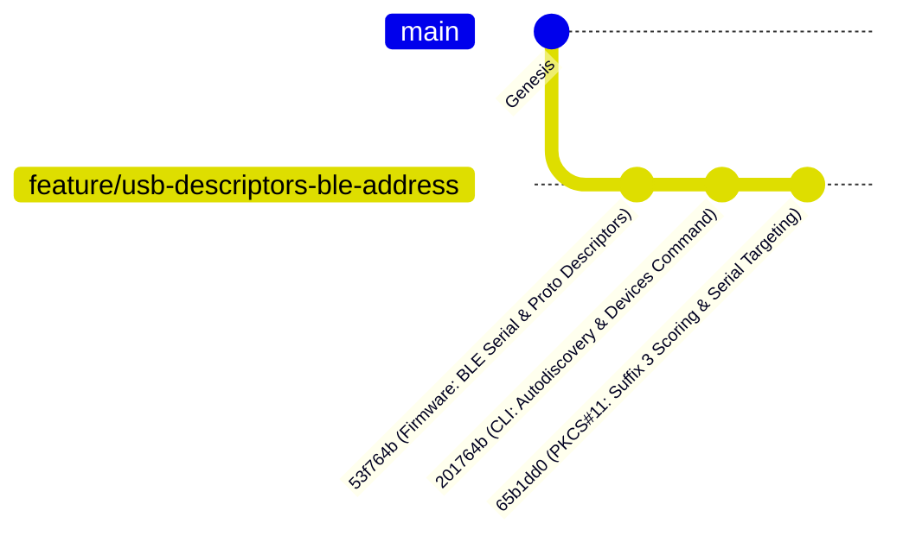

# Workspace Git Status & Repository Topologies

This document tracks real-time Git branch topologies, commit records, and working directory statuses across the multi-repository workspace.

---

## 1. Repository Status Overview

| Repository | Path | Active Branch | Tracking / Upstream | Latest Commit | Working Tree Status |
| :--- | :--- | :--- | :--- | :--- | :--- |
| **Workspace Root** | [nrf52840-hsm](file:///Users/gpfister/Development/Projects/gpfister/nrf52840-hsm) | `master` | Clean | `b727950` (*Update local agent*) | Ready for Phase 6 Merge |
| **Firmware** | [nrf52840-hsm-firmware](file:///Users/gpfister/Development/Projects/gpfister/nrf52840-hsm/nrf52840-hsm-firmware) | `feature/usb-descriptors-ble-address` | Clean | `53f764b` (*feat(usb): implement dynamic serial from BLE address and configure interface descriptors*) | Ready for Phase 6 Merge |
| **CLI** | [nrf52840-hsm-cli](file:///Users/gpfister/Development/Projects/gpfister/nrf52840-hsm/nrf52840-hsm-cli) | `feature/usb-descriptors-ble-address` | Clean | `201764b` (*feat(cli): implement serial port autodiscovery heuristics and serial targeting*) | Ready for Phase 6 Merge |
| **PKCS#11 Provider** | [nrf52840-hsm-libpkcs11](file:///Users/gpfister/Development/Projects/gpfister/nrf52840-hsm/nrf52840-hsm-libpkcs11) | `feature/usb-descriptors-ble-address` | Clean | `65b1dd0` (*feat(p11): prioritize suffix '3' AT port and support NRF52840_HSM_SERIAL targeting*) | Ready for Phase 6 Merge |
| **Obsidian Vault** | [nrf52840-hsm-obsidian](file:///Users/gpfister/Development/Projects/gpfister/nrf52840-hsm/nrf52840-hsm-obsidian) | `master` | Pre-Merge Docs | `73e7257` (*docs(spec): document and index approved USB descriptors and device identification specification*) | Pre-Merge Complete |

---

## 2. Active Feature: USB Descriptors & Device Identification

> [!NOTE]
> Feature specification and implementation tracking note: [[features/usb-descriptors-ble-address|USB Descriptors & Device Identification]].  
> Architectural design note: [[Architecture/USB Composite Stack|USB Composite Stack Architecture]].

### 2.1 Subsystem Implementations & Commits



#### 1. Firmware (`nrf52840-hsm-firmware`)
- **Branch**: `feature/usb-descriptors-ble-address`
- **Commit**: `53f764b4`
- **Author**: Greg PFISTER
- **Modifications**:
  - `compute_ble_sn()`: reads `NRF_FICR->DEVICEADDR[1]` (with BLE Random Static bitmask `0xC000`) and `NRF_FICR->DEVICEADDR[0]`. Formatted as 12-char hex string (`%04X%08X`).
  - Strong symbol override of `usb_update_sn_string_descriptor()` returning dynamic BLE serial string.
  - Defined user string descriptors using `USBD_STRING_DESCR_USER_DEFINE(primary)`: `"Zephyr CDC ACM Console"` and `"nRF52840 HSM AT Interface"`.
  - Implemented `usb_serial_patch_descriptors()`: traverses `__usb_descriptor_start` to set `bInterfaceProtocol` (`0x01` Console, `0x02` HSM AT) and descriptor string indices prior to calling `usb_enable(NULL)`.
  - Configured `CONFIG_USB_DEVICE_SN="000000000000"` and `CONFIG_HWINFO=y` in `prj.conf`.
- **Artifacts**:
  - `firmware/app/build-prod/app/zephyr/zephyr.signed.bin` (MCUboot signed application)
  - `firmware/app/build-prod/merged.hex` (Full flash image: B0 + MCUboot + App)
  - `firmware/app/build-prod/dfu_application.zip` (DFU package)

#### 2. CLI (`nrf52840-hsm-cli`)
- **Branch**: `feature/usb-descriptors-ble-address`
- **Commit**: `201764bc`
- **Author**: Greg PFISTER
- **Modifications**:
  - Autodiscovery port scoring: assigns suffix `3` (AT data channel) score `+100` and demotes suffix `1` (Console logging) by `-50`.
  - Added `hsmutil devices` (alias `hsmutil list`) command with `--json` option to discover connected dongles with BLE addresses, Console, and Data ports.
  - Added persistent `--serial` (`-s`) flag to target specific dongles by 12-digit hex BLE address or device UID.
  - Supported `NRF52840_HSM_SERIAL` environment variable.
- **Verification & Builds**:
  - `go test ./...` passed 100%.
  - Cross-compiled all 5 architectures: `darwin-arm64`, `linux-amd64`, `linux-arm64`, `windows-amd64.exe`, `windows-arm64.exe`.

#### 3. PKCS#11 Library (`nrf52840-hsm-libpkcs11`)
- **Branch**: `feature/usb-descriptors-ble-address`
- **Commit**: `65b1dd05`
- **Author**: Greg PFISTER
- **Modifications**:
  - Implemented `serial_score_candidate()`: rates macOS `tty.usbmodem*` suffix `3` at `1000`, `cu.usbmodem*` suffix `3` at `900`, demoting suffix `1` to `200`/`100`.
  - Sorts candidates via `qsort` and `compare_port_candidates` to probe AT channels first.
  - Supports `NRF52840_HSM_SERIAL` environment targeting for direct port synthesis and filtering.
- **Verification**:
  - CTest `test_p11_mock` passed 100%.
  - Verified hardware discovery against physical connected dongles.

---

## 3. Physical Hardware Topologies

Connected dongles detected via `hsmutil devices`:

```text
[1] Serial / BLE:  FD54E793A75540C9
    AT Data Port:  /dev/tty.usbmodem31424103
    Console Port:  /dev/tty.usbmodem31424101
    USB ID:        1209:0001 (nRF52840 HSM Dongle)

[2] Serial / BLE:  3302311888499AC7
    AT Data Port:  /dev/tty.usbmodem31424403
    Console Port:  /dev/tty.usbmodem31424401
    USB ID:        1209:0001 (nRF52840 HSM Dongle)
```

### 3.1 Hardware Verification Status (100% Verified)
- **USB Descriptors**: Validated on physical PCA10059 dongles with dynamic 12-digit hex BLE serial numbers (`%04X%08X`).
- **Protocol Identifiers**: Dynamic runtime descriptor patching sets Protocol `0x0001` (Console) on Interface 0 and `0x0002` (HSM AT API) on Interface 2.
- **macOS TTY Mapping**: Suffix `1` attached to Zephyr console logging; Suffix `3` attached to HSM AT data stream.
- **Dual-Device Concurrency & Serial Targeting**: Concurrently tested two connected hardware dongles with `hsmutil devices` and `hsmutil info -s <SERIAL>`, confirming complete isolation without port crosstalk.

### 3.2 Note on Firmware DFU Streaming Migration
- Current firmware release runs the pure AT command interface on CDC-ACM UART1 (`AT`, `AT+INFO`, `AT+AUTH`, `AT+KEYGEN`, `AT+SIGN`).
- Dual-stage secure boot MCUboot signing and candidate partition images are fully functional.
- The migration of firmware DFU streaming (`AT+DFU_CHUNK` / `AT+DFU_APPLY`) will be implemented in a dedicated follow-up feature task.

---

## 4. Architecture Decision Records (ADRs)

- [[Architecture/Decisions/ADR-0001 - Hardware BLE Address for Deterministic USB Serial Number|ADR-0001: Hardware BLE Address for Deterministic USB Serial Number]]
- [[Architecture/Decisions/ADR-0002 - In-Tree Protocol Descriptor Patching vs macOS DriverKit Extension|ADR-0002: In-Tree Protocol Descriptor Patching vs macOS DriverKit Extension]]
- [[Architecture/Decisions/ADR-0003 - Host Port Discovery and Serial Targeting Strategy|ADR-0003: Host Port Discovery and Serial Targeting Strategy]]

---

## 5. Related Documentation

- [[00 - Index|Vault Index]]
- [[features/usb-descriptors-ble-address|USB Descriptors & Device Identification Feature Specification & Implementation]]
- [[Architecture/USB Composite Stack|USB Composite Stack Architecture]]
- [[Development/CLI Reference|hsmutil CLI Reference]]
