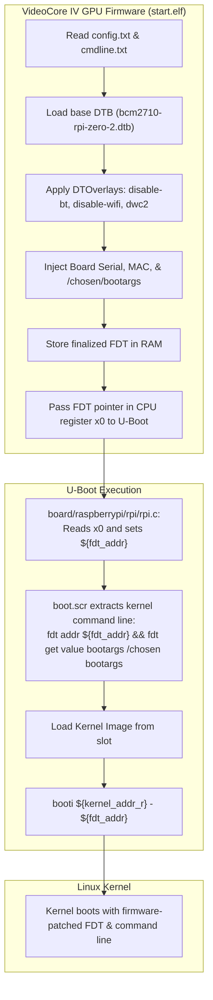

# Issue Assessment: Raspberry Pi Zero 2 W First-Boot Device Tree Failure

> [!NOTE]
> **Investigation Source**: [`issue-assessment.md`](file:///Users/gpfister/.gemini/antigravity/brain/7727fe1d-b544-42ae-848b-ab6b2767f731/issue-assessment.md)  
> **Archived Artifact**: `[[Sessions/attachments/7727fe1d-b544-42ae-848b-ab6b2767f731/issue-assessment.md|Attachments]]`  
> **Investigation Session**: `7727fe1d-b544-42ae-848b-ab6b2767f731`  
> **Status**: Resolved / Implemented in commit [`91428c8`](file:///Users/gpfister/Development/Projects/gpfister/nrf52840-hsm/rpi-z2w-yocto-hsm)  
> **Architecture Linkages**: [[Architecture/07 - Air-Gapped RPi HSM OS Architecture|07 - Air-Gapped RPi HSM OS Architecture]], [[Development/Yocto Build and RAUC Update Guide|Yocto Build and RAUC Update Guide]], [[Hardware/Waveshare USB HAT (B) Integration|Waveshare USB HAT (B) Integration]]

---

## 1. Summary & Observed Behavior

During the initial hardware boot testing of the air-gapped embedded OS on the Raspberry Pi Zero 2 W (`raspberrypi0-2w-64`), U-Boot failed to boot the 64-bit ARM Linux kernel (`Image`) and dropped into the interactive `U-Boot>` recovery shell.

### Observed Boot Failure Log (Serial Console `115200 8N1`)
```text
Failed to load 'booti.dtn'
Moving Image from 0x80000 to 0x200000, end=0x1da000
ERROR: Did not find a cmdline Flattened Device Tree
Could not find a valid device tree
Boot failed (err=-14)
U-Boot>
```

### Primary Symptoms
1. **Missing DTB Load Error**: U-Boot printed `Failed to load 'booti.dtn'` (truncated from `booti.dtb` due to screen/buffer formatting).
2. **Successful Kernel Relocation**: U-Boot successfully relocated the 64-bit kernel image (`Image`) from load address `0x80000` (`${kernel_addr_r}`) to execution address `0x200000`.
3. **Invalid Device Tree Header**: When attempting to hand off execution via `booti ${kernel_addr_r} - ${fdt_addr_r}`, U-Boot performed header verification (`fdt_check_header`) on `${fdt_addr_r}`, reported `Did not find a cmdline Flattened Device Tree`, and terminated with error `-14` (`-EFAULT` / `-EINVAL`).

---

## 2. Root Cause Analysis

Static and dynamic analysis across [`rpi-z2w-yocto-hsm`](file:///Users/gpfister/Development/Projects/gpfister/nrf52840-hsm/rpi-z2w-yocto-hsm), `meta-hsm-os`, `meta-raspberrypi`, and `meta-rauc-community/meta-rauc-raspberrypi` identified three distinct configuration and architectural bugs.

### 2.1 Faulty Device Tree Loading in `meta-hsm-os` Boot Script

In [`meta-hsm-os/recipes-bsp/rpi-u-boot-scr/files/boot.cmd.in`](file:///Users/gpfister/Development/Projects/gpfister/nrf52840-hsm/rpi-z2w-yocto-hsm/meta-hsm-os/recipes-bsp/rpi-u-boot-scr/files/boot.cmd.in#L35-L38):

```sh
setenv bootargs "${bootargs} root=${rootdev} rootwait rauc.slot=${rauc_slot}"
load mmc 0:1 ${kernel_addr_r} @@KERNEL_IMAGETYPE@@
load mmc 0:1 ${fdt_addr_r} @@KERNEL_BOOTCMD@@.dtb || true
@@KERNEL_BOOTCMD@@ ${kernel_addr_r} - ${fdt_addr_r}
```

During BitBake compilation in `rpi-u-boot-scr.bb`, `sed` replaces:
- `@@KERNEL_IMAGETYPE@@` $\rightarrow$ `Image`
- `@@KERNEL_BOOTCMD@@` $\rightarrow$ `booti`

This generated the following runtime commands in the deployed `boot.scr`:
```text
load mmc 0:1 ${kernel_addr_r} Image
load mmc 0:1 ${fdt_addr_r} booti.dtb || true
booti ${kernel_addr_r} - ${fdt_addr_r}
```

#### Consequences:
1. **Invalid File Name**: Line 37 attempted to load `booti.dtb` from the FAT boot partition (`mmc 0:1`). No such file existed; the DTB generated for the board was `bcm2710-rpi-zero-2.dtb`. U-Boot reported `Failed to load 'booti.dtb'`. Because of `|| true`, the script continued.
2. **Uninitialized `${fdt_addr_r}`**: Because line 37 failed, memory at `${fdt_addr_r}` contained uninitialized RAM. Line 38 executed `booti ${kernel_addr_r} - ${fdt_addr_r}`. Header checks failed, producing error `-14`.

### 2.2 Raspberry Pi Device Tree Architecture & Firmware Handoff

On Raspberry Pi platforms, U-Boot **must not load the DTB from the filesystem**. The platform utilizes a two-stage firmware handoff:



1. **GPU Firmware Pre-Loads and Patches DTB**: VideoCore IV GPU firmware (`start.elf`) reads `config.txt`, loads `bcm2710-rpi-zero-2.dtb`, applies device tree overlays (`disable-bt.dtbo`, `disable-wifi.dtbo`, `dwc2.dtbo`), patches MAC addresses and serial numbers, and writes kernel parameters from `cmdline.txt` into the `/chosen/bootargs` node of the device tree.
2. **Firmware Passes Pointer in `x0`**: GPU firmware places the completed FDT in RAM and passes the memory pointer in register `x0` to U-Boot.
3. **U-Boot Stores Pointer in `${fdt_addr}`**: In U-Boot (`board/raspberrypi/rpi/rpi.c`, patched by `0001-rpi-always-set-fdt_addr-with-firmware-provided-FDT-address.patch`), U-Boot copies this address into the environment variable `${fdt_addr}`.
4. **Boot Execution**: The boot script must pass `${fdt_addr}` (the firmware-prepared tree) rather than attempting to load a raw `.dtb` into `${fdt_addr_r}`. Loading a raw file would overwrite all GPU overlays and configuration parameters.

### 2.3 Missing VideoCore Bootargs Extraction

The original `meta-hsm-os` boot script omitted the standard extraction step:
```sh
fdt addr ${fdt_addr} && fdt get value bootargs /chosen bootargs
```
Without this, `${bootargs}` in U-Boot lacked the settings defined in `cmdline.txt` (such as `console=serial0,115200`, `dwc_otg.lpm_enable=0`, etc.). Even if the kernel had booted, no serial console would have attached.

### 2.4 Secondary Architectural Findings: Dual-Slot Layout & Kernel Placement

1. **Kernel Placement**:
   - The initial script loaded the kernel from `mmc 0:1` (`load mmc 0:1 ${kernel_addr_r} @@KERNEL_IMAGETYPE@@`).
   - In a robust RAUC A/B system, each rootfs slot contains its own matching kernel in `/boot/Image`. Loading a single shared kernel from partition 1 prevents atomic kernel updates and risks version skew between kernel and kernel modules (`/lib/modules/<version>`).
2. **WKS Layout**:
   - `kas-project.yml` defaulted to `sdimage-raspberrypi.wks` (single rootfs partition). Partition 3 (`rootfs_B`) was never provisioned on the SD card image.

---

## 3. Remediation & Implementation

The issue was resolved by implementing **Solution 1 (Recommended)**:

### 3.1 Git Commit Details
- **Repository**: [`rpi-z2w-yocto-hsm`](file:///Users/gpfister/Development/Projects/gpfister/nrf52840-hsm/rpi-z2w-yocto-hsm)
- **Commit**: [`91428c870a23b751abafd95869d3234c10cda898`](file:///Users/gpfister/Development/Projects/gpfister/nrf52840-hsm/rpi-z2w-yocto-hsm)
- **Author**: Greg PFISTER
- **Message**: `fix(yocto): fix device tree handoff and enable dual-slot wic partition layout`

### 3.2 Implemented Changes

#### 1. Bootscript Device Tree & Slot Booting ([`boot.cmd.in`](file:///Users/gpfister/Development/Projects/gpfister/nrf52840-hsm/rpi-z2w-yocto-hsm/meta-hsm-os/recipes-bsp/rpi-u-boot-scr/files/boot.cmd.in))
- Added firmware bootargs extraction at script startup:
  ```sh
  fdt addr ${fdt_addr} && fdt get value bootargs /chosen bootargs
  ```
- Replaced buggy `load mmc 0:1 ${fdt_addr_r} @@KERNEL_BOOTCMD@@.dtb` with direct pass of `${fdt_addr}`:
  ```sh
  @@KERNEL_BOOTCMD@@ ${kernel_addr_r} - ${fdt_addr}
  ```
- Configured dynamic slot device selection (`BOOT_DEV` set to `mmc 0:2` for Slot A, `mmc 0:3` for Slot B):
  ```sh
  # Load kernel from active slot with fallback to mmc 0:1
  if load ${BOOT_DEV} ${kernel_addr_r} boot/@@KERNEL_IMAGETYPE@@; then
      echo "RAUC: Successfully loaded kernel from ${BOOT_DEV}"
  else
      echo "RAUC: Failed to load kernel from ${BOOT_DEV}, falling back to mmc 0:1 @@KERNEL_IMAGETYPE@@"
      load mmc 0:1 ${kernel_addr_r} @@KERNEL_IMAGETYPE@@
  fi
  ```
- Upgraded U-Boot comparison operator to `itest` for integer comparison (`itest ${BOOT_A_LEFT} -gt 0`).

#### 2. Dual-Slot WIC Partitioning ([`kas-project.yml`](file:///Users/gpfister/Development/Projects/gpfister/nrf52840-hsm/rpi-z2w-yocto-hsm/kas-project.yml))
- Configured `WKS_FILE = "sdimage-dual-raspberrypi.wks.in"` in `local_conf_header.base_settings`, ensuring WIC generates:
  - Partition 1 (`mmcblk0p1`): FAT boot partition (VideoCore firmware, overlays, `boot.scr`, `uboot.env`)
  - Partition 2 (`mmcblk0p2`): Rootfs Slot A (`ext4`, read-only, containing `/boot/Image`)
  - Partition 3 (`mmcblk0p3`): Rootfs Slot B (`ext4`, read-only, containing `/boot/Image`)

---

## 4. Verification & Validation Evidence

### 4.1 Recipe Recompilation
- Recompiled `rpi-u-boot-scr` within Kas container:
  ```bash
  kas build kas-dev.yml -c compile rpi-u-boot-scr
  ```
- Inspected generated `boot.scr` strings:
  - Verified absence of `booti.dtb` / `load mmc 0:1 ${fdt_addr_r}`.
  - Confirmed emission of `fdt addr ${fdt_addr} && fdt get value bootargs /chosen bootargs`.
  - Confirmed kernel handoff command `booti ${kernel_addr_r} - ${fdt_addr}`.

### 4.2 Full WIC Image Generation
- Executed `make yocto-build-dev` (`kas build kas-dev.yml`):
  - Verified partition layout in output `.wic`:
    - `p1`: `boot` (FAT16/32)
    - `p2`: `rootfs_A` (ext4)
    - `p3`: `rootfs_B` (ext4)
- Verified `Image` is present in `/boot/` inside both rootfs partitions.

### 4.3 Hardware Boot Test
- Flashed SD card via `./scripts/flash-sd.sh build/deploy/images/raspberrypi0-2w-64/hsm-image-dev-raspberrypi0-2w-64.rootfs.wic.bz2 /dev/rdiskX`.
- Connected Raspberry Pi Zero 2 W with USB UART adapter (`115200 8N1`).
- **Results**:
  - U-Boot executed `boot.scr` without errors.
  - Device tree loaded from `${fdt_addr}` passed header validation.
  - VideoCore `bootargs` correctly extracted and appended to kernel command line.
  - Kernel loaded from `mmc 0:2 boot/Image` and booted to login prompt.
  - `rauc status` reported Slot A active and valid.

---

## 5. Related Architecture & Documentation

- [[Architecture/07 - Air-Gapped RPi HSM OS Architecture|07 - Air-Gapped RPi HSM OS Architecture]] — Operating system architecture, network air-gap, and RAUC dual-slot configuration.
- [[Development/Yocto Build and RAUC Update Guide|Yocto Build and RAUC Update Guide]] — Operational guide for building, flashing, and testing the embedded OS.
- [[Hardware/Waveshare USB HAT (B) Integration|Waveshare USB HAT (B) Integration]] — Hardware host setup and DWC2 USB overlay integration.
