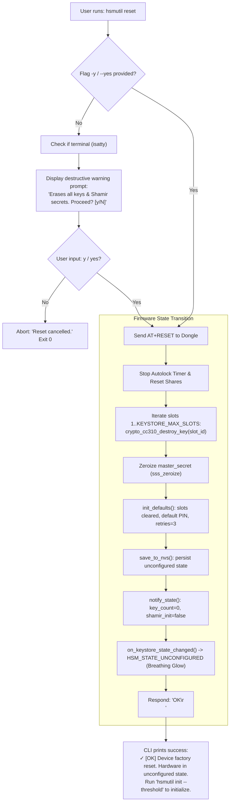
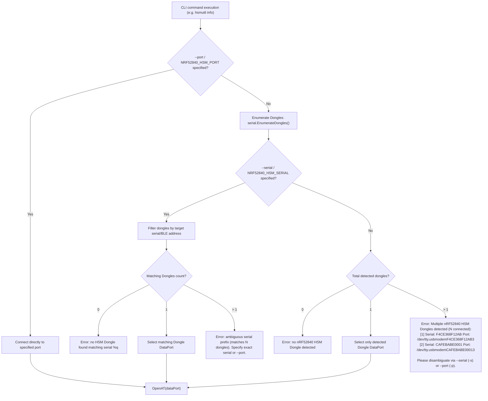

# Issue Assessment: `hsmutil` Reset Confirmation & Factory Reset, and Multi-Device Disambiguation

> [!NOTE]
> **Investigation Source**: [`issue-assessment.md`](file:///Users/gpfister/.gemini/antigravity/brain/597d007f-0afa-4845-b766-880c6ae6e465/issue-assessment.md)  
> **Archived Artifact**: `[[Sessions/attachments/597d007f-0afa-4845-b766-880c6ae6e465/issue-assessment.md|Attachments]]`  
> **Formal Specification**: [[Specification/Reset Confirmation and Multi-Device Disambiguation|Reset Confirmation and Multi-Device Disambiguation Specification]]  
> **Status**: Approved by User / Ready for Implementation  
> **Architecture Linkages**: [[Architecture/HSM State Machine|HSM State Machine]], [[Architecture/Decisions/ADR-0003 - Host Port Discovery and Serial Targeting Strategy|ADR-0003: Host Port Discovery and Serial Targeting Strategy]], [[Architecture/Decisions/ADR-0004 - Factory Reset Semantics and Safeguards|ADR-0004: Factory Reset Semantics and Safe Erasure Safeguards]], [[features/hsmutil-reset-and-multi-device-disambiguation|Reset Confirmation & Multi-Device Disambiguation]], [[features/usb-descriptors-ble-address|USB Descriptors & Device Identification]]

---

## 1. Summary & Observed Behavior

Two distinct functional enhancements and architectural gaps were identified in the `hsmutil` CLI and its underlying firmware interaction within the `nrf52840-hsm` multi-repository workspace:

### 1.1 Issue 1: `hsmutil reset` Confirmation & Factory Reset Semantics
- **Current Behavior**:
  Running `hsmutil reset` executes immediately without any confirmation prompt or `--yes`/`-y` flag. Furthermore, it only transmits `AT+RESET` to the dongle, which currently performs a transient session reset (`s_authenticated = false`, autolock timer stop, and ephemeral ECDH target key destruction). Persistent cryptographic keys stored in PSA / CryptoCell CC310 slots remain completely intact, the Shamir master secret is retained in NVS, and the device remains in a configured (locked) state (`HSM_STATE_LOCKED`, solid RED LED).
- **Required Behavior**:
  `hsmutil reset` must require explicit confirmation before proceeding (interactive prompt `[y/N]` when run in a TTY, or bypassed via a `-y` / `--yes` flag). Following confirmation, it must execute a true **factory reset** that permanently purges all persistent keys across all slots, securely zeroes out the Shamir master secret, restores default PIN and retry counts, saves the pristine state to NVS, and triggers a state transition back to `HSM_STATE_UNCONFIGURED` (synchronous breathing glow), thereby requiring `hsmutil init --threshold` before any subsequent cryptographic operations can be performed.

### 1.2 Issue 2: Multi-Dongle Auto-Discovery & Disambiguation
- **Current Behavior**:
  The device discovery engine in `nrf52840-hsm-cli` ([`internal/infra/serial/discovery.go`](file:///Users/gpfister/Development/Projects/gpfister/nrf52840-hsm/nrf52840-hsm-cli/internal/infra/serial/discovery.go)) enumerates USB CDC-ACM interfaces (filtering by VID `1209` / PID `0001` or OS serial patterns). When multiple physical dongles are attached to the host machine and neither `--port` nor `--serial` (nor environment overrides) is specified, `AutoDiscoverPortTargeting("")` pools all candidate data and console ports from all connected dongles together. It then silently selects the first port in priority order (arbitrarily picking Dongle 1 over Dongle 2).
- **Required Behavior**:
  When more than one physical HSM dongle is detected, `hsmutil` commands requiring a device target must **refuse to execute silently** on an arbitrary device. Instead, the CLI must raise a clear disambiguation error that lists all detected dongles (with their BLE address / serial numbers and port paths) and mandates the user to supply `--port (-p)` or `--serial (-s)` (or their respective environment variables `NRF52840_HSM_PORT` / `NRF52840_HSM_SERIAL`). Disambiguation exceptions must apply cleanly to enumeration commands (`hsmutil devices`) and dual-device workflows (`hsmutil key migrate`).

---

## 2. Root Cause Analysis

### 2.1 Issue 1: `reset` Command Implementation & Keystore State Machine

#### Affected Repositories & Files:
- [`nrf52840-hsm-cli/internal/ui/cli/auth.go`](file:///Users/gpfister/Development/Projects/gpfister/nrf52840-hsm/nrf52840-hsm-cli/internal/ui/cli/auth.go#L75-L94)
- [`nrf52840-hsm-firmware/firmware/lib/src/at_commands.c`](file:///Users/gpfister/Development/Projects/gpfister/nrf52840-hsm/nrf52840-hsm-firmware/firmware/lib/src/at_commands.c#L185-L192)
- [`nrf52840-hsm-firmware/firmware/lib/src/keystore.c`](file:///Users/gpfister/Development/Projects/gpfister/nrf52840-hsm/nrf52840-hsm-firmware/firmware/lib/src/keystore.c#L165-L173)
- [`nrf52840-hsm-firmware/firmware/lib/include/hsm/keystore.h`](file:///Users/gpfister/Development/Projects/gpfister/nrf52840-hsm/nrf52840-hsm-firmware/firmware/lib/include/hsm/keystore.h#L64)
- [`nrf52840-hsm-firmware/firmware/app/src/main.c`](file:///Users/gpfister/Development/Projects/gpfister/nrf52840-hsm/nrf52840-hsm-firmware/firmware/app/src/main.c#L13-L30)
- [`scripts/mock_hsm_pty.py`](file:///Users/gpfister/Development/Projects/gpfister/nrf52840-hsm/scripts/mock_hsm_pty.py#L164-L169)

#### Detailed Findings & Evidence:

1. **CLI Missing Confirmation Gate**:
   In [`auth.go`](file:///Users/gpfister/Development/Projects/gpfister/nrf52840-hsm/nrf52840-hsm-cli/internal/ui/cli/auth.go#L75-L94):
   ```go
   func newResetCmd() *cobra.Command {
       return &cobra.Command{
           Use:   "reset",
           Short: "Reset active session state (AT+RESET)",
           RunE: func(cmd *cobra.Command, args []string) error {
               client, cleanup, err := getATClient()
               if err != nil {
                   return err
               }
               defer cleanup()

               if err := client.Reset(); err != nil {
                   return fmt.Errorf("reset failed: %w", err)
               }
               fmt.Println("✓ [OK] HSM Session Reset! Volatile context cleared.")
               return nil
           },
       }
   }
   ```
   No flags (`--yes` / `-y`) are defined on `resetCmd`. No interactive confirmation check (`bufio.Reader` on `os.Stdin`) exists before dispatching the command.

2. **Firmware AT Command Semantics**:
   In [`at_commands.c`](file:///Users/gpfister/Development/Projects/gpfister/nrf52840-hsm/nrf52840-hsm-firmware/firmware/lib/src/at_commands.c#L185-L192):
   ```c
   /* 6. AT+RESET */
   if (strcmp(p, "+RESET") == 0 || strcmp(p, "+reset") == 0) {
       k_timer_stop(&s_autolock_timer);
       at_commands_reset_shares();
       keystore_reset();
       snprintf(resp_buf, max_resp_len, "OK\r\n");
       return 0;
   }
   ```
   `AT+RESET` invokes `keystore_reset()`.

3. **Keystore Reset is Volatile Session Reset Only**:
   In [`keystore.c`](file:///Users/gpfister/Development/Projects/gpfister/nrf52840-hsm/nrf52840-hsm-firmware/firmware/lib/src/keystore.c#L165-L173):
   ```c
   void keystore_reset(void) {
       s_authenticated = false;
       if (s_target_ephemeral_key_id != 0) {
           (void)psa_destroy_key(s_target_ephemeral_key_id);
           s_target_ephemeral_key_id = 0;
       }
       notify_state();
       LOG_INF("Keystore session reset");
   }
   ```
   `keystore_reset()` only locks the session and destroys ephemeral migration keys:
   - Persistent keys generated in slots `1..KEYSTORE_MAX_SLOTS` via `crypto_cc310_generate_p256_keypair` (`PSA_KEY_LIFETIME_PERSISTENT`, key IDs `0x40000000 + slot_id`) are **NOT** destroyed.
   - `s_data.slots` slot occupancy and metadata are not wiped.
   - `s_data.shamir_initialized` remains `true`.
   - `s_data.master_secret` is not zeroized.
   - No flash update occurs (`save_to_nvs()` is not called).
   - In [`main.c`](file:///Users/gpfister/Development/Projects/gpfister/nrf52840-hsm/nrf52840-hsm-firmware/firmware/app/src/main.c#L13-L30), `on_keystore_state_changed` checks:
     ```c
     } else if (key_count == 0 && !keystore_is_shamir_initialized()) {
         /* Unconfigured / Empty -> Breathing WHITE */
         led_status_set_state(HSM_STATE_UNCONFIGURED);
     } else {
         /* Configured but locked -> Solid RED */
         led_status_set_state(HSM_STATE_LOCKED);
     }
     ```
     Because `key_count > 0` and `keystore_is_shamir_initialized() == true`, the LED remains `HSM_STATE_LOCKED` (solid RED). The device never returns to `HSM_STATE_UNCONFIGURED`.

---

### 2.2 Issue 2: Multi-Device Disambiguation & Discovery

#### Affected Repositories & Files:
- [`nrf52840-hsm-cli/internal/infra/serial/discovery.go`](file:///Users/gpfister/Development/Projects/gpfister/nrf52840-hsm/nrf52840-hsm-cli/internal/infra/serial/discovery.go#L227-L331)
- [`nrf52840-hsm-cli/internal/infra/serial/discovery_enumerator.go`](file:///Users/gpfister/Development/Projects/gpfister/nrf52840-hsm/nrf52840-hsm-cli/internal/infra/serial/discovery_enumerator.go#L31-L145)
- [`nrf52840-hsm-cli/internal/ui/cli/root.go`](file:///Users/gpfister/Development/Projects/gpfister/nrf52840-hsm/nrf52840-hsm-cli/internal/ui/cli/root.go#L57-L117)
- [`nrf52840-hsm-cli/internal/domain/command.go`](file:///Users/gpfister/Development/Projects/gpfister/nrf52840-hsm/nrf52840-hsm-cli/internal/domain/command.go#L25-L30)
- [`nrf52840-hsm-cli/internal/ui/cli/migrate.go`](file:///Users/gpfister/Development/Projects/gpfister/nrf52840-hsm/nrf52840-hsm-cli/internal/ui/cli/migrate.go#L11-L52)

#### Detailed Findings & Evidence:

1. **Unconstrained Port Merging in `FindDonglePortsTargeting`**:
   In [`discovery.go`](file:///Users/gpfister/Development/Projects/gpfister/nrf52840-hsm/nrf52840-hsm-cli/internal/infra/serial/discovery.go#L227-L260):
   ```go
   func FindDonglePortsTargeting(targetSerial string) ([]string, error) {
       ...
       dongles, err := EnumerateDongles()
       ...
       var matchingDongles []domain.DiscoveredDongle
       if targetSerial != "" {
           ... // filter matching dongles
       } else {
           matchingDongles = dongles
       }

       var ports []string
       for _, d := range matchingDongles {
           if d.DataPort != "" {
               ports = append(ports, d.DataPort)
           }
           if d.ConsolePort != "" {
               ports = append(ports, d.ConsolePort)
           }
       }
       SortPortsByPriority(ports)
       return ports, nil
   }
   ```
   If two dongles (e.g. Dongle A with Serial `F4CE368F12AB` and Dongle B with Serial `CAFEBABE0001`) are connected and `targetSerial` is empty, `ports` contains `[DongleA_Data, DongleB_Data, DongleA_Console, DongleB_Console]`.

2. **Silent Single-Port Selection in `AutoDiscoverPortTargeting`**:
   ```go
   func AutoDiscoverPortTargeting(targetSerial string) (string, error) {
       ...
       ports, err := FindDonglePortsTargeting(targetSerial)
       ...
       for _, p := range ports {
           if strings.HasSuffix(p, "3") {
               return p, nil
           }
       }
       return ports[0], nil
   }
   ```
   `AutoDiscoverPortTargeting` unconditionally returns the first data port (`ports[0]`). If two dongles are connected, it arbitrarily operates on the first device enumerated by the OS without notifying the user or requesting disambiguation.

3. **Inconsistent Port Resolution in `getService()`**:
   In [`root.go`](file:///Users/gpfister/Development/Projects/gpfister/nrf52840-hsm/nrf52840-hsm-cli/internal/ui/cli/root.go#L57-L117):
   If `getATClient()` fails and `getService()` falls back to legacy binary serial, it also calls `FindDonglePortsTargeting(targetSerial)` and blindly picks `ports[0]`.

---

## 3. Architecture & Proposed Solutions

### 3.1 Solution for Issue 1: Factory Reset Implementation & Confirmation Gate



#### Firmware Enhancements:
- **`keystore_factory_reset(void)` in [`keystore.c`](file:///Users/gpfister/Development/Projects/gpfister/nrf52840-hsm/nrf52840-hsm-firmware/firmware/lib/src/keystore.c) & [`keystore.h`](file:///Users/gpfister/Development/Projects/gpfister/nrf52840-hsm/nrf52840-hsm-firmware/firmware/lib/include/hsm/keystore.h)**:
  ```c
  int keystore_factory_reset(void) {
      s_authenticated = false;
      if (s_target_ephemeral_key_id != 0) {
          (void)psa_destroy_key(s_target_ephemeral_key_id);
          s_target_ephemeral_key_id = 0;
      }
      for (uint8_t i = 1; i <= KEYSTORE_MAX_SLOTS; i++) {
          (void)crypto_cc310_destroy_key(i);
      }
      sss_zeroize(s_data.master_secret, sizeof(s_data.master_secret));
      init_defaults();
      save_to_nvs();
      notify_state();
      LOG_INF("Keystore factory reset complete: all keys purged, state unconfigured");
      return 0;
  }
  ```
- **[`at_commands.c`](file:///Users/gpfister/Development/Projects/gpfister/nrf52840-hsm/nrf52840-hsm-firmware/firmware/lib/src/at_commands.c)**:
  Update `AT+RESET` (and accept `AT+FACTORYRESET` as alias) to invoke `keystore_factory_reset()`.
- **[`scripts/mock_hsm_pty.py`](file:///Users/gpfister/Development/Projects/gpfister/nrf52840-hsm/scripts/mock_hsm_pty.py)**:
  Update `AT+RESET` handler in mock PTY daemon to clear `slots`, `master_secret`, reset `shamir_initialized = False`, and return `OK\r\n`.

#### CLI Enhancements:
- **[`nrf52840-hsm-cli/internal/ui/cli/auth.go`](file:///Users/gpfister/Development/Projects/gpfister/nrf52840-hsm/nrf52840-hsm-cli/internal/ui/cli/auth.go)**:
  - Add `-y, --yes` flag to `newResetCmd()`.
  - When `--yes` is not set:
    - Display warning:
      ```text
      ⚠️  WARNING: Factory reset permanently destroys all stored cryptographic keys,
      invalidates Shamir custodian shares, and restores default factory settings.
      The device will enter an unconfigured state and will require 'hsmutil init'.

      Are you sure you want to proceed? (yes/no): 
      ```
    - Read confirmation from `os.Stdin`. If not `y` / `yes`, abort cleanly.
  - On success, output clear next steps:
    ```text
    ✓ [OK] Device successfully factory reset.
    All persistent cryptographic keys and Shamir custodian secrets destroyed.
    Device returned to unconfigured state (Synchronous breathing glow).
    Run 'hsmutil init --threshold' to initialize custodian ceremony.
    ```

---

### 3.2 Solution for Issue 2: Multi-Device Auto-Discovery & Disambiguation Protocol



#### Discovery & Domain Layer Updates:
1. **Define `ErrMultipleDevicesDetected` in [`internal/domain/command.go`](file:///Users/gpfister/Development/Projects/gpfister/nrf52840-hsm/nrf52840-hsm-cli/internal/domain/command.go)**:
   ```go
   type ErrMultipleDevicesDetected struct {
       Devices []DiscoveredDongle
   }

   func (e *ErrMultipleDevicesDetected) Error() string {
       var b strings.Builder
       fmt.Fprintf(&b, "multiple nRF52840 HSM Dongles detected (%d connected):\n", len(e.Devices))
       for i, d := range e.Devices {
           fmt.Fprintf(&b, "  [%d] Serial / BLE: %-16s  AT Data Port: %s", i+1, d.Serial, d.DataPort)
           if d.Product != "" {
               fmt.Fprintf(&b, " (%s)", d.Product)
           }
           fmt.Fprintln(&b)
       }
       fmt.Fprintln(&b, "\nPlease specify target device using --serial (-s) or --port (-p), or set NRF52840_HSM_SERIAL / NRF52840_HSM_PORT.")
       return b.String()
   }
   ```
2. **Update `AutoDiscoverPortTargeting(targetSerial string)` in [`discovery.go`](file:///Users/gpfister/Development/Projects/gpfister/nrf52840-hsm/nrf52840-hsm-cli/internal/infra/serial/discovery.go)**:
   - If `targetSerial == ""` and `len(dongles) > 1`: return `&domain.ErrMultipleDevicesDetected{Devices: dongles}`.
   - If `targetSerial == ""` and `len(dongles) == 1`: select `dongles[0].DataPort`.
   - If `targetSerial != ""`: filter dongles by normalized serial, prefix, or port substring. If exactly 1 match, return its `DataPort`; if multiple matches, return ambiguous match error; if 0 matches, return not found error.
3. **Synchronize `getService()` in [`root.go`](file:///Users/gpfister/Development/Projects/gpfister/nrf52840-hsm/nrf52840-hsm-cli/internal/ui/cli/root.go)**:
   - If `getATClient()` fails with `ErrMultipleDevicesDetected`, propagate it immediately rather than falling back to picking `ports[0]`.
4. **Enrich `hsmutil key migrate` ([`migrate.go`](file:///Users/gpfister/Development/Projects/gpfister/nrf52840-hsm/nrf52840-hsm-cli/internal/ui/cli/migrate.go))**:
   - Allow `--source` and `--target` to accept either port paths OR serial/BLE addresses by utilizing a helper `ResolvePortOrSerial(target string) (string, error)`.

---

## 4. Verification & Validation Plan

### 4.1 Unit Tests:
1. **CLI Flag & Confirmation Tests (`internal/ui/cli/cli_test.go`)**:
   - Verify `-y` / `--yes` flag is registered on `resetCmd`.
   - Test `resetCmd` with simulated stdin `n` $\rightarrow$ cancels without executing AT command.
   - Test `resetCmd` with `-y` $\rightarrow$ succeeds without interactive prompt.
2. **Discovery & Multi-Device Disambiguation Tests (`internal/infra/serial/discovery_test.go`)**:
   - Mock multiple `DiscoveredDongle` instances.
   - Assert `AutoDiscoverPortTargeting("")` returns `ErrMultipleDevicesDetected` containing details of all detected devices.
   - Assert `AutoDiscoverPortTargeting("F4CE368F12AB")` disambiguates correctly and returns the target's data port.
   - Assert `AutoDiscoverPortTargeting("UNKNOWN")` returns `ErrDeviceNotFound`.

### 4.2 Integration & Mock PTY Tests:
1. **`mock_hsm_pty.py` Protocol Verification**:
   - Run `test_at_client.py` and verify `AT+RESET` resets slot table, zeroes Shamir initialization, and restores default state.
   - Verify `hsmutil init --threshold` succeeds following `hsmutil reset -y`.
2. **Multi-Dongle Virtual Test**:
   - Launch two mock PTYs on `/tmp/mock-hsm-pty-1` and `/tmp/mock-hsm-pty-2`.
   - Verify CLI blocks commands without flags and lists both devices, then succeeds when `--port` or `--serial` is supplied.

---

> [!IMPORTANT]
> The proposed design guarantees safety against accidental erasure through interactive confirmation, enforces true hardware factory reset across Zephyr PSA crypto and NVS, and prevents cross-device command misdirection in multi-dongle environments.
